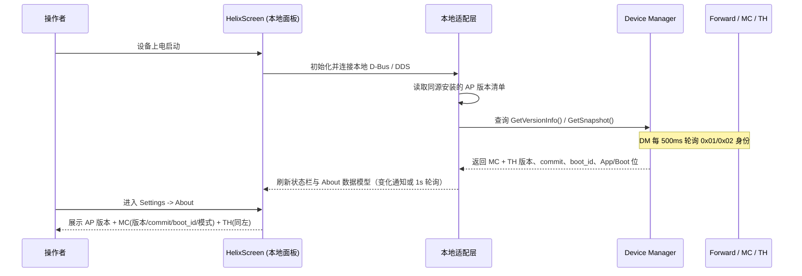
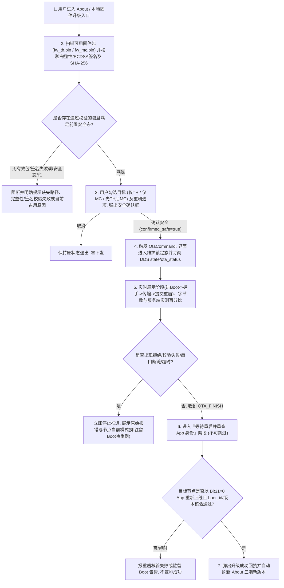
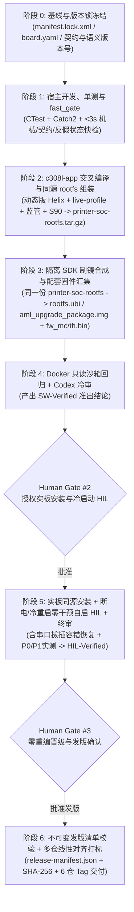
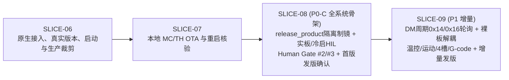

# HelixScreen 本地业务接入与 MC/TH 能力集成实施方案

## 修订历史

| 版本 | 修订时间 | 修订人 | 变更摘要 | 审批状态 |
| :--- | :--- | :--- | :--- | :--- |
| `v0.1` | `2026-11-18` | `AI (Antigravity-CLI) - PM` | 初始产品评估、屏幕功能就绪度梳理、分期范围、用户流程与关键取舍草案 | 待 ARCH 合成第 2 部分并交用户审批 (Human Gate #1) |
| `v1.0` | `2026-11-18` | `AI (Antigravity-CLI) - ARCH` | 合成第 2 部分深度技术方案：AST 调用链核实、Design-It-Twice 接缝比选、链接/ABI/线程/内存预算、Diff Budget 与 SLICE-06~08 垂直切片规划 | 待用户审批 (Human Gate #1) |
| `v1.1` | `2026-11-18` | `AI (Antigravity-CLI) - PM` | 新增系统割裂与 AP 冷启动 HelixScreen 未自启专项评估、全开发验收至版本发布端到端完整系统骨架流程、AC-09/AC-10 与 DEC-SCREEN-07（更新 DEC-SCREEN-06） | 待 ARCH 同步更新第 2 部分后交用户审批 (Human Gate #1) |
| `v1.2` | `2026-11-18` | `AI (Antigravity-CLI) - ARCH` | 同步补充冷启动统一监管与同源制镜发版调用链/断点、接缝 5~6 Design-It-Twice、完整系统骨架 Diff Budget 与 SLICE-06~09 切片规划（纳入 DEC-SCREEN-07 与 AC-09~10 追踪） | 待用户审批 (Human Gate #1) |
| `v1.4` | `2026-11-18` | `AI (Antigravity-CLI) - PM` | 回应审批复核 2 项追问：补全半断连/全断连开机自愈（允许最小改 `Forward`）及 `AC-09` 判据；严格区分 ATSG 完整性校验与可信发布方 ECDSA 数字签名，新增 `DEC-SCREEN-08` 与 `AC-04` 坏签名负例 | 待 ARCH 同步修订第 2 部分后交用户审批 (Human Gate #1) |
| `v1.5` | `2026-11-18` | `AI (Codex)` | 按用户确认的产品结构改为 HelixScreen 进程内原生 AISoC 接入，修订生产裁剪、版本优先与 OTA 切片，并与半断连自愈、固件签名待决项及同源制镜一致 | 产品结构已确认，用户指示交 COORD 执行首批软件工作。未决选项按 §0.3 停在对应边界 |
| `v1.6` | `2026-11-18` | `AI (Antigravity-CLI) - ARCH` | 同步第 2 部分响应审批两项复核意见：写入 Forward `--allow-offline-start`、只读 `QueryVersion` 穿透与 `allow_open=true` 自愈实证及白名单；补充 `DEC-SCREEN-08` 完整性校验 vs AP 侧 `ECDSA-P256` 数字签名擦除前原子拒绝闭环，并与 `v1.5` 原生 `AisocConnection` 架构对齐 | 与 `v1.5` 结构对齐；按 §0.3 分段推进，未决项随 `DEC-SCREEN-01~08` 停在对应边界 |
| `v1.7` | `2026-11-18` | `AI (Antigravity-CLI) - COORD` | 回写用户 `Human Gate #1` 最终拍板结论：锁定 `DEC-SCREEN-01=A`、`02=B`、`03=有条件A`（并发/互斥/急停+`BUSY` 区分+`AC-09` 半断连与单板 OTA 解耦）、`04=留待P1`（温区隔离+禁全加热入口含通用 G-code）、`05=已确认`、`06=A`（保留 `boot_backup.img`+清前复测清单）、`07=A`、`08=B`（写刷前可信签名+4类测试向量+U盘边界） | **已批准启动**：先过 `SLICE-06` 软件门禁，通过后推进 `SLICE-07` 软件联调；`SLICE-08` 上板/整机刷写/正式发布分别按门禁另行报批 |

---

## 0. 状态区分声明与任务背景

### 0.1 信息来源与状态区分声明

为严格区分既定事实、产品建议与待决取舍，不将产品提议伪装为已定案决定，也不臆造未验证的硬件或软件能力，本文档统一使用以下四类标注：

1. **`[用户已确认]` 原始诉求与既有产品基线**：
   - **本任务原始诉求**：
     > 1，评估现在的屏幕有哪些功能，哪些可以接通了，安排合适的角色去调研。
     > 2，将现在 MC/TH 已经支持的功能，例如升级，版本显示，做上去。
   - **用户最新补充诉求（2026-11-18）**：
     > 加入一个评估任务项，当前仍然割裂状态，我看AP启动后，helixscreen都没有启动。需要带上一个全开发验收流程，一直到发版本的流程确认：完整的系统（功能可以不全，但是骨架要完整）。
   - **完整系统骨架核心原则**：
     - **功能可以不全，但骨架必须 100% 完整闭环**：未支持或不具备硬件条件的业务功能按 P0/P1 诚实裁剪（隐藏或明示暂不可用，严禁造假）；但从“源码与版本锁 ➔ 交叉构建与同源产品 rootfs ➔ 隔离 SDK 制镜 ➔ AP 冷启动自动拉起统一后台与 HelixScreen ➔ 本地真实控制/OTA ➔ 独立门禁与冷启动 HIL ➔ 不可变发版清单与 Tag 确认”的整机系统骨架必须全链打通。
   - **既有已确认基准**（沿用 `printer-soc/documents/architecture.md`、`status.md` 与 `SLICE-01~05` 已结项的 `mc_th_upgrade_acceptance` 基线）：
     - HelixScreen v1.0.9 已在 C308L 开发板（`192.168.1.101`）完成 `--test` 离线 Mock 验证，显示分辨率（`1280×720`、`270°` 旋转）及 Goodix 触控已获用户现场确认；
     - 本地面板业务接入必须独立于外部 HTTP/SSE `ui_gateway`，严禁采用 Mock 数据、HTTP 假代理或 UI 定时器自走进度条；
     - MC/TH 双板固件 OTA 必须基于 `MiniMCProto v2.0 (Rev 2.0.4)` 串口链路实现，严格执行**先 TH 后 MC**（或单节点）顺序并在发起 `0x1D`/`0x20` 擦除前完成包完整性检验（或按 `DEC-SCREEN-08` 执行可信发布方数字签名校验），保留 MC FAT32 U 盘独立救援能力，常规升级严禁使用 `probe-rs`/SWD 探针替代；
     - 严格区分状态语义：**通信在线（`ONLINE`）≠ App 就绪可控制（`READY`）**、**命令发出/ACK ≠ 物理执行完成**、**`OTA_FINISH` ACK ≠ 新 App 身份重新上线确认**。

2. **`[ARCH核实]` 源码与板端物理核查事实**（来源：`arch_screen_survey` 及 `COORD/ARCH` 板端冷启动/制镜专项核查）：
   - **HelixScreen v1.0.9 代码现状（`printer-soc/services/helixscreen/`）**：
     - 界面已具备 6 个顶层导航面板（`Home`、`PrintSelect`、`Controls`、`Filament`、`Settings`、`Advanced`）及 `AboutSettingsOverlay`、`NozzleTempPanel`/`BedTempPanel`、`MotionPanel`、`ConsolePanel`、`NetworkSettingsOverlay`、`DisplaySoundSettingsOverlay`、`BedMeshPanel`、`InputShaperPanel`、`SpoolmanPanel`、`CalibrationPidPanel`、`PowerPanel` 等子页；目前 C308L 上仅在离线 `--test` Mock 模式下验证过显示、触控与导航，尚未接入本地 `DM`/`Forward`/DDS/MCU。
     - 现有 `MoonrakerManager` 既负责 Moonraker 生命周期，也间接初始化键盘等通用组件。有些页面直接发 JSON-RPC，`PrinterState` 也有旧通知解析入口。C308L 当前采用 `-static` 静态链接，接入现有中间件共享库需要调整生产链接与打包。
   - **MC/TH 与 AP 后台真实就绪度**：
     - **P0 核心诉求（低门槛可通）**：
       - **版本与身份展示（`0x01/0x02`）**：MC App/Boot 与 TH App/Boot 均已支持；`DM` 已每 `500ms` 轮询并维护 MC 与 TH 的 `fw_major.minor`、`commit`、`boot_id`、`Bit31(App/Boot)`，并通过 D-Bus `org.aisoc.DeviceInterface.GetVersionInfo()` 与 `GetSnapshot()` 暴露；当前缺 AP 自身版本归集、版本变化通知信号/本地 `1s` 轮询，以及在 `AboutSettingsOverlay` 呈现三端（AP + MC + TH）版本。
       - **MC/TH 固件 OTA 升级（`0x1D + 0x20..0x23`）**：双 Bootloader 与 `mcu-p3@7b623d9a` 已在 `SLICE-01~05` 达成 `HIL-Verified`；`Forward` 的 `OtaCommand` + DDS `state/ota_status` 已完整实现先 TH 后 MC（或单节点）4 阶段升级与实测进度发布。当前缺：Helix 本地 OTA 界面与进度订阅闭环、选包/镜像来源路径（目前 `OtaCommand` 硬编码读取固定 `<firmware_dir>/fw_mc.bin` 与 `fw_th.bin`），以及触发路径选型（直调 `Forward` 还是经 `DM` 代理）。
       - **紧急停止与解除（`0x17`）**：MC/TH 与 `DM.EmergencyStop` 全链路已通。
     - **P1 能力（MC/TH 协议已支持，需先在 `printer-soc` 补齐 2 项 AP 接缝）**：
       - 温度读写（`0x14/0x15` + `0x10`）、XYZ 坐标/归零/点动（`0x16/0x18`、`0x11`、`0x12`）、4 槽选丝/进退丝（`0x19`）、单行 G-code 发送（`0x1C`）在 MC/TH 端均已支持。
       - **当前存在两项阻断级 AP 现状**：① MC/TH 未实现 `0x40` 主动遥测上报，且 AP 侧 `DM`/`Forward` 目前未对 `0x14/0x16` 发起周期自动轮询，导致开机冷态下 DDS `telemetry/device_status` 为 0 样本、`machine_state` 持续停留在 `"OFFLINE"`；② 一旦发起查温，无热敏电阻的裸板开发台架返回 `32767 / sensor_status=1`（开路/故障），现行 `DM` 会直接置 `FAULT` 态并锁死 `node_ready()` 准入，连带阻塞归零、点动、单行 G-code、耗材控制与设温。上述两项均可在 `printer-soc`（`DM`/`Forward`）补齐，**保持已 `HIL-Verified` 的 `mcu-p3` 固件代码 0 改动**。
     - **暂不可接通模块**：`PrintSelect`/`PrintStatus` 真实打印流程（AP 缺 G-code 文件流控、层解析与缩略图引擎）、`BedMesh`/`ScrewsTilt`/`InputShaper`/`Spoolman`/`Timelapse`/`Macros`/`PrintHistory`/`PID`/`Probe/Z-Offset`（Klipper 专属或无底层支撑）、**Wi-Fi**（板端无 `wlan0` 驱动及 `wpa_supplicant`）与 **U 盘热插拔**（板端 `/etc/mdev.conf` 仅自动挂载 TF 卡 `/media/mmcblk0p1`，无 `sd[a-z]` 规则）。
     - **平台可直用项**：屏幕背光亮度（`/sys/class/backlight/aml-bl`）、以太网 `eth0` IP/MAC 展示、设备重启/关机、语言/屏幕旋转/Goodix 触控动态设备识别均直接在 `printer-soc` 范围可用。
   - **AP 冷启动、自启链路与系统制镜发版物理现状**：
     - **实板根分区未安装业务服务与自启入口**：实板 `192.168.1.101`（`mtd6: "system" 128MiB` SPI NAND，`ubi0_0` 挂载于 `/`，剩 `58.3 MiB`）内当前**不存在** `/usr/bin/printer-soc*`、`/usr/share/printer-soc` 与 `/etc/init.d/S90*`；`/etc/init.d/` 当前只有 `S01mkmisc`、`S02sysctl`、`S03datamount`、`S10mdev`、`S20urandom`、`S40network`、`S45display_splash`（仅运行一次 `/usr/bin/show_color helix` 后退出）、`S50dropbear`、`S50mbp_pipeline`（仅调 `load_mbd.sh`，`run_pipeline.sh` 已注释）。板端已有 `/usr/bin/python3` (`Python 3.9.2`)。
     - **`/data` 被手工临时目录占满且冷重启无拉起**：`/data/`（`ubi1_0`, `mtd7: "data" 75MiB`）目前仅剩 `12.6 MiB`，其中 `/data/apps/` 散落手工验证目录共占 `70.1M` 逻辑字节（`helixscreen-c308l-demo` `38.5M` + 5 个历史 `printer-soc`/`soc-ap` 目录）及 `/data/boot_backup.img`（`16.0M`），冷重启后没有任何开机脚本拉起业务服务或屏幕。
     - **自启脚本与启动器双轨割裂且强制 Mock/离线**：`printer-soc/boards/c308l-aw419/rootfs-overlay/etc/init.d/S90printer-soc:3` 硬编码 `/usr/bin/printer-soc start-offline`（仅拉起 `dbus-daemon + device_manager + ui-gateway`，**不启动连串口的 `forward_service_daemon`，也不启动 `helix-screen`**）；`printer-soc/boards/c308l-aw419/rootfs-overlay/usr/bin/printer-soc-panel:5` 调 `services/helixscreen/platform/c308l/demo.py:19`，强制要求 `--test` Mock 模式，拒绝生产模式运行，且无任何自启入口。
     - **演示管理器无容错能力**：`printer-soc/tools/c308l_services.py:2,168-213` 是演示管理器，首错即停（无自动重连/降级）、强绑等待 `ui-gateway` TCP 监听（`wait_gateway`），冷上电若 MCU 晚就绪或未连接串口即整体退出。
     - **系统制镜与发布流水线尚未接入**：`printer-soc/tools/package_c308l_product.py:124` 仍写死 `'boot_mode': 'offline', 'panel': 'mock_demo'`，且 `sdk/c308l/release-tool/env/include/image.mk:379-396` (`UPGRADE_IMAGE_BUILD`) 与 `rootfs.mk:70-75,210-214` 尚未接入产品 rootfs 合入 Hook，仓内尚未落地 `tools/release_product.py` 单一发布入口，`boards/c308l-aw419/board.yaml:22` 仍标 `storage: unverified`。
   - **复核追问专项物理核实（断连开机自愈与固件包“验签”边界）**：
     - **半断连/全断连开机退出与自愈路径**：`printer-soc:services/forward/forward_main.cpp:76-82` 当前首次探测 `forward_service_probe_versions(&state, 200U)` 失败即 `return 3;` 退出（不仅 MC 全断连会退，**MC 在线但 TH 断连也会返回退出码 `3` 连累 MC**）。同时 `DM` (`device_manager_service.cpp:319-331`) 每 `500ms` 轮转调用 `ForwardInterface.QueryVersion` 走 `fwd_exchange_locked` (`allow_open=true`) 会自动调用 `fwd_uart_open()` 重连串口；且若开机 MC 处于 `Boot` 态，`forward_ota_guard.cpp:6-17` 当前会在 `recovery_pending` 时连只读 `QueryVersion` 一并阻断。因此确定采用**最小白名单修改 `Forward`**：新增 `--allow-offline-start` 参数供生产自启使用（保留无该参数的默认 fail-fast 退出码 `2/3` 契约不破坏既有单测），并放行非写刷期的只读 `QueryVersion` 以便显示 `Boot 模式` 并在外部恢复 App 后自愈。
     - **ATSG 完整性校验 vs 可信发布方 ECDSA 数字签名**：经对 `printer-soc:services/forward/modules/ota/ota_image.cpp:49-64`、`boot/bootloadermc/bootloader/src/boot_uart_ota.c:134-165`、`boot/bootloaderth/src/iap.c:184-200` 与 `contracts/twin/telemetry_types.h:406-417` 物理核实，现有 `128B ATSG` 尾块虽预留 `sig_r[32]` / `sig_s[32]`，但首版全部填 `0`；现有五端代码**仅校验魔数 `0x41545347`、结构版本、板型 `board_id`、长度上限、`124B trailer_crc32` 与净荷 `SHA-256`**（能识别错包或损坏，**不能验证来自可信发布方的数字签名**）。`sdk/c308l/platform/tools/board/openssl-1.1.1f/` 现成提供 ARM `libcrypto.a` / `libcrypto.so.1.1`（ECDSA P-256），可在保持 `mcu-p3` / `boot/*` `0` 改动前提下于 AP 侧 `Forward`（`ota_image.cpp:verify_image()`）及 Helix TF 导包预检中启用 `ECDSA-P256` 数字签名验证，在发送 `0x1D`/`0x20` 擦除前原子拒绝；但因 `boot/*` 冻结 `0` 改动，**直接插在 MC 板上的 FAT32 U 盘独立救援通道仍不含数字签名验证**（须诚实明示边界）。

3. **`[PM提议]` 产品范围、优先级与推荐方案**：
   - 第 1 节保留产品评估。分期与决策状态见 §0.3 和 §1.6.3。

4. **`[待用户决定]` 关键取舍**：
   - 已确认的产品结构与首批软件工作按 §0.3 执行。§1.6.3 记录各选项和后续适用的决策。

### 0.2 任务背景

为响应用户对“现有屏幕功能摸底”、“MC/TH 已支持能力（升级、版本显示等）上屏”以及“解决 AP 启动后 HelixScreen 未拉起的系统割裂状态，形成从开发验收至发版的完整系统骨架”的综合诉求，团队已完成由 `ARCH` 与 `COORD` 主导的屏幕、后台服务、启动链与制镜物理核查，并由 `PM` 梳理出全量功能就绪度、系统割裂专项评估、分期范围、端到端全开发验收至发版流程、可观察验收标准与关键待决项。本文件第 0~1 部分定义产品目标与边界，第 2 部分由 `ARCH` 负责技术可行性、架构设计与垂直切片规划，并在 **Human Gate #1** 获用户批准后组织实施。

---

### 0.3 v1.7 已批准执行边界与 `DEC-SCREEN-01~08` 拍板锁定

- **已批准启动路径（用户 `2026-11-18` 审批生效）**：
  1. 按 `v1.6/v1.7` 立即登记并启动 **`SLICE-06` 软件实施与四阶门禁**，先验收 **生产启动、AP／MC／TH 真实版本，以及全断连和半断连恢复**，同步以编译、页面注册、资源打包清单验收 `DEC-SCREEN-05` 生产裁剪；
  2. `SLICE-06` 软件门禁通过后，按批准连续推进 **`SLICE-07` 软件联调**，落实 **`DEC-SCREEN-02=B`**（固定固件目录读取）、**`DEC-SCREEN-03` 有条件选 A**（复用 `Forward.OtaCommand` + DDS，补齐并发控制/维护互斥/急停后端验收，UI 明确区分“后台已锁定”与“设备已确认急停”）与 **`DEC-SCREEN-08=B`**（`Forward` 写刷前验证可信发布方签名，覆盖合法包、未签名包、坏签名、缺失公钥 4 类测试）；
  3. **已锁定跨切片边界**：`DEC-SCREEN-01=A`（本轮只做 P0 + 同源制镜 + 冷启动验收 + 发版骨架，`SLICE-09` P1 后续单独排期，未来 P1 须按温区隔离故障并在热敏开路时拦截含通用 G-code 在内的全部加热入口）；`DEC-SCREEN-06=A`（部署入 `/`、持久数据留 `/data`，清理前复测两处余量并列清单，**保留 `/data/boot_backup.img`**，确需迁移须先核对备份与恢复路径）；`DEC-SCREEN-07=A`（产出并校验同源系统镜像，实板使用同一安装包验证冷启动/断连恢复/P0，上板部署、整机刷写、正式发布分别停机申请对应门禁授权）；`AC-09` 半断连验证 MC 可识别、TH 离线与接回自愈，MC 单板能否升级由 OTA 准入单独验证。
  4. **汇报与门禁约束**：由 COORD 通过 V2 切片账本与四阶门禁执行；进度仅报告**通过、失败或阻塞**并附当次证据链接，严禁未过门禁推进下一切片或未获 `Human Gate #2/#3` 授权触碰实板/远端发布。

---

## 1. 屏幕功能评估与产品需求定义

### 1.1 问题、场景与核心目标

#### 1.1.1 要解决的核心问题

1. **屏幕尚处离线 Mock 演示态，UI 与真机能力脱节**：HelixScreen v1.0.9 虽然已能在 C308L 开发板上流畅显示与触控，但当前运行于 `--test` 离线 Mock 模式，界面中的温度曲线、坐标、版本号、更新检测和文件列表均为模拟数据或 Klipper 假设逻辑，不能反映真实 MC/TH 硬件状态，也不能实际下发控制与固件升级。
2. **上游 UI 存在大量 Klipper 专属或板端无硬件的功能入口**：如果不加筛选与评估直接上屏，诸如 Wi-Fi 配网、U 盘读盘、床网调平、PID 校准、完整 G-code 打印等功能会在本地触发死等、报错或假状态，严重误导测试与产线操作人员。
3. **P1 能力存在 AP 轮询与裸板传感器准入阻断**：MC/TH 虽已支持查温、控温、运动、多色与单行 G-code，但因未实现 `0x40` 主动上报且裸板无热敏电阻返回 `32767/sensor_status=1`，直接对接现行 `DM` 会导致冷启动永远 `OFFLINE` 或查温后整机进入 `FAULT` 锁死，无法在开发台架验证非加热动作。
4. **板端存储与链接方式约束需前置决策**：切换到动态链接接入 D-Bus/Fast-DDS `.so` 后，受限于 `/data` 仅剩 `12.6 MiB` 的现实约束，必须在实施前确定部署路径与空间方案。
5. **系统割裂与冷启动无屏、无完整发版骨架**：当前实板冷重启后没有任何业务服务与 HelixScreen 自动拉起，且缺少从代码构建、隔离 SDK 制镜、冷启动 HIL 验收到正式打标发版的端到端闭环（详见 `1.2.2` 节与 `1.4.5` 节）。

#### 1.1.2 目标用户与核心场景

- **目标用户**：SoC/MCU 联调工程师、HIL 测试人员、产线刷机与整机调试操作者、版本发布负责人。
- **核心使用场景**：
  - **场景 1（设备自检与三端版本核对）**：开机后无需连接 PC 调试串口或外部浏览器，直接在屏幕“关于设备”页核对 AP、MC、TH 三端的版本号、commit 摘要、`boot_id` 及当前处于 `App` 还是 `Boot` 模式。
  - **场景 2（本地触屏发起 MC/TH 固件 OTA 升级）**：操作者在本地屏幕确认固件包与 SHA-256 摘要，勾选升级目标（单 TH、单 MC 或先 TH 后 MC），确认安全前置条件后发起升级，实时观察真实 4 阶段进度并在 MCU 重启回到新 App 后完成版本核验。
  - **场景 3（安全急停与局部设备调试）**：在真机调试时随手从屏幕触发或解除急停；若纳入 P1，还可直接在屏幕查看实时温度（或裸板开路告警）、进行 XYZ 归零/点动、4 槽选丝/进退丝与单行 G-code 下发。
  - **场景 4（面板基础设施本地调节）**：在脱离外部网络/PC 情况下直接调节屏幕背光亮度、语言/显示偏好、查看有线网卡 `eth0` IP/MAC、执行设备重启或关机。
  - **场景 5（断电冷启动整机拉起与端到端版本交付）**：设备插电或 `reboot` 后零人工 SSH 干预即自动完成开机引导并进入真实 HelixScreen 主界面（即便串口暂未接通也照常亮屏报 `OFFLINE`，接通即恢复）；发版前通过统一流程产出同源 rootfs、隔离 SDK 系统镜像、配套 MCU 包及不可变发版清单并完成签字发布。

#### 1.1.3 核心产品目标

1. **透明摸底（回应诉求 1）**：逐一盘点 HelixScreen v1.0.9 现有全部界面功能，按真实底层与硬件支撑情况给出“可接通状态”与“处置策略”，做到真功能真通、不可通项不造假。
2. **真机能力上屏（回应诉求 2）**：优先打通 **版本显示、MC/TH 本地 OTA 升级、急停控制与平台基础项（P0）**；并根据用户对 `DEC-SCREEN-01` 的拍板，统筹打通 **温度、运动、多色选丝与单行 G-code（P1）**，实现完全独立于 `ui_gateway` 的本地实时闭环。
3. **补全完整系统骨架（回应最新补充诉求）**：贯彻“功能可以不全，但骨架必须完整”原则，打通 **AP 冷启动自动拉起统一后台与屏幕 ➔ 串口失联/异常降级容错 ➔ 受控开发模式互斥切换 ➔ 隔离 SDK 制镜 ➔ 全开发验收至不可变版本发布确认** 完整闭环。

---

### 1.2 屏幕全量功能与系统启动骨架评估

#### 1.2.1 屏幕全量功能就绪度评估总表

> 下表以 HelixScreen v1.0.9 实际 UI 页面结构（`app_layout.xml` 6 个顶层面板及核心子页/设置页）为基线，结合 `[ARCH核实]` 事实逐项评估。

| 顶层模块 / 页面入口 | 对应屏幕功能（用户视角） | 底层与硬件真实就绪度 `[ARCH核实]` | 可接通状态 | 处置建议 `[PM提议]` |
| :--- | :--- | :--- | :--- | :--- |
| **全局 / 导航与状态栏**<br>（`app_layout` / `HomePanel` 顶部状态） | 在线/离线状态指示、连接态提示、全局急停按钮 | `DM` 维护 MC/TH 身份、`GetSnapshot` 与 `GetDeviceState`；`0x17` + `DM.EmergencyStop` 全链已通。冷态 `device_status` 0 样本需注意状态映射区分 `ONLINE` 与 `READY` | **P0 低门槛可通** | **P0 必接**：替换 Mock 连接器，精准展示连接态、急停状态与告警提示；严禁将通信 `ONLINE` 等同于 `READY` |
| **设置 → 关于设备**<br>（`Settings` → `AboutSettingsOverlay`） | 展示设备名称、系统与固件版本、Klipper/Moonraker 版本、`OS/Host` 等信息 | `DM` 每 500ms 轮询并暴露 `GetVersionInfo()`（含 MC/TH `fw_major.minor`、`commit`、`boot_id`、`Bit31(App/Boot)`）；缺 AP 自身版本归集与版本变化信号/1s 本地刷新 | **P0 低门槛可通** | **P0 必接**：去除 Klipper/Moonraker 占位文本，改造为真实展示 **AP + MC + TH 三端版本**及 `App/Boot` 运行模式 |
| **设置 → 关于设备 / 固件升级入口**<br>（原 `Check for Updates / Install Update` 改造为本地 OTA 面板） | 扫描可用固件包、选择升级目标、查看实时升级进度与结果回执 | 双 Bootloader 与 `mcu-p3@7b623d9a` 已 `HIL-Verified`；`Forward.OtaCommand` + DDS `state/ota_status` 已实现先 TH 后 MC 4 阶段升级；缺本地 UI 入口、选包来源及触发路径选型 | **P0 低门槛可通** | **P0 必接**：关闭上游 GitHub/互联网更新检查，改造为本地 **MC/TH 固件 OTA 升级入口**（选包与路径按 `DEC-SCREEN-02/03`） |
| **全局 / 控制 / 高级 / 安全设置**<br>（`Controls` / `Advanced` / `Settings -> Safety`） | 紧急停止（E-Stop）触发、状态锁定提示与显式解除急停 | MC/TH `0x17` 与 `DM.EmergencyStop` 全链已通；`DM` 支持急停锁存与显式解除逻辑 | **P0 低门槛可通** | **P0 必接**：接入真实 `EmergencyStop`，触发后立即锁定加热/运动控制并需人工显式确认解除 |
| **设置 → 显示与声音**<br>（`DisplaySoundSettingsOverlay`） | 屏幕背光亮度调节、语言切换、屏幕方向/旋转、Goodix 触控适配、主题 | 背光控制 `/sys/class/backlight/aml-bl` 直接可用；语言/旋转/Goodix 触控动态识别已验证；板端蜂鸣器/音频硬件驱动未作为本轮前提 `[UNVERIFIED]` | **平台直用**（背光/显示/触控） | **P0 必接**：接通真实背光亮度调节、语言与触控持久化；音频/蜂鸣若无真实硬件则隐藏试音/禁用 `[UNVERIFIED]` |
| **设置 → 系统 → 网络**<br>（`NetworkSettingsOverlay`） | 有线以太网 `eth0` IP/MAC 查看；Wi-Fi 扫描、开关与密码连接 | `eth0` IP/MAC 可直接读取系统网口状态；**板端无 `wlan0` 驱动及 `wpa_supplicant`** | **eth0 直用**<br>**Wi-Fi 暂不可通** | **P0 拆分处置**：保留并接通 `eth0` 真实 IP/MAC 展示；**隐藏** Wi-Fi 扫描与密码连接界面（`DEC-SCREEN-05`） |
| **高级 → 电源管理**<br>（`Advanced` → `PowerPanel`） | 设备重启（Reboot）、设备关机（Shutdown）；上游另有 `Restart Klipper` / `Firmware Restart` | 设备重启/关机在 `printer-soc` 范围直接可用；Klipper 重启概念不适用本地架构 | **电源控制直用**<br>**Klipper 重启不适用** | **P0 处置**：接通设备重启/关机（带二次确认）；隐藏 `Restart Klipper`，`Firmware Restart` 按需隐藏或仅保留明确的受控软复位 |
| **首页 / 控制 → 温度卡片与曲线**<br>（`Home` / `Controls` / `NozzleTempPanel` / `BedTempPanel` / `TempGraphOverlay`） | 喷头 `T0` 与热床 `Bed` 实时温度、目标温度设置、预设材料温度、温度曲线 | MC/TH 支持 `0x14/0x15` 查温与 `0x10` 设温；**阻断项**：缺周期主动轮询导致冷态 0 样本；裸板无热敏返回 `32767/sensor_status=1` 会令 `DM` 进入 `FAULT` 锁死 `node_ready()` | **P1 需补 AP 接缝可通** | **P1 纳入（依 `DEC-SCREEN-01/04`）**：在 `printer-soc` 补周期低频轮询与裸板告警分级，开路时显式显示“未接/开路”并禁加热；隐藏 `Chamber` 仓温（若无硬件） |
| **首页 / 控制 → 运动控制**<br>（`Controls` / `MotionPanel`） | XYZ 实时坐标显示、归零（`Home X/Y/Z/All`）、点动步进（`Jog`） | MC 支持 `0x16/0x18` 坐标查询、`0x11` 归零、`0x12` 点动；受限于上述 `DM` 轮询缺口与裸板 `FAULT` 锁死 `node_ready()` | **P1 需补 AP 接缝可通** | **P1 纳入（依 `DEC-SCREEN-01/04`）**：补齐 AP 轮询与裸板非加热放行后，接通真实坐标刷新与归零/点动 |
| **耗材 / 多色供料**<br>（`FilamentPanel` / `AmsPanel` / `AmsOverviewPanel`） | 4 槽位状态显示、选槽切换、进丝（Load）/ 退丝（Unload） | MC/TH 支持 `0x19` 4 槽选丝/进退丝；同样受限于上述 `DM` `node_ready()` 准入与冷态轮询 | **P1 需补 AP 接缝可通** | **P1 纳入（依 `DEC-SCREEN-01/04`）**：精简对齐 4 槽位真实 `0x19` 控制；隐藏上游 Spoolman 库/温控自动联动等无支撑部分 |
| **高级 → 控制台**<br>（`Advanced` → `ConsolePanel`） | 输入并发送单行 G-code、查看下位反馈/日志输出 | MC/TH 支持 `0x1C` 单行 G-code；`DM` 已有 `ExecuteGcode` 接口，受限于 `node_ready()` 准入与裸板锁死 | **P1 需补 AP 接缝可通** | **P1 纳入（依 `DEC-SCREEN-01/04`）**：接入单行 `0x1C` 下发与真实回执显示；禁止虚假模拟 G-code 输出 |
| **首页打印 / 文件选择 / 打印状态**<br>（`PrintSelect` / `PrintStatus`） | 浏览本地/U 盘模型文件与缩略图、发起打印、查看进度/层数、暂停/恢复/取消/调速调流 | **AP 缺 G-code 文件流控引擎、层解析与缩略图管线**；`/etc/mdev.conf` 仅挂载 TF 卡 `/media/mmcblk0p1`，无 U 盘 `sd[a-z]` 热插拔规则 | **暂不可通** | **暂不纳入**：首版生产排除页面与示例文件，保留通用解析和预览源码（`DEC-SCREEN-05`） |
| **校准与 Klipper 专属高级插件**<br>（`BedMesh`、`ScrewsTilt`、`InputShaper`、`CalibrationPid`、`CalibrationZoffset`/`Probe`、`Spoolman`、`Timelapse`、`Macros`、`PrintHistory`、`BeltTension`、插件/扫码/标签打印等） | 床网探测图、螺丝调平、输入整形测量、PID 整定、Z-Offset、线轴管理、延时摄影、自定义宏、历史记录 | 均属于 Klipper 专属生态或完全无底层协议、服务及外设硬件支撑 | **暂不可通** | **暂不纳入**：专用入口、注册源与资源退出首版生产构建（`DEC-SCREEN-05`） |

---

#### 1.2.2 当前系统割裂状态与 AP 启动未拉起 HelixScreen 专项评估

针对用户指出的“当前仍然割裂状态，AP 启动后 HelixScreen 未启动”问题，基于 `COORD` 与 `ARCH` 对实板 `192.168.1.101` 与源码树的物理核查，现梳理出 **5 大物理割裂断点** 及其产品交付后果：

| 断点编号 | 物理现状核实 `[ARCH/COORD核实]` | 产品与交付后果 |
| :--- | :--- | :--- |
| **断点 1：实板 `/` 缺失安装与开机自启入口** | 实板 `mtd6` (`ubi0_0` 挂载于 `/`，剩 `58.3 MiB`) 内**不存在** `/usr/bin/printer-soc*`、`/usr/share/printer-soc` 与 `/etc/init.d/S90*`；`/etc/init.d/S45display_splash` 仅执行一次 `/usr/bin/show_color helix` 后退出，`/usr/bin/python3` (`Python 3.9.2`) 已就绪但无任何业务守护或屏幕进程被拉起。 | 设备通电或 `reboot` 后屏幕永远停在静态开机图片或黑屏，必须由研发人员 SSH 手动进入 `/tmp` 或 `/data/apps` 拉起临时脚本，完全不具备“开机即产品”的整机体验。 |
| **断点 2：前后端双轨割裂且强制离线 Mock** | `printer-soc/boards/c308l-aw419/rootfs-overlay/etc/init.d/S90printer-soc:3` 硬编码 `/usr/bin/printer-soc start-offline`（仅启 `dbus + DM + ui-gateway`，**不启 `forward`，也不启 `helix-screen`**）；`usr/bin/printer-soc-panel:5` 调 `demo.py:19`，强制校验 `--test` Mock 参数且拒绝生产运行；`package_c308l_product.py:124` 亦写死 `'boot_mode': 'offline', 'panel': 'mock_demo'`。 | 即使把现有安装树装进实板，开机也不会启动真实串口转发与屏幕，手动拉起的也只是离线假演示界面，前后端物理上仍处于两张皮割裂状态。 |
| **断点 3：演示管理器首错即停、强绑 `ui-gateway`** | `printer-soc/tools/c308l_services.py:2,168-213` 是面向人工调试的演示管理器：首错即退出全组（无自动重连或降级容错），且强绑等待 `ui-gateway` TCP 监听（`wait_gateway`）。 | 整机冷上电时若 MCU 晚于 AP 就绪、串口未接或 `ui-gateway` 异常，整套后台即刻退出，既连累屏幕无法独立生存，也无法容忍热拔插/重启恢复。 |
| **断点 4：`/data` 历史杂包占满且未与 `/` 对齐** | `/data` (`ubi1_0`, 剩 `12.6 MiB`) 被 `/data/apps/` 散落的 6 个手工验证目录（占 `70.1M` 逻辑字节，含 `helixscreen-c308l-demo` `38.5M` 与 5 个历史 `printer-soc`/`soc-ap` 目录）及 `/data/boot_backup.img`（`16.0M`）挤占；`boards/c308l-aw419/board.yaml:22` 仍标 `storage: unverified`。 | 既无法在 `/data` 放入完整动态版生产包，也缺乏清晰统一的 `/` 只读程序与 `/data` 可写数据分工，容易诱发磁盘写满与配置漂移。 |
| **断点 5：制镜 Hook 与单一发版入口缺失** | `sdk/c308l/release-tool/env/include/image.mk:379-396` (`UPGRADE_IMAGE_BUILD`) 与 `rootfs.mk:70-75,210-214` 尚未接入产品 `printer-soc-rootfs` 合入 Hook；仓内尚无 `tools/release_product.py` 单一发布入口。 | 无法从同一份经验证的 `printer-soc-rootfs` 一键合成系统级 `rootfs.ubi` / `aml_upgrade_package.img` 并连同 MCU 固件打标交付，难以保障“研发验证包 == 发版系统镜像”。 |

- **目标“完整系统骨架”产品态定义**：
  1. **开机零干预自动拉起**：AP 通电冷启动 ➔ `rcS`（`S90printer-soc`）非阻塞拉起统一监管入口（`D-Bus -> Forward -> DM -> HelixScreen`，默认不依赖 `ui_gateway`）➔ 接管 `/dev/fb0` 与 Goodix 触控进入真实 HelixScreen 主界面（彻底消除冷启动停留在静态 `show_color` 彩图的问题）。
  2. **串口/MCU 失联容错与自愈（涵盖全断连与半断连）**：MCU 全双端在线即显示 `AP + MC + TH` 三端真实版本并支持本地 OTA/急停（及纳入 P1 后的温度/运动/多色/G-code）；当冷开机时全断连（MCU 未上电/串口拔除）、**半断连（如 MC 在线但 TH 断连/未上电）**或 MCU 驻留 `Boot` 模式时，**生产启动（`--allow-offline-start`）不得因探针失败退出，屏幕必须照常启动亮屏并可交互**，诚实展示在线节点与 `OFFLINE`/`Boot` 降级状态（MC 在线时仍可查看版本与执行 MC 级操作/恢复），待串口或 TH 节点接回恢复后 `<= 2s` 自动重新识别上线。
  3. **开发调试受控互斥切换**：提供统一的受控启停指令（如 `stop` / 进入开发调试模式），可有序停止托管进程并互斥释放 `/dev/ttyS1` 与 `/dev/fb0`，方便研发执行独立串口探针诊断或局部调试，不出现双进程抢串口或抢屏现象。

---

### 1.3 分期范围与优先级（`[PM提议]`）

为平衡“快速交付可稳定运行的真机版本显示与 OTA 屏幕”与“把 MC/TH 已具备能力全部做上去”两项诉求，`[PM提议]` 将能力划分为 **P0**、**P1** 与 **暂不纳入** 三档（具体是仅先做 P0 还是 P0+P1 同批先后切片交付，由 `DEC-SCREEN-01` 拍板）：

#### 1.3.1 P0：基础真机联调、版本透明、OTA 闭环、冷启动自启与系统骨架

1. **脱离 `--test` Mock 与 `ui_gateway` 依赖**：通过本地 D-Bus + Fast-DDS 适配器直连 `DM` 与 `Forward`，切换动态链接构建并部署到板端选定空间（`DEC-SCREEN-06`）。
2. **三端（AP + MC + TH）版本与模式展示**：改造 `AboutSettingsOverlay`，集中呈现 AP 自身版本与 MC/TH 的 `fw_major.minor`、`commit`、`boot_id`、`App/Boot` 运行模式，支持变化更新或 `1s` 本地轮询刷新。
3. **MC/TH 本地固件 OTA 升级 UI**：支持镜像扫描与 SHA-256 展示、目标勾选（单 TH / 单 MC / 组合先 TH 后 MC）、安全确认与同版本重刷控制（`allow_reflash`）、订阅 `state/ota_status` 显示真实 4 阶段与实测百分比、异常原子拒错提示及升级后重启重查新 App 版本验证闭环。
4. **全局急停与显式解除**：接通 `0x17` + `DM.EmergencyStop`，提供全局入口与急停锁定态指示及显式解除流程。
5. **平台直用基础项**：背光亮度（`/sys/class/backlight/aml-bl`）、`eth0` IP/MAC 展示、设备重启/关机、语言/旋转/Goodix 触控。
6. **生产模块收敛**：按 `DEC-SCREEN-05` 只注册、编译及打包实际交付功能。移除 Klipper／Moonraker 专用页、无支撑的 Wi-Fi／U 盘入口及演示打印。
7. **AP 冷启动自启监管与系统制镜/发版骨架**：补齐生产级统一监管与 `S90printer-soc` 开机自启（`D-Bus -> Forward -> DM -> HelixScreen`，默认无 `ui_gateway`、串口失联照常亮屏报 `OFFLINE` 且自动恢复、互斥停启切换调试态）；同步落地同源 `printer-soc-rootfs` `/` 分区安装布局、`c308l-system` 隔离 SDK 制镜合成与 `release_product.py` 不可变版本发布确认流程（详见 `1.4.5` 节）。

#### 1.3.2 P1：MC/TH 已支持控制与遥测能力上屏（需补 `printer-soc` 2 项 AP 接缝）

1. **补齐 `printer-soc` AP 侧 2 项基础接缝（`mcu-p3` 保持 0 改动）**：
   - 增加 `DM`/`Forward` 对 `0x14`（温度）与 `0x16`（坐标）的低频周期轮询，解决冷开机 `device_status` 0 样本与永久 `"OFFLINE"` 问题；
   - 调整 `DM` 裸板传感器故障准入策略（依 `DEC-SCREEN-04`），使无热敏电阻返回 `32767 / sensor_status=1` 仅标记热故障并禁用加热设温，不锁死非加热动作。
2. **温度监视与控温**：`Home` / `Controls` / `NozzleTempPanel` / `BedTempPanel` 接入真实 `T0` 与 `Bed` 实测温度、状态标签与目标温度设置（`0x10`）。
3. **运动归零与点动**：`Controls` / `MotionPanel` 接入 XYZ 坐标显示（`0x16/0x18`）、`Home`（`0x11`）与步进点动（`0x12`）。
4. **4 槽多色选丝/进退丝**：`Filament` 面板接入 `0x19` 4 槽切换与进退丝操作。
5. **单行 G-code 控制台**：`Advanced -> ConsolePanel` 接入 `0x1C` 单行指令发送与真实回执显示。

#### 1.3.3 包含与排除边界对照表

| 边界分类 | 明确包含（In-Scope） | 明确排除（Out-of-Scope） |
| :--- | :--- | :--- |
| **目标端与代码修改仓** | 1. **`printer-soc`**：HelixScreen 本地适配与 UI 改造、同源 AP 版本清单与 P1 的 DM/Forward 轮询及裸板准入调整、**最小化允许 `Forward` `--allow-offline-start` 离线启动/非写刷只读 `QueryVersion` 穿透适配**、**按 `DEC-SCREEN-08` 选定的 AP 侧固件包完整性校验/ECDSA-P256 数字签名改造**、统一开机监管与 `S90printer-soc` 生产自启、同源 `printer-soc-rootfs` `/` 布局打包及 `release_product.py` 发版骨架、`board.yaml` 存储声明核实；<br>2. **`test_harness`**：必要软件/冷启动/制镜清单回归校验；<br>3. **`sdk/c308l` 制镜衔接边界**：若采用隔离工作区打补丁/合入方式执行 `c308l-system` 制镜，则 **`sdk/c308l` 源仓保持只读干净**；若需改写 `sdk/c308l/release-tool` 分支代码，必须按契约归属 **`ENG-PLATFORM`** 经最小白名单授权修改。 | 严禁修改 `mcu-p3`（已 `HIL-Verified` 固件保持 0 改动）、`boot/bootloadermc`、`boot/bootloaderth`、`soc-ap`、以及 `sdk/c308l` 的内核/Wi-Fi 驱动/`mdev` U 盘热插拔规则 |
| **硬件与接口方式** | C308L 本地显示屏 + Goodix 触控；D-Bus + Fast-DDS 本机直连（脱离 `ui_gateway`）；已接通的 `/dev/ttyS1` MC/TH 协议帧；同源 `/` 分区部署与冷重启自启 | 不新增 HTTP/SSE 假代理；不新增虚拟 UART 模拟数据；不依赖外接 Wi-Fi 模块或未配置的 U 盘热插拔自动挂载；无现场物理 USB 救砖值守下不远程覆写 `boot/recovery/mtd` 底层分区（依 `DEC-SCREEN-07`） |
| **业务功能边界** | P0（版本、MC/TH OTA、急停、背光/`eth0`/电源、UI 收敛、AP 冷启动自启与全开发至发版系统骨架）+ P1（按 `DEC-SCREEN-01` 纳入温度、归零点动、4 槽选丝、单行 G-code） | 完整文件流控打印（`PrintSelect`/`PrintStatus`）、切片与缩略图解析、Klipper 校准插件（`BedMesh`/`PID`/`InputShaper`/`ScrewsTilt`/`Z-Offset`/`Spoolman`/`Timelapse`/`Macros`/`History`）、AP 应用内在线 Linux 系统 OTA 引擎、Bootloader 自升级 |

---

### 1.4 核心用户流程与异常/降级表现

#### 1.4.1 开机初始化与三端（AP + MC + TH）版本展示流程



- **正常表现**：
  - 开机阶段连接建立前，UI 显示“正在连接本地设备服务…”与 `--`，绝不展示 Mock 版本号；
  - 连上后，`AboutSettingsOverlay` 分别列出 **AP（应用/后台版本）**、**MC** 与 **TH** 的固件主次版本、短 `commit`、`boot_id` 及运行模式标签（`App` 或 `Boot`）；
  - 当 MCU 发生重启（`boot_id` 变化）或固件升级后版本变动时，UI 在不超过 `1s` 的刷新周期内自动更新展示新值。
- **异常 / 降级表现**：
  - **D-Bus 未连接或 `DM` 未就绪**：状态栏与 `About` 明确提示“本地设备管理服务未连接”，三端中 MCU 版本显示 `离线 / 未连接`，允许用户查看 AP 本地信息与网络/背光设置；
  - **单节点失联（如 TH 掉线但 MC 在线）**：MC 正常显示，TH 字段标红/置灰显示 `离线 (OFFLINE)` 并保留明确原因，不因单节点失联将正常节点也显示为未知；
  - **节点驻留 Bootloader（`Bit31 = 1`）**：该节点清晰标注 `Bootloader 模式（等待升级/恢复）`，状态栏不标为“就绪 (`READY`)”；
  - **数据过期（`STALE`）**：超过新鲜度阈值未取得有效轮询应答时，显式叠加 `数据陈旧 (STALE)` 标记，禁止用过期缓存冒充实时在线。

#### 1.4.2 本地 MC/TH 固件 OTA 升级流程（正常 / 报错 / 拒错 / 重启校验）



- **核心交互与异常/拒错/重启校验规则**：
  1. **严格禁止 UI 假进度条**：进度百分比、当前阶段、已传/总字节、目标节点必须 **100% 绑定 DDS `state/ota_status` 快照**；若后台进程退出或串口断开，UI 进度立即冻结并提示错误，绝不允许通过前端定时器自走进度。
  2. **升级顺序保护**：同时选择 MC 与 TH 时，强制并向用户展示“步骤 1/2：升级 TH → 步骤 2/2：升级 MC”；若 MC 当前离线或已处于 `Boot` 模式（`Bit31=1`），主动拦截“升级 TH”操作并提示“MC 当前未处于 App 运行态，无法中继 TH 升级，请先恢复 MC”。
  3. **擦除前拒错透明展示与校验边界（按 `DEC-SCREEN-08` 严格区分）**：
     - **当 `DEC-SCREEN-08=A`（仅完整性 + 板型校验）**：由 `Forward.ota_load_image` 与 Helix TF 导包预检校验 `128B ATSG` 魔数、结构版本、板型 `board_id`、长度上限、`124B trailer_crc32` 与净荷 `SHA-256`（仅防包损坏与错板混刷，**不宣称来源数字签名认证**）；
     - **当 `DEC-SCREEN-08=B`（AP 侧强制可信发布方 ECDSA-P256 数字签名，推荐）**：在完整性校验基础上，由 AP 侧 `Forward.ota_load_image` 唯一权威把关（并配合 Helix TF 导包预检），基于只读公钥 `/etc/printer-soc/fw_signing_pub.pem` 校验可信发布方 `ECDSA-P256` 数字签名（`sig_r[32]/sig_s[32]`）；未通过时必须在发送任何 `0x1D`/`0x20` 串口帧擦除 Flash 前直接返回 `PACKAGE_SIGNATURE_INVALID` 拒错，确保 MCU Flash 零擦写、原固件完好，UI 弹窗清晰展示原因后退出维护锁定态。同时诚实声明：因 `boot/bootloadermc` 保持冻结 `0` 改动，**直接插在 MC 板上的 FAT32 U 盘独立救援通道仍不含数字签名验证**。
  4. **中止与取消边界**：在“安全确认”点击前取消，零下发；一旦开始传输写 Flash，由于 `[ARCH核实]` 真实 MC/TH Bootloader 不支持传输中平滑取消（仅支持 `0x01/0x03/0x1D/0x20..0x23`，`0x24` 与带载荷 `0x23` 均返回 NACK），界面不得提供虚假的“一键优雅回滚”按钮，若中途强制中止或意外断电/重启，须诚实提示目标节点将安全驻留 Bootloader 等待再次重刷恢复。
  5. **两段式重启校验（防假成功）**：收到 `OTA_FINISH` 仅代表传输提交阶段完成，界面必须显示“正在重启并校验新固件身份…”，直到查询到对应节点恢复 `App` 模式（`Bit31=0`）、`boot_id` 发生跃迁且版本符合预期后，才判定升级完成并更新 `About` 页面显示。

#### 1.4.3 P1 实时温度与控温 / 运动 / 多色 / 单行 G-code 流程（纳入 P1 时生效）

1. **温度监视与目标温度设置**：
   - 开机后随着 AP 周期低频轮询启动，温度卡片在数秒内从 `待确认 (UNKNOWN)` 收敛为真实数值或传感器状态；
   - **裸板无热敏电阻降级（`32767 / sensor_status=1`）**：界面对开路通道显示 `-- / 传感器未连接（已禁加热）` 与非阻断性告警角标；当用户点击该通道设置目标温度（`>0°C`）时直接提示“传感器开路，禁止下发加热目标”，但**不封锁**运动归零、点动、4 槽切换及非加热 G-code；
   - 当连接真实热敏电阻且状态正常时，下发 `SetTemperature` 后显示“目标温度下发中”，以设备实际回读确认生效。
2. **运动归零与点动**：
   - `MotionPanel` / `ControlsPanel` 显示来自真实轮询的 XYZ 坐标与各轴归零状态；
   - 点击 `Home` 或步进点动时（`0x11` / `0x12`），按钮短时进入“执行中”，收到真实下位 ACK / 位置刷新后更新；命令被 `DM` 拒绝（如急停态、维护锁、离线）时弹窗展示具体拒绝原因，不假造屏幕坐标移动。
3. **4 槽多色选丝/进退丝**：
   - `Filament` 面板仅呈现与 `0x19` 对应的 4 个槽位状态及“选槽 / 进丝 / 退丝”控制；操作提交后等待协议事务回执并更新激活槽位指示，不伪造平滑动画冒充真实送料成功。
4. **单行 G-code 控制台**：
   - `ConsolePanel` 提供单行指令输入框与常用快捷校验指令，通过 `0x1C` 下发并按时间顺序展示真实发送记录、下位 `ACK/NACK` 状态或错误信息。

#### 1.4.4 全局状态异常与安全锁定降级矩阵

| 运行 / 异常状态 | 屏幕状态栏与控件可观察表现 | 允许的操作 | 禁止与拦截的操作 |
| :--- | :--- | :--- | :--- |
| **`UNKNOWN`（启动待确认）** | 温度/坐标显示 `--`，状态提示“正在同步设备状态” | 查看设置、背光、网络、`About` 已读部分、触发急停 | 禁止启动 OTA、禁止加热/运动/选丝/G-code |
| **`OFFLINE`（后台断连或串口无应答）** | 明确提示“设备离线 / 串口未连通”，相关实时字段置灰或 `--` | 查看本机 AP 信息、网络、背光、重启/关机、救援指引 | 禁止推进虚假状态、禁止将历史缓存作为在线结果 |
| **`STALE`（通信曾经成功但超过新鲜度窗口）** | 数值旁显示 `陈旧/待刷新` 警告标识，提醒链路卡顿或中断 | 触发急停、查看版本、诊断状态 | 禁止基于过期数据执行升温、运动或 OTA 确认 |
| **`Boot`（MC 或 TH 驻留 Bootloader）** | 节点模式明确显示 `Boot 模式`，提示“固件待升级或恢复” | **允许**针对该节点（MC 直接恢复；若 MC 为 App 则可恢复 TH）发起 OTA | 禁止发起普通控制（温度/运动/选丝/G-code）；MC 为 Boot 时禁止发起 TH OTA |
| **裸板传感器开路（`32767 / sensor_status=1`）** | 对应温区显示 `未接/开路（禁用加热）`；整机不标全机瘫痪 | 按 `DEC-SCREEN-04=A` 放行 `Home`、点动、选丝、非加热 G-code、版本与 OTA | **严禁**对开路温区设置目标温度 `>0°C`（及需加热前提的动作） |
| **急停锁定（`E-Stop`）** | 全屏显著红色横幅/弹窗提示“急停已触发，运动与加热已锁定”，提供“解除急停”入口 | 版本/状态只读查询、显式“解除急停”操作、设备重启 | 锁定所有运动、加热、选丝、G-code 与常规控制 |
| **OTA 维护锁定（`Maintenance`）** | 全屏/模态显示 OTA 实时进度，隐藏或锁死普通控制页入口 | 仅限查看 OTA 真实进度及完成后确认/失败复位提示 | 绝对禁止切回普通页触发运动、温控或 G-code（防止打断 UART 传输） |

#### 1.4.5 全开发验收至版本发布端到端确认流程（完整系统骨架）

> 为消除“模块零散验证、无法一键装机冷启、研发包与交付镜像两张皮”的割裂状态，本节定义**功能可先裁剪、系统骨架必须完整**的 7 阶段端到端流水线与发版确认门禁：



| 阶段 | 核心输入与前提 | 关键执行动作 | 阶段产出与不可变门禁判据 |
| :--- | :--- | :--- | :--- |
| **阶段 0：基线与版本锁冻结** | 已批准实施方案（Human Gate #1）；各受管仓最新线性分支 | 核对 `boards/c308l-aw419/sdk/manifest.lock.xml`、`board.yaml`、`contracts/` 及拟定发版语义版本号（如 `v0.1.0-skeleton`） | 冻结版基线输入清单；未核对锁文件或契约漂移前禁止进入编码 |
| **阶段 1：宿主开发、单测与 `fast_gate` 快检** | `Diff Budget` 白名单内的本地开发改动 | 运行宿主 `CTest`、Helix Catch2 宿主单测、Python 工具单测及 `tools/gates/fast_gate.py` | 100% 单测通过；`fast_gate` 0 违规（函数长度/入参/中文注释/契约/反假状态） |
| **阶段 2：`c308l-app` 交叉编译与同源 `printer-soc-rootfs` 组装** | 锁定 ARM 工具链与依赖前缀 | 执行 `build_c308l_services.py`、动态版 Helix 生产构建、嵌入 `S90printer-soc` 生产自启监管与 `live-profile`（默认无 `--test`、无 `ui_gateway` 强绑），打包唯一同源 `printer-soc-rootfs.tar.gz` | ELF `NEEDED` 闭环无缺失、无绝对 `RPATH`、`<= 44 MiB`、自检清单 `manifest.json` 完整 |
| **阶段 3：`c308l-system` 隔离 SDK 制镜与配套 MCU 汇集** | **阶段 2 同一份** `printer-soc-rootfs` 与已 `HIL-Verified` 的 `fw_mc.bin` / `fw_th.bin` | 在隔离工作区接入 `c308l-system` 制镜（保证 `sdk/c308l` 源仓干净或按 `ENG-PLATFORM` 授权最小化合入），生成 `rootfs.ubi` / `aml_upgrade_package.img`，记录二次 `strip` 后摘要 | 成功产出整机系统镜像与配套 MCU 升级包；验证镜像未超出目标 MTD 分区容量 |
| **阶段 4：Docker 只读沙箱回归 + 独立 Codex 冷审（`SW-Verified`）** | 阶段 1~3 冻结输入与制品 | 执行 `qa_runner.py` 独立只读 Docker 构建打包回归 + `codex_review.py` 双轴分级冷审 | `qa_runner` 全绿 + Codex `0 BLOCKER` ➔ 正式达成 **`SW-Verified`** |
| **阶段 5：实板同源安装 + 冷重启零干预自启 HIL + 终审（`HIL-Verified`）** | **Human Gate #2** 人工授权；实板清理 `/data` 冗余并核验分区余量 | 将阶段 2 同一份 `printer-soc-rootfs` 部署至实板 `/`，执行**断电/真 `reboot` 零 SSH 干预冷启动验收**、串口断连/恢复容错、开发模式互斥释放与 P0/P1 功能全测；采集四方物证并完成二次独立终审 | 实板冷启动自动进入真实 Helix 主界面、`AC-01 ~ AC-10` 对应硬件项全绿 + 终审 0 `BLOCKER` ➔ 达成 **`HIL-Verified`** |
| **阶段 6：候选零重编晋级、发版清单校验与多仓 Tag 确认** | **Human Gate #3** 人工发版审批；`HIL-Verified` 证据归档完毕 | 运行统一发版入口（`release_product.py`）校验**零重编晋级**（严禁发版前临时改代码重编），生成并锁定 `release-manifest.json` 全量 SHA-256，各仓 `fetch/rebase` 保持严格线性历史对齐推送并打版本 Tag | 全量制品校验通过、多仓 commit 与 Tag 可追溯一致，完成正式发版签字确认 |

- **发版确认交付物清单（Release Deliverables Checklist）**：
  1. **整机语义版本号**：如 `v0.1.0-skeleton`（作为发版唯一版本标识，写入 `release-manifest.json` 并用于 AP 版本展示）。
  2. **多仓精确 Commit SHA 与平台锁**：记录工作区根及 `printer-soc`、`mcu-p3`、`boot/bootloadermc`、`boot/bootloaderth`、`test_harness`、`project-control` 共 6 个受管工程仓精确 commit SHA 与 `boards/c308l-aw419/sdk/manifest.lock.xml` 锁定哈希。
  3. **全量不可变二进制制品与 SHA-256**：同源 `printer-soc-rootfs.tar.gz`、隔离 SDK 制镜产物 `rootfs.ubi` / `aml_upgrade_package.img`（含 SDK 二次 `strip` 后映射清单）、配套 `fw_mc.bin` / `fw_th.bin` 及 `release-manifest.json` 全量 SHA-256。
  4. **真实功能启用/隐藏边界声明表**：明文列出本版本已接通真实功能（P0/P1）、明确隐藏或不可用占位功能（文件打印、Klipper 插件、Wi-Fi、U 盘热插拔）及已知限制（如裸板开路禁加热）。
  5. **操作、回滚与救援手册**：包含开机冷启验证要点、开发调试模式启停与串口/显示互斥释放指令、OTA 中途中断驻留 Boot 重刷及 MC FAT32 U 盘救援步骤、镜像回退方法。

---

### 1.5 可观察完成条件（Acceptance Criteria）

> 本阶段严格遵循 V2 双态准出规则：软件与沙箱回归仅产出 `SW-Verified`；实板真实屏幕与真机 MCU 联调经人工授权运行后产出 `HIL-Verified`，二者绝不混用替代。

| 用例编号 | 所属分期 | 前置条件 | 操作步骤 | 可观察的成功与负例判据 |
| :--- | :--- | :--- | :--- | :--- |
| **`AC-01`** | **P0** | 动态版 HelixScreen 与本地后台（专用 D-Bus、`Forward`、`DM`），停用 `ui_gateway` | 从生产入口启动，遍历首页、设置、关于设备、急停和本地 OTA | 界面正常渲染，Goodix 触控响应，设备状态为真实来源。编译、链接和资源清单证明旧通信客户端、Mock、远程演示和未交付页面已退出生产构建。 |
| **`AC-02`** | **P0** | MC/TH 接入并运行正常 App；然后人为断开 TH 串口或令某节点驻留 Boot | 1. 打开 `Settings -> About`；<br>2. 断开节点或切换到 Boot 后观察 2 秒内刷新；<br>3. 停止 `DM` 观察界面变化 | 1. 正常时清晰展示 AP 版本 + MC/TH 的 `fw_major.minor`、`commit`、`boot_id` 与 `App` 标签；<br>2. 节点切至 Boot 或断连时，界面在 `≤ 2s` 内如实变为 `Boot` 或 `OFFLINE`；<br>3. `DM` 停止时提示后台未连接，无假版本保留。 |
| **`AC-03`** | **P0** | 准备合法校验固件包 `fw_th.bin` / `fw_mc.bin`（`allow_reflash` 或高低版本；若 `DEC-SCREEN-08=A` 则通过 `ATSG` 完整性校验，若 `DEC-SCREEN-08=B` 则须携带有效可信发布方 `ECDSA-P256` 数字签名）；设备处于安全空闲态 | 1. 在屏幕上打开本地 OTA 界面并执行扫描；<br>2. 勾选“先 TH 后 MC”并确认安全；<br>3. 观察升级全过程及完成后状态 | 1. 扫描准确列出固件文件与 SHA-256（及验签结果）；<br>2. 升级期间 UI 展示 `TH -> MC` 与真实 4 阶段及百分比，普通控制被维护锁拦截；<br>3. 收到 `OTA_FINISH` 后屏幕先进入“重启校验”而不是直接报成功，待重读到 `Bit31=0` 新 `App` 且 `boot_id` 跃迁后才弹窗成功并自动更新 `About` 版本。 |
| **`AC-04`** | **P0** | 准备 4 类负例：<br>① 错板/损坏 Trailer/CRC/SHA-256 完整性破坏包；<br>② 升级传输中途拔掉串口/强停 `Forward`；<br>③ 令 MC 处于 `Boot` 模式；<br>④ **（若 `DEC-SCREEN-08=B`）无签名全零 `sig_r/sig_s` 包 & 篡改签名或净荷包** | 分别在屏幕发起对应升级（及对负例④直调 `Forward.OtaCommand`）并观察结果 | 1. 负例①：在擦除前原子拒绝，屏幕明确提示错板/完整性校验失败，重启原 App 版本不变；<br>2. 负例②：屏幕进度**立即停止增长**（绝不自行跑到 100%），有界超时后报升级失败及节点可能驻留 Boot；<br>3. 负例③：在屏幕选择单升 TH 时被明确拦截提示“须先恢复 MC App”；<br>4. 负例④（`DEC-SCREEN-08=B`）：UI 扫描/TF 导包即拦截拒绝；直接绕过 UI 调用 `Forward.OtaCommand` 时，`Forward` 必须在发送 `0` 条 `0x1D`/`0x20` 串口帧、MCU Flash 零擦写前提下原子返回 `PACKAGE_SIGNATURE_INVALID` 拒错。 |
| **`AC-05`** | **P0** | MC/TH 在线处于正常空闲或 P1 控制就绪态 | 1. 点击全局急停按钮并确认；<br>2. 尝试点击控制按钮/发起常规动作；<br>3. 点击“解除急停”并确认 | 1. 急停触发后界面立即显示红色急停锁定态，`DM` 急停状态同步置位；<br>2. 急停期间常规运动/温控操作全部被拒并提示需先解除急停；<br>3. 显式解除后锁定解除，可恢复正常操作。 |
| **`AC-06`** | **P0** | C308L 实板运行 | 调整亮度、查看有线网络并遍历首版导航与设置 | 物理背光随控件变化，正确显示 `eth0` IP 和 MAC，生产导航与首版功能清单一致。 |
| **`AC-07`** | **P1** | 接入 P1 后，分别在：**① 无热敏电阻裸板**；**② 接有有效热敏电阻（或可控合规信号）**条件下测试 | 1. 冷开机观察 `Home`/`Controls` 收敛；<br>2. 裸板下尝试设温 `200°C`，再执行 `Home`/`Jog`/4 槽选丝/单行 G-code；<br>3. 有效传感器下设温并读取实测值 | 1. 冷开机数秒内状态从 `UNKNOWN` 收敛而非长期卡在 `OFFLINE`；<br>2. 裸板下温区明确标为 `未接/开路（禁加热）`，设温 `>0°C` 被拒，但 `Home`、点动、4 槽切换及非加热 `0x1C` 单行 G-code 均真实成功下发并获得真实应答；<br>3. 有效传感器下设温后目标与实测更新一致。 |
| **`AC-08`** | **P0/P1** | 按 `DEC-SCREEN-06` 确定部署目录，运行 `inspect_board` 检查分区余量 | 执行安装部署并运行 `SW` 静态/沙箱检查 + `HIL` 真机检查 | 1. 部署后所在分区与 `/data` 留有安全余量，不触发磁盘写满；<br>2. 通过独立 QA 静态门禁与真机检查，确认零 Mock/零测试垫片/零假状态。 |
| **`AC-09`** | **P0（系统骨架）** | 已将同源 `printer-soc-rootfs` 按 `DEC-SCREEN-06` 安装至实板 `/` 且已停止/清理临时手工脚本与历史进程 | 1. 断开全部 SSH 人工交互，执行真 `reboot`/断电再上电并计时观察屏幕与串口；<br>2. 分别执行**【全断连：拔除 `/dev/ttyS1` 或关闭 MCU 电源】**与**【半断连：MC 在线 + TH 断连/未上电】**冷重启，亮屏后再接通串口/恢复 TH；<br>3. 执行统一监管 `stop` / 进入开发调试模式；<br>4. 不传 `--allow-offline-start` 参数按默认命令行启动 `forward_service_daemon`（串口断开或 TH 断连场景） | 1. **正例（冷重启自启）**：零 SSH 人工干预下自动通过开机画面、拉起统一监管（`D-Bus + Forward(--allow-offline-start) + DM + HelixScreen`，不依赖 `ui_gateway`）并进入真实 Helix 主界面（目标 30s 内亮屏，实测耗时如实计录），`About` 直接显现 AP/MC/TH 真实版本；<br>2. **负例（全断连与半断连容错自愈）**：① **全断连**冷重启时屏幕仍正常亮屏进入主界面并诚实展示 `OFFLINE`，绝不崩溃退出，插回串口/恢复供电后 `<= 2s` 自动恢复上线；② **半断连（MC 在线 + TH 断连/未上电）**冷重启时，`Forward` 不得因 TH 探针失败退出码 `3` 连累 MC，屏幕正常亮屏且 **MC 正常在线可用/可升级、TH 明确报 `OFFLINE`**，接通 TH 后 **`<= 2s` 自动恢复 `ONLINE`**；<br>3. **调试互斥释放**：`stop` 后完整退出并互斥释放 `/dev/ttyS1` 与 `/dev/fb0`，无残留进程抢占设备；<br>4. **默认命令行契约保持**：无 `--allow-offline-start` 的默认命令行启动在串口或任一节点探测失败时仍保持 fail-fast 退出码 `2/3`，不破坏既有单测契约。 |
| **`AC-10`** | **P0（系统骨架）** | 阶段 1~5 已完成并达成 `SW-Verified` 与 `HIL-Verified` | 运行统一发版流水线（`release_product.py` / 隔离 SDK 制镜），核验产出的全量发布制品与 `release-manifest.json` | 1. 真实产出并校验 `printer-soc-rootfs.tar.gz`、隔离 SDK 系统镜像（`rootfs.ubi` / `aml_upgrade_package.img`）、配套 `fw_mc.bin` / `fw_th.bin` 及 `release-manifest.json`；<br>2. 完成“**零重编晋级**”闭环校验：发版制品及 SDK 二次 `strip` 后映射摘要与已验 `HIL-Verified` 同源候选完全可追溯一致，无临阵偷换/重编；<br>3. 交付物齐备：整机语义版本号、6 仓 + `manifest.lock.xml` 精确 commit SHA、全量 SHA-256、真实功能启用/隐藏边界表及回滚救援手册。 |

---

### 1.6 约束、风险与待用户拍板决策项

#### 1.6.1 关键约束

1. **架构与真实性约束**：严禁通过 HTTP/SSE 依赖 `ui_gateway`，严禁在 UI 或适配层使用静态假数据、内存假状态或定时器假进度条；遵循 `architecture.md` 控制层（`DM`）与协议事务层（`Forward`）分离原则。
2. **动态链接约束**：HelixScreen C308L 现为 `-static` 构建，需切换为动态链接以链接 `libdbus` / `Fast-DDS` 动态库，并随运行包携带或核对系统共享库依赖。
3. **固件冻结约束**：`mcu-p3@7b623d9a` 与双 Bootloader 已达成 `HIL-Verified`，本轮通过 `printer-soc` 侧补齐适配接缝解决 P1 轮询与裸板准入，**不改动 MCU 固件**。
4. **同源与零重编晋级约束**：接入隔离 SDK 制镜的 `printer-soc-rootfs`、实板冷启动验证的安装包与最终 `release-manifest.json` 发版制品必须**源自同一批已验证候选**，严禁“测试一份包、发版另编一份包”。

#### 1.6.2 已识别风险与应对预案

| 风险 | 影响 | 应对措施 |
| :--- | :--- | :--- |
| **`/data` 空间仅剩 `12.6 MiB`（历史杂包占 `70.1M` + `16.0M`）** | 动态版 Helix + 资源 + 后台及 OTA 镜像包同时落盘极易写满 `/data` | 按 `DEC-SCREEN-06=A` 清理前先复测 `/` 与 `/data` 分区余量并列出 `/data/apps` 清理清单，**保留 `/data/boot_backup.img`**（确需迁移时须先核对备份与恢复路径），并将同源 `printer-soc-rootfs` 安装至 `/`（`ubi0_0` 剩 `58.3 MiB`）匹配原生 `S90printer-soc`，`/data/printer-soc` 仅保留配置/轮转日志/维护锁与 OTA 暂存包 |
| **冷启动串联阻塞或串口未接导致整机崩溃** | 沿用 `c308l_services.py` 首错即停与 `wait_gateway` 会导致 MCU 晚就绪或拔串时黑屏/退回静态图 | 去除对 `ui-gateway` 的启动期强等待，将业务监管拆分为容错重连模型：即使串口暂无应答或处于 `Boot`，后台与 HelixScreen 仍正常启动并亮屏示警 |
| **裸板无热敏电阻触发 `DM` 假死** | 启用周期查温后，裸板返回 `32767/sensor_status=1` 会锁死全部 P1 控制 | 按 `DEC-SCREEN-04` 在 `DM` 拆分“热传感器故障禁加热”与“非加热动作正常准入”，且保留可观察告警 |
| **Klipper 上游耦合残留** | 旧页面入口可能初始化设备客户端或订阅 Moonraker 状态 | AISoC 生产入口同时收紧页面初始化、源码和资源清单。用离线启动、单节点掉线及重连验收。 |
| **音频/蜂鸣及特殊外设硬件未核实** | `DisplaySoundSettingsOverlay` 中的声音提示若无板端蜂鸣器/声卡驱动可能无效 `[UNVERIFIED]` | 实施阶段先只读确认板端音频/蜂鸣器节点，无硬件则对音频选项隐藏或置灰标注 |

#### 1.6.3 已拍板决策清单（`DEC-SCREEN-01 ~ DEC-SCREEN-08`，`2026-11-18` 用户批复生效）

> 以下 8 项均已由用户正式拍板，作为 `SLICE-06 ~ SLICE-08` 实施与后续 P1 排期的强制约束。

---

##### `DEC-SCREEN-01` `[已拍板：选 A]`：本轮仅做 P0（含同源制镜、冷启动验收与发版流程），P1 后续单独排期

- **拍板结论**：**选 A**。本轮（`SLICE-06 -> SLICE-07 -> SLICE-08`）只交付 P0 全功能及完整系统骨架（同源制镜、冷启动自启验收与不可变发版流程）；P1（温度/控温、XYZ 归零/点动、4 槽选丝、单行 G-code）挂起，后续单独排期实施（`SLICE-09` 不在本轮连续执行范围内）。

---

##### `DEC-SCREEN-02` `[已拍板：选 B]`：首版从固定目录读取 `fw_mc.bin` / `fw_th.bin`

- **拍板结论**：**选 B**。首版仅从后台配置固定固件目录读取 `fw_mc.bin` 与 `fw_th.bin`；TF 卡与 U 盘导入后续再评估。

---

##### `DEC-SCREEN-03` `[已拍板：有条件选 A]`：复用 `Forward.OtaCommand` + DDS 进度（附带 3 项硬条件）

- **拍板结论**：**有条件选 A**。沿用 `Forward.OtaCommand` + DDS `state/ota_status` 进度上报，必须同时满足以下条件：
  1. **真机升级前补齐后端验收**：须完整覆盖 **并发控制、维护互斥与急停** 行为测试；
  2. **屏幕区分“后台已锁定”与“设备已确认急停”**：由于现有 OTA 独占锁可能使急停请求返回 `BUSY`，UI 必须严格区分提示“后台已锁定（BUSY）”与“设备已确认急停”，严禁把 `BUSY` 伪报为急停成功；
  3. **`AC-09` 与单板 OTA 准入解耦**：`AC-09` 的半断连验收只验证 **MC 仍可识别、TH 离线且接回自愈**；MC 单板在 TH 离线/在位不同条件下的升级能力，由 **OTA 准入规则单独验证**。

---

##### `DEC-SCREEN-04` `[已拍板：留到 P1]`：按温区隔离故障，热敏开路禁全加热入口（含通用 G-code）

- **拍板结论**：**留到 P1 后续单独排期**。设计原则锁定：按温区隔离热敏开路故障，在任一热区处于热敏开路故障时，后端必须拦截 **所有可能启动加热的入口（包括 `SetTemperature` 与通用 G-code `M104/M109/M140/M190` 等）**。

---

##### `DEC-SCREEN-05` `[已拍板：按已确认结构执行]`：首版 UI 与资源裁剪

- **拍板结论**：**按已确认结构执行**。首版仅构建发布首页、关于设备、本地 OTA、急停与必要设置等实际可用界面与资源；按 **编译源码清单、页面注册表与产品打包清单** 三重证据验收裁剪结果。

---

##### `DEC-SCREEN-06` `[已拍板：选 A]`：部署 `/`，数据留 `/data`，清理前复测并保留 `boot_backup.img`

- **拍板结论**：**选 A**。程序随同源安装包进入 `/` 根分区（配套 `/etc/init.d/S90printer-soc` 原生自启），配置/日志/固件暂存等持久数据留在 `/data`；**清理前必须复测 `/` 与 `/data` 两处分区可用余量并列出 `/data/apps` 等清理清单**，**`/data/boot_backup.img` 予以保留**，若确需迁移必须先核对完整备份与恢复路径。

---

##### `DEC-SCREEN-07` `[已拍板：选 A]`：同源系统镜像校验与实板分级授权

- **拍板结论**：**选 A**。隔离 SDK 流水线真实产出并校验同源系统镜像（`rootfs.ubi` / `aml_upgrade_package.img`）；实板使用 **同一份** 应用安装包验证冷启动、断连恢复与 P0；上板部署（`Human Gate #2`）、整机底层刷写与正式发布（`Human Gate #3`）分别按对应门禁单独报批授权。

---

##### `DEC-SCREEN-08` `[已拍板：选 B]`：由 `Forward` 在写刷前验证可信发布方 ECDSA-P256 数字签名

- **拍板结论**：**选 B，作为产品 OTA 写刷强制准入条件**：
  1. 由 `Forward` 在发起 `0x1D`/`0x20` 擦除前验证可信发布方 `ECDSA-P256` 数字签名（信任锚 `/etc/printer-soc/fw_signing_pub.pem` + SDK `libcrypto.a`）；
  2. 签发端（`tools/sign_mcu_firmware.py`）与验签端（`ota_image.cpp:verify_image()`）严格统一签名覆盖范围（`minimc_fw_trailer_t` 定长头 `trailer[0..52]`）；
  3. 软件与实机验收必须完整覆盖 4 类测试场景：**合法签名包（通过）、未签名包（全 0 拒绝）、坏签名/篡改包（拒绝）、缺失公钥（拒绝）**，且拒绝时串口 `0` 帧擦写；
  4. **MC FAT32 U 盘直接救援通道继续保持冻结 `0` 改动，并在文档与发布说明中明确注明其无 ECDSA 验签的校验边界**。

---

## 2. 技术可行性、架构设计与垂直切片规划

### 2.1 端到端真实符号调用链与现状断点核实表

> HelixScreen 接缝以候选源码和构建清单核实，旧 AST 图谱早于模块导入。其他链路及板端读数沿用已记录的核查，实板状态按本次 HIL 更新。

| 链路 / 能力域 | 物理核实端到端真实调用链（`仓:文件路径:符号`） | 现状断点 / 契约偏差 |
| :--- | :--- | :--- |
| **HelixScreen 解耦与主线程投递** | `printer-soc:services/helixscreen/src/main.cpp` ➔ `MoonrakerManager::init()` (`src/application/moonraker_manager.cpp:626-666`) ➔ `create_client()` (`338-490`, `std::unique_ptr<helix::IMoonrakerClient>`) + `create_api()` (`626-653`, `MoonrakerAPI : IMoonrakerAPI`) ➔ `set_moonraker_api(IMoonrakerAPI*)` (`src/app_globals.cpp:132`)<br>UI 驱动：`PrinterState` (`src/printer/printer_state.cpp:399-872`) + `PrinterVersionsState` (`include/printer_versions_state.h:76-165`) + `PrinterCapabilitiesState` (`include/printer_capabilities_state.h:354-380`)<br>异步派发：`UpdateQueue::instance()` (`include/ui_update_queue.h`) + `AsyncLifetimeGuard::bg_cb/defer` (`include/async_helpers.h`) | 1. `MoonrakerManager::m_api` 在 `include/moonraker_manager.h:134` 仍为具体类型 `std::unique_ptr<MoonrakerAPI>`（而非 `IMoonrakerAPI`）；<br>2. `platform/c308l/demo.py:19` 与 `demo-profile.json:40-49` 强制注入 `--test` 走 `MoonrakerClientMock`/`MoonrakerAPIMock`；<br>3. `cross.mk:9` 使用 `-static`，而 D-Bus/Fast-DDS 为 `.so` 动态库。 |
| **版本号与在线身份 (`0x01/0x02`)** | **MCU**：`mcu-p3:motion-controller-mcu/project/src/minimc_proto.c:964-1004` (`build_version_resp`)、`mcu-p3:color-engine-mcu/io_toggle/src/app/minimc_proto.c:269-310` (`build_version_resp`)、`boot/bootloadermc/bootloader/src/boot_uart_ota.c:712`、`boot/bootloaderth/src/iap.c:627` 均返回 `proto=2.0, fw, boot_id, git_commit, capability_flags(Bit31=BOOT_MODE)`<br>**AP 后台** (`graphify` 实证)：`forward_main.cpp:77` ➔ `forward_service_probe_versions()` (`forward_service.cpp:268-288`) / `ForwardInterface.QueryVersion` (`forward_dbus.cpp:520`) ➔ `fwd_version_exchange_locked` (`forward_version.cpp:46`) ➔ `fwd_exchange_locked` (`forward_exchange.cpp:140-144`, `allow_open=true` ➔ `prepare_connection` [`78-79`] ➔ `fwd_uart_open` [`forward_uart.cpp:41-66`])；`device_manager_dispatch()` (`device_manager_service.cpp:340-362`) ➔ `refresh_identity()` (`319-331`, 每 500ms 轮转 MC/TH) ➔ `device_manager_sync_mcu_version()` (`208-230`) ➔ `DeviceInterface.GetVersionInfo()` (`device_manager_dbus.cpp:292-309,971`) & `GetSnapshot()` (`83-99,963`)<br>**UI**：`AboutSettingsOverlay` (`ui_xml/about_settings_overlay.xml:142-152`, `src/ui/ui_settings_about.cpp:302-317`) 绑定 `klipper_version` / `moonraker_version` / `os_version` | 1. **DM 已同时轮询 MC 与 TH**，但 DM 无 AP 自身版本信息（由 Helix 直读同源 `/etc/printer-soc/version.json`）；<br>2. **MC Boot 阻断只读探测**：`forward_service.cpp:281` 在 MC Boot 时调用 `fwd_ota_note_mc_boot` (`forward_ota.cpp:76-83`) 置 `recovery_pending=true`，使 `fwd_ota_blocks_thread` (`forward_ota_guard.cpp:6-17`) 在 `forward_exchange.cpp:129` 连只读 `QueryVersion` 亦阻断返回 `AISOC_FWD_ERR_BUSY`，致使无法显现 Boot 身份且外部恢复回 App 后无法自愈；<br>3. `contracts/twin/dbus_interfaces.xml` 严重过时（仅列 6 个 Forward 方法，缺 `GetVersionInfo`、全部控制方法与 `OtaCommand`）；<br>4. `AboutSettingsOverlay` 仍显示 Klipper/Moonraker 占位文本，缺三端（AP+MC+TH）版本与 `App/Boot` 模式行；`HELIX_DISABLE_AUTO_UPDATES=1` 时隐藏更新按钮。 |
| **固件升级 OTA (`0x1D + 0x20..0x23`)** | **MCU Bootloader**：`SLICE-01~05` `HIL-Verified` (`project-control/slices/ledger.md:16`，登记 `HIL-FINDING-02`：MC Boot `.bss` 清零依赖 `2000ms` 窗口)；`boot/bootloadermc/bootloader/src/boot_uart_ota.c:134-165,434-440` (`boot_verify_trailer_struct`)、`boot/bootloaderth/src/iap.c:184-200,354-361` (`iap_trailer_validate`)<br>**Forward OTA**：`ForwardInterface.OtaCommand` (`forward_dbus.cpp:528`) ➔ `fwd_ota_command()` (`forward_ota.cpp:216-238`) ➔ `prepare_images()` (`86-99,116-130`) ➔ `ota_load_image()` (`modules/ota/ota_image.cpp:66-86`) ➔ `verify_image()` (`49-64`, 调 `core/firmware/firmware_hash.cpp:102` `fw_image_sha256`) ➔ 若通过方进入 `ota_preflight()` & `ota_upgrade_node()` (`modules/ota/ota_transfer.cpp:109-347`, 走 `fwd_exchange` `allow_open=false`) ➔ DDS `AISOC_TOPIC_OTA_STATUS` (`"state/ota_status"`, `ota_status.h:9`, `1536B JSON`)<br>**尾块规范**：`contracts/twin/telemetry_types.h:406-417` (`minimc_fw_trailer_t` 含 `sig_r[32]/sig_s[32]` 首版填 0)；打包脚本 `boot/bootloadermc/scripts/pack_firmware.py:56-57`、`boot/bootloaderth/tools/pack_firmware.py:35-36`、`test_harness/hil/tools/hil_deploy_via_minimc_ota.py:156-157`<br>**DM**：`receive_maintenance()` (`device_manager_service.cpp:307-316`) + `fw_updater_verify_buffer()` (`firmware_updater.cpp:112-150`) | 1. **仅有完整性+板型校验，尚无数字签名验证**：`ota_image.cpp:49-64`、`firmware_updater.cpp:112-150` 与双 Bootloader **均仅校验魔数 `0x41545347`、结构版本、`board_id`、长度上限、`124B trailer_crc32` 与净荷 `SHA-256`**，`sig_r/sig_s` 全 `0` 且不验发布方身份；<br>2. **AP 密码学依赖现状**：`printer-soc` 尚未链接 OpenSSL（实板 `/` 无 `/lib/libcrypto*` / `/usr/lib/libcrypto*`），但 **`sdk/c308l/platform/tools/board/openssl-1.1.1f/` 现成提供 ARM `libcrypto.a`/`libcrypto.so.1.1`**；<br>3. `device_manager_dbus.cpp:962-988` 无 OTA D-Bus 方法；`OtaCommand` 禁止传路径且仅认 `<firmware_dir>/fw_{mc,th}.bin`；`/etc/mdev.conf` 仅自动挂 TF 卡 `/media/mmcblk0p1`；`dev_state_check_ota_admission()` (`device_manager_state.cpp:1215-1226`) 会误拒裸板温度开路。 |
| **P1 遥测与控制 (`0x40` / `0x14` / `0x10` / `0x11` / `0x12` / `0x16` / `0x17` / `0x19` / `0x1C` / `0x13`)** | **0x40 链路**：`forward_service_start()` ➔ `fwd_status_start()` (`forward_status.cpp:119-145`) ➔ 仅被动等 `0x40` ➔ `AISOC_TOPIC_DEVICE_STATUS` ➔ DM `receive_device_status()` (`device_manager_service.cpp:287-304`)<br>**0x17 急停**：`DM.EmergencyStop` (`device_manager_dbus.cpp:242-283`) ➔ `Forward.EmergencyStop` (`forward_control.cpp:179-194`) ➔ MC/TH `quickStop()`<br>**P1 控制**：`DM` (`SetTemperature`, `MotionHome`, `MotionMove`, `QueryPosition`, `ControlFilament`, `ExecuteGcode`, `QueryLevelGrid`) ➔ `Forward` ➔ MC/TH | 1. **`status.md` 0 样本根因**：MC 与 TH 固件**均未实现主动发送 `0x40`**（`minimc_proto_defs.h:43-73` 无 `0x40`），且 DM/Forward 未周期轮询 `0x14`/`0x16`，致 `last_bed_rx_ns==0 && last_tool_rx_ns==0`、`device_manager_state.cpp:701` 强行报 `device_state="OFFLINE"`；<br>2. **裸板门禁死锁**：无热敏电阻时 MC/TH 返回 `32767 / sensor_status=1`（`mc_dbg_sync_runtime_state` & `thermistor_adc.c:343-353`），`dev_state_update_raw_sample()` (`391-393`) 置 `is_fault=true` 致 `node_ready()` (`device_manager_admission.cpp:30`) 拦截全部 `ACTUATE`；<br>3. `SetTemperature` 强行双路下发；`MotionMove` 限 `axis 0..2`；`0x1C` 无 Marlin 文本回显；`0x13` 仅计数器无 G-code 文件流控。 |
| **C308L 板端实测 (`192.168.1.101` 只读核实)** | 只读 SSH (`ps`, `ls`, `df -h`, `/sys/*`, `/etc/mdev.conf`) | 1. 当前无 `printer-soc`/`helix-screen` 运行中；Goodix 触控在 **`/dev/input/event0`**；片上串口 **`/dev/ttyS1` (`crw-rw---- 240, 1`) 恒存在**；<br>2. `/dev/disp` 不存在，**`/sys/class/backlight/aml-bl`** 存在（`0..255`），`BacklightBackendSysfs` 直用；<br>3. 仅 `eth0` 在线，无 `wlan0`/`wpa_supplicant`/`nmcli`/`netd`；<br>4. `/` (`ubi0_0`) 剩 **`58.3 MiB`**，**`/data` (`ubi1_0`) 仅剩 `12.6 MiB`**（`/data/apps/` 与 `/data/boot_backup.img` 等历史文件占满）；rootfs 已有 `libstdc++.so.6.0.28`、`libz.so.1.2.11` 与 `/usr/bin/python3` (`Python 3.9.2`)，**无 `/lib/libcrypto*` / `/usr/lib/libcrypto*`**。 |
| **AP 冷启动与进程监管链** | **SDK 启动链**：`sdk/c308l:release-tool/rootfs/minirootfs/etc/inittab:26,49` (`::sysinit:/etc/init.d/rcS`, `null::shutdown:/etc/init.d/rcK`) ➔ `rcS:13-19`（顺序执行 `/etc/init.d/S[0-9][0-9]* start`）/ `rcK:7-26`（反序 `stop`）<br>**Forward 启动与热重连链**：`forward_main.cpp:70-90` ➔ `forward_service_start()` (`forward_service.cpp:114-119`, `fwd_uart_open`) ➔ `forward_service_probe_versions(&state, 200U)` (`forward_service.cpp:268-288`)；挂起关闭 `comm_serial.cpp:121,149` / `forward_receive.cpp:74-75` / `forward_service.cpp:246-247` (`fwd_uart_close`)；默认启动回归 `tests/forward/startup/test_startup_fail_fast.py:44,65,90`<br>**仓内 overlay 与监管入口**：`boards/c308l-aw419/rootfs-overlay/etc/init.d/S90printer-soc:1-6` ➔ `usr/bin/printer-soc:1-4` ➔ `tools/c308l_services.py:267-305`；面板入口 `usr/bin/printer-soc-panel:1-5` ➔ `services/helixscreen/platform/c308l/demo.py:19`；配置 `config/runtime/c308l/services.json:1-7` | 1. **实板 `/` 零安装与冷启动停图**：实板 `/etc/init.d/` 仅含 `S01mkmisc`~`S50mbp_pipeline`（`S45display_splash` 仅执行一次 `/usr/bin/show_color helix` 后退出），无 `S90printer-soc` 与 `/usr/bin/printer-soc*`；<br>2. **Forward 默认首探强退连累半/全断连**：`forward_main.cpp:77-82` 对 `probe_versions` 失败直接 `return 3;`，不仅全断连（MC 超时）退出，**`MC` 在线但 `TH` 断连同样在 `forward_service.cpp:286-288` 返回错误退出码 `3` 连累 `MC`**（且 `test_startup_fail_fast.py` 锁死默认命令行必须保持 `2/3` 退出）；<br>3. **仓内脚本强制离线 Mock 且 `c308l_services.py` 无容错**：`S90printer-soc:3` 写死 `start-offline`，`printer-soc-panel:5` 调 `demo.py:19` 强制 `--test`；`c308l_services.py:2,168-213` 强绑 `wait_gateway()` 且首错即停。 |
| **同源安装、SDK 制镜与版本发布链** | **应用构建打包**：`printer-soc:tools/build_c308l_services.py` + `tools/build_helixscreen_c308l.py` + `tools/package_c308l_product.py:77-131`（合并后台+面板 install tree 并校验 `readelf`）<br>**SDK 制镜链**：`sdk/c308l:release-tool/env/mk/Makefile.sdk:32-38` (`global`/`image` ➔ `UPGRADE_IMAGE_BUILD` + `ROOTFS_OTA_SWU_PACK`)；`Config.mk:17,89,98,103` (`PLATFORM?=C308L`, `BOOT_MEDIUM?=SPI_NAND`, `ROOTFS_MEDIUM?=FLASH`, `FILE_FILTER?=N`)；`image.mk:379-396` (`SWUPDATE_DEPENDENCIES_INSTALL` ➔ `STRIP_DIR_ELF` [`rules.mk:279-290`] ➔ `AML_ROOTFS_BUILD` ➔ `AML_IMAGE_BUILD` [`image.mk:316-331`])；`rootfs.mk:70-75,179-217` (`ROOTFS_IMAGE_BUILD` ➔ `AML_ROOTFS_BUILD_UBI` 生成 `rootfs.ubi` 并打入 `aml_upgrade_package.img`) | 1. **`package_c308l_product.py:124` 仍写死** `'boot_mode': 'offline', 'panel': 'mock_demo'`，且安装树缺少 `/etc/printer-soc/version.json` 与 `/` 安全装机脚手架；<br>2. **`image.mk:388-395` 缺产品 rootfs 合入 Hook**，且 `STRIP_DIR_ELF` 二次剥离会改变 ELF 文件 `SHA-256`，当前无入镜前后摘要对齐校验；<br>3. `documents/dependency_build_release.md:172` 规划的 `tools/release_product.py` 尚未落地；`boards/c308l-aw419/board.yaml:22-23` 仍为 `storage.status: unverified`。 |

---

### 2.2 关键接缝 `Design-It-Twice` 架构比选

#### 接缝 1：HelixScreen 进程内 AISoC 接入（用户已确认）

```text
HelixScreen 进程
  XML 布局和 C++ 页面 ↔ UI 状态与 LVGL 主线程更新队列 ↔ AISoC 接入
                                                          ↕ 专用 D-Bus / Fast DDS
                                                      Device Manager / Forward
```

- **采用原生设备接口。** `Application` 持有一个进程内 AISoC 接入对象，生产启动直接构造它。页面发出版本刷新、急停或 OTA 操作，并观察相应状态。已有 `UpdateQueue` 和 `AsyncLifetimeGuard` 管理回到 LVGL 主线程及销毁期回调。启动、离线显示与恢复在应用层闭合。
- **兼容接入曾用于保留两套后端。** 继续继承 `IMoonrakerClient`／`IMoonrakerAPI` 会把 JSON-RPC、旧订阅形状和无支撑操作带入 AISoC 生产链。C308L 生产目标使用原生入口，不启用 Moonraker／Klipper、回环代理、额外服务进程或 `ui_gateway`。宿主开发中仍有真实用途的通用代码和测试可按依赖确认逐步迁移。
- **消息边界。** D-Bus 版本与快照的 JSON、现有 DDS OTA 消息的 JSON 在 AISoC 接入处各解析一次。UI 消费类型化字段。沿用已有 typed D-Bus 命令和 DDS 样本，包括后续温度样本，不改数据类型或另立线端协议。DM 负责设备状态和普通控制，Forward 负责串口事务和升级执行。
- **生产裁剪。** 公共键盘和触控初始化移出旧通信入口。首版同步收紧 `Application`、`PanelFactory`、导航、XML 注册、Makefile 源码清单和 C308L 资源清单。先从生产构建移除旧后端、专用面板、Mock、示例 G-code 和演示远程控制。通用打印解析、预览和延后交付的设备控件按需留在源码，待真实 AISoC 能力接通后再编入。对证明已无调用的旧代码，由 COORD 按已获批文件边界安排删除。
- **源码证据。** `Application::run()` 与 `init_moonraker()` 在 `src/application/application.cpp:762,2100`，C308L 仍在 `src/application/panel_factory.cpp:129` 主动创建既有页面。`ui_xml/app_layout.xml:16` 声明旧面板，`src/xml_registration.cpp` 直接注册旧组件，`Makefile:423` 使用源码通配，`platform/c308l/package.py:25` 递归打包资源。本地既有 `graphify-out` 早于 HelixScreen 导入，本次 Helix 接缝以实际源码和构建清单为证，沿用原方案其他链路的取证记录。

#### 接缝 2：`cross.mk` 静态切动态链接与 `package_c308l_product.py` ELF 兼容比选
- **方案 A（推荐）：`printer-soc` 导出纯 C ABI 中间件前缀，HelixScreen C308L 切换为受控动态链接**
  - `build_c308l_services.py:72` 已将 `fastdds 3.6.2`、`fastcdr 2.2.5`、`memory 0.7-3`、`dbus 1.16.2`、`expat 2.2.9` 编译为 `.so` 共享库，而 `glibc 2.33` + `Fast-DDS` SHM 无法兼容 `-static`。
  - 在 `build_c308l_services.py` 中同步安装 `aisoc_dbus.h`、`aisoc_dds.h`、`contracts/twin/*.h` 与 `libaisoc_dbus.a`、`libaisoc_dds.so`（`middleware/dds/CMakeLists.txt:26` 已定义 `aisoc_dds SHARED`）至隔离依赖前缀 `work/install`；修改 `platform/c308l/cross.mk` 去掉 `-static`，改用 `-Wl,-Bstatic -lz -Wl,-Bdynamic` 链接目标 `libc/libstdc++/libpthread/libm/libdl/librt/libgcc_s`，并链接 `libaisoc_dbus.a` + `-laisoc_dds -ldbus-1`，嵌入相对 `RUNPATH=$ORIGIN/../../../lib/printer-soc`（满足 `package_c308l_product.py:107` 禁止绝对路径 `RPATH` 的硬门禁）。
  - 在 `package_c308l_product.py:91` 同步把 `libaisoc_dds.so` 随 `/usr/lib/printer-soc/` 打包并校验 `readelf -d` `NEEDED` 闭环，新增生产启动器替换仅限 `--test` 的 `demo.py` (`demo.py:19`)。
- **方案 B（否定）：在 `services/helixscreen/Makefile` 直接编入 Fast-DDS/TinyXML2/Asio 源码或强行静态打包全部依赖**
  - 破坏 `third_party/lock.json` 与 `helixscreen.lock.json` 双锁隔离，引发 C++ STL/RTTI 编译选项冲突且单文件远超空间预算。

#### 接缝 3：P0 OTA 触发与选包接缝（正面分析 `DEC-SCREEN-03` 与 `DEC-SCREEN-02`）
- **OTA 触发路径比选 (`DEC-SCREEN-03`)**：
  - **选项 A（基线沿用：`Helix` 检查 `DM` 空闲后直调 `ForwardInterface.OtaCommand` + 订阅 DDS `state/ota_status`）**：
    - 机制：`session.conf:20-21` 已授权定制总线上客户端向 `org.aisoc.Forward` 与 `org.aisoc.Device` 发送 `method_call`；`Forward` `ota_preflight()`（`ota_transfer.cpp:109-149`）串行查 `0x01`、`0x16(mc_state==0)`、`0x14(target<=0 && duty==0)` 并天然兼容裸板温度开路；`DM` `receive_maintenance()` (`device_manager_service.cpp:307-316`) 通过 DDS `state/ota_status` 自动切入维护锁。
    - 竞态与代价：存在 UI 读 `DM.GetDeviceState()` 与调 `Forward.OtaCommand()` 之间毫秒级切换窗口，但 `Forward` 单任务锁 (`fwd_ota_runtime`) 与 `ota_preflight()` 会在串口入口再次串行兜底拒绝运动/加热态；**`DM` 侧 0 代码改动**。
  - **选项 B（控制统一：在 `DM` 新增薄代理 `RequestOta(operation, target_mask, confirmed_safe, allow_reflash, mc_sha256, th_sha256)`）**：
    - 机制：在 `DM` `state_mutex` 内原子检查 `is_printing`/`estop_latched`/`is_maintenance`（若选 B 须同步修改 `device_manager_state.cpp:1215-1226` `dev_state_check_ota_admission()` 放宽裸板开路拒错为告警，仅拒 `target_temp > 0 || duty > 0`），并置 `is_maintenance=true` 后转调 `Forward.OtaCommand`。
    - 竞态与代价：消除 UI-DM-Forward 窗口并彻底落实 `architecture.md` 单一控制网关语义，但需修改 `device_manager_dbus.cpp`、`device_manager_state.cpp` 与 `DM` 单元测试（约 `+3` 文件 / `+120` 行）。
  - **架构建议**：若用户拍板 `A`（当前 `[PM提议]`），`SLICE-07` 直接复用已 `HIL-Verified` 的 `Forward.OtaCommand`；若用户拍板 `B`，可在 `SLICE-07` 第 1 子任务增量补齐 `DM.RequestOta` 薄代理并走同一套后端适配。
- **TF 卡 `/media/mmcblk0p1` 受控导包机制 （仅在 `DEC-SCREEN-02=A` 获批后纳入）**：
  - `OtaCommand` 严格只读 `<firmware_dir>/fw_mc.bin` 与 `fw_th.bin` (`ota_image.cpp:73-76`)。为兼顾安全性与现场免 PC 换包，在 Helix 本地 OTA 适配层实现 `import_ota_package_from_tf(src_path, dst_firmware_dir, target_node)`：
    1. 仅允许读取正则文件（`O_RDONLY | O_NOFOLLOW`），限制字节大小（MC `<= 917504 + 128`、TH `<= 241664 + 128`）；
    2. 复核 `128B ATSG` 尾块魔数 `0x41545347`、`struct_version=0x00010000`、对应 `board_id` (`0x43500001` MC / `0x42300001` TH)、`trailer_crc32` 及净荷 `SHA-256`（若 `DEC-SCREEN-08=B`，同时基于只读 `/etc/printer-soc/fw_signing_pub.pem` 完成 `ECDSA-P256` 验签，未通过禁止写入覆盖）；
    3. 全检通过后写入 `<firmware_dir>/fw_{mc|th}.bin.part`，`fsync` 后原子 `rename` 覆盖目标文件（避免 `Forward` 扫到半截文件），再触发 `OtaCommand(op=0)` 由 `Forward` 执行权威完整性检验（及 `DEC-SCREEN-08=B` 权威验签），经 DDS `state/ota_status` 返回本次任务的 `sha256` 与校验结果。
- **固件包完整性校验 vs 可信发布方 `ECDSA-P256` 数字签名闭环 (`DEC-SCREEN-08`)**：
  - **现状实证**：`telemetry_types.h:406-417` 虽在 `128B ATSG` 预留 `sig_r[32]/sig_s[32]`，但首版全部填 `0`（`pack_firmware.py:56-57`、`hil_deploy_via_minimc_ota.py:156-157`）；`ota_image.cpp:49-64`、`firmware_updater.cpp:112-150`、`boot_uart_ota.c:134-165` 与 `iap.c:184-200` 当前**只做完整性+板型校验**（`magic`、`struct_version`、`board_id`、长度上限、`124B trailer_crc32` 与净荷 `SHA-256`），**不验证发布方数字签名**。
  - **路径 1（`DEC-SCREEN-08 = A`：首版仅执行完整性 + 板型校验）**：严格纠偏文档与 UI 文案为“ATSG 格式/板型/CRC32/SHA-256 完整性校验”，**0 新增密码学依赖**，兼容既有打包脚本与全部黄金向量，并诚实声明“不认证可信发布方身份”。
  - **路径 2（`DEC-SCREEN-08 = B`，`[PM提议]`：在保持 `mcu-p3` / `boot/*` `0` 改动前提下，于 AP 侧强制可信发布方 `ECDSA-P256` 数字签名）**：
    1. **谁验证与信任根**：**`Forward` `ota_image.cpp:verify_image()` 为擦除前唯一权威验签关口**（`DM` `firmware_updater.cpp` 及 TF 导包预检复用 `core/firmware` 同源验签函数）；信任锚点公钥固定同源安装于只读根分区 **`/etc/printer-soc/fw_signing_pub.pem`**（`0444 root:root`，严禁从 `/data` 或 TF 卡动态读取公钥；仅隔离单测可注入测试公钥），链接 `sdk/c308l/platform/tools/board/openssl-1.1.1f/` 现成 ARM `libcrypto.a`（宿主对接 `-lcrypto`）。
    2. **签名覆盖范围**：使用 `ECDSA P-256 (prime256v1) + SHA-256` 写入 `minimc_fw_trailer_t` 预留 `sig_r[32] || sig_s[32]`，待签名报文固定为 **`trailer[0..52]`**（`magic || struct_version || board_id || version_code || payload_len || payload_sha256` 52B 小端定长头；先验证 `fw_image_sha256(payload) == payload_sha256` 并核对前 124B `trailer_crc32`）。
    3. **如何在发送 `0x1D` / `0x20` 擦除 Flash 之前原子拒绝**：核实 `forward_ota.cpp:86-99,116-130`：`execute_task()` 在进入 `order[2]` 节点升级循环之前首先执行 `prepare_images(rt)` ➔ `ota_load_image(rt, index)` ➔ `verify_image()`。只要全零 `sig_r/sig_s`、坏签名、篡改净荷或公钥缺失，**`prepare_images()` 在 `L93` 立即置 `FAILED`（错误码 `PACKAGE_SIGNATURE_INVALID`）并返回 `false` 中止任务，绝不进入 `ota_preflight()` / `ota_upgrade_node()`，串口发送 `0x1D` 与 `0x20`（`boot_uart_ota.c:440` / `iap.c:360` 擦首扇区）帧数严格为 `0`**，原固件完好无损。
    4. **诚实声明的物理边界**：因双 Bootloader 保持冻结 `0` 改动，**直接插在 MC 板物理口上的 FAT32 U 盘独立救援通道仍不包含数字签名验证**，仅经 AP 本地 UI / TF 导包 / `Forward` 下发路径具备密码学验签保护。

#### 接缝 4：P1 遥测新鲜度周期轮询与裸板热故障隔离 (`DEC-SCREEN-04`)
- **周期轮询落点比选**：
  - **方案 A（推荐）：在 `DM` 主循环 `device_manager_dispatch()` 增设 `refresh_telemetry()`**，与既有 `refresh_identity()` (`device_manager_service.cpp:319-331`) 同构：每 `1000ms` 在 `!state->is_maintenance && !state->ota_recovery_pending && !state->estop_latched` 条件下轮转发送 `TriggerQuery(MC)` ➔ `TriggerQuery(TH)` ➔ `QueryPosition()`。复用 `Forward` 单 `fwd_io` 8 槽串行排班及 `fwd_ota_blocks_current_thread` 防抢占逻辑，**`mcu-p3` 保持 `0` 改动**。
  - **方案 B（否定）：在 `Forward` 内新开后台定时器线程主动发送 `0x14/0x16`**。会引入 `Forward` 与 `DM` 对维护态判定的跨进程竞态，且额外增加串口锁竞争。
- **裸板热故障隔离比选 (`DEC-SCREEN-04`)**：
  - **方案 A（推荐）：在 `DM` 拆分通道级热传感器故障 (`bed_sensor_fault` / `tool_sensor_fault`) 与系统级致命故障 (`is_fault` / `estop_latched`)**：
    1. `dev_state_update_raw_sample()` (`device_manager_state.cpp:367-394`) 当 `sensor_status != OK` 或超量程时，将对应通道置为 `AISOC_TEMP_MILLIC_FAULT` / `AISOC_QUALITY_FAULT`，记录独立 `bed_thermal_fault` / `tool_thermal_fault`（快照 JSON 新增/保留 `"sensor_status":"OPEN"`），**不因单传感器开路置位全局 `state->is_fault`**（即顶层 `device_state` 可维持 `"IDLE"`/`"DEGRADED"` 而非全局 `"FAULT"`）；
    2. `dev_state_control_admission()` (`device_manager_admission.cpp:32-46`) 细化 `dev_control_policy`：对 `SetTemperature` 设置 `>0°C` 的加热动作保留 `node_ready()` 温度传感器强制 `OK && FRESH` 校验（开路即拒 `ERR_FAULT`）；对非加热动作（`MotionHome`, `MotionMove`, `ControlFilament`, `ExecuteGcode`, `SetTemperature(0,0)`）引入 `ACTUATE_MOTION` 策略，只校验 **节点身份 `ONLINE && FRESH`、`App` 模式（`Bit31==0`）、无 `estop_latched`/`is_maintenance` 与无串口超时**，从而在开发裸板与故障排查台架上安全放行归零/点动/4 槽/G-code，同时严守“传感器故障绝对禁加热”安全底线。
  - **方案 B（否定）**：保留 `node_ready()` 全局锁死，无法在无热敏电阻的 C308L 台架上联调 P1 功能。

#### 接缝 5：AP 冷启动统一进程监管与开发互斥架构（含 `Forward` 断连开机与自愈）
- **方案 A（推荐）：演进 `tools/c308l_services.py` + `S90printer-soc` + `services.json` 为单一有界产品监管入口（`start` / `start-offline` / `stop` / `status` / `dev-mode`），并赋予 `Forward` 最小白名单 `--allow-offline-start` 与只读 `QueryVersion` 穿透**：
  1. **开机非阻塞启动与维护抑制**：`S90printer-soc start` 仅触发后台监管守护进程并在 `<= 5s` 内有界返回 `rcS`（绝不阻塞系统引导）；先检查 `/data/printer-soc/maintenance_inhibit`（或 `dev-mode` 独占锁，存在则跳过自动拉起），并初始化 `/run/printer-soc`（PID/socket/`flock` 锁）与 `/data/printer-soc/{config,logs,firmware,cache}`。
  2. **生产监管拓扑与 `Forward` 半/全断连开机自愈（物理源码实证）**：
     - 固定按 **`dbus-daemon` ➔ `forward_service_daemon --allow-offline-start` ➔ `device_manager_daemon` ➔ `helix-screen`** 顺序拉起（默认 `enable_gateway: false`，废除 `wait_gateway()` 阻塞判定）。
     - **保留默认 fail-fast 契约**：不传 `--allow-offline-start` 时，严格保留 `forward_main.cpp:70-82` 原生逻辑（缺串口节点返回 `2`、首探失败返回 `3`），100% 兼容 `tests/forward/startup/test_startup_fail_fast.py`。
     - **生产离线降级存活**：传入 `--allow-offline-start` 且 `/dev/ttyS1` 打开后，`forward_service_probe_versions(&state, 200U)` (`forward_service.cpp:268-288`) 若遇全断连（MC 超时）或**半断连（MC 在线但 TH 断连/未上电）**，**跳过 `return 3;` 强退**，对失败节点发射 `forward_service_emit_link_state(..., false, "STARTUP_PROBE_FAILED")`、记录 `[FWD START] stage=NODE_PROBE mode=OFFLINE_DEGRADED`，随后进入 `forward_service_dispatch()` (`L87-90`) 主循环保持 `org.aisoc.Forward` + DDS 存活并独占 `/dev/ttyS1`。（若 `/dev/ttyS1` 设备节点本身不存在仍返回 `2` 交监管器有限退避，不掩盖驱动配置错误。）
     - **非写刷期只读 `QueryVersion` 穿透 `Boot` 锁定**：当 `forward_service.cpp:281` 在 MC 驻留 `Boot` 时置 `rt->recovery_pending=true` (`forward_ota.cpp:76-83`)，`forward_ota_guard.cpp:6-17` 仅在 `rt->active` 时阻塞 `0x01 QueryVersion`；在 `!rt->active && rt->recovery_pending` 时仍严格拒绝 `ExecuteGcode`/运动/加热等一切写控制（返回 `-5` `AISOC_FWD_ERR_BUSY`），但放行只读 `QueryVersion` 并在真实读回 MC `Bit31==0` App 后自动解除非活动期 `recovery_pending`，确保 `About` 显现 `MC Boot 模式` 且外部复位恢复 App 后自愈。
     - **拔插/重连 `<= 2s` 自动重开串口**：运行期如因挂起关闭串口（`comm_serial.cpp:121,149` / `forward_receive.cpp:74-75` / `forward_service.cpp:246-247` 调 `fwd_uart_close`），`DM` (`device_manager_service.cpp:319-331`) 每 `500ms` 轮转 `QueryVersion` 走 `fwd_version_exchange_locked` (`forward_version.cpp:46`) ➔ `fwd_exchange_locked` (`forward_exchange.cpp:140-144`, `allow_open=true`) ➔ 自动调用 `fwd_uart_open()` (`forward_uart.cpp:41-66`) 重开串口并重置解析器、发射 `LinkStateChanged(true)` 并由 `DM` 恢复 `ONLINE`；同时 `ota_transfer.cpp:42` 仍走 `fwd_exchange` (`allow_open=false`) 保证 OTA 不偷开串口。
     - `helix-screen` 由监管器传入生产 `live-profile.json`（零 `--test`）、动态匹配 Goodix `/dev/input/event*`、注入专用 `DBUS_SESSION_BUS_ADDRESS` 与基于安装根的私有库路径（不改全局 `LD_LIBRARY_PATH`）。
  3. **异常退避恢复与反序互斥停机（对齐 `platform_integration_design.md` §6 & §7）**：无状态 `helix-screen` 与 `device_manager_daemon` 异常退出按指数退避有界重启（窗口内达上限后进入 `DEGRADED`）；`Forward` 仅在真实进程崩溃后按有界退避重启并置恢复核对态重查 `0x01`，**严禁自动补发运动、加热或 OTA 指令**。`rcK -> S90printer-soc stop` 或 `dev-mode enter` 按反序（`helix-screen ➔ DM ➔ Forward ➔ dbus-daemon`）发送 `SIGTERM` 有界回收，并通过 `port_owners()` 与 `/dev/fb0` 持有扫描确认 **零残留占用** 后才放行独立串口探针或开发调试包（`/data/printer-soc/dev/<build-id>/`）。
- **方案 B（否定）：不改 `Forward`，完全依靠 `c308l_services.py` 保活重启 `Forward`；或继续双脚本手启/引入重型第三方进程框架**
  - **已源码实证方案 B 对 `Forward` 存在两项致命缺陷**：① 只要 **`MC` 在线但 `TH` 断连/未上电**，`forward_service_probe_versions()` (`forward_service.cpp:286-288`) 同样报错使 `forward_main.cpp:81` 返回 `3` 退出，监管器重启会在“MC 通 ➔ TH 超时 ➔ 退出 `3` ➔ 重建 D-Bus/DDS”中反复抖动或耗尽重试停服，**连累正常的 `MC` 一同瘫痪**；② 全离线开机每 ~200ms 退出一次，一旦触发监管器有界重启上限停服，后续接回 MCU 无法再自动恢复。且实板已预置 `/usr/bin/python3` (`Python 3.9.2`)，复用 `c308l_services.py` `identity()`/`matches()`/`append_log()`/`port_owners()` 即可满足监管边界。

#### 接缝 6：`c308l-system` SDK 制镜合入与全流程发版骨架（对齐 `c308l_platform_contract.yaml` 与 `DEC-SCREEN-07`）
- **方案 A（推荐）：同源 `printer-soc-rootfs` 安装树 + 外部隔离 SDK 工作副本受控补丁制镜 + `tools/release_product.py` 单一发版编排器**：
  1. **SDK 源仓零污染与受控补丁 Hook**：受管 `sdk/c308l` 源码树保持 **100% 只读干净**（严格对齐 `boards/c308l-aw419/sdk/manifest.lock.xml` 与 `agents/c308l-sdk/.agents/rules/repository.md`）。在 `printer-soc/boards/c308l-aw419/sdk/patches/` 下维护带 `SHA-256` 校验的最小 `release-tool/env/include/image.mk` 补丁：仅在 `UPGRADE_IMAGE_BUILD`（`image.mk:388-395`）的 `SWUPDATE_DEPENDENCIES_INSTALL` 之后、`STRIP_DIR_ELF` 之前追加条件 Hook（当 `PRODUCT_ROOTFS_OVERLAY_DIR` 非空时同步合入同源 `printer-soc-rootfs`，若 `FILE_FILTER=Y` 则合并产品 filelist），制镜时以 `patch --fuzz=0` 仅作用于外部隔离 SDK 构建副本。
  2. **单一发布编排与零重编晋级**：新增 `printer-soc/tools/release_product.py`（提供 `plan` / `build` / `package` / `system-image` / `verify` / `release-manifest` 子命令，每函数 `<= 50` 行、入参 `<= 4` 个、全中文注释与 docstring），封装既有 `build_c308l_services.py`、`build_helixscreen_c308l.py`、`package_helixscreen_c308l.py` 与 `package_c308l_product.py` 生成唯一同源 `printer-soc-rootfs.tar.gz`（含 `/etc/printer-soc/version.json`）；接入隔离 SDK 产出 `rootfs.ubi` / `aml_upgrade_package.img`，核对 `$(ROOTFS_TARGET_DIR)` 经 `STRIP_DIR_ELF` 二次剥离后的入镜二进制摘要与安装树同源关系，输出不可变 `release-manifest.json`（绑定 6 个受管工程仓 + 根工作区精确 commit SHA、`manifest.lock.xml` 与全制品 `SHA-256`）。发版晋级阶段仅做指纹核验，**严禁发版前重编**。
- **方案 B（备选对比）：由 `ENG-PLATFORM` 直接在 `sdk/c308l/release-tool`（Repo 项目 `vendor-amlogic-ipc-ipc-release-tool`）产品分支提交 Hook 并滚动更新 `manifest.lock.xml`**
  - 省去外部副本 `patch`，但必须修改 `sdk/c308l` 受管分支与 `manifest.lock.xml`，跨仓授权与回滚成本更高。适合后续有内核/DTS/分区表联动改动时启用；本轮仅最小制镜 Hook，优先方案 A，并在 `2.4`/`2.6.2` 保留切换至方案 B 时的 `ENG-PLATFORM` 边界。

---

### 2.3 线程安全、内存/空间有界预算与契约对齐

1. **跨线程、冷启动监管与编码门禁不变量**：
   - **Helix UI 线程安全**：接入模块在一个受控后台执行 D-Bus 请求、连接恢复与当前切片所需的 DDS 读取。所有外部调用使用有界超时。设备操作优先于版本轮询。仅在 LVGL 主线程更新 subject，沿用 `UpdateQueue` 和 `AsyncLifetimeGuard`。关闭时取消在途回调、停止后台并释放句柄。
   - **冷启动监管边界**：`c308l_services.py` Python 监管进程参考 `platform_integration_design.md:331` 实板离线基线（约 `5.2 MiB PSS / 1 线程`），全部子进程日志限制为单份 `512 KiB × 2` 滚动（单组件上限 `1 MiB`）；`S90printer-soc start` 仅派发守护并在 `<= 5s` 返回 `rcS`；`stop` / `dev-mode` 按固定超时窗口反序回收并校验 `/dev/ttyS1` 与 `/dev/fb0` 零句柄残留。
   - **自研编码门禁对齐**：新增 C/C++/Python 源码严格执行自研函数有效代码 **`<= 50` 行**、入参 **`<= 4` 个**（多参数封为只读 `Config`/`Result` 结构体或字典）、禁指针自增解引用与无超时轮询、全量中文注释与 docstring（确保 100% 通过 `tools/gates/fast_gate.py`）。

2. **内存、板端存储与版本身份清单预算（对齐 `DEC-SCREEN-06`、`DEC-SCREEN-08` & `AC-10`）**：
   - **运行内存预算**：首批最多一个 DDS participant，OTA 上屏只订阅 `state/ota_status`，样本类型 `aisoc_ota_status_t` 的 JSON 缓冲为 `1536B`。P1 如获准入再增加实际需要的订阅（如 `state/temperature_snapshot`）。Forward 的 OTA 缓冲及串口事务按既有实现复用。
   - **板端存储布局预算（`DEC-SCREEN-06=A` 已批准）**：
     - 安装镜像包总大小 `<= 44 MiB` (`platform/c308l/package.py:109` 硬限制)；
     - 目标布局：只读程序、动态版 `helix-screen`、`forward`/`device_manager`/`dbus-daemon`、`/usr/lib/printer-soc/*.so`、UI 静态资源及 `/etc/init.d/S90printer-soc` 随同源 `printer-soc-rootfs` 部署至根分区 **`/`**（当前 `/` 剩 **`58.3 MiB`**，远高于动态拆分后的预计增量 ~22~28 MiB）；
     - `/data/printer-soc/` 仅存 `settings.json`、`HELIX_LOG_ROTATE_BYTES=524288` × `2` 文件（`<= 1 MiB`）、后台日志轮转限额（`<= 2 MiB`）、`maintenance_inhibit` 锁标与 OTA 固件暂存目录（双包上限 `fw_mc.bin` `<= 900 KiB` + `fw_th.bin` `<= 240 KiB`）；**清理前先复测 `/` 与 `/data` 两处分区余量并列出 `/data/apps/` 等待清理清单，`/data/boot_backup.img` 予以保留（确需迁移时须先核对备份和恢复路径）**；
     - **签名公钥与校验库预算（`DEC-SCREEN-08=B` 已批准）**：同源根文件系统新增只读公钥 `/etc/printer-soc/fw_signing_pub.pem`（`0444 root:root`，`< 1 KiB`）；后台与 OTA 验签复用 SDK 既有 ARMv7 hard-float 产物 `sdk/c308l/platform/tools/board/openssl-1.1.1f/usr/lib/libcrypto.a`（或随同源打包显式入镜 `libcrypto.so.1.1`，增量约 `~1.5 MiB` 级别，总包体仍远低于 `44 MiB` 与 `/` `58.3 MiB` 上限）。
   - **只读产品版本文件（`/etc/printer-soc/version.json`）规范**：由同源打包注入只读配置区，包含 `product_version`（如 `0.1.0-skeleton`）、`build_id`、`candidate_id`、`profile`（`c308l-production` / `c308l-dev`）、`git_sha`、`abi`（`armv7l-hf-glibc2.33`）、`mcu_proto`（`2.0`）。HelixScreen 直接读取该同源清单为 `AboutSettingsOverlay` 提供 AP 身份。DM 的 `GetVersionInfo()` 继续返回 MC／TH。运行时只读 `/etc`。
   - **不可变发版清单（`release-manifest.json`）规范**：由 `tools/release_product.py` 生成，锁定 `product_version`、`tag`、`build_plan_sha256`、`repos`（工作区根与 6 个受管工程仓精确 commit SHA 及 clean 状态）、`sdk_lock_sha256`（`manifest.lock.xml`）及 `sdk_patch_sha256`、`artifacts`（`printer-soc-rootfs.tar.gz`、`rootfs.ubi`、`aml_upgrade_package.img`、`fw_mc.bin`、`fw_th.bin` 全量 `SHA-256`）、`in_image_post_strip_digest_map`（`STRIP_DIR_ELF` 二次剥离后入镜 ELF 摘要对齐映射）、`feature_matrix`（已通能力 vs 隐藏/暂不可用边界）及 `qa_evidence`（`SW-Verified` + `HIL-Verified` 证据引用），严格落实 **零重编晋级**。

3. **契约同步义务**：
   - 在 `SLICE-06` 内同步更新过时的 `printer-soc/contracts/twin/dbus_interfaces.xml`，补全 `ForwardInterface` 真实 14 个方法与 `DeviceInterface` 真实 13 个方法（及若 `DEC-SCREEN-03=B` 新增的代理方法），消除“XML 契约与 `.cpp` 源码漂移”；确认 `config/runtime/c308l/session.conf` 允许本地面板连接并保持合理的 `max_completed_connections=32`；
   - 明确 `contracts/twin/telemetry_types.h:406-417` 定义的 `minimc_fw_trailer_t` 128B 线缆尾部结构 **保持 `0` 字节布局变更**：`DEC-SCREEN-08=A` 下 `sig_r[32]/sig_s[32]` 保持全 `0`；`DEC-SCREEN-08=B` 下由 `tools/sign_mcu_firmware.py` 填入对 `trailer[0..52]` 的 ECDSA-P256 签名并由 AP `ota_image.cpp` 验签，不改 MCU/Bootloader 既有帧长与尾校验布局；
   - `SLICE-08` 实板验收时核对并更新 `boards/c308l-aw419/board.yaml` 实板存储事实（保持 `sdk.lock_path` 与 `manifest.lock.xml` SHA 一致）。

---

### 2.4 影响仓库精确白名单与 `Diff Budget`

| 仓库 | 责任角色 / 分支 | 允许修改/新增路径白名单 (`allowed_paths`) | 单切片 `Diff Budget` (`max_files`) | 冻结与只读硬红线 |
| :--- | :--- | :--- | :--- | :--- |
| **`printer-soc`** | `ENG-AP` / `main` | • 构建/冷启动/发版：`tools/build_c308l_services.py`, `tools/build_helixscreen_c308l.py`, `tools/package_helixscreen_c308l.py`, `tools/c308l_services.py`, `tools/package_c308l_product.py`, `tools/release_product.py`, `tools/sign_mcu_firmware.py` (`DEC-SCREEN-08=B`), `config/runtime/c308l/*`, `boards/c308l-aw419/board.yaml` (仅 `SLICE-08` 实板存储核验), `boards/c308l-aw419/rootfs-overlay/**` (含 `etc/printer-soc/fw_signing_pub.pem`), `boards/c308l-aw419/sdk/patches/*`, `services/helixscreen/platform/c308l/{cross.mk,dependencies.mk,build.py,build_env.py,package.py,live-profile.json}`<br>• 契约、通用固件与后台：`contracts/twin/dbus_interfaces.xml`, `core/firmware/{CMakeLists.txt,firmware_hash.h,firmware_hash.cpp}` (`DEC-SCREEN-08=B`), `services/forward/{forward_main.cpp,forward_service.cpp,forward_types.h,forward_ota.h,forward_ota_guard.cpp,forward_version.cpp,forward_exchange.cpp}` (`SLICE-06` 生产 `--allow-offline-start`、只读 `QueryVersion` 与断连自愈), `services/forward/modules/ota/{CMakeLists.txt,ota_image.cpp}` & `services/forward/forward_ota.cpp` (`DEC-SCREEN-08=B`), `services/device_manager/{device_manager_types.h,device_manager_state.*,device_manager_admission.cpp,device_manager_service.cpp,device_manager_dbus.cpp,firmware_updater.cpp}` (`firmware_updater.cpp` 用于 `DEC-SCREEN-08=B`，其余仅 P1 单列排期后开放)<br>• Helix 本地接入与 UI：`services/helixscreen/{Makefile,mk/tests.mk,include/{application.h,ui_settings_about.h,ui_settings_ota.h,ui_emergency_stop.h},src/application/{application.cpp,panel_factory.cpp},src/xml_registration.cpp,src/ui/ui_emergency_stop.cpp,include/aisoc/*,src/aisoc/*,ui_xml/{app_layout.xml,home_panel.xml,settings_panel.xml,about_settings_overlay.xml,settings_system_overlay.xml,network_settings_overlay.xml,ota_local_overlay.xml},src/ui/{ui_settings_about.cpp,ui_settings_ota.*,ui_overlay_network_settings.cpp}}`<br>• 单测：`tests/forward/startup/test_startup_fail_fast.py`, `tests/ota/test_ota_e2e.py`, `tests/device_manager/twin/test_firmware_updater.cpp`, `tests/forward/twin/**`, `tests/**`, `services/helixscreen/tests/unit/**` | • `SLICE-06` (`P0-A`)：**`<= 36`** 文件（含 `Forward` 7 个断连自愈白名单文件、`test_startup_fail_fast.py` 正反例与裁剪清单验证）<br>• `SLICE-07` (`P0-B`)：**`<= 20`** 文件（`DEC-SCREEN-02=B` 仅固定目录 + `DEC-SCREEN-03` 有条件选 A + `DEC-SCREEN-08=B` 验签、`sign_mcu_firmware.py`、`fw_signing_pub.pem` 与并发/互斥/急停/4 类验签测试）<br>• `SLICE-08` (`P0-C`)：`<= 10` 文件<br>• *`SLICE-09` (`P1`)：依 `DEC-SCREEN-01=A` 本轮挂起，后续单列排期* | **严禁改动 `services/ui_gateway/**` 作为面板依赖**；`services/helixscreen/src/ui/` 上游无关页面禁顺带重构；`boards/c308l-aw419/sdk/manifest.lock.xml` 在接缝 6 方案 A 下禁止修改；本轮 `DEC-SCREEN-01=A` 下禁止修改 `DM` P1 遥测与控制准入逻辑 |
| **`test_harness`** | `INTEGRATOR` / `main` | `hil/tests/test_helix_screen_integration.py`（及冷启动自启/发布清单核验用例） | • `SLICE-08`：`<= 3` 文件<br>• `SLICE-09`：`<= 2` 文件 | 严禁修改既有 OTA 黄金向量与静态检查门禁逻辑 |
| **`project-control`** | `COORD` / `main` | `slices/SLICE-06.yaml ~ SLICE-09.yaml`, `slices/ledger.md`, `docs/evidence/SLICE-06~09/**` | 按 V2 切片账本规则 | 严禁篡改历史 `SLICE-01~05` 文档与证据 |
| **`sdk/c308l`** | 接缝 6 方案 A 只读；若切方案 B 由 `ENG-PLATFORM` 专责 | **默认方案 A：无修改 (`0` 文件)**。<br>*(仅当显式切换接缝 6 方案 B 时)*：按 `c308l_platform_contract.yaml` 仅授予 Repo 项目 `vendor-amlogic-ipc-ipc-release-tool`（`sdk/c308l/release-tool/env/include/image.mk`）独立产品分支 | • 方案 A：**`max_files = 0`**<br>• 仅方案 B：`<= 2` 文件 | 严禁授予 `sdk/c308l/**` 整体写权；严禁修改内核、Wi-Fi 驱动及 `mdev` |
| **`mcu-p3`** / **`boot/*`** / **`agents`** | 只读 | **无（0 修改）** | **`max_files = 0`** | 已 `HIL-Verified` 固件与规则仓绝对只读冻结 |

---

### 2.5 拓扑有序垂直切片（`SLICE-06 ~ SLICE-09`）与双向测试/HIL 规划



#### `SLICE-06`（P0-A：先交付生产启动、真实版本和断连恢复）
- **Owner**：`ENG-AP`（`printer-soc`, `main`）。
- **目标**：C308L 走唯一生产 AISoC 入口。先验证首页、设置和 AP／MC／TH 版本可用，再交付急停、背光、有线网络和统一监管。确认 D-Bus 与 MCU 晚上线不影响亮屏和本地操作。
- **Consumes**：`org.aisoc.DeviceInterface.GetVersionInfo() -> string`（MC／TH JSON）、`GetSnapshot() -> string`（状态 JSON）、`EmergencyStop(byte reason_code) -> int32`（`1` 急停、`0` 请求解除）。复用 D-Bus C ABI、`UpdateQueue`、`AsyncLifetimeGuard` 和 LVGL subject。
- **Produces**：
  - 规划中的 `helix::aisoc::AisocConnection` 由 `Application` 持有，文件为 `include/aisoc/aisoc_connection.h`、`src/aisoc/aisoc_connection.cpp`。计划接口 `void request_refresh()`、`void request_emergency_stop(bool engage)` 均异步，结果投递至主线程。关于页绑定 AP／MC／TH 独立身份与连接状态。AP 读取同源只读 `/etc/printer-soc/version.json`，MC／TH 读取 DM，保持既有 D-Bus 方法返回结构。
  - 生产配置、源文件和资源清单落在 §2.4。公共键盘和平台初始化独立于设备服务。首页与本地设置启动时不等待 D-Bus、DDS 或 MCU。急停结果区分后台锁定和命令回执。
  - 生产 `S90printer-soc`、`printer-soc-panel`、`c308l_services.py` 及 `live-profile.json` 负责同一启动链与反序停服。`Forward` 生产启动传入 `--allow-offline-start`（`forward_main.cpp:76-82`：仅跳过开机首探失败退 `3`；无该参数时严格保留既有默认 fail-fast 退出码 `2/3`）；`forward_ota_guard.cpp:6-17` 在 `!rt->active && rt->recovery_pending` 非写刷期间放行只读 `0x01 QueryVersion`（并在目标恢复为 `Bit31==0` App 时自动解除非写刷 `recovery_pending`，一切写控制与真 OTA 写刷期间仍拒接返回 `-5`），依赖 `DM` `500ms` 轮询走 `forward_exchange.cpp:78-79` `allow_open=true` 自动 `fwd_uart_open()` 实现半/全断连 `<= 2s` 自愈；同步按 `.cpp` 实际导出对齐 `contracts/twin/dbus_interfaces.xml`。
- **软件验收**：
  1. `make -C printer-soc/services/helixscreen test-fast` 覆盖独立节点状态、错误 JSON、服务断连、UI 退出与重连。执行 `cmake --build <候选构建目录>`、`ctest --test-dir <候选构建目录> --output-on-failure`、`python3 printer-soc/tests/forward/startup/test_startup_fail_fast.py` 及监管器单测，验证全断连、MC 在线／TH 离线半断连、`Boot`、迟到节点自动恢复、无 `--allow-offline-start` 默认 fail-fast 退出 `2/3` 及调试互斥。
  2. 运行现有 C308L 后台和 Helix 交叉构建、面板与产品打包，核查 `readelf -d helix-screen` 的依赖闭合和相对路径。以候选编译源文件、生产链接／启动及资源清单验证旧客户端、专用页面、Mock 和远程演示退出生产链。包体按 §2.3 检查。
  3. 用已登记的真实进程合龙命令通过四阶门禁后记录 `SW-Verified`。屏幕、触控、恢复时效及物理急停在 `SLICE-08` HIL 验证。

#### `SLICE-07`（P0-B：本地固定目录 MC/TH OTA、可信数字签名与后端并发/互斥/急停联调）
- **前置依赖**：`SLICE-06` `SW-Verified`。**Owner**：`ENG-AP`（`printer-soc`, `main`）。
- **目标**：严格按 `DEC-SCREEN-02=B`、`DEC-SCREEN-03` 有条件选 A、`DEC-SCREEN-08=B` 落地固定固件目录 `fw_mc.bin`/`fw_th.bin` 扫描、确认、ECDSA-P256 写刷前验签、`Forward.OtaCommand` + DDS 真进度与重启身份核验，并补齐并发控制、维护互斥与急停（UI 区分“后台已锁定”与“设备已确认急停”）软件联调验收。
- **Consumes**：`Forward.OtaCommand(byte op, byte target_mask, bool confirmed_safe, bool allow_reflash, string mc_sha256, string th_sha256) -> (int32 status, uint64 task_id)`、`op=0` 扫描/预检、`op=1` 请求升级、`aisoc_dds_take_ota_status`（`state/ota_status` JSON）与 DM 版本重查。
- **Produces**：
  - 进程内接入增量 `request_ota(const OtaRequest& request)`（仅固定目录，不含 TF/U 盘导入）；升级页 `ui_xml/ota_local_overlay.xml`、`src/ui/ui_settings_ota.cpp`、`include/ui_settings_ota.h` 挂载在关于页，按本次 `task_id` 和递增 `event_id` 更新真实阶段与进度，后台 `SUCCEEDED` 后核验节点已回 App、`boot_id` 与预期版本通过方显示成功；**急停与并发 UI 明确区分“后台已锁定 (`BUSY`)”与“设备已确认急停”**。
  - **可信发布方 ECDSA-P256 数字签名闭环（`DEC-SCREEN-08=B` 强制准入）**：`core/firmware` 与 `services/forward/modules/ota/ota_image.cpp`（`verify_image()`）链接 `sdk/c308l/platform/tools/board/openssl-1.1.1f/usr/lib/libcrypto.a`，读取只读公钥 `/etc/printer-soc/fw_signing_pub.pem` 对 `minimc_fw_trailer_t` 定长头 `trailer[0..52]` 与 `sig_r/sig_s` 执行 ECDSA-P256 验签；`forward_ota.cpp:86-99,116-130` `prepare_images()` 拒签立即返回 `PACKAGE_SIGNATURE_INVALID` 且发送 **`0` 帧** `0x1D`/`0x20` 禁止擦写；配套 `tools/sign_mcu_firmware.py` 统一签发覆盖范围，并继续声明 `bootloadermc` FAT32 U 盘直接救援通道无 ECDSA 验签的边界。
- **软件验收**：Catch2、C++ 单元测试（含 `test_firmware_updater`）与真实 `Forward+DM` 的 PTY/OTA 合龙（含 `tests/ota/test_ota_e2e.py`）覆盖：
  1. `DEC-SCREEN-08=B` 4 类包校验案例：**合法签名包、未签名包（全 0）、坏签名/篡改包、缺失公钥**（拒绝时串口 `0` 帧 `0x1D`/`0x20`）；
  2. `DEC-SCREEN-03` 有条件 A 后端验收：先 TH 后 MC、并发请求拦截、维护锁互斥（常规控制拒 `BUSY`）及急停场景（正常急停确认 + OTA 独占 `BUSY` 区分）；
  3. 断链、错包、禁止降级与重启身份核验。通过四阶门禁后推进 `SLICE-08`。

#### `SLICE-08`（P0-C 全系统闭环骨架：`release_product.py` 隔离 SDK 制镜与发版流水线 + 实板 `/` 安装 & 断电/冷重启零干预自启 HIL + 首版候选发版确认）
- **前置依赖**：`SLICE-07` (`SW-Verified`)。
- **Owner**：`ENG-AP`（若接缝 6 切换方案 B 改 `release-tool` 分支则为 `ENG-PLATFORM`）+ `INTEGRATOR`（`test_harness`）。
- **目标**：彻底打通“同源应用安装树 ➔ 外部隔离 SDK 制镜合成 ➔ 实板 `/` 部署与断电/冷重启零人工干预自启 ➔ P0 全功能真机 HIL ➔ 不可变 `release-manifest.json` 零重编晋级发版”完整系统骨架。
- **Exact `Consumes / Produces` 接口契约**：
  - `Consumes`：`SLICE-06/07` 验证基线、`boards/c308l-aw419/sdk/manifest.lock.xml`、已 `HIL-Verified` 的 `fw_mc.bin` / `fw_th.bin`、`sdk/c308l` 只读源码输入。
  - `Produces`：
    - `printer-soc/boards/c308l-aw419/sdk/patches/0001-image-mk-product-rootfs-hook.patch`（带 `SHA-256` 校验，仅在外部隔离 SDK 构建副本的 `image.mk:388-395` 注入 `PRODUCT_ROOTFS_OVERLAY_DIR`）；
    - `printer-soc/tools/release_product.py`（子命令：`plan / build / package / system-image / verify / release-manifest`）：产出同源 `printer-soc-rootfs.tar.gz`、板端 `/` 安全安装与卸载清单脚手架、隔离 SDK `rootfs.ubi` / `aml_upgrade_package.img`、二次 `STRIP_DIR_ELF` 后入镜摘要对齐清单及不可变 `release-manifest.json`；
    - `test_harness/hil/tests/test_helix_screen_integration.py`（覆盖冷重启自启、断串容错、`dev-mode` 互斥、P0 全量核验与零重编晋级验证）。
- **验证命令与 Pass Criteria（先 `SW-Verified` ➔ 停机申请 `Human Gate #2` ➔ `HIL-Verified` ➔ 提交 `Human Gate #3` 正式发版确认）**：
  1. **软件与隔离制镜阶段（`SW-Verified`）**：在干净隔离工作区执行 `release_product.py plan/build/package/system-image/verify`，产出唯一 `printer-soc-rootfs.tar.gz` + `rootfs.ubi` / `aml_upgrade_package.img`（核验未超目标 MTD 分区容量且 `in_image_post_strip_digest_map` 100% 对齐）+ 候选 `release-manifest.json`；通过 `tests/integration/test_release_product.py`、`fast_gate.py`、`qa_runner.py`（Docker 只读沙箱）与 `codex_review.py`（0 `BLOCKER`）。
  2. **真机 HIL 阶段（申请 `Human Gate #2` 授权上板 ➔ 记录四方物证至 `project-control/docs/evidence/SLICE-08/` ➔ `HIL-Verified`）**：
     - 环境前置：按 `DEC-SCREEN-06=A` 清理前先复测 `/` 与 `/data` 两处分区余量并列出 `/data/apps` 等清理清单，**保留 `/data/boot_backup.img`**（确需迁移须先核对备份和恢复路径）；将阶段 1 **同一份** `printer-soc-rootfs` 部署至实板 `/`（同步核对并更新 `boards/c308l-aw419/board.yaml` 实板存储确认事实）；**确认 `ui_gateway` 未运行**、`heating_pwm_pct == 0`、`probe_rs_used == false`；
     - **`AC-09` 冷启系统骨架实测**：断开全部 SSH 人工交互执行真 `reboot`/断电再上电（正例：目标 30s 内亮屏进入真实 Helix 主界面且 `About` 直接现 AP/MC/TH 版本；负例：拔 `/dev/ttyS1`/MCU 全断电冷启及“MC 在线 + TH 离线”半断连冷启仍亮屏——半断连先验证 MC 可识别、TH 离线与接回 `allow_open=true` `<= 2s` 自愈，**MC 单板能否升级由 OTA 准入单独验证**，且不破坏无 `--allow-offline-start` 默认退出码 `2/3` 契约；互斥：`S90printer-soc stop`/`dev-mode` 完全退出并零残留占用 `/dev/ttyS1` 与 `/dev/fb0`）；
     - **P0 业务全测**：`AC-01`（触控/零 Mock）、`AC-02`（`About` 实时显 AP/MC/TH 版本/模式及断连/切 `Boot` `<= 2s` 刷新）、`AC-03`（先 TH 后 MC 真实 `/dev/ttyS1 @ 921600` 升级至新 App 与 `boot_id` 跃迁）、`AC-04`（既有负例 + `DEC-SCREEN-08=B` 合法包/未签名包/坏签名/缺失公钥 4 类测试与 `0` 帧擦写）、`AC-05`（急停与解除，区分 `BUSY` 与设备确认急停）、`AC-06`（`aml-bl` 背光、`eth0` IP/MAC、UI 收敛）、`AC-08`（磁盘余量与零造假审计）➔ 二次独立 Codex 终审 0 `BLOCKER` ➔ 达成 **`HIL-Verified`**。
  3. **发版晋级阶段（提交 `Human Gate #3` ➔ `AC-10`）**：执行 `release_product.py release-manifest --promote` 校验零重编指纹与 `HIL-Verified` 候选完全一致，6 个受管工程仓与工作区根 `rebase` 保持线性历史并打首版骨架 Tag（如 `v0.1.0-skeleton`），分别按授权流程签字发布。

#### `SLICE-09`（`[已按 DEC-SCREEN-01=A 挂起，P1 后续单独排期]`：`DM` 周期 `0x14/0x16` 轮询 + 按温区热故障隔离 + P1 上屏）
- **状态**：依用户 `DEC-SCREEN-01=A` 拍板，本轮不实施，结项 `SLICE-08` 后另行立项排期。
- **已锁定 P1 硬约束（`DEC-SCREEN-04`）**：未来启动 P1 时须按温区隔离故障，**任一温区热敏开路时，后端必须拦截所有可能启动加热的入口，包括通用 G-code（`0x1C` 中的加热指令）**。

#### 回滚与应急预案
1. **代码与候选版本回滚**：`printer-soc` 按 `SLICE-06 ~ SLICE-09` 单切片线性提交；任一切片失败可立即 `git revert` 到上一切片基线；所有已构建候选按 `build_id` 独立留档，绝不覆写已验证可用候选。
2. **冷启动异常与 `maintenance_inhibit` 安全停启应急**：若出现开机拉起循环异常或需抢占串口排障，仅需在 `/data/printer-soc/` 创建 `maintenance_inhibit` 空标志文件或从串口 `ttyS0` 执行 `/etc/init.d/S90printer-soc stop` / `dev-mode`，即可按反序在有界超时内干净退出全部守护进程并释放 `/dev/ttyS1` 与 `/dev/fb0`（且可临时切回 `demo.py --test` 离线排查 UI）。
3. **OTA 中途掉电/断链应急**：若真机升级中途发生串口断链或掉电，目标 MCU 自动安全驻留 Bootloader（`Bit31=1`）；操作者可直接在 Helix `About` 识别 `Boot 模式` 后触发单板恢复重刷，或使用既有 MC FAT32 U 盘独立救援通道恢复，无需拆机 SWD。
4. **`/` 安装与镜像回退**：部署脚本写入前强制检查 `/` 与 `/data` 可用余量（分别保留 `>= 10 MiB` 与 `>= 5 MiB` 安全水线）并记录安装文件清单；如需将 `/` 撤回干净状态，停服后按安装清单移除 `/usr/bin/printer-soc*`、`/usr/lib/printer-soc`、`/usr/share/printer-soc`、`/etc/printer-soc` 与 `/etc/init.d/S90printer-soc` 即可。若选 `DEC-SCREEN-07=B` 整机刷写，须在现场 USB Burning Tool / Recovery 物理值守下保留已知可用 `aml_upgrade_package.img` 救砖包。

---

### 2.6 目标覆盖、`DEC-SCREEN-01~08` 技术影响映射与自检

#### 2.6.1 需求与验收条件 (`AC-01 ~ AC-10`) 全覆盖追踪表

| 原始诉求 / 验收条目 | 覆盖切片与核心交付锚点 |
| :--- | :--- |
| **诉求 1**：全量屏幕功能评估与处置 | §1.2.1 就绪度表，`SLICE-06` 生产编译、注册、导航及资源清单 |
| **诉求 2 & `AC-02`**：版本显示（AP + MC + TH / Mode） | `SLICE-06`（`/etc/printer-soc/version.json` + `AisocConnection` + `GetVersionInfo` 轮询 + `AboutSettingsOverlay` + `QueryVersion` 只读识别 `Boot`）+ `SLICE-08` HIL |
| **诉求 2 & `AC-03` / `AC-04`**：MC/TH 本地 OTA 升级与负例 | `SLICE-07`（固定目录扫描，导包按 `DEC-SCREEN-02` + `Forward.OtaCommand` + DDS `state/ota_status` + `DEC-SCREEN-08` A/B 包校验与 `PACKAGE_SIGNATURE_INVALID` 拒签零擦写 + 重启核验）+ `SLICE-08` HIL |
| **最新补充诉求 & `AC-09`**：AP 冷启动自启、半/全断连自愈与互斥 | 第 `1.2.2` 节 + `SLICE-06`（`S90printer-soc` + `c308l_services.py` + `Forward --allow-offline-start` + `allow_open=true` `fwd_uart_open` 自动重连与 `dev-mode` 互斥）+ `SLICE-08` 真 `reboot`/断电冷启 HIL |
| **最新补充诉求 & `AC-10`**：全开发验收至隔离制镜发版骨架 | 第 `1.4.5` 节 + `SLICE-08`（`release_product.py` + 隔离 SDK 制镜 + 二次 `strip` 对齐 + `release-manifest.json` 零重编晋级）+ `SLICE-09` 增量发布 |
| **`AC-01`**：去 `--test`、脱离 `ui_gateway` 独立运行 | `SLICE-06`（动态链接 + `live-profile.json` + 进程内 `AisocConnection`）+ `SLICE-08` 真机核验 |
| **`AC-05`**：全局急停与显式解除 | `SLICE-06`（`DM.EmergencyStop` 接线）+ `SLICE-08` 真机核验 |
| **`AC-06`**：背光 (`aml-bl`)、`eth0`、电源、UI 收敛 | `SLICE-06`（系统/网络/电源适配与收敛）+ `SLICE-08` 真机核验 |
| **`AC-07`**：P1 周期轮询、裸板解耦与控温/运动/4 槽/G-code | `SLICE-09`（`refresh_telemetry` + `ACTUATE_MOTION` + 原生设备操作增量 + HIL） |
| **`AC-08`**：分区空间余量与零造假独立 QA | `SLICE-06 ~ SLICE-09`（`package_c308l_product.py` + `fast_gate` + Docker 只读 QA + Codex 冷审 + HIL） |

#### 2.6.2 `DEC-SCREEN-01 ~ DEC-SCREEN-08` 用户已拍板定案汇总表

| 决策项 | 最终拍板结论 | 已锁定的实施与验收约束 |
| :--- | :--- | :--- |
| **`DEC-SCREEN-01`** | **选 A**（仅做 P0 + 系统骨架） | 本轮推进 `SLICE-06 -> SLICE-07 -> SLICE-08` 完成 P0、同源制镜、冷启动验收与发版骨架；`SLICE-09` P1 挂起后续单独排期。 |
| **`DEC-SCREEN-02`** | **选 B**（固定固件目录） | `SLICE-07` 仅从固定固件目录读取 `fw_mc.bin`/`fw_th.bin`；TF 卡与 U 盘导入留待后续评估。 |
| **`DEC-SCREEN-03`** | **有条件选 A**（`Forward.OtaCommand` + DDS） | ① 真机升级前补齐后端并发控制、维护互斥与急停验收；② UI 明确区分“后台已锁定（`BUSY`）”与“设备已确认急停”；③ `AC-09` 半断连验证 MC 可识别、TH 离线与接回自愈，MC 单板能否升级由 OTA 准入单独验证。 |
| **`DEC-SCREEN-04`** | **留到 P1** | 未来 P1 须按温区隔离故障，热敏开路时后端必须拦截含通用 G-code 在内的全部启动加热入口。 |
| **`DEC-SCREEN-05`** | **按已确认结构执行** | 首版只发布实际可用界面和资源，`SLICE-06` 按编译、页面注册和打包清单三方验收裁剪结果。 |
| **`DEC-SCREEN-06`** | **选 A**（`/` 装机、`/data` 留数据） | 清理前复测两处分区余量并列清理清单；**`boot_backup.img` 保留**，确需迁移前先核对备份与恢复路径。 |
| **`DEC-SCREEN-07`** | **选 A**（同源镜像 + 分级授权） | 隔离 SDK 产出并校验同源系统镜像；实板用同一份安装包验冷启动/断连恢复/P0；部署、整机刷写与正式发布分别报批。 |
| **`DEC-SCREEN-08`** | **选 B**（`Forward` 写刷前验签） | 签发与验签统一签名覆盖范围（`trailer[0..52]`），验收覆盖合法包、未签名包、坏签名与缺失公钥 4 类案例；注明 MC FAT32 U 盘救援无数字签名的边界。 |

#### 2.6.3 架构自检清单
- [x] 已通过物理源码、`graphify` 与 `192.168.1.101` 只读核查核实全部 D-Bus 接口（揭示 `dbus_interfaces.xml` 漂移）、DDS Topic、MiniMCProto 命令码、`inittab/rcS/rcK`、`image.mk/rootfs.mk` 制镜链、`Forward` 启动探测与 `allow_open=true` 重连链、以及 `minimc_fw_trailer_t`/`ota_image`/`boot_uart_ota.c`/`iap.c` 验签边界。
- [x] 彻底独立于 `ui_gateway` HTTP/SSE，零伪造 Moonraker 代理、零 UI 定时器假进度条；`Forward --allow-offline-start` 保障半/全断连冷启照常亮屏报 `OFFLINE` 并在插回后自动恢复，同时严格不破坏无参默认 `2/3` fail-fast 契约。
- [x] `mcu-p3`、`boot/*`、`agents` 保持 **`0` 改动**；接缝 6 默认方案 A 下 `sdk/c308l` 保持 **100% 只读干净**（若切换方案 B 严格锁定 `ENG-PLATFORM` + `release-tool` 产品分支边界）。
- [x] `SLICE-06 ~ SLICE-09` 覆盖宿主/交叉构建 ➔ 同源 rootfs ➔ 隔离 SDK 制镜 ➔ 冷启动 HIL (`AC-09`) ➔ 零重编晋级发版 (`AC-10`) 的完整系统骨架闭环，严格维持 `SW-Verified` ➔ `Human Gate #2` ➔ `HIL-Verified` ➔ `Human Gate #3` 门禁隔离与 `Diff Budget` 收敛。
