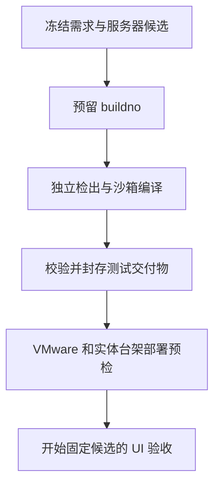

# 独立 QA 沙箱构建与 VMware 真机黑盒验收流程

本文将 [QA 建议方案 v2](qa_automation_real_environment_acceptance_proposal_20261102_v2.md)落实为执行交接设计，沿用[交付门禁](../../.agents/rules/delivery_and_coord_gate.md)、[独立 QA 规则](../../.agents/rules/codex_qa_review.md)和[Issue 流转规则](../../.agents/rules/e2e_issue_verification_flow.md)。本文及配套清单仍需非作者独立复核；文档存在不表示运行器已支持或测试已执行。

配套原件：[basecase 草案](qa_web_hmi_basecases_20261103.md)、[Issue 交接模板](../guides/templates/qa_blackbox_issue_template.md)、[四张问题卡及用户答复](qa_environment_decision_cards_20261103.md)。用户给出的 `Z:\home\sushaohua\workspace\ai_soc_project\...` 在本工作区按对应 Linux 路径读取。

## 1. 已确认的本轮边界

- **环境**：使用现有 VMware，划定 QA 独占窗口并冻结快照。服务器源码独立取得，Docker 独立构建；目标 VM 使用本轮受控部署目录、账户/权限和浏览器 profile。作者可写工作树及共享目录不能充当 QA 源码或制品来源。
- **首次完整验收**：等待 [MC/TH Debug 模式](mc_th_debug_mode_requirement_confirmation_20261103.md)与 [VMware–MC 921600 baud](vmware_mc_921600_requirement_confirmation_20261103.md)交付，再锁定包含两项功能的同一组合。环境调查、用例和工具准备可以先行；不将准备完成写成完整验收通过。
- **硬件**：用户确认已有 MC、TH 和完整机械/传感器设备，可安排受控运动测试；执行前仍须核对实际连接、限位、可运行范围、保护状态和台架窗口。沿用当前 Option A 加热输出 0% 约束；0% 加热不等于电机不会运动，也不授权实加热。
- **烧录**：自动构建制品和烧录计划，由授权人员复核目标、地址和完整命令并执行烧录，留存部署/校验记录；设备身份核对通过后再启动自动测试。本轮不启用无人值守自动烧录。
- **目标**：主要以 Web UI 黑盒验收产品行为；内部源码、单测和日志作工程支持及定位。软件自动化、真实 HIL、UI 人工可执行性分别记录。首轮必须安排非实现者按书面步骤走核心旅程，不能以自动化代替人工可执行性。

## 2. 分工和单轮入口

| 责任方 | 本轮职责与出口 |
| --- | --- |
| PM / ARCH / Owner | 接受功能需求和手册歧义处理，确定正常/异常/恢复预期、触发源、期限、物理效果和安全范围 |
| QA 用例/工具作者 | 根据需求建立 base/delta、环境 SOP、浏览器及采集工具；工具和独立预期交非作者复核 |
| INTEGRATOR / 发布工具 | 锁定服务器候选，分配组合 buildno，协调本轮 QA 重建制品清单、部署包、台架和修复映射 |
| 受控 QA 执行器 / 授权台架人员 | Python 确定性拉取、构建、采集和测试；人员确认/实施烧录和必要物理动作，保护原始证据 |
| 独立 Codex Reviewer | 在宿主独立会话只读审阅同一候选、需求、构建及 HIL 物证，不亲自连接物理设备或启动 Docker |
| 报告非作者 Reviewer | 独立核对报告原始哈希、范围、候选及证据；未参与报告写作 |
| 唯一开发 COORD | 收件回执、查重和分流、派修复任务、协调集成并核验关闭；QA 线不另设开发调度权 |

单轮开工冻结：任务 ID/revision、需求和手册版本、逐项必测/不适用清单、base/delta 和工具版本、服务器 ref/完整 commit、构建合同、台架/账户/窗口、完成期限和证据目录。未接受的具体阈值只阻塞相应断言，不阻止其他已明确准备工作。

## 3. 从服务器拉代码，在 Docker 构建交付物



1. 从当前已接受的[仓库清单](../../manifest.yaml)及任务候选单取 URL/ref/完整 commit。`soc-ap` 构建 AP 程序及 Web 静态资源；`mcu-p3` 分别构建 MC App、TH App；`test_harness` 获取已复核测试工具/夹具；`project-control` 获取规则、需求、手册及独立预期。MC/TH App 按任务绑定的 `feat/soc-debug` 核验，不拿默认 main 代替。Boot 仓仅在确属本轮范围时读取锁定版本；本轮不重编或刷写 Bootloader。
2. 在 QA 控制的独立 Git 对象库检出服务器准确提交，记录服务器查询/fetch 及解析结果。禁用借用作者对象库或复制未提交文件；分支只是定位入口，实际冻结完整 commit。凭据由受控环境提供，原始日志不包含密钥、认证缓存或令牌。
3. 为各构建选择已接受的容器镜像 digest、工具链、依赖锁和命令/cwd/环境变量/超时/产物清单。只将服务器取得的 QA 输入和独立输出目录交给构建容器，记录实际 `docker inspect`、挂载、退出码与构建日志，不挂作者工作树或宿主 Docker socket。
4. 在沙箱中分别编译 AP/UI、MC 和 TH。输出原始 ELF/BIN、升级所需封装及可追溯映射；若打包原地覆盖 BIN，分别封存打包前后身份。MC/TH 工具链不能在 Docker 独立复现时，登记工具/环境阻塞，不能复制作者旧固件顶替本轮构建。
5. 执行事前接受的软件检查和必要回归，校验包内实际文件、依赖、架构与资源预算。制品、编译配置、静态页面和日志逐个计算 SHA256，失败保留日志并产出问题/阻塞记录，禁止用空测试或 exit 0 代替有效用例。
6. 封存 build 清单后，独立 Reviewer 核对本次软件门禁范围，再释放到部署阶段。此时结论只覆盖软件构建/检查；真实环境验收仍未完成。软件测试与后续 HIL 各自有事实、独立审阅及范围记录。

**buildno 规则**：沿用 QA v2 §1.9，`release_series + buildno` 标识不可变的可部署组合，分配者为 INTEGRATOR/发布工具，QA 不另造同名序列。为本轮 QA 构建先预留编号，构建成功后以实际 AP/UI、MC、TH、配置、源码及工具链/依赖哈希封存。失败编号保留、不复用；`run_id`/`attempt` 单独标识测试及重试。

重建已有发布候选时先记录 `source_candidate_ref`。若重建得到不同制品或有效配置，应登记新的组合 buildno 并保留来源映射，不能覆盖原编号的制品；字节一致时才可在核验后引用原组合。构建时间/PID 等非确定性来源应明确记录，不能要求不同时间重建天然同哈希，也不能只凭源码 commit 宣称同一制品。

buildno 至少出现在交付目录/包名、构建与制品清单、运行清单、日志、结果和 Issue。优先通过已接受构建参数/旁路元数据绑定，不为编号改 Boot 协议、硬编码业务固件版本、运行会改 `version.ini` 的发布动作，或自动新增 UI 展示需求。

建议交付结构如下，是待实现的产物合同，并非当前已生成目录：

```text
<release_series>/build-<buildno>/
  candidate_lock.yaml          各仓完整提交、服务器及输入版本
  build_manifest.yaml          编号、来源候选、构建配置/工具链及制品映射
  SHA256SUMS                   实际封存文件的校验和
  ap/                         AP 程序、Web 静态资源、运行配置和必要依赖
  mc/  th/                    各自 ELF、原始/封装固件和身份映射
  deployment/                 部署说明、人工烧录计划、回退组合及校验步骤
  checks/                     构建/软件检查日志和沙箱物证
```

清单的自哈希存外部引用，不写自引用字段。日志/QA 报告后续独立封存并引用该组合，不原地改变已封存候选。仅证据或报告新增不递归产生新源码候选。

## 4. 现有 VMware 和实体环境的搭建顺序

| 次序 | 必须核验/保存的内容 | 失败处理 |
| --- | --- | --- |
| 1. 获取独占窗口 | 唯一台架操作者、VM/串口/探针/Chrome 使用者、租约；隔离作者自动部署和热更新，保存原服务/配置及回退入口 | 冲突不抢占，协调窗口；开发在独立环境继续 |
| 2. 冻结 VM | VM UUID、快照 ID、OS/内核、资源、网络、USB 透传、QA 账户与数据目录、对外地址 | 旧服务或共享目录无法隔离则阻塞正式验收 |
| 3. 安装/核验工具 | 固定版本的部署与采集依赖、Chrome 和自动化工具、ST-Link 驱动/后端（优先现有 probe-rs）、配置及磁盘预算 | 本轮不盲目升级所有系统软件；缺依赖交 INTEGRATOR |
| 4. 识别物理设备 | MC/TH 芯片/板卡 UID、各自 ST-Link 序列号、业务串口与两路调试串口稳定身份/实际 tty、级联拓扑；设备只能由一个主机/VM 实际占用 | 缺失/重复/绑定不明则停止相关动作，不按 tty 序号猜板卡 |
| 5. 人工部署 MCU | 自动输出锁定 ELF/BIN、地址/分区、完整烧录/校验计划，按 HW-G2 人工复核执行并保存人员、工具和校验输出 | 禁止整片擦除或覆盖 Boot；地址以板型/链接脚本/已接受契约交叉核实 |
| 6. 部署 AP/UI | 只部署本轮 QA 包，确认进程/配置/静态资源哈希、真实 IPC/网关和启动记录；冻结 VMware–MC 921600 生效配置 | 发现版本漂移建立新组合/新 run，不现场热改后沿用结果 |
| 7. 开始物证采集 | 冷启动前准备业务双向帧观测、MC/TH 独立调试串口、后台/部署日志；保存启动代次和采集丢失计数 | 不另开业务串口读者抢数据；丢证据如实记录 |
| 8. 核对健康前提 | 实际双向响应、两个固件映射、传感器及机械/限位、0% 加热约束和恢复入口；正常旅程从本轮真实触发开始 | 预检只读，不以预探测缓存代替待测冷启动探测；风险停止相关动作 |
| 9. 启动 Chrome | 固定版本、viewport/语言、受控独立 profile；有界自动化连接端口，记录浏览器启动和网络；清理仅限本轮数据 | 不复用作者 profile；清缓存不能替代持久化用例 |

VM 快照不恢复 MCU Flash、外部目录、物理位置或耗材状态，恢复后逐项核验。跨机器用 UTC 关联并记录时钟差，单机等待用单调时钟；两板本地时间不能未经校准直接比较。

## 5. 自动化执行、结果和动态 Issue

1. 将 [basecase 草案](qa_web_hmi_basecases_20261103.md)与已接受需求/首版范围对账，固化每例具体步骤、正负/恢复、期限和证据。首次完整验收覆盖全部适用基础范围，Debug 与 921600 作为 delta；后续按影响选 base，修复后至少重跑原失败例、配对及必要回归。
2. 冻结 `run_manifest`：build 清单哈希、需求/手册/base/delta/工具版本、必测/未选及依据、VM 快照、已烧录固件、三路串口、两探针、浏览器、台架、操作者/会话和起止时间。范围内产品缺功能记失败；缺台架/需求期限/有效来源则相应阻塞，不临时删必测项。
3. Python/受控执行器驱动 Chrome 的真实输入事件，从可见入口运行正常旅程，再按依赖执行相关故障/恢复。可用已复核的 Playwright 或 CDP 实现；不以 DOM `.click()`、隐藏 API、注入状态或改 localStorage 跳过必测操作。只读 DOM/网络/日志观测用于断言和物证。
4. 每步有限等待并采集浏览器轨迹/截图、公开请求响应、真实双向帧、两路调试日志和适用物理效果。UI 与设备对账按同一请求/采样关联；“发送成功”“收到 ACK”“执行完成”分开判定。
5. 每例逐次记录 `PASS / FAIL / BLOCKED / NOT_RUN / NOT_APPLICABLE`、原因和证据；这些是用例结果，不写入正式任务 status。保留第一次失败和全部重试。缺必需证据不能通过，测试工具错误交 QA 工具 Owner，不强派业务作者改代码。
6. 一旦失败，先保存现场和证据，以[模板](../guides/templates/qa_blackbox_issue_template.md)生成发现包并通知 COORD；不等整轮报告或审阅结束。只阻塞依赖该失败的用例，继续同候选的独立用例；安全/通用环境前提丢失时停止相关硬件动作。
7. 范围完成后固化结果、原始物证、Issue 和缺口清单。独立 Codex 只读审阅准确候选及证据，结果经程序校验、报告非作者复核和必要 Owner 接受后，由 COORD 分范围收件。格式错误/超时等记可重试或阻塞结果，禁止回退 self 或补造 APPROVED。

## 6. Issue 交 COORD 与开发并行闭环

QA 写自己的发现/证据和待投递记录；COORD 是 `docs/issues/` 正式登记、任务关联和最终处置的受控写入方。QA 不与 COORD 并发修改同一个 Issue 或 Git index。实际台架由一方独占，开发代码/构建可继续，工程联调/重刷必须另排窗口。

| 交接 | 必需字段及行为 |
| --- | --- |
| QA → COORD：发现/追加证据 | 稳定 `finding_id`、`event_id`、发现者、Issue 模板字段、run/build/候选及证据哈希；保存耐久待投递记录后发送 |
| COORD → QA：收件 | 按事件 ID 幂等，回 `receipt_id`、正式 Issue ID 或重复关联、负责人/下一步；实际根因未知可先调查，收到不等于修复 |
| 开发 → QA：候选就绪 | Issue、`fix_available_buildno`、各仓 `fix_commits`/依赖、不可变清单及复验请求；QA 随时入队回执 |
| QA → COORD：复验 | 新 run 的原失败例、配对、必要 base 和实际证据/独立接受；只有通过后填写实际 `verified_buildno` |
| COORD → QA：关闭/继续处理 | 满足原规则才置 `resolution: fixed` 并关闭；保留旧失败和历史签署，缺证据不关闭 |

功能缺陷交对应 ENG，需求歧义交 PM，跨模块契约/触发缺失交 ARCH，部署/设备绑定交 INTEGRATOR，工具问题交 QA 工具作者；不是每票串行调用全部角色。COORD 正式任务仍沿用原状态及返工预算。

**当前接入缺口**：本地 `tools/coord_runner/work_intake.py` 的第一阶段 MD 入口要求 `reported_by.actor_type == HUMAN`，原专项也明确不验 QA 自动入队。QA 来源不能伪装成人。此次 Issue 模板对齐现行字段并扩展发现/版本交接信息，但该发现事件 schema 仍需实施接受，不能直接投到 HUMAN 入口并声称兼容。

本专项应另交付一个有界 QA 发现接收适配：校验真实 QA 来源、schema、引用/权限，映射正式 Issue，提供幂等收件和可查询回执。接通前可由现有 COORD 在检查点主动读取已封存发现包、实际登记和回执；这属于人工触发收件，不算自动接入验收通过。通知失败保留待投递并重试，不能因“文件已写”声称已送达，不能要求用户逐票复制技术细节。

QA 运行中只接收通知、不换版。仅在本轮完成、空闲，或整轮阻塞且无独立例可继续、现场已安全交接时选下一候选。`buildno >= fix_available_buildno` 且包含有效修复/依赖、无已知撤回，只证明具备复验资格；新 run 实测通过才能关闭。环境阻塞须先恢复，提高编号无效。每轮 base/delta 在同一固定组合执行，旧版通过不拼接成新版批准。

## 7. 交付、退出与下一步

本专项最小交付：已复核需求/用例；可重复构建合同及带 buildno 的实际制品；VM/硬件部署 SOP 和环境清单；自动化/采集工具；动态发现与 COORD 回执；新候选固定检查点复验；分范围独立报告及报告非作者复核。正式报告列全必测结果、软件/HIL/UI 人工范围、未关闭 Issue 和限制。

完整接受要求同一最终组合的全部必测项具有有效证据及适用接受，原失败及回归闭环。部分能力可按事前冻结范围接受；运动、调平、供料等必须有相应实际效果，不能用版本查询、固件逻辑坐标或截图扩大结论。

建议现有 COORD 按边界登记准备任务：PM/ARCH 对齐手册与需求；独立 QA 编制并交复核用例/工具；INTEGRATOR 提供 buildno/打包、环境及发现收件适配；两项前置交付后安排本轮独立验收及复验。代码/工具工作交实际工程角色，COORD 不代写。单步验证通过再接受无人值守自动运行，不能仅凭定时服务存在宣称闭环。

本次只完成流程和模板编写及作者文档检查；未安装工具、运行构建/浏览器/HIL、烧录、派单、创建真实 Issue、修改在途任务、提交或推送。实际命令、任务 ID、会话及服务器候选由对应任务冻结后执行；现有 qa_runner 的 CLI 没有原生 buildno/HIL 全流程入口，不能编造一条现成的“一键全验收”命令。
