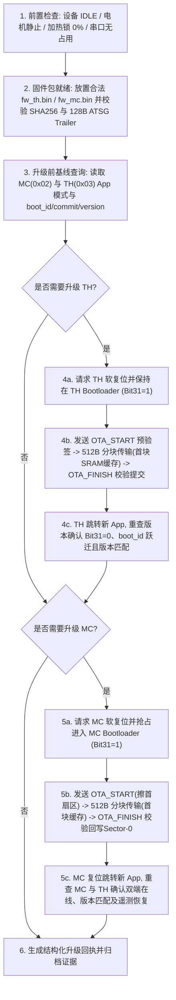
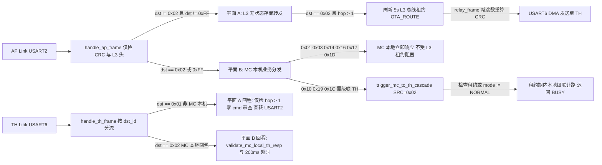

# 现有 MC 与 TH 固件升级功能验收实施方案

## 修订历史

| 版本 | 修订时间 | 修订人 | 变更摘要 | 审批状态 |
| :--- | :--- | :--- | :--- | :--- |
| `v0.1` | `2026-11-17` | `AI (Antigravity-CLI) - PM` | 初始产品目标与验收范围草案 | 待 ARCH 核对与用户审批 |
| `v0.2` | `2026-11-17` | `AI (Antigravity-CLI) - PM` | 根据 ARCH 物理取证收敛需求范围、异常行为与待决取舍 | 待 ARCH 合成第 2 部分 |
| `v1.0` | `2026-11-17` | `AI (Antigravity-CLI) - ARCH` | 合成第 2 部分技术取证、接缝比选、Diff Budget 与垂直切片规划 | 待用户审批 (Human Gate #1) |
| `v1.1` | `2026-11-17` | `AI (Antigravity-CLI) - COORD` | 用户批准 Human Gate #1（确认 `DEC-USER-1=B, DEC-USER-2=A, DEC-USER-3=A, DEC-USER-4=A, DEC-USER-5=A`），落盘契约与切片并启动 Phase 2 执行 | 已批准执行 (Approved) |
| `v1.2` | `2026-11-18` | `AI (Antigravity-CLI) - COORD` | 实探核实 VMware (`192.168.77.134`) 离线而 C308L (`192.168.1.101:/dev/ttyS1`) 在线接有真实 MC/TH 板卡，按用户更新 SSH 公钥及授权 2 转入 C308L `/dev/ttyS1` 执行 `SLICE-03` `B1~B4` 实测（标明未连接物理 U 盘与 COM12/13） | 执行中 (Stage B HIL) |
| `v1.3` | `2026-11-18` | `AI (Antigravity-CLI) - COORD` | 完成 `SLICE-01/02` `SW-Verified` 准出与 `SLICE-03` C308L (`/dev/ttyS1`) 真机 HIL 穿刺实测（双板升级至 `mcu-p3@b865222c` 成功，定位 `HIL-FINDING-01/02` 两项真机缺陷） | 已完成首轮验收并待决缺陷修复 |
| `v1.4` | `2026-11-18` | `AI (Antigravity-CLI) - ARCH` | 针对 SLICE-03 真机暴露的 HIL-FINDING-01（MC 路由层违背 §2.2 零业务解析原则）与 HIL-FINDING-02（MC Bootloader .bss 盐值软复位归零及 _estack 栈顶隐患）补充第 3 部分穿透式架构整改方案、Diff Budget 与 SLICE-04/05 闭环规划 | 已由 v1.5 收敛替代 |
| `v1.5` | `2026-11-18` | `AI (Antigravity-CLI) - ARCH` | 按用户裁决豁免 HIL-FINDING-02（确认风险可承受，本轮不修改 boot/bootloadermc 且真机全程禁用 SWD 探针），将第 3 部分收敛为仅在 mcu-p3@feat/soc-debug 重构 MC 正交 L3 透明路由（HIL-FINDING-01）并经 /dev/ttyS1 串口 OTA 真机闭环 | 已批准执行 (Approved, DEC-REM-1=A) |

---

## 0. 信息来源与状态区分声明

为避免把建议写成决定或臆测硬件/源码现状，本方案严格区分以下四类信息：
1. **用户已确认基准**：
   - 本任务目标：用户要求以“验收现有 MC 和 TH 升级功能”为首个任务，检验 AI SoC V2 多 Agent 团队能否自动协作。
   - 既定产品边界（沿用 `first_release_scope_decision_20261029.md` `U-D05` 及已批准的 `minimc_v2_unified_mcu_upgrade_architecture_20261105.md` `revision: 2`）：双 MCU（MC/TH）真实固件升级纳入首版；全链路串口升级统一采用 `MiniMCProto v2.0 (Rev 2.0.4)`；100% 保留 MC U 盘升级与恢复能力；常规 App 升级、测试与 HIL 部署严禁使用 `probe-rs` / SWD / JTAG 探针写入替代（仅首次 Boot 迁移或极端救援经单独授权除外）；严禁以文件复制或模拟升级冒充真实升级；排除 AP 系统级 OTA 或完整 A/B 分区升级；HIL 物理台架阶段维持 Option A（加热 PWM 严格锁死 `0%`）。
2. **`[ARCH核实]` 源码与工具链物理核查事实**：
   - ARCH 已完成五端源码与 `graphify` AST 物理取证，核实了 `printer-soc`、`mcu-p3`、`boot/bootloadermc`、`boot/bootloaderth`、`test_harness` 及 `qa-sandbox:20261029` 的真实能力、隐藏契约冲突与阻塞项（详见 1.6.3 节）。
3. **`[PM提议]`**：第 1 节中的优先级调整、分阶段边界与推荐选项均标注为 `[PM提议]`，不代表用户已拍板。
4. **`[待用户决定]`**：所有涉及修补范围、验收入口取舍、交叉编译载体、准出深度及 HIL 台架载体的决策均集中于 1.6.4 节 `DEC-USER-1 ~ DEC-USER-5`，须由用户最终拍板。

---

## 第 1 部分：产品目标与范围（PM 主责）

### 1.1 问题、场景与目标

#### 1.1.1 要解决的问题
1. **现状可信度与暴露断层**：`[ARCH核实]` 当前工作区已从已封存的 `soc-ap` 演进至 `printer-soc`，且 `boot/bootloadermc` 已合入 `DMA1_CHANNEL6` RX 与 Sector-0 防变砖缓存；`printer-soc` 亦已具备 REST → D-Bus → `forward_ota` → DDS 的主干闭环与 PTY E2E 测试。但 ARCH 物理取证同时暴露出“零修改直接验收”存在阻断项：
   - **隐藏版本编码冲突**：`printer-soc` 与 `boot/bootloadermc/scripts/pack_firmware.py` 按 `(major << 24) | (minor << 16)` 编码/校验 `version_code`，而 `test_harness/hil/tools/hil_deploy_via_minimc_ota.py` 按 `(major << 8) | minor` 编码/校验（`boot/bootloaderth/tools/pack_firmware.py` 默认 `0x00010000`），混用会导致 Stage 4 版本匹配必败；
   - **测试套件过期与假阳性隐患**：`test_harness` 静态检查与 `run_ota_software_suite.py` 仍硬编码指向已封存的 `soc-ap` 及旧测试名，直接执行会失败；且 M07 测试了真实 Bootloader 并不支持的 `0x23` 4B 主动取消语义（仅存在于虚拟靶机）；
   - **沙箱镜像工具链缺口**：`qa-sandbox:20261029` 镜像内不含 `arm-none-eabi-gcc`、`ninja`、`pytest`（宿主机具备），无法在当前镜像内执行 ARM 交叉编译；
   - **AP 入口局部未接通**：`printer-soc` 仅从 `--firmware-dir` 读取固定文件名 `fw_mc.bin`/`fw_th.bin`，尚未接入 `/var/update/incoming` 扫描与 `/var/update/sealed`（`0444` 封存）及 `services/helixscreen` 本地触屏 UI。
2. **团队自动协作首战验证**：以本任务验证 `PM ↔ ARCH → 用户审批 (Gate #1) → COORD → ENG / INTEGRATOR / 独立 QA` 的 V2 协作链路、垂直切片编排与四阶漏斗门禁能否顺畅闭环运行。

#### 1.1.2 目标用户与核心场景
- **研发 / 测试 / HIL 集成操作者**：
  - **场景 A（双板常规串口协议升级）**：操作者在上位主机/目标环境准备合法签名封装包（`fw_th.bin`、`fw_mc.bin`），在设备安全就绪时通过 CLI 部署工具或 `printer-soc` REST 入口执行常规在线升级（支持单升级 TH、单升级 MC，或先 TH 后 MC 的双板组合升级），并在升级前后核验 `boot_id` 跃迁与版本变化。
  - **场景 B（MC 独立 U 盘升级与救援恢复）**：当现场需离线升级或 MC App 损坏导致级联路由不可用时，操作者通过 FAT32 U 盘对 MC 执行独立升级/恢复，并确保 U 盘通道与串口升级通道互斥安全。
  - **场景 C（异常拦截与故障恢复）**：操作者或自动化测试注入错板固件、超限包、损坏校验、断链/中途复位等异常输入时，系统须安全拒绝（零擦除）或在重启后安全驻留 Bootloader 并支持重刷恢复，严禁静默变砖或假成功。

#### 1.1.3 产品边界澄清：纯验收定位问题 vs 小预算修通验收阻塞
- **`[PM提议 - 针对现已暴露的对齐冲突，建议选项 B：小预算修复测试/契约对齐后完整验收]`**：
  - 鉴于 `[ARCH核实]` 已确认 `test_harness` 存在 `soc-ap` 失效路径、M07 假取消与 `version_code` 编码冲突，**完全“零修改”执行既有测试套件将直接报错阻塞**，既无法验证现有 MC/TH 升级真值，也无法跑通 V2 四阶门禁闭环。
  - **选项 A（严格纯验收、只出缺口报告）**：不修改任何测试脚本或业务/打包代码，直接记录上述断链、版本冲突与 M07 假阳性问题并结单，待后续另行立项修复再验收。
  - **选项 B（`[PM提议]` 授权小预算修复对齐项后完成真实闭环验收）**：仅授权在最小 Diff Budget 内清理 `test_harness` 的 `soc-ap` 失效路径、移除 M07 假取消断言、并统一 `version_code` 编码/校验规则，随后跑通 V2 四阶门禁与真实升级验收。至于 `printer-soc` 的 `/var/update/incoming -> sealed` 接入及 `services/helixscreen` 触屏 UI，另由 `DEC-USER-2` 决定是否纳入本轮。
  - *(详见 1.6.4 节 `DEC-USER-1`、`DEC-USER-2`)*。

---

### 1.2 需求与优先级草案

> 以下优先级基于用户价值、已确认约束（`U-D05`、部署手册安全门禁）及 `[ARCH核实]` 现状更新；涉及修补或扩展入口的项均标记 `[待用户决定]`。

| 需求 ID | 优先级 | 需求名称 | 核心产品要求（做什么与做到哪里） | 来源 / 性质 |
| :--- | :--- | :--- | :--- | :--- |
| `REQ-ACC-01` | **P0** | 升级前后版本与模式核验 | 升级前能分别识别 MC 与 TH 当前处于 App 模式还是 Boot 模式，并读取可区分的身份信息（`boot_id`、固件版本/commit、能力标志）；升级完成后能再次读取并确认已返回新 App 模式、`boot_id` 真实跃迁且版本校验通过。`[ARCH核实]` 双版本测试可通过 `mcu-p3` `version.ini`/`FW_VERSION_*` 编译不同版本 `.bin` 或以 `allow_reflash=true` + 动态 `boot_id` 跃迁验证；`printer-soc` 与 `test_harness` 的 `version_code` 编码冲突须按 `DEC-USER-1` 处置。 | 已确认需求（`U-D05`）+ `[ARCH核实]` |
| `REQ-ACC-02` | **P0** | TH 级联与独立升级 | 支持经 `AP -> MC App (透明级联路由) -> TH Bootloader` 完成 TH App 独立升级；双板组合升级严格执行**先 TH 后 MC**，禁止由 MC Bootloader 承担 TH 路由；当 MC App 不可用时，明确拒绝/阻塞 TH 级联并要求先恢复 MC App。 | 已确认架构边界（`minimc_v2` 架构方案 §1.1） |
| `REQ-ACC-03` | **P0** | MC 串口独立升级 | 支持 MC 从 App 运行态软进入（或冷启动驻留）MC Bootloader，接收带合法 `128B ATSG Trailer` 的 `fw_mc.bin`，按 Sector-0 防变砖缓存流程写入 App 分区校验回写后重启进入新 MC App（`[ARCH核实]` `boot/bootloadermc` 已合入 `DMA1_CHANNEL6` RX 与 Sector-0 缓存），并恢复对 TH 的透明路由与基础遥测。 | 已确认需求（`U-D05`）+ `[ARCH核实]` |
| `REQ-ACC-04` | **P0** | MC U 盘升级与恢复回归 | 验证 MC 原有 FAT32 U 盘升级入口完整有效：合法包（`0:/fw_mc.bin`）预验签通过后擦写跳转并原子重命名为 `FW_MC.CUR`；重启遇到 `.cur` 不重复刷写；错板/损坏包零擦除拒绝并重命名为 `.err`；串口 OTA 与 U 盘升级单写者互斥。 | 已确认边界（保留 100% U 盘回归） |
| `REQ-ACC-05` | **P0** | 常规升级禁用探针覆盖门禁 | 核验本次常规 App 升级验收（含自动化脚本与实机操作）100% 通过 MiniMCProto v2.0 串口或 MC U 盘完成，严禁调用 `probe-rs` / `OpenOCD` / `ST-Link` 直刷 App 分区，严禁以文件复制、Mock 或硬编码假状态冒充真实升级（含清理虚拟靶机假阳性断言）。 | 已确认红线（`HW-G2`、`HW-G5`） |
| `REQ-ACC-06` | **P0** | 异常、负例与安全前置保护 | 1. 擦除前原子拒绝错板 `board_id`、超分区容量上限及损坏 Trailer/CRC 的升级包（`bytes_written=0`，原 App 完好）；<br>2. `[ARCH核实]` 真实 MC/TH Bootloader 仅支持 7 条命令（`0x01, 0x03, 0x1D, 0x20, 0x21, 0x22, 0x23`），**不支持**传输中主动取消指令（发 `0x24` 返回 `NACK 0x04`，带载荷 `0x23` 返回 `NACK 0x06`）；异常中止依赖停止下发/超时/复位后安全驻留 Bootloader（`Bit31=1`）并可重刷恢复；<br>3. 并发请求触发忙碌拒绝；<br>4. 前置条件检查满足安全态（作业 `IDLE`、运动静止、Option A 加热 PWM `0%`），维护期锁定常规控制入口（`HTTP 409`）。 | 已确认需求 + `[ARCH核实]` |
| `REQ-ACC-07` | **P1** `[PM提议]` | AP 应用侧入口验收（`printer-soc` REST / 目录规范 / UI） | `[ARCH核实]` `printer-soc` 已实现 REST（`GET /api/v1/ota/status`, `POST /api/v1/ota/scan`, `POST /api/v1/ota/trigger`, `HTTP 409` 维护锁）→ D-Bus `OtaCommand` → `forward_ota` → DDS 闭环（从 `--firmware-dir` 读 `fw_mc.bin`/`fw_th.bin`），并有 `tests/ota/test_ota_e2e.py`；但尚未接入 `/var/update/incoming` 扫描、`/var/update/sealed`（`0444` 封存）及 `services/helixscreen` 触屏 UI。按 `DEC-USER-2` 确定验收现有入口还是补齐后再验。 | `[ARCH核实]` + `[待用户决定 DEC-USER-2]` |
| `REQ-ACC-08` | **P1** `[PM提议]` | 部署说明书与工具/脚本参数对账 | 核对《MiniMCProto v2.0 双 MCU 升级操作与 HIL 部署说明书》中的命令参数、默认分块（`512B`）、`version_code` 编码格式、超时预期及回执字段与当前实际代码/测试脚本是否一致，记录或对齐全部漂移项。 | `[PM提议]`（保障可复现性） |

---

### 1.3 用户流程

#### 1.3.1 正常流程（常规串口升级：支持单 TH、单 MC 或先 TH 后 MC 组合）



- **单板独立升级**：
  - 仅升级 TH 时跳过步骤 5；仅升级 MC 时跳过步骤 4。
- **MC U 盘独立升级/恢复正常流程**：
  1. 将带有效 `128B ATSG Trailer` 的 `fw_mc.bin` 放入 FAT32 U 盘根目录 `0:/`；
  2. 冷启动或复位 MC，MC Bootloader 挂载 U 盘并完成预验签；
  3. 仅写入有效净荷至 `0x08020000` 并比对 CRC32；
  4. 原子将 `0:/fw_mc.bin` 重命名为 `0:/FW_MC.CUR`，重启跳转新 MC App；
  5. 再次重启遇到 `0:/FW_MC.CUR` 时直接引导 App，不再重复刷写。

#### 1.3.2 异常、失效与取消表现

| 异常 / 失效 / 取消场景 | 预期外部可观察表现 | 禁止出现的不良表现 |
| :--- | :--- | :--- |
| **固件包错误（错板 `board_id`、超容量上限、损坏 Trailer/CRC、非完整 `.part` 文件）** | 在**任何有效固件破坏前**原子拒绝；串口返回明确 `NACK` 错误码，工具非零退出；`0x23` 状态核实写入/提交未生效；U 盘通道将错包重命名为 `.err`；原有片上 App 保持完好可重启运行（注：`[ARCH核实]` MC Sector-0 防变砖机制为 `0x20` 擦除首扇区、`0x21` 缓存首块、`0x22` 校验后回写，因此 `0x20` 预验签拒绝须发生在擦首扇区之前）。 | 预验签未过即擦除 Flash；静默忽略错误继续传输；将 `.part` 未写完文件直接投入升级。 |
| **升级中串口断链 / 串口被占 / 节点超时** | 工具/AP 在有界超时窗口内失败退出并返回非零退出码（REST 维护锁解除/报失败）；若后台守护进程占用串口或并发请求竞争，返回设备忙/拒绝（如单写者互斥）；不报告“升级成功”。 | 死等卡死无超时；后台继续假装推进百分比；在无硬件确认时标记完成。 |
| **升级中途掉电或意外复位（含 TH 首块延迟提交与 MC Sector-0 缓存窗口）** | 重启后，未完成提交的目标板（TH 锚点未写入且首块未提交；MC 首扇区未在 `0x22` 校验后回写）自动安全驻留于各自 Bootloader（`Bit31=1`），操作者可直接重新发起全量升级或对 MC 使用 U 盘恢复。 | 因半截镜像被误跳转而跑飞锁死，必须依赖 SWD 探针才能救活。 |
| **MC App 损坏时尝试升级 TH** | 因 MC Bootloader 不承担 TH 级联路由，TH 级联握手超时/受阻并明确报错；操作者必须先通过 MC Bootloader（串口或 U 盘）恢复 MC App，再执行 TH 升级。 | 强行由 MC Bootloader 转发或绕过 MC App 静默失败。 |
| **传输中请求取消 / 收到未知取消指令** | `[ARCH核实]` 真实 MC/TH Bootloader 均**不支持**传输中主动取消指令（仅支持 `0x01, 0x03, 0x1D, 0x20, 0x21, 0x22, 0x23` 7 条指令；发送 `0x24` 返回 `NACK 0x04`，带载荷 `0x23` 返回 `NACK 0x06`）。在“开始刷写前”的校验/准备阶段可拒绝取消且不改写固件；一旦进入传输后需要中止，外部表现为**停止下发数据 / 超时退出 / 复位**，目标板安全驻留 Bootloader（`Bit31=1`）等待下次重刷恢复。 | 依赖虚构的 `0x23` 4B Abort 指令（旧虚拟靶机 M07 假阳性语义）宣称支持平滑取消或假装回滚旧版本。 |
| **前置条件不满足或维护期控制冲突** | 设备处于非 `IDLE`（打印/运动中）或维护期收到常规运动/温控/作业指令时，明确锁定拒绝（`printer-soc` 返回 `HTTP 409`）。 | 打印运动过程中强行复位 MCU 刷机；状态报告“已升级”但实际仍运行旧固件。 |

---

### 1.4 包含与排除范围

| 分类 | 具体项 |
| :--- | :--- |
| **包含范围 (In-Scope)** | 1. 现有 MC App 与 TH App 串口协议升级链路验收（`MiniMCProto v2.0 Rev 2.0.4`，涵盖单 TH、单 MC、先 TH 后 MC 组合及升级前后 `boot_id`/版本/遥测核验）；<br>2. 现有 `printer-soc` REST → D-Bus → `forward_ota` → DDS 闭环验收（按 `DEC-USER-2` 确定仅验现有 `--firmware-dir` 还是含 `incoming/sealed`）；<br>3. 现有 MC FAT32 U 盘升级、防重刷（`.cur`/`.err`）与串口/U 盘单写者互斥回归验收；<br>4. 擦除前预验签拒绝、超限拒绝、断链/复位驻留 Bootloader 恢复、超时/忙碌拒绝及 `0x24`/带载荷 `0x23` 拒收验证；<br>5. 依托 V2 垂直切片与四阶漏斗门禁完成团队自动协作验证（按 `DEC-USER-1` 决定是否包含修复 `test_harness` `soc-ap` 断链、M07 假取消与 `version_code` 冲突的小预算切片）。 |
| **排除范围 (Out-of-Scope)** | 1. AP 侧（C308L / Linux）系统固件升级与完整 A/B 分区 OTA；<br>2. 运行期 Bootloader 自升级（双 Bootloader 不改写 Boot 分区，仅只读核验版本与能力位）；<br>3. `services/helixscreen` 本地触屏 UI 接入（`[ARCH核实]` 尚未接入；如 `DEC-USER-2` 不扩围则明确后置）；<br>4. 新增打印业务功能开发（如混色、调平、切片、3MF 解析等）；<br>5. 未经 Human Gate #2 单次授权的任何 SWD/JTAG 探针写操作。 |

---

### 1.5 可观察完成条件

> 严格执行 V2 双态准出规则：软件与沙箱验证只能产出 `SW-Verified`，绝不替代真机物理烧录验收；真机物理验收须在 Human Gate #2 授权后执行并产出 `HIL-Verified`。

#### 阶段 A：软件与隔离沙箱可观察完成条件（`SW-Verified`）

| 验收项 | 前置条件 | 操作 | 可观察成功结果 / 相关负例 |
| :--- | :--- | :--- | :--- |
| **A1. 跨仓协议契约与静态门禁** | 候选仓库 Commit 锁定；`check_opcode_alignment.py` 对齐范围按 `DEC-USER-1` 处理完成 | 运行契约对齐校验、`fast_gate.py` 及静态规则检查 | 命令码（含 `0x1D`/`0x20~0x23`）、载荷上限、ATSG 常量、分区上限、`version_code` 编码规则及禁探针检查全部通过（退出码 `0`）。 |
| **A2. 软件与 PTY 端到端回归** | `qa-sandbox:20261029` 就绪（`host-software` 范围）；`test_harness` 失效引用与 M07 假取消按 `DEC-USER-1` 清理后；ARM 交叉编译执行方式按 `DEC-USER-4` 确定 | 1. 在沙箱运行 `printer-soc` 构建、`tests/ota/test_ota_e2e.py` PTY E2E 及 MCU/Boot 宿主单测；<br>2. 运行修正后的 OTA 软件回归套件；<br>3. 按 `DEC-USER-4` 完成 ARM 目标镜像编译校验 | 1. 正例：ATSG 打包与解析、512B 分块切片、`printer-soc` REST/D-Bus/DDS/HTTP 409 维护锁、版本编码匹配与回执生成全部通过；<br>2. 负例：错板 `board_id`、超容量上限、损坏 CRC/Trailer、非法分块、发送未支持取消帧（`0x24`/带载荷 `0x23` 返回 NACK）、超时与忙碌均按预期被精确拦截（无跳过、无虚构通过）。 |
| **A3. V2 独立 QA 与账本闭环** | A1、A2 全部通过 | 执行 `qa_runner.py` 沙箱构建回归与独立异构 Codex 双轴冷审 | 产出带 SHA256 绑定的 `server_qa.json` 与 `verdict.json`（`APPROVED` 且 **`0 BLOCKER`**），切片状态真实写入 `slices/ledger.md` 为 `SW-Verified`。 |

#### 阶段 B：真机 HIL 台架可观察完成条件（`HIL-Verified`，需 Human Gate #2 独占窗口）

| 验收项 | 前置条件 | 操作 | 可观察成功结果 / 相关负例 |
| :--- | :--- | :--- | :--- |
| **B1. 升级前基线与常规禁探针确认** | 物理 MC/TH 板卡按 `DEC-USER-5` 选定载体（VMware `/dev/ttyUSB0` 或 C308L `/dev/ttyS1`）连接就绪，Option A 加热 PWM=`0%`，独立 `[MC-DBG]`/`[TH-DBG]` 采集就绪 | 查询双端版本并核验当前可观察标识 | 双板均返回 `App 模式 (Bit31=0)`，可记录非零 `boot_id` 与固件版本/commit；全过程无 `probe-rs`/SWD 刷写 App 操作。 |
| **B2. 正例：先 TH 后 MC 全链路升级与恢复** | 通过 `version.ini`/`FW_VERSION_*` 编译产出不同版本 `.bin`（或经允许以 `allow_reflash=true` + 动态 `boot_id` 跃迁验证） | 执行标准自动化升级流程（先 TH 后 MC；并按 `DEC-USER-2` 覆盖 `printer-soc` REST 入口） | 1. TH 经 `AP -> MC App -> TH Boot` 升级后重入 App（`Bit31=0`），`boot_id` 跃迁且版本校验匹配；<br>2. MC 软入 `MC Boot` 完成 Sector-0 缓存回写并重启进入新 App（`Bit31=0`），`boot_id` 跃迁且版本校验匹配；<br>3. 升级后双端心跳/版本查询及温度遥测闭环正常，生成结构化回执。 |
| **B3. 负例：擦除前零擦除原子拒绝（MC & TH）** | 准备错板包（MC 投 TH 包、TH 投 MC 包）及超分区上限包 | 分别在 MC 与 TH Boot 阶段发起 `0x20` 握手并立即查 `0x23` 状态，随后复位 | 协议明确返回拒绝 NACK，写入字节数保持 `0`；复位后原片上 App 正常启动，证明未损坏片上固件。 |
| **B4. 负例：异常中止（停止下发/超时/复位）与未知取消码拒收** | 处于 Boot 握手或有效传输中（含 TH 首块延迟提交与 MC Sector-0 缓存窗口） | 1. 发送未支持取消指令（`0x24` / 带载荷 `0x23`）；<br>2. 制造传输中断或触发中途复位，观察超时与重启后状态，再重传合法包 | 1. `0x24` 返回 `NACK 0x04`，带载荷 `0x23` 返回 `NACK 0x06`；<br>2. 中断后工具/AP 在有界超时内非零失败（无假成功）；目标板重启后安全驻留 Bootloader（`Bit31=1`）；重新执行全量升级后恢复正常 App 运行。 |
| **B5. 回归：MC U 盘升级、防重刷与单写者互斥** | 物理 FAT32 U 盘及合法/非法固件包 | 依次实测：放错包启动、放合法包启动、带 `.cur` 再次启动、串口 OTA 持锁期间并发测试 | 非法包零擦除并重命名为 `.err`；合法包写入新 App 并重命名为 `.cur`；带 `.cur` 重启不重复刷写；串口持锁期间 U 盘礼让且并发串口请求返回忙碌拒绝。 |
| **B6. 独立 QA 物证审计升级准出** | B1~B5 执行完毕并保存原始日志与固件 SHA256 | 提交双向 Raw Hex（带毫秒时戳）、Debug 串口日志、回执与 SHA256 给独立 QA 审计 | 独立 QA 核验物证真实完整后，切片由 `SW-Verified` 升级为 `HIL-Verified`。 |

---

### 1.6 约束、假设与待决项

#### 1.6.1 已知约束
1. **协议与通信约束**：统一使用 `MiniMCProto v2.0 (Rev 2.0.4)`；真实 Bootloader 仅支持 7 条升级/查询指令（不支持传输中主动取消）；`MC Bootloader` 不承担 TH 级联路由；常规 App 部署禁止探针写操作（`HW-G2`）。
2. **安全与零造假约束**：HIL 台架强制 Option A（加热 `0%`）；严禁 PTY/Loopback/Mock 冒充 HIL（`HW-G5`）；严禁假状态/测试桥垫片（`Anti-Fake`），严禁保留仅在虚拟靶机通过的 M07 假取消断言。
3. **分支与权限红线**：`mcu-p3` 锁定 `feat/soc-debug`；`boot/bootloadermc` 与 `boot/bootloaderth` 锁定 `soc_debug`（禁写 `main`）；`PM`/`ARCH`/`COORD` 不得手改业务源码。
4. **流程约束**：遵循 V2 两阶段协议，Gate #1 审批前不改工程代码；进入真机物理实测前须获 Human Gate #2 确认。

#### 1.6.2 关键环境条件（`[ARCH核实]` 已确认）
1. **宿主机串口现状**：当前宿主机无 `/dev/ttyUSB*` 或 `/dev/ttyACM*`，执行真实 HIL 须接入目标物理台架（VMware `/dev/ttyUSB0` 或 C308L `/dev/ttyS1`）。
2. **沙箱镜像边界**：`qa-sandbox:20261029` 内不含 `arm-none-eabi-gcc`、`ninja`、`pytest`（宿主机已具备）；`host-software` 沙箱可跑 `printer-soc` 构建测试与 MCU/Boot 宿主单测，ARM 交叉编译须按 `DEC-USER-4` 决定验证路径。
3. **双版本包可生成性**：`mcu-p3` 可通过 `version.ini` / `FW_VERSION_*` 编译产出两个不同版本号 `.bin` 用于升级前后对比，也可配合 `allow_reflash=true` 验证动态 `boot_id` 跃迁。

#### 1.6.3 待 ARCH 核实的技术可行性问题清单（`[ARCH核实]` 均已物理核实完成）

| 问题编号 | 状态 | ARCH 物理核实结论摘要（详细文件/AST 依据见第 2 部分） | 对产品范围与验收条件的影响 |
| :--- | :--- | :--- | :--- |
| **`Q-ARCH-1`** | **已核实 (`[ARCH核实]`)** | `printer-soc` 已完整实现 REST (`status`/`scan`/`trigger`, `HTTP 409` 锁) → D-Bus `OtaCommand` → `forward_ota`（先 TH 后 MC，512B 分块，`boot_id` 跃迁与版本校验）→ DDS 闭环，并有 `tests/ota/test_ota_e2e.py`；断点为：(a) `ota_image.cpp` 仅从 `--firmware-dir` 读 `fw_mc.bin`/`fw_th.bin`，未接入 `firmware_updater.cpp` 的 `/var/update/incoming` 扫描与 `/var/update/sealed`（`0444`）；(b) `services/helixscreen` 本地触屏 UI 未接入。 | `REQ-ACC-07` 已有真实可验主干；是否补齐 `incoming/sealed` 收敛至 `DEC-USER-2`。 |
| **`Q-ARCH-2`** | **已核实 (`[ARCH核实]`)** | 1. `boot/bootloadermc` 已合入 `DMA1_CHANNEL6` RX 与 Sector-0 防变砖缓存（`0x20` 擦首扇区、`0x21` 缓存首块、`0x22` 校验后原子回写），`printer-soc` 已兼容；<br>2. **隐藏契约冲突**：`printer-soc` 与 `boot/bootloadermc/scripts/pack_firmware.py` 按 `(major << 24) \| (minor << 16)` 编码/校验 `version_code`，而 `test_harness/hil/tools/hil_deploy_via_minimc_ota.py` 按 `(major << 8) \| minor` 编码/校验（`boot/bootloaderth/tools/pack_firmware.py` 默认 `0x00010000`），混用必败。 | 必须在 Stage 4 验收前消除 `version_code` 编码冲突，否则 `printer-soc` 与 `test_harness` 工具链互不兼容（见 `DEC-USER-1`）。 |
| **`Q-ARCH-3`** | **已核实 (`[ARCH核实]`)** | 当前无法“零修改直接跑通”门禁：(a) `test_harness` 的 `check_opcode_alignment.py` 与 `run_ota_software_suite.py` 仍硬编码指向已封存 `soc-ap` 与旧测试名；(b) `qa-sandbox:20261029` 不含 `arm-none-eabi-gcc`/`ninja`/`pytest`（宿主机有），`host-software` 沙箱可跑 `printer-soc` 与 MCU/Boot 宿主单测，不能在当前容器跑 ARM 交叉编译。 | 阻断纯零修改跑通；需通过 `DEC-USER-1` 授权修复 `test_harness` 断链，并通过 `DEC-USER-4` 决定 ARM 交叉编译执行策略。 |
| **`Q-ARCH-4`** | **已核实 (`[ARCH核实]`)** | 1. 真实 MC/TH Bootloader 均**不支持**传输中主动取消指令（仅支持 7 条命令，`0x24` 回 `NACK 0x04`，带载荷 `0x23` 回 `NACK 0x06`），`run_ota_software_suite.py` M07 属虚拟靶机假阳性；<br>2. 可通过 `mcu-p3` `version.ini`/`FW_VERSION_*` 编译产出两个不同版本号 `.bin`，或以 `allow_reflash=true` 配合 `boot_id` 跃迁验证。 | 已修正 1.3.2 与 B4 的取消/中断行为定义；`DEC-USER-1` 需清理 M07 假取消。 |
| **`Q-ARCH-5`** | **已核实 (`[ARCH核实]`)** | 本机无 `/dev/ttyUSB*` 或 `/dev/ttyACM*`；`hil_deploy_via_minimc_ota.py` 与 `printer-soc` 均支持 `/dev/ttyUSB0`（VMware 台架）与 `/dev/ttyS1`（C308L 板端），但 C308L `/dev/ttyS1` 尚未实测 OTA 且需先跑通 `c308l-app` SDK 交叉编译部署。 | 收敛至 `DEC-USER-5`，由用户确定真机 HIL 验收载体。 |

#### 1.6.4 已拍板取舍项（`[用户已批准 DEC-USER-1 ~ DEC-USER-5]`：2026-11-17 回复“批准执行，按推荐方案推进”）

| 决定编号 | 取舍议题 | 可选方案与影响 | `[PM提议]` 建议 / 最终裁决 |
| :--- | :--- | :--- | :--- |
| **`DEC-USER-1`** | **是否批准小预算修复 `test_harness` 阻塞项以跑通验收** | - **选项 A（严格零修改纯验收）**：不改动任何仓库，直接将 `soc-ap` 失效路径、M07 假取消及 `version_code` 冲突作为验收失败/阻塞报告输出并结单。<br>- **选项 B（小预算修复对齐后闭环验收）**：批准 `INTEGRATOR`（及必要契约对齐）在最小 Diff Budget 内修复 `test_harness` 中的 `soc-ap` 断链、移除 M07 假取消并统一 `version_code` 编码，使 V2 四阶门禁与真实端到端验收得以跑通。 | **已确认选 B**（强烈建议选 B） |
| **`DEC-USER-2`** | **`printer-soc` AP 入口验收范围** | - **选项 A（按现有 REST 闭环验收）**：验收 `printer-soc` 现有 `--firmware-dir`（`fw_mc.bin`/`fw_th.bin`）REST → D-Bus → `forward_ota` → DDS 全闭环；将 `/var/update/incoming -> sealed (0444)` 及 `services/helixscreen` 触屏 UI 明确列为后续接入切片。<br>- **选项 B（先补齐 `incoming/sealed` 再验收）**：要求本轮同步把 `firmware_updater.cpp` 的 `/var/update/incoming` 与 `/var/update/sealed`（`0444`）接入 `ota_image.cpp` 后再完成验收。 | **已确认选 A**（建议选 A） |
| **`DEC-USER-3`** | **本轮协作检验的目标准出深度** | - **选项 A（两阶段闭环：`SW-Verified` → Gate #2 → `HIL-Verified`）**：先批复 Phase 1 完成 V2 切片与四阶漏斗门禁达到 `SW-Verified`，再请求 Human Gate #2 独占台架完成真机 `HIL-Verified`。<br>- **选项 B（仅软件门禁阶段 `SW-Verified`）**：本轮仅验证到软件沙箱与独立 Codex 冷审（`SW-Verified`），真机 HIL 延后。 | **已确认选 A**（建议选 A） |
| **`DEC-USER-4`** | **ARM 交叉编译在 `SW-Verified` 阶段的验证方式** | - **选项 A（先宿主机交叉编译核验 + 沙箱跑 `host-software`）**：`host-software` 切片在 `qa-sandbox:20261029` 内运行 `printer-soc`、MCU/Boot 宿主单测与 `test_harness`；ARM 固件交叉编译暂在宿主机按固定工具链命令采集物证，不阻断本轮验证。<br>- **选项 B（先扩充 QA 沙箱镜像）**：先向 `qa-sandbox` 镜像补齐 `arm-none-eabi-gcc`/`ninja`/`pytest` 并发布新镜像基线，再在容器内执行 ARM 交叉编译。 | **已确认选 A**（建议选 A） |
| **`DEC-USER-5`** | **Stage B 真机 HIL 验收载体选择** | - **选项 A（VMware `/dev/ttyUSB0` 台架）**：沿用既有已接通的 VMware + `/dev/ttyUSB0` + `COM12/COM13` Debug 口与物理 U 盘台架，快速完成现网双板升级复验。<br>- **选项 B（C308L 板端 `/dev/ttyS1`）**：先打通 `c308l-app` SDK 交叉编译部署，再在 C308L 实板上通过 `/dev/ttyS1` 首次实测 MC/TH OTA。 | **原拟选 A（视现场台架定）；2026-11-18 实探 VMware 离线且 C308L (`192.168.1.101:/dev/ttyS1`) 在线接有 MC/TH，经用户更新公钥授权后按 C308L `/dev/ttyS1` 执行串口 `B1~B4` 实测，未连硬件 U 盘与 COM12/13 如实记为未测** |

---

## 第 2 部分：技术架构核实、设计方案与垂直切片（ARCH 主责）

> **取证基线（只读核验）**：`project-control@main` (`948fa87a20575a623e38d5cf67ced42f2c7b44c1`)、`printer-soc@main` (`888d389c8969d90de57c189907cf2c58543b7b64`)、`mcu-p3@feat/soc-debug` (`b865222c5e7ec50cbe7d7174b8aa25f93ed16ae0`)、`boot/bootloadermc@soc_debug` (`3e01c00ce4dfb5e9e749e79c3cfbc076e3680bf4`)、`boot/bootloaderth@soc_debug` (`c56ae6fa36d8ca034f4efc8c66c1c46442433748`)、`test_harness@main` (`3eef26a98a0e785a35516c910ab971ce208c58b2`)。
> **当前约束**：Human Gate #1 审批通过并确认 `DEC-USER-1 ~ DEC-USER-5` 前，暂不在 `project-control/slices/` 下落盘正式 `SLICE-*.yaml` 文件，亦不修改任何业务仓库源码。

---

### 2.1 端到端真实符号调用链与现状断点核实表

#### 2.1.1 五端真实调用链与断点清单（经 `graphify` AST 与源码物理核验）

| 仓库与端 | 核心调用链（`仓:路径:符号:行号`） | 已核实真实能力 | 核实断点 / 风险（标注精确位置） |
| :--- | :--- | :--- | :--- |
| **`printer-soc` (`main`)** | 1. HTTP 入口：`services/ui_gateway/ui_gateway_server.cpp:dispatch_ota_route:L916-937` & `is_maintenance_locked_route:L883-895,L1004-1005` ➔ `services/ui_gateway/ui_gateway_ota.cpp:ui_gw_ota_submit:L144-161` ➔ `submit:L119-143` (D-Bus `OtaCommand`)；<br>2. 状态订阅与维护锁：`ui_gw_ota_poll:L182-192` 订阅 DDS `AISOC_TOPIC_OTA_STATUS`，置位 `server->is_maintenance`（拦截 10 条控制路由回 `HTTP 409`）并推 SSE `ota_update`；<br>3. Forward 编排：`services/forward/forward_dbus.cpp:L528` (`OtaCommand` -> `fwd_ota_dbus_command`) ➔ `services/forward/forward_ota.cpp:fwd_ota_command:L216-238` ➔ `worker_main:L139-154` ➔ `execute_task:L116-136`（固定 `order={1,0}` 先 TH 后 MC）；<br>4. 镜像加载与传送：`services/forward/modules/ota/ota_image.cpp:ota_load_image:L66-86` ➔ `services/forward/modules/ota/ota_transfer.cpp:ota_preflight:L109-150` ➔ `ota_upgrade_node:L341-347` (`enter_boot` -> `begin_image` -> `send_image` -> `finish_image`) ➔ `services/forward/modules/ota/ota_progress.cpp:fwd_ota_decode_progress:L60-73`；<br>5. DM 维护抑制：`services/device_manager/device_manager_service.cpp:receive_maintenance:L307-325` | 1. REST (`GET /api/v1/ota/status`, `POST /api/v1/ota/{scan,trigger}`, `HTTP 409`) → D-Bus → `forward_ota` → DDS 闭环已完整；<br>2. 支持 `512B` 分块、`allow_reflash`、MC Sector-0 缓存进度扣减（`ota_progress.cpp:L47-51`）与 Stage 3 (`95%`) / Stage 4 (`100%`) 严格隔离；<br>3. `tests/ota/test_ota_e2e.py` (CTest `ota_forward_gateway_pty`) 已覆盖 12 个正负 PTY E2E 用例 | 1. **目录扫描与封存未接线**：`ota_image.cpp:L73-74` 仅从 `--firmware-dir`（默认 `/var/lib/aisoc/firmware`，`forward_service.cpp:L46`）直读 `fw_mc.bin`/`fw_th.bin`；带 `/var/update/incoming` 扫描与 `0444` 封存的 `services/device_manager/firmware_updater.cpp:L47-213` 仅在单测 `test_firmware_updater.cpp` 调用，未接入生产守护进程；<br>2. **`version_code` 位域**：`ota_transfer.cpp:L193,L324` 与 `firmware_updater.cpp:L364-365` 按 `(major<<24)\|(minor<<16)` 解码，与 `test_harness` CLI 冲突；<br>3. **HelixScreen UI 缺口**：`services/helixscreen/` (v1.0.9) 未接入 DM/DDS/Gateway（`documents/status.md:L5,L36`）；<br>4. **本地依赖前缀**：工作区无 `third_party/install/`，容器构建需显式传 `-DTHIRDPARTY_INSTALL_DIR=/usr/local` |
| **`mcu-p3` (`feat/soc-debug`)** | 1. 共享契约：`common/protocol/minimc_proto_defs.h:L38-73` (`520B` 载荷 / `534B` 帧、`0x1D`、`0x20..0x24`)；<br>2. MC App：`motion-controller-mcu/project/src/minimc_proto.c:build_version_resp:L955-995`（`FW_VERSION_MAJOR/MINOR` 来自 `version.ini` `2.0.1.1` + `s_runtime_boot_id` + `FW_GIT_COMMIT_SHORT`）、`handle_mc_sys_ctrl:L2129-2169`（归零温度 + `quickStop()` + 去能步进 + 回 `0x00` + `UPG2` `0x2005FFF0` 复位）、`handle_ap_frame:L2582-2610` -> `handle_th_relay_req:L2535-2575`（切 `FORWARD_UART_MODE_OTA_ROUTE` 并 534B 透明转发至 `USART6`）；<br>3. MC U盘升 TH：`motion-controller-mcu/project/marlin/marlin_module/th_upgrade_mgr.c:th_upg_send_v2_req:L122-160`；<br>4. TH App：`color-engine-mcu/io_toggle/src/app/minimc_proto.c:L23,L290` & `handle_th_sys_ctrl:L720-758`（清温 + `quickStop()` + 去能 + 回 `0x00` + `UPGD` `0x20008000` 复位） | 1. 双板 LD 分区与 IPC 区对齐：`AT32F435xG_FLASH.ld:L34-36` (`0x08020000`, `896K`, `BOOT_IPC=0x2005FFF0`) 与 `AT32F423xC_FLASH.ld:L34-37` (`0x08004000`, `236K`, `BOOT_IPC=0x20008000`)；<br>2. `th_upgrade_mgr.c` 已全面迁至 MiniMCProto v2.0（`tests/run_tests.sh` 校验零 `M997`/`0x5A` 残留）；<br>3. 支持通过 `version.ini` / `FW_VERSION_*` 与 `FW_GIT_COMMIT_SHORT` 编译可辨识双版本 `.bin` | 1. **`[UNVERIFIED]` 硬件复位弱钩子**：`th_upgrade_mgr.c:th_hw_reset_pulse_hook:L50-53` 仍为弱空返回 `false`（U 盘升 TH 依赖软复位 `0x1D`）；<br>2. 宿主机 `gcc` 单测完整，但 `qa-sandbox:20261029` 容器内无 `arm-none-eabi-gcc`，不能在该容器直接跑 ARM 交叉编译 |
| **`boot/bootloadermc` (`soc_debug`)** | 1. 启动/跳转：`bootloader/src/main.c:is_app_valid:L37-53`, `jump_to_app:L107-123` (`SCB->VTOR = 0x08020000`)；<br>2. 串口 OTA：`bootloader/src/boot_uart_ota.c:init_uart2_dma_rx:L774-800` (`DMA1_CHANNEL6` 2048B 循环 RX) ➔ `boot_uart_ota_poll:L914-950` ➔ `dispatch_valid_frame:L696-721` ➔ `handle_cmd_ota_start:L409-458`（擦首扇区 `0x08020000`）➔ `handle_cmd_ota_data:L543-588`（`offset=0` 暂存 `s_chunk0_buf[512]`）➔ `handle_cmd_ota_finish:L654-691`（全片 CRC32 + `verify_and_commit_chunk0:L611-649`）；<br>3. U 盘路径：`bootloader/src/usbh_user.c:verify_firmware_trailer:L297-336` -> `write_bin_to_flash:L341-390` -> `rename_firmware_file:L460-504` (`.cur`/`.err`) 与 `boot_ota_acquire_writer` 互斥 | 1. 已合入 `eb68d63` Sector-0 防变砖缓存与 `DMA1_CHANNEL6`；<br>2. `scripts/pack_firmware.py:L32` 按 `(major<<24)\|(minor<<16)` (`0x01000000`) 打包，与 `printer-soc` 一致；<br>3. `tests/run_tests.sh` 验证 `<128KB`、零 `USART6` 耦合与宿主单测 | 1. **不支持主动取消**：`dispatch_valid_frame:L710-720` 对 `0x24` 回 `NACK 0x04` (`UNKNOWN_CMD`)，`handle_cmd_ota_status:L593-606` 对 `payload_len != 0` 回 `NACK 0x06`；<br>2. `handle_cmd_ota_status:L604` 上报 `bytes_written = s_ota.next_offset`（含内存首块），已由 `printer-soc` `ota_progress.cpp` 适配 |
| **`boot/bootloaderth` (`soc_debug`)** | 1. 启动/Anchor：`src/main.c:boot_check_and_wait_handshake:L17-52`（检 `UPGD` @ `0x20008000`）➔ `src/flash.c:bsp_flash_app_integrity_check:L163-195`（强校验 `0x0803F800` Anchor + 全片 CRC32）➔ `src/iap.c:app_load:L799-828` (`SCB->VTOR = 0x08004000`)；<br>2. 7 命令子集：`src/iap.c:iap_dispatch_frame:L613-652` ➔ `iap_handle_ota_start:L333-381`（擦 `0x08004000` & `0x0803F800`）➔ `iap_handle_ota_data:L465-503`（`offset<512` 仅入 `s_ota.chunk0_buf`）➔ `iap_handle_ota_finish:L550-593`（先写 Anchor 再写 Chunk0） | 1. 严格锁定 `<16KB` (`ldscripts/AT32A423xC_FLASH.ld:L34`) 与 `236KB` App 上限；<br>2. `tests/run_tests.sh` 验证 `16KB` 链接溢出拦截、`236KB` 打包边界及宿主单测 | 1. **不支持主动取消**：`iap_dispatch_frame:L648` 对 `0x24` 回 `NACK 0x04`，`iap_handle_ota_status:L600` 对 `payload_len != 0` 回 `NACK 0x06`；<br>2. **`tools/pack_firmware.py:L17` 版本常量**：默认 `FW_VERSION_DEFAULT = 0x00010000`（若按 `>>24 / >>16` 解码为 `0.1` 而非 `1.0`） |
| **`test_harness` (`main`)** | 1. 静态门禁：`static_checks/minimcproto/check_opcode_alignment.py:verify_all_five_endpoints:L235-275`；<br>2. 软件矩阵：`static_checks/minimcproto/run_ota_software_suite.py:main:L580-604` (`S/D/C/M/N`)；<br>3. 部署与 HIL：`hil/tools/hil_deploy_via_minimc_ota.py` (`SerialOtaTarget:L455-516`, `VirtualDualMcuOtaTarget:L247-424`, `run_ordered_th_then_mc_upgrade:L673-685`) & `hil/tests/test_mcu_firmware_upgrade.py` | 1. `SerialOtaTarget` 支持 `/dev/ttyUSB0` 与 `--port /dev/ttyS1`（POSIX `termios` 严格波特率校验）；<br>2. 默认 `DEFAULT_OTA_CHUNK_SIZE=512`、`TH_BOOT_CAPABILITY=0xE0080423`、`MC_BOOT_CAPABILITY=0xC0080435`、`G01~G25` 黄金向量与 `S04` AST 检查完备 | 1. **BLOCKER（`soc-ap` 失效路径）**：`check_opcode_alignment.py:L241` 与 `run_ota_software_suite.py:L241,L280-281,L290,L300` 硬编码已封存的 `soc-ap`；<br>2. **BLOCKER（`version_code` 位域冲突）**：`hil_deploy_via_minimc_ota.py:L658-659,L811` 使用 `(maj<<8)\|min`，与 `printer-soc`/`bootloadermc` `(maj<<24)\|(min<<16)` 不兼容；<br>3. **假阳性隐患**：`run_ota_software_suite.py:L408-410` 与 `hil_deploy_via_minimc_ota.py:L418-420` 虚构了真实 Bootloader 不支持的 `0x23` 4B Abort（M07） |
| **`project-control` (`main`)** | 1. 契约同步：`tools/sync_contracts.py:verify_workspace_contracts:L158-174`（已指向 `printer-soc` 且实测退出码 `0`）；<br>2. 门禁巡航：`tools/gates/fast_gate.py` -> `tools/gates/slice_gate.py:execute_slice_funnel:L128-151` -> `tools/qa_runner/qa_runner.py` -> `tools/gates/codex_review.py` | 1. `default_config.yaml` 与 `workspace.json` 已登记 `printer-soc`、`mcu-p3`、`boot/bootloadermc`、`boot/bootloaderth`、`test_harness`、`agents`；<br>2. `host-software` profile 可直接使用 `qa-sandbox:20261029` | 1. `qa-sandbox:20261029` 镜像内不含 `arm-none-eabi-gcc`、`ninja`、`pytest`（宿主机有）；<br>2. `default_config.yaml:L12,L56` `image_digest: null` 与 `accepted_sdk_tool_sha256: null` 阻塞 `c308l-app/system`（不阻塞 `host-software`） |

---

### 2.2 关键接缝 `Design-It-Twice` 比选与契约对齐方案

#### 接缝 1：`ATSG` Trailer `version_code` 位域冲突（`DEC-USER-1 = B` 触发）
- **方案 1A（向既有生产服务端 `printer-soc` 与 `boot/bootloadermc` 对齐 — 推荐）**：
  - 锁定 `version_code` 32 位标准布局为 **`(major << 24) | (minor << 16) | (patch << 8) | build`**（即 `v2.1.0.0 = 0x02010000U`，兼容 `printer-soc` `ota_transfer.cpp:L193,L324`、`firmware_updater.cpp:L364-365`、`test_ota_e2e.py:L130` 与 `boot/bootloadermc/scripts/pack_firmware.py:L32`）。
  - 仅修改 `test_harness/hil/tools/hil_deploy_via_minimc_ota.py`、`test_harness/hil/tests/test_mcu_firmware_upgrade.py`、`test_harness/static_checks/minimcproto/run_ota_software_suite.py` 及 `boot/bootloaderth/tools/pack_firmware.py` 默认版本常量（`0x01000000`），并更新 `project-control/contracts/minimc_v2_contract.yaml` 显式锁定 `version_code_layout: "major[31:24], minor[23:16], patch[15:8], build[7:0]"`。
- **方案 1B（反向修改 `printer-soc` 与 `bootloadermc` 迁就 `(major<<8)|minor`）**：
  - 需修改 `printer-soc` `ota_transfer.cpp`、`firmware_updater.cpp`、`test_ota_e2e.py`、`test_firmware_updater.cpp` 及 `boot/bootloadermc` 打包脚本，破坏既有 `printer-soc` 契约且增加跨仓联动风险。
- **裁决**：选择 **方案 1A**（最小修改面，保护活动主线 `printer-soc` 与 `bootloadermc` 零改动）。

#### 接缝 2：`test_harness` 的 `soc-ap` 失效路径与 M07 虚拟 `0x23` 4B Abort 假阳性清理（`DEC-USER-1 = B`）
- **方案 2A（对齐真实能力与活动仓路径 — 推荐）**：
  - 将 `check_opcode_alignment.py:L241` 与 `run_ota_software_suite.py:L241-302` 切换至 `printer-soc`，并调用 `printer-soc` CMake + CTest（传 `-DSOC_AP_BUILD_SERVICES=ON -DTHIRDPARTY_INSTALL_DIR=/usr/local`）实际跑通 `test_forward_protocol`、`test_firmware_updater`、`test_ui_gateway_routes` 及 `ota_forward_gateway_pty`；
  - 移除 `VirtualDualMcuOtaTarget` 中虚构的 `0x23` 4B Abort 分支（`hil_deploy_via_minimc_ota.py:L418-420`），改为对齐真机 Bootloader 行为：**发送 `0x24` 回 `NACK(0x04)`、发送 4B `0x23` 回 `NACK(0x06)`**，M07 改为验证“中断下发 + 超时退出 + 复位驻留 Bootloader (`Bit31=1`) + 重传恢复”。
- **方案 2B（在真机双 Bootloader 强行新增 `0x24` 取消指令）**：
  - 违反“首版优先复用现有 Bootloader、非必要不触碰 TH 16KB Boot 分区”约束，且会强制触发一轮物理 Bootloader 重刷，风险高。
- **裁决**：选择 **方案 2A**（诚实对齐真实固件契约，彻底消除假阳性）。

#### 接缝 3：`qa-sandbox:20261029` 缺 ARM 工具链的构建取证边界（`DEC-USER-4`）
- **方案 3A（默认推荐：`host-software` 沙箱跑软件全回归 + 宿主机只读构建验证 ARM 产物）**：`qa_runner.py` 在 `qa-sandbox:20261029` 内完成 `printer-soc` 全服务 CTest（含 `test_ota_e2e.py`）与 MCU/Boot 宿主 `gcc` 单测（`C01~C04`）及 `run_ota_software_suite.py`；ARM 交叉编译（`arm-none-eabi-gcc` + `make`/`cmake`）在 `SLICE-02` 于宿主机执行并校验产物尺寸与 `ATSG` 打包 SHA256。
- **方案 3B（如用户选 `DEC-USER-4 = B`）**：先单列基础镜像构建，向容器内安装 `gcc-arm-none-eabi`、`ninja-build`、`python3-pytest` 并锁定镜像摘要，再将 ARM 构建直接放入 `qa_runner.py` `qa_commands`。
- **裁决**：推荐 **方案 3A**（不拖慢首轮团队协作验证），若用户选 3B 则按 §2.4 增量条目追加镜像准备工作。

---

### 2.3 软硬件与跨仓协议契约推演

1. **帧边界、波特率与吞吐预算**：
   - 物理链路固定为 **`921600 bps 8N1`**（`AP ⇄ MC USART2` 与 `MC USART6 ⇄ TH USART1`），理论峰值吞吐 `~92.16 KB/s`。
   - 单帧上限：`12B Header + 520B MaxPayload (8B 0x21 头 + 512B 净荷块) + 2B CRC16 = 534B`（符合 `minimc_v2_contract.yaml:L6-10`）。
   - `printer-soc` `ota_transfer.cpp:L277` 与 `hil_deploy_via_minimc_ota.py:L59` 默认 `512B` 分块；TH 典型 `76,896B` (`151` 块) 串口耗时 `~15–30s`，MC 典型 `383,272B` (`749` 块) 耗时 `~20–265s`。
2. **指令-ACK 超时矩阵**：
   - `0x01/0x02` 与 `0x14/0x15` 预检：`400–500ms`（`ota_transfer.cpp:L67,L97`）；
   - `0x1D` 软复位进 Boot：`800ms` ACK 超时 + `250ms` 首次进入 Boot 等待窗口 + `100ms × 29` 有界轮询（`ota_transfer.cpp:L11-15,L76-86,L201`）；回 App 首次等待 `450ms`；
   - `0x20 OTA_START` 预擦除握手：`6000ms`（覆盖 `bootloadermc` 2KB 首扇区擦除 / `bootloaderth` 首扇区 + Anchor 扇区擦除）；
   - `0x21 OTA_DATA` + `0x23 OTA_STATUS`：每块 `5000ms`（含按需 2KB 扇区擦写）+ `800ms` 状态对账；MC App 中继等待 `5000ms`（`minimc_proto.c:L2512-2514`）；
   - `0x22 OTA_FINISH`：`8000ms`（覆盖全片软件/硬件 CRC32 + Anchor/Chunk0 落盘提交）。
3. **DMA/中断、静态 RAM 零堆分配与 Flash/VTOR 隔离**：
   - **AP (`printer-soc`)**：`firmware_updater.cpp:L16` 静态槽 `s_sealed_file_buf[2][920000]`、`forward_ota.cpp:L12-13` 静态 `mc_image[FWD_OTA_IMAGE_CAPACITY]` 与 `th_image[241792]`，运行时升级路径零动态堆分配。
   - **MC Bootloader (`boot/bootloadermc`)**：Flash `0x08000000..0x0801FFFF (128KB)`；App `0x08020000..0x080FFFFF (896KB = 917,504B)`，`SCB->VTOR = 0x08020000`；`USART2` 采用 `DMA1_CHANNEL6` `2048B` 循环缓冲，无 ISR 字节丢包；`s_chunk0_buf[512]` 延迟回写首扇区；`BOOT_IPC` 魔数 `0x2005FFF0 == 0x55504732 ("UPG2")`。
   - **TH Bootloader (`boot/bootloaderth`)**：Flash `0x08000000..0x08003FFF (16KB)` 链接器硬上限；App `0x08004000..0x0803EFFF (236KB = 241,664B)`，`SCB->VTOR = 0x08004000`；Anchor `0x0803F800` (Sector 127)；`s_ota.chunk0_buf[512]` 与 `s_rx.payload[520]` 全静态分配；`BOOT_IPC` 魔数 `0x20008000 == 0x55504744 ("UPGD")`、递增种子 `0x20008004`。
4. **双端 `boot_id` 跃迁与 Stage 3 / Stage 4 硬隔离**：
   - 正常全流程必须观测三次不同非零 `boot_id`：`pre_boot (App) -> boot_session (Boot, Bit31=1) -> post_boot (New App, Bit31=0)`；`0x22 ACK` 仅置进度 `95%` (`IMAGE_COMMITTED`)，仅在 Stage 4 重读新 App `0x02` 与 `0x14/0x15` 通过后置 `100%` (`SUCCEEDED`)。

---

### 2.4 影响仓库、精确文件清单与最小修改预算（Diff Budget）

#### 按推荐路线（`DEC-USER-1=B, DEC-USER-2=A, DEC-USER-3=A, DEC-USER-4=A, DEC-USER-5=A`）

| 仓库 | 分支锁定 | 角色 | 允许修改文件路径（`allowed_paths`） | Diff Budget | 说明 |
| :--- | :--- | :--- | :--- | :--- | :--- |
| **`test_harness`** | `main` | `INTEGRATOR` | `static_checks/minimcproto/check_opcode_alignment.py`<br>`static_checks/minimcproto/run_ota_software_suite.py`<br>`hil/tools/hil_deploy_via_minimc_ota.py`<br>`hil/tests/test_mcu_firmware_upgrade.py` | `max_files: 4`<br>`protected_globs: []`<br>`max_protected_lines: 0` | 迁移 `soc-ap` -> `printer-soc`、统一 `version_code` `(maj<<24)\|(min<<16)`、清理 M07 假取消改测真实 `0x24`/`0x23(4B)` NACK 与断点重刷恢复 |
| **`boot/bootloaderth`** | `soc_debug`（禁写 `main`） | `ENG_BOOT_TH` | `tools/pack_firmware.py` | `max_files: 1`<br>`protected_globs: ["src/**", "inc/**", "ldscripts/**"]`<br>`max_protected_lines: 0` | 仅将 `FW_VERSION_DEFAULT` 从 `0x00010000` 对齐为 `0x01000000` (`v1.0.0`)，**固件 C 源码与 16KB LD 零改动** |
| **`printer-soc`** | `main` | 只读输入（除非 `DEC-USER-2=B`） | —（本路线只读验证） | `0` 文件 | 直接复用现有 REST/D-Bus/`forward_ota`/DDS 与 `tests/ota/test_ota_e2e.py` |
| **`mcu-p3`** | `feat/soc-debug` | 只读输入（除非需发版改版本号测试） | —（按 `version.ini`/构建宏参数区分双版本测试包时不改源码；如需提交双版本测试配置可仅限 `version.ini`） | `0` 文件（只读构建验证） | 宿主机构建验证产物尺寸与双版本包 |
| **`boot/bootloadermc`** | `soc_debug`（禁写 `main`） | 只读输入 | —（本路线只读验证） | `0` 文件 | 已具备 `eb68d63` Sector-0 防变砖与 U 盘回归 |
| **`project-control`** | `main` | `COORD` | `contracts/minimc_v2_contract.yaml`<br>`slices/SLICE-01.yaml ~ SLICE-03.yaml`<br>`slices/ledger.md`<br>`docs/guides/minimc_v2_mcu_upgrade_and_hil_deployment_manual_20261105.md`<br>`docs/evidence/**` | 按 COORD 治理职责 | 契约补记 `version_code_layout`、落盘切片、更新部署说明书实证基线与归档证据 |

> **备选用户决策对 Diff Budget 的增量影响**：
> - 若选 **`DEC-USER-1 = A`（零改码纯验收）**：`test_harness` 与 `boot/bootloaderth` 预算归零，直接在 `SLICE-01` 记录 `check_opcode_alignment.py` / `run_ota_software_suite.py` / `version_code` 失败证据并停机待立项；
> - 若选 **`DEC-USER-2 = B`（补齐 `printer-soc` `incoming/sealed`）**：为 `ENG-AP` 新增子任务（`printer-soc`: `services/forward/modules/ota/ota_image.cpp`, `services/forward/forward_ota.cpp`, `tests/ota/test_ota_e2e.py`, `max_files: 4`），将 `/var/update/incoming` 扫描忽略 `.part` 与只读 `0444` 封存接入 `ota_load_image`；
> - 若选 **`DEC-USER-4 = B`（容器内跑 ARM 编译）**：需前置在 `project-control` 更新 Docker 镜像构建脚本与 `default_config.yaml` 镜像基线；
> - 若选 **`DEC-USER-5 = B`（C308L 板端 `/dev/ttyS1` HIL）**：`SLICE-03` 须增列 `profile: c308l-app` 前置包构建部署及 `default_config.yaml` 的 `image_digest`/`accepted_sdk_tool_sha256` 人工锁定门禁。

---

### 2.5 拓扑有序垂直切片设计（`SLICE-01` ~ `SLICE-03`）及验收映射表

> Gate #1 批准并确认 `DEC-USER-1 ~ DEC-USER-5` 后，再按选定方案在 `project-control/slices/` 生成对应 YAML 文件。

| 切片 ID | 依赖前置 | `profile` | 负责角色与写仓 | 关键 `Consumes / Produces` 接口契约 | 正负 Pass Criteria | `requires_hil_immediately` |
| :--- | :--- | :--- | :--- | :--- | :--- | :--- |
| **`SLICE-01`**<br>跨仓契约对齐、五端软件/PTY 回归与四阶漏斗闭环 | 无（首切片） | `host-software` | `INTEGRATOR` (`test_harness@main`) + `ENG_BOOT_TH` (`boot/bootloaderth@soc_debug`)<br>只读输入：`project-control`, `agents`, `printer-soc`, `mcu-p3`, `boot/bootloadermc` | - **Consumes**: `minimc_v2_contract.yaml` (`version_code` `(maj<<24)\|(min<<16)`), `printer-soc/CMakeLists.txt` (`-DSOC_AP_BUILD_SERVICES=ON -DTHIRDPARTY_INSTALL_DIR=/usr/local`)；<br>- **Produces**: 对齐后的 `check_opcode_alignment.py`（5 端含 `printer-soc`）、`run_ota_software_suite.py`（真实调用 `printer-soc` CTest + `test_ota_e2e.py` + 无 M07 假取消）、统一 `version_code` 编码的 `hil_deploy_via_minimc_ota.py` 与 `boot/bootloaderth/tools/pack_firmware.py` | **正例**：`sync_contracts.py`、`fast_gate.py`、`run_ota_software_suite.py`（`S01~S04`, `D01~D08`, `C01~C09`, `M01~M08`, `N01~N10`）、`printer-soc` CTest（`test_ota_progress`, `test_forward_protocol`, `test_firmware_updater`, `test_ui_gateway_routes`, `ota_forward_gateway_pty`）及 `test_mcu_firmware_upgrade.py` 全过；<br>**负例**：`0x24` 返 `NACK 0x04`、4B `0x23` 返 `NACK 0x06`、错板/超限/坏 CRC 零擦除拒绝、`409` 维护锁生效；<br>**门禁**：`qa_runner.py` + Codex 冷审 `0 BLOCKER` ➔ `SW-Verified` | `false` |
| **`SLICE-02`**<br>ARM 固件交叉编译、分区预算与双版本包打包对齐验证 | `SLICE-01` | `host-software` | `COORD` 编排核验（只读构建 `mcu-p3`, `boot/bootloadermc`, `boot/bootloaderth`；产生物证归档于 `project-control/docs/evidence/SLICE-02/`） | - **Consumes**: `SLICE-01` 对齐后的打包工具、`mcu-p3` (`CMakeLists.txt`, `Makefile`, `version.ini`)、`boot/*` (`Makefile`, `ldscripts`)；<br>- **Produces**: 验证产物尺寸（`bootloaderth.bin <= 16,384B`、`bootloader.bin <= 131,072B`、`fw_th.bin` 净荷 `<= 241,664B`、`fw_mc.bin` 净荷 `<= 917,504B`）及两套可辨识版本测试包（如 `v2.0` 与 `v2.1`）与 SHA256 清单 | **正例**：四目标 `arm-none-eabi-gcc` 编译 0 Error，溢出测试脚本（`boot/bootloaderth/tests/run_tests.sh` 16KB 溢出错）通过，`pack_firmware.py` 与 `hil_deploy_via_minimc_ota.py` 打出的包均可被 `printer-soc` `fw_updater_verify_buffer` 与 `ota_load_image` 校验通过；<br>**负例**：超 236KB/896KB 打包拦截返回非 0 | `false` |
| **`SLICE-03`**<br>Human Gate #2 物理 HIL 全链路穿刺与独立审计准出 | `SLICE-01`, `SLICE-02` | `host-software`（VMware 台架） | `INTEGRATOR` 黑盒实操 + `QA` 独立审计（需用户提供独占台架与 Gate #2 授权） | - **Consumes**: `SLICE-02` 合法双版本包、`hil_deploy_via_minimc_ota.py`、`printer-soc` 服务集群；<br>- **Produces**: `hil_deployment_receipt.json`、双向 Raw Hex（带毫秒时戳）、`[MC-DBG]`/`[TH-DBG]` 日志、U 盘回归与互斥日志及独立 QA 审计报告 | **正例**：`B1` 基线零探针；`B2` 先 TH 后 MC 全链路升级（覆盖 CLI 与 `printer-soc` REST）`boot_id` 三态跃迁及版本变化；`B5` U 盘 `.cur` 与防重刷；<br>**负例**：`B3` 错板/超限零擦除；`B4` 发送 `0x24`/`0x23(4B)` NACK 及中途断链/复位驻留 Boot 重刷恢复；`B5` 错包 `.err` 与单写者互斥 NACK `0x05/0x0B`；<br>**准出**：`B6` 独立 QA 审计后更新 `ledger.md` 为 `HIL-Verified` | **`true`** |

#### 切片详细门禁命令与产品目标映射

1. **切片门禁与集成命令参考**：
   - `SLICE-01` `integration_cmd`:
     ```bash
     python3 project-control/tools/sync_contracts.py --workspace . && \
     python3 test_harness/static_checks/minimcproto/check_opcode_alignment.py && \
     python3 test_harness/static_checks/minimcproto/run_ota_software_suite.py && \
     python3 -m unittest test_harness/hil/tests/test_mcu_firmware_upgrade.py
     ```
   - `SLICE-01` `qa_commands`（在 `qa-sandbox:20261029` 只读挂载下执行）：
     - `build:printer-soc:cmake -S . -B /output/build_ps -DSOC_AP_BUILD_SERVICES=ON -DTHIRDPARTY_INSTALL_DIR=/usr/local && cmake --build /output/build_ps -j4`
     - `test:printer-soc:ctest --test-dir /output/build_ps --output-on-failure -R "forward_ota_progress|test_forward_protocol|test_firmware_updater|test_ui_gateway_routes|ota_forward_gateway_pty"`
     - `test:test_harness:python3 static_checks/minimcproto/run_ota_software_suite.py`
   - `SLICE-02` 宿主机 ARM 构建与打包校验命令（若 `DEC-USER-4=A`）：
     - `(cd boot/bootloaderth && sh tests/run_tests.sh)`
     - `(cd boot/bootloadermc && sh tests/run_tests.sh)`
     - `(cd mcu-p3/color-engine-mcu/io_toggle && make clean all) && (cd mcu-p3/color-engine-mcu/tests && sh run_tests.sh)`
     - `(cd mcu-p3/motion-controller-mcu && cmake -B /tmp/build_mc_arm -G Ninja && cmake --build /tmp/build_mc_arm) && (cd mcu-p3/motion-controller-mcu/tests && sh run_tests.sh)`

2. **产品需求 / 验收条件 → 垂直切片映射表**：

| 需求 / 验收条款 | 覆盖切片 | 核心验证方式与物证 |
| :--- | :--- | :--- |
| `REQ-ACC-01` / `A1` / `B1` / `B2` | `SLICE-01`, `SLICE-02`, `SLICE-03` | 统一 `version_code` 位域；双版本包构建；升级前后 `0x01/0x02` `Bit31`、`boot_id` 跃迁及版本核验 |
| `REQ-ACC-02` / `A2` / `B2` | `SLICE-01`, `SLICE-03` | `AP -> MC App -> TH Boot` 级联升级、先 TH 后 MC 顺序锁、`MC Boot` 状态下阻塞 TH 升级 (`RESTORE_MC_BEFORE_TH`) |
| `REQ-ACC-03` / `A2` / `B2` | `SLICE-01`, `SLICE-03` | MC `0x1D` (`UPG2`) 进 Boot、`DMA1_CHANNEL6` + Sector-0 延迟回写、新 App 恢复透明路由与遥测 |
| `REQ-ACC-04` / `B5` | `SLICE-01`, `SLICE-03` | `boot/bootloadermc` 宿主单测 + 物理 FAT32 U 盘 `.bin -> .cur/.err`、防重刷及串口/U 盘单写者互斥 |
| `REQ-ACC-05` / `A1` / `B1` | `SLICE-01`, `SLICE-03` | `fast_gate.py` + 清除 M07 假取消 + 全程禁 `probe-rs` 实操审计 |
| `REQ-ACC-06` / `A2` / `B3` / `B4` | `SLICE-01`, `SLICE-03` | 擦除前零擦除拒绝、超限 `0x14`、`0x24`/`0x23(4B)` NACK、中途断链/复位驻留 Boot 重刷、`HTTP 409` 锁 |
| `REQ-ACC-07` / `A2` / `B2` | `SLICE-01`, `SLICE-03` | `printer-soc` REST (`status/scan/trigger`, `409`) → D-Bus → `forward_ota` → DDS (`ota_forward_gateway_pty` & 实机) |
| `REQ-ACC-08` / `A3` / `B6` | `SLICE-01`, `SLICE-03` | 对齐更新 `minimc_v2_mcu_upgrade_and_hil_deployment_manual_20261105.md` 参数（含 `version_code`、MC Sector-0 机制及取消边界）+ `ledger.md` 记账 |

---

### 2.6 验证、四阶门禁与回滚预案

1. **分支红线与线性提交**：
   - `test_harness` 锁定 `main`；`boot/bootloaderth` 严格锁定 `soc_debug`（**严禁写 `main`**）；`mcu-p3` 锁定 `feat/soc-debug`；`printer-soc` 锁定 `main`。
   - 推送前统一执行 `git fetch origin && git rebase origin/<branch>` 保持线性历史；若遇变基冲突立即 `git rebase --abort` 停机交人工仲裁。
2. **四阶漏斗与熔断规则**：
   - 每张切片通过 `project-control/tools/gates/slice_gate.py` 顺序校验：`fast_gate.py (<3s)` ➔ `integration_cmd` ➔ `qa_runner.py` 只读 Docker 沙箱 ➔ 独立 Codex 双轴冷审。
   - 若 Codex 返回 `BLOCKER`，仅允许唤醒原角色会话最多 **2 轮** 定向返修；超限立即 Fail-Fast 熔断升级人类。
3. **异常回滚预案**：
   - **软件仓回滚**：未推送前以 `git -C <repo> reset --hard <locked_baseline_commit>` 恢复至 §2 顶部记录的基线提交；已批准修改仅限本方案 `Diff Budget` 内文件，无业务仓副作用。
   - **HIL 硬件救援预案**：若 Stage B 真机测试中因意外导致任一节点卡在 Bootloader（`Bit31=1`），**禁止直接动用 `probe-rs`**，优先通过串口重发 `hil_deploy_via_minimc_ota.py` 或 MC FAT32 U 盘（`0:/fw_mc.bin`）恢复；仅在 Boot 分区损坏无法响应串口及 U 盘时，按 `HW-G2` 申请单次人类 SWD 救援授权。

---

## 第 3 部分：首轮真机缺陷根因与穿透式架构整改方案（v1.5 ARCH 收敛版）

> 本部分基于 `SLICE-03` C308L（`192.168.1.101:/dev/ttyS1`）真机 HIL 验收报告与 `verdict.json` 暴露的两项真实硬件缺陷（`HIL-FINDING-01`、`HIL-FINDING-02`）做物理取证。按用户正式裁决（**确认 `HIL-FINDING-02` 风险可承受，本轮豁免不修且全程禁用 SWD 探针**），本版将整改范围收敛为 **单业务仓闭环**：仅在 `mcu-p3@feat/soc-debug` 重构 MC 正交 L3 透明路由（彻底解决 `HIL-FINDING-01`），保持 `boot/bootloadermc@soc_debug` 零改动只读，并通过 C308L `/dev/ttyS1` 纯串口 OTA 完成全链路真机闭环。

### 3.1 缺陷根因与现状实证

#### 当前受管仓干净基线快照（v1.5 取证基准）

| 仓库 | 分支 | 当前干净基线 Commit | 本轮角色 |
| :--- | :--- | :--- | :--- |
| `project-control` | `main` | `e6f8fb70b99726e00c5fee461e1fd91aaec7e70c` | 治理总控、规划、技术债台账与切片门禁 |
| `printer-soc` | `main` | `888d389c8969d90de57c189907cf2c58543b7b64` | 零改动参考仓（AP OTA 宿主基准） |
| `mcu-p3` | `feat/soc-debug` | `b865222c5e7ec50cbe7d7174b8aa25f93ed16ae0` | **唯一业务修改仓**：`HIL-FINDING-01` 整改目标仓（`ENG-MCU`） |
| `test_harness` | `main` | `371a3a3de7e878d4035388ccab70ef4bc84f9046` | 零改动静态/OTA/HIL 验证工具链（以磁盘 `git rev-parse HEAD` 实测为准） |
| `boot/bootloadermc` | `soc_debug` | `3e01c00ce4dfb5e9e749e79c3cfbc076e3680bf4` | **零改动只读基线（用户确认 `HIL-FINDING-02` 风险可承受、本轮豁免不修）** |
| `boot/bootloaderth` | `soc_debug` | `1a0351363cf7b9cbc0aa6919b4afc6be61561152` | 零改动参考仓（TH Bootloader 已验证 `0x20008004UL`） |
| `agents` | `main` | `30ecc6586a861c1543a97804cfe0600bb4778efb` | 零改动规则与技能托管仓 |

> 注：`ARCH` 物理核验确认 `test_harness@main` 当前真实 `HEAD` 为 `371a3a3de7e878d4035388ccab70ef4bc84f9046`，`boot/bootloaderth@soc_debug` 完整 40 位 `HEAD` 为 `1a0351363cf7b9cbc0aa6919b4afc6be1561152`；本方案及后续 `SLICE-04`/`SLICE-05` 锁定哈希均以仓库实测 `HEAD` 为准。

#### 物理取证：端到端调用链与缺陷机理

| 缺陷编号 | 实测现象（`SLICE-03`） | 源码物理证据与精确调用链（`仓:路径:符号:行号`） | 根因与裁决状态 |
| :--- | :--- | :--- | :--- |
| **`HIL-FINDING-01`** | `B4_TH` 场景下进入 TH 透明转发窗口后，AP 向 `DST=0x03` 发送 `0x24 MINIMC_CMD_OTA_ABORT`（`seq=18`），期望由 TH Bootloader 返回 `src=0x03 NACK 0x04`，但实测收到 MC 代回的 `src=0x02 NACK 0x05`（`DEVICE_BUSY`）；仅待 `5s` 代理超时后重发 `seq=19` 才由 TH 返回 `src=0x03 NACK 0x04` | 1. 接收拦截链：`drain_ap_rx`（`mcu-p3:motion-controller-mcu/project/src/minimc_proto.c:L3015`，注：`graphify-out` 2026-11-14 快照曾映射至历史行 `L2844`）➔ `handle_ap_frame`（`L2582-2610`）。在 `L2596`，代码在 **`dst_id` 路由分流（`L2601` / `L2606`）之前** 先执行 `s_th_proxy_active && !is_ota_or_maint_cmd(cmd_id)` ➔ `send_mc_nack(frame, seq, MINIMC_ERR_DEVICE_BUSY)`。<br>2. 命令白名单耦合：`is_ota_or_maint_cmd`（`L2487-2494`）仅放行 `0x01, 0x03, 0x17, 0x1D, 0x20..0x23`，遗漏 `0x24`、`0x14` 等指令。<br>3. 请求侧 L7 代理锁与超时猜测：`handle_th_relay_req`（`L2527-2575`）置位 `s_th_proxy_active=true`、`FORWARD_UART_MODE_OTA_ROUTE`（`minimc_proto.h:L46`）与单槽 `s_relay_pending=true`，并调用 `get_th_relay_timeout_ms`（`L2501-2520`）按 `cmd_id` 设定 `200~5000ms` 定时器，超时由 `check_th_relay_timeout`（`L2943-2979`）代回 `SRC=0x02 NACK 0x03`。<br>4. 回程响应审查：`drain_th_rx`（`L3034`）➔ `handle_th_frame`（`L2796-2843`）➔ `validate_th_relay_resp`（`L2669-2701`）➔ `is_valid_th_relay_cmd`（`L2619-2661`）强核对 `s_relay_pending`、`seq` 与命令字配对，并在 `L2838` 偷窥 `orig_req_cmd==0x22 && cmd_id==0x00` 清除 `s_th_proxy_active`。<br>5. 全局状态交叉污染：`trigger_mc_to_th_cascade`（`L1744-1788`，被 `handle_mc_set_temp:L1828`、`handle_mc_filament:L2233`、`handle_mc_gcode_exec:L2297` 调用）与 `handle_mc_sys_ctrl`（`L2129-2169`, `L2155`）共用 `s_relay_*` 与 `s_th_proxy_active`；而 TH 侧 `dispatch_th_command`（`mcu-p3:color-engine-mcu/io_toggle/src/app/minimc_proto.c:L845-889`）及 TH Bootloader（`boot/bootloaderth/src/iap.c:L215`）均原样回填 `dst_id = frame[2]`（AP 来包回 `0x01`，MC 来包回 `0x02`）。 | **真实阻断缺陷（本轮必改）**：MC 应用层违背《协议规范 v2.0.4》§2.2「`dst_id != local_id` 时严禁解析 `cmd_id`、解包 Payload 与修改 `seq`」及 `HW-G6` 原则，将本应正交的 **L3 无状态存储转发** 做成了深度耦合 `cmd_id` 的 **有状态 L7 透明代理**。 |
| **`HIL-FINDING-02`** | `B4_MC` 场景下 MC Bootloader（`commit=0x4FC171EA`）在 `B3_MC`（`seq=182`）、`B4_MC` 复位前（`seq=193`）与 `B4_MC` `0x1D(1)` 软复位后（`seq=200`）三次返回完全相同的 `boot_id=0xC1E6CD05`，跨软复位未刷新 | 1. `.bss` 盐值软复位归零：`boot_uart_ota.c:L52` 定义 `static uint32_t s_boot_salt = 0U;`（位于 `.bss` 段），每次 `NVIC_SystemReset()` 经 `startup_at32f435_437.s:L72-79`（`FillZerobss`）清零；`derive_dynamic_boot_id`（`boot_uart_ota.c:L206-223`，在 `boot_uart_ota_init:L833` 调用）混合 `CRM->ctrlsts`（`at32f435_437_crm.h:L1447-1465` bit 28 `swrstf`，清除位 bit 24 `rstfc` 且源码未清）与静态 `UID0..2`，导致连续 `Boot -> Boot` 软复位产出固定 `boot_id`。<br>2. 栈顶与 `2000ms` 探测窗现状：`at32f435_bootloader.ld:L14,L22` 当前配置 `_estack = 0x20060000` / `384K`，`-Os`（`Makefile:L10`）反汇编实证 `main()`（`main.c:L187-193`）入口首指令 `stmdb sp!, {r4, r5, r6, r7, r8, r9, lr}`（压栈 28B，`r7` 恰好落入 `0x2005FFF0` 覆盖 `UPG2`，早于 `L192 boot_uart_ota_init()` 检查）；现网实际依靠 `main.c:L202-220` 的 `2000ms` U盘/UART2 探测窗 + AP 侧 `ota_transfer.cpp:L11,15,76-87`（`250ms` 初等与 `100ms` 轮询）进入 Bootloader 并锁住驻留态。<br>3. 正常升级链路兼容：`ota_transfer.cpp:L321-328` 与 `hil_deploy_via_minimc_ota.py:L568-580,686` 仅校验 `App != Boot != 新 App`（`0x8B139E59 != 0xC1E6CD05 != 0x02789779`，实测均不等）。 | **用户已裁决豁免（本轮不修）**：用户确认该风险可承受，本轮不修改 `boot/bootloadermc` 源码与链接脚本、不借 SWD 擦写 `0x08000000`，转入 `project-control/slices/ledger.md` 登记为**非阻断已接受技术债**。 |

#### 沿用现有逻辑的弊端实证（为何 `HIL-FINDING-01` 禁止局部打补丁）

- **`HIL-FINDING-01` 禁止“在 `is_ota_or_maint_cmd()` 增补 `0x24` 或调换 `if` 顺序”**：
  - 若仅向 `is_ota_or_maint_cmd()` 补充 `0x24`（或仅把 `L2596` 挪到 `dst_id == 0x02` 分支内部），`handle_th_relay_req()` 与 `validate_th_relay_resp()` 仍会持续读取 `cmd_id`、强制单槽 `s_relay_pending` 串行锁、强设与 AP 侧 `ota_transfer.cpp`（`6000/5000/8000ms`）不一致的 `1500/3000/5000ms` 超时（由 MC 伪造 `SRC=0x02 NACK 0x03`），并丢弃任何未列入 `is_valid_th_relay_cmd()` 的合法 TH 响应或 `0x14/0x16` 并发探测。
  - 既有单测 `test_mc_ota_and_relay.c:L352-384`（`L370-371` 断言代理期间发 `DST=0x02 0x10` 返回 `NACK 0x05`）、`L442-475`（断言 AP ➔ TH `0x21` 由 MC 代回 `1500ms NACK 0x03`）及 `test_twin44_mc_debug.c:L478-519, L575-667`（断言 MC 对 `DST=0x01` 回包执行 `seq` 相关性拦截与 `200ms` 代理超时）固化了上述 L7 代理错误契约，必须随正交重构同步清理并切换为真实 L3 行为断言。

---

### 3.2 `Design-It-Twice` 架构方案选型与精确契约设计

#### 一、MC 路由正交分层重构（解决 `HIL-FINDING-01`，`mcu-p3@feat/soc-debug`）



| 方案对比维度 | 备选方案 A：**正交双平面架构（推荐采纳）** | 备选方案 B：在 `is_ota_or_maint_cmd` 补 `0x24` 并局部微调（否决） |
| :--- | :--- | :--- |
| **L3 零业务解析（§2.2）** | **100% 满足**。`dst_id != 0x02 && dst_id != 0xFF` 路径完全不读 `cmd_id`、`seq` 与 Payload，彻底删除 L7 审查与代理伪造超时代回。 | **不满足**。仍持续解析 `cmd_id`（`is_ota_or_maint_cmd`、`get_th_relay_timeout_ms`、`is_valid_th_relay_cmd`），未来新增任何指令仍会复现 `NACK 0x05`。 |
| **端到端超时责任边界** | **清晰无歧义**。AP ↔ TH 超时完全由发起端 AP（`printer-soc/services/forward/modules/ota/ota_transfer.cpp` `6000/5000/8000ms`）裁决；MC 仅维护 `200ms` 的 MC-local 级联超时（`SRC=0x02 <-> DST=0x02`）。 | MC 仍用与 AP 不一致的 `1500/3000/5000ms` 定时器强行代回 `SRC=0x02 NACK 0x03`，且强行丢弃晚到或非配对表内的真实 TH 帧。 |
| **`USART6` 半双工/文本防冲突** | 通过与业务完全解耦的 **L3 活跃租约（5000ms 静默自动释放 `FORWARD_UART_MODE_OTA_ROUTE`）** 互斥 Marlin 文本 G-code（`wk_usart.c:forward_uart_send_line`）与 MC 本地 `SRC=0x02` 级联。 | `s_th_proxy_active` 同时锁死 `DST=0x02` 无关本机查询、MC `0x1D` 复位（依赖偷窥 TH `0x22` ACK 才能解锁）及不相关指令。 |
| **`B2_TH` 后立即 `B2_MC` 时序兼容性** | **`handle_mc_sys_ctrl`（`0x1D`）不再依赖 L3 租约状态，仅检查运动/加热安全门控与 `mc_app_is_busy_hook()`**；因此 `B2_TH` 结束 `<500ms` 内立即向 MC 发 `0x1D` 零卡顿通过。 | 若不偷窥 TH `0x22` 又保留 `s_th_proxy_active` 对 `0x1D` 的拦截，`B2_TH -> B2_MC` 会被误拦 5 秒导致阶段超时。 |

**平面 A 与平面 B 精确接口/函数变更清单（`minimc_proto.h` / `minimc_proto.c`）**：
1. **彻底删除的反模式 L7 代理函数（4 个）**：
   - 删除 `is_ota_or_maint_cmd(uint8_t cmd_id)`（`L2487-2494`）
   - 删除 `get_th_relay_timeout_ms(uint8_t cmd_id)`（`L2501-2520`）
   - 删除 `is_valid_th_relay_cmd(uint8_t req_cmd, uint8_t resp_cmd, uint16_t plen)`（`L2619-2661`）
   - 删除 `validate_th_relay_resp(const uint8_t *frame, uint8_t *out_err_code)`（`L2669-2701`）—— 拆分为仅针对 `DST=0x02`（`SRC=0x02` 级联回包）的 `validate_mc_local_th_resp(...)` 辅助函数，平面 A `DST=0x01` 回包不再经过任何 L7 校验。
2. **平面 A（L3 无状态存储转发）精确规则**：
   - `handle_ap_frame(frame, len)`：在校验 `MINIMC_FRAME_MIN_LEN` 与 CRC16 后，仅凭 `dst_id = frame[3]` 正交分流，严禁提前读取 `cmd_id` 拦截：
     - `dst_id == MINIMC_NODE_MC || dst_id == MINIMC_NODE_BROADCAST` ➔ 交平面 B；
     - 其他 `dst_id` ➔ 交 `forward_ap_to_th_l3(frame, len)`（原 `handle_th_relay_req` 重构）：
       - Split Horizon 检查：`src_id == MINIMC_NODE_MC` 或 `dst_id == MINIMC_NODE_AP` 时丢弃并递增 `s_l3_err_bad_route`；
       - 静态路由检查：仅支持 `dst_id == MINIMC_NODE_TH`，未知 `dst_id` 按 §2.2 & `V2-14` 直接丢弃并递增 `s_l3_err_no_route`；
       - Hop 耗尽检查：`hop_limit <= 1U` 按 §2.2 & `V2-14` 静默丢弃并递增 `s_l3_err_hop_exhausted`（不再伪造 L7 `NACK 0x02`）；
       - 执行转发：调用 `relay_frame(frame, len, s_l3_tx_buf)`（`hop_limit - 1`，`route_ctrl |= MINIMC_ROUTE_IS_ROUTED`，重算 CRC16），调用 `forward_uart_send_raw(s_l3_tx_buf, len)`；若 TX DMA 忙/满，递增 `s_l3_err_tx_drop` 并丢弃（不重传）；若发送成功，刷新 `s_th_l3_lease_active = true`、`s_th_l3_lease_last_ms = now_ms` 并置 `forward_uart_mode_set(FORWARD_UART_MODE_OTA_ROUTE)`。
   - `handle_th_frame(frame, len)`：仅凭 `dst_id = frame[3]` 正交分流：
     - `dst_id != MINIMC_NODE_MC && dst_id != MINIMC_NODE_BROADCAST`（如 `dst_id == MINIMC_NODE_AP`）：调用 `forward_th_to_ap_l3(frame, len)`，仅校验 `hop_limit > 1U`（否则丢弃并递增 `s_l3_err_hop_exhausted`）与 `src_id != MINIMC_NODE_MC`，通过独立 TX 缓冲调用 `relay_frame` + `minimc_proto_send` 直转 `USART2`，**零 `s_relay_pending` 检查、零 `seq` 检查、零 `cmd_id` 偷窥**（成功转发可刷新 `s_th_l3_lease_last_ms`）。
3. **平面 B（MC 本机业务与 `SRC=0x02 <-> DST=0x02` 本地级联）精确规则**：
   - `handle_mc_query`（`0x01, 0x03, 0x14, 0x16, 0x17, 0x1D`）及广播 `handle_mc_motion_stop`（`0xFF`）**在 L3 租约期间始终可用，不受 `s_th_l3_lease_active` 阻断**；其中 `handle_mc_sys_ctrl`（`0x1D`）将 `proxy_or_app_busy`（`L2155`）收敛为仅检查 `mc_app_is_busy_hook()`（不再被 5000ms L3 租约阻塞）。
   - `trigger_mc_to_th_cascade`（`L1744-1788`）与 `minimc_proto_send_th_gcode`（`L2895-2937`）使用**平面 B 专属状态** `s_mc_local_relay_pending` / `s_mc_local_relay_cmd` / `s_mc_local_relay_seq` / `s_mc_local_relay_seq16` / `s_mc_local_relay_start_ms`（固定 `MC_RELAY_TIMEOUT_MS = 200U`）。若 `s_th_l3_lease_active || (forward_uart_mode_get() != FORWARD_UART_MODE_NORMAL)`，平面 B 本地级联主动让路并按原接口语义拒绝发起（对 `0x19 FILAMENT`、`0x1C GCODE` 或 `0x10 SET_TEMP` 喷头段返回 `MINIMC_ERR_DEVICE_BUSY (0x05)`，或使 `minimc_proto_send_th_gcode` 返回 `false`），确保不破坏 `USART6` 二进制 OTA/L3 链路。
   - `handle_th_frame` 当 `dst_id == MINIMC_NODE_MC` 时仅处理本地 `SRC=0x02` 回包（经 `validate_mc_local_th_resp` 与 `s_mc_local_relay_pending` 配对后完成 MC-local 应答并清标志）；`check_th_link_timeouts(now_ms)`（原 `check_th_relay_timeout` 重构）分两段独立运行：仅对 `s_mc_local_relay_pending` 触发 `200ms` 超时复位并输出 `[MC-DBG] TIMEOUT` 诊断日志，严禁向 `USART2` (AP) 补发重复或无主 `NACK 0x03`；对 `s_th_l3_lease_active` 仅在连续 `MC_TH_PROXY_TIMEOUT_MS (5000U)` 无 L3 帧后自动复位 `forward_uart_mode_set(FORWARD_UART_MODE_NORMAL)`（无任何 L7 NACK 产生）。
   - `minimc_proto.h:L282`：`minimc_proto_is_th_proxy_active(void)` 可保留为 `minimc_proto_is_th_l3_lease_active(void)`（或在 `minimc_proto.h` 保持声明并映射至 `s_th_l3_lease_active` 以兼容 `Marlin`/调用方语义，经全仓核查仅 `minimc_proto.*` 与 `test_mc_ota_and_relay.c` 引用该函数）。
   - 编码铁律约束：`minimc_proto.c` 内所有新增及修改函数严格满足函数总行数 `<= 50` 行、入参 `<= 4` 个、单 `if` 逻辑运算符 `<= 2` 个、扁平缩进、零动态堆分配及全中文注释；`wk_usart.h` / `wk_usart.c` 保持零修改（`forward_uart_send_line` 对非 `NORMAL` 模式已原生阻断，而 `forward_uart_send_raw` 仅在 `PERF_TEST` 模式阻断）。

#### 二、`HIL-FINDING-02` 风险接受裁决与零探针验收口径对齐

1. **风险裁决与零改动边界**：
   - 遵循“首版优先复用现有 Bootloader、避免单点 SWD 擦写 `0x08000000` 引入现场变砖与返修风险”原则，正式保留 `boot/bootloadermc@3e01c00ce4dfb5e9e749e79c3cfbc076e3680bf4` **源码与链接脚本零修改**，真机全程严禁使用 `probe-rs` / SWD / JTAG（`probe_rs_used: false`）。
   - 将 `HIL-FINDING-02`（Bootloader 态下连续 `Boot -> Boot` 软复位复现固定 `boot_id=0xC1E6CD05`，以及 `-Os` 下 `main()` 栈帧在进入 `boot_uart_ota_init()` 前覆写 `0x2005FFF0` 现象）记入 `project-control/slices/ledger.md` **非阻断已接受技术债**。
2. **真机验收口径与运行时约束对齐**：
   - **`B4_MC` 验收聚焦**：验证合法 `0x20` + Chunk 0 后发送 `0x24` 返回 `NACK 0x04`、`4B 0x23` 返回 `NACK 0x06`、`0x1D(1)` 中途软复位安全驻留 Bootloader（`Bit31=1` 且 `0x23 bytes_written=0`）并全量重刷恢复新 App；`Boot -> Boot` 软复位复现固定 `boot_id=0xC1E6CD05` 按已批准豁免记录为预期观测特征，不再阻断 `SLICE-05` 准出。
   - **AP `< 2.0s` 首次探询约束**：因现网 `boot/bootloadermc` 实际依赖 `main.c:L202-220` 的 `2000ms` 探测窗口接管 UART2 OTA，正常升级下发 `0x1D(2)` 后需保证 AP 在 `< 2.0s` 内发起首次 `0x01` 探询（现有 `printer-soc` `ota_transfer.cpp:L11,15,76-87` 的 `250ms` 初等 + `100ms` 轮询，以及 `hil_deploy_via_minimc_ota.py` 均已天然满足；且正常 `App -> Boot -> 新 App` 均满足 `App != Boot != 新 App` 校验）。

---

### 3.3 整改影响仓库、精确文件白名单与最小修改预算（Diff Budget）

| 仓库 | 分支（锁） | 负责角色 | 允许改动精确文件白名单（上限） | 严禁触碰说明 |
| :--- | :--- | :--- | :--- | :--- |
| `mcu-p3` | `feat/soc-debug` | `ENG-MCU` | **唯一业务修改仓（上限 4 文件）**：<br>1. `motion-controller-mcu/project/inc/minimc_proto.h`<br>2. `motion-controller-mcu/project/src/minimc_proto.c`<br>3. `motion-controller-mcu/tests/test_mc_ota_and_relay.c`<br>4. `motion-controller-mcu/project/src/test_twin44_mc_debug.c` | 严禁改动 `wk_usart.*`、`color-engine-mcu/*`（TH App）、`AT32F435xG_FLASH.ld`、`startup_*` 或 `Marlin_main.c` |
| `boot/bootloadermc` | `soc_debug` | 只读输入（豁免 `HIL-FINDING-02`） | **0 文件改动** | **绝对严禁写入任何代码或 `main` 分支**；真机严禁 SWD 刷写 |
| `printer-soc` / `boot/bootloaderth` / `test_harness` / `agents` | 各锁定分支 | 只读参考 | **0 文件改动** | 严禁任何修改；直接复用现有 `test_harness` 与 `printer-soc` 回归基准 |
| `project-control` | `main` | `COORD` / `ARCH` | 本方案 `mc_th_upgrade_acceptance_implementationplan_20261117_174500.md`、`slices/ledger.md`（登记 `HIL-FINDING-02` 已接受技术债）、`slices/SLICE-04.yaml`、`slices/SLICE-05.yaml`、`docs/evidence/SLICE-04/*`、`docs/evidence/SLICE-05/*`、`manifest.yaml` | **无需修改 `contracts/minimc_v2_contract.yaml` 与 `ap_mc_formal_protocol_v2_0_4_unified_ota_20261106.md`**（现行协议原本即要求 L3 零业务解析） |

---

### 3.4 新增垂直切片（`SLICE-04` ~ `SLICE-05`）、门禁命令与审批决策项（`Human Gate #1-R2` / `DEC-REM-1`）

#### 新增切片编排总览（Phase 2 批准后由 COORD 生成 `SLICE-04.yaml` / `SLICE-05.yaml` 并续跑）

| Slice ID | 依赖 (`depends_on`) | Profile | `requires_hil_immediately` | Consumes（输入依赖） | Produces（准出产物） |
| :--- | :--- | :--- | :--- | :--- | :--- |
| **`SLICE-04`** | `["SLICE-02"]` | `host-software` | `false` | 基线 `mcu-p3@b865222c`、`test_harness@371a3a3d`、`printer-soc@888d389c`（`boot/bootloadermc@3e01c00` 只读引用） | **SW-Verified** 修复后 `mcu-p3@feat/soc-debug` 提交、`run_ota_software_suite.py` `39/39`（含 `C02`/`C03` 与 `printer-soc` CTest `C05~C08`）及单测报告、ARM 编译产物（`Marlin_AT32.bin <= 917,504 B`，`BOOT_IPC == 4 B`）与 ATSG 打包校验、以及 `ledger.md` 中 `HIL-FINDING-02` 已接受技术债登记 |
| **`SLICE-05`** | `["SLICE-04"]` | `host-software` | `true` | `SLICE-04` 新编 `fw_mc.bin`（ATSG 打包）+ `SLICE-02` `fw_th.bin` + C308L `/dev/ttyS1 @ 921600` 实板硬件（**全程 `probe_rs_used: false`**） | **HIL-Verified** 真机全闭环报告：经串口 MiniMCProto v2.0 OTA 直接刷入新编 `fw_mc.bin`、专项实测 `HIL-FINDING-01`（`B4_TH` L3 窗口 `0x24 -> SRC=0x03 NACK 0x04`、`0x14/0x01/0x03` 透传、MC 本地查询与 `<5s` 衔接 `B2_MC` 无 `NACK 0x05`、`>5s` 恢复 `0x10` 级联）及全链路 `B1~B4`（核记 `B4_MC` `0xC1E6CD05` 为已豁免观测特征） |

#### 切片详细定义与验收门禁

1. **`SLICE-04`：MC L3 正交透明路由重构与 SW 全门禁**
   - **子任务派单**：
     - `ENG-MCU`（`mcu-p3@feat/soc-debug`，`max_files: 4`）：按 §3.2 重构 `minimc_proto.h/.c`，同步更新 `test_mc_ota_and_relay.c` 与 `test_twin44_mc_debug.c`（新增/覆写：① TH L3 活跃窗口内向 `DST=0x03` 发 `0x24` 与 `0x14` 零拦截无篡改透传；② L3 窗口内向 `DST=0x02` 发 `0x01/0x03/0x14/0x17/0x1D` 本地不报 `NACK 0x05`；③ L3 窗口内 MC 本地级联 `0x10/0x19/0x1C` 主动让路不碰 `USART6`；④ `TH -> AP`（`DST=0x01`）任何未登记指令或晚到回复无条件透传；⑤ `hop_limit <= 1` 严格按 §2.2 丢弃并统计 `s_l3_err_hop_exhausted`；⑥ `5000ms` 静默自动恢复 `FORWARD_UART_MODE_NORMAL`）。
     - **零业务子任务**：移除原 `ENG_BOOT_MC` 子任务（`boot/bootloadermc` 保持零改动，由 `COORD` 在 `ledger.md` 同步登记 `HIL-FINDING-02` 非阻断已接受技术债）。
   - **集成、Docker 沙箱与 ARM 验证命令（规避 `P-05` 自引用 SHA 悖论：工作日志不作为 `input_repositories` 后置修改引入未提交循环）**：
     - 快检与代码规范门禁：`python3 project-control/tools/gates/fast_gate.py --workspace . --slice project-control/slices/SLICE-04.yaml`
     - 宿主机 C 单测与风格检查：`(cd mcu-p3/motion-controller-mcu/tests && sh run_tests.sh)`
     - 宿主机 ARM 交叉编译、空间门禁与打包验证（`integration_cmd` 落盘证据至 `docs/evidence/SLICE-04/`）：
       - `(cd mcu-p3/motion-controller-mcu && cmake -B /tmp/build_mc_arm -G Ninja && cmake --build /tmp/build_mc_arm)`（验证 `Marlin_AT32.bin <= 917,504 B`、`BOOT_IPC == 4 B` 且 `FLASH`/`RAM` 无溢出，并通过打包工具生成合法 ATSG `fw_mc` 包）；
     - Docker 只读沙箱（`qa-sandbox:20261029`）`qa_commands`（含 `printer-soc` CTest 与 39 项 OTA 套件）：
       - `python3 static_checks/minimcproto/check_opcode_alignment.py`（于 `test_harness` 目录）
       - `python3 static_checks/minimcproto/run_ota_software_suite.py`（于 `test_harness` 目录，确保 `39/39` 全绿，包含未改动的 `C02`、已随 L3 重构更新的 `C03` 单测以及 `C05~C08` 的 `printer-soc` CTest `test_forward_protocol`/`forward_ota_progress`/`test_firmware_updater`/`test_ui_gateway_routes`/`ota_forward_gateway_pty`）
     - 正式切片总门禁：`python3 project-control/tools/gates/slice_gate.py --workspace . --slice project-control/slices/SLICE-04.yaml --out-dir project-control/docs/evidence/SLICE-04`（含独立 Codex `gpt-6-luna` 双轴冷审）。
   - **Pass Criteria**：`run_tests.sh` 100% PASS；`run_ota_software_suite.py` `39/39` PASS；ARM 构建 `Marlin_AT32.bin <= 917,504 B`、`BOOT_IPC == 4 B` 且零警告；`slice_gate.py`（含 Codex）返回 `APPROVED` ➔ `SW-Verified`。

2. **`SLICE-05`：纯串口真机 HIL 回归与 `HIL-FINDING-01` 穿刺验收**
   - **零探针硬铁律（彻底移除 SWD 刷机）**：
     - **全程 100% 禁用 `probe-rs` / SWD / JTAG（`probe_rs_used: false`）**！不再需要也严禁任何 `0x08000000` Bootloader 烧录操作；直接经 `C308L`（`root@192.168.1.101:/dev/ttyS1 @ 921600`）调用 `test_harness/hil/tools/hil_deploy_via_minimc_ota.py`，通过真实串口 MiniMCProto v2.0 OTA 将 `SLICE-04` 新编 `fw_mc.bin`（`feat/soc-debug` 新 `commit`）刷入真实 MC 板。
   - **真机穿刺验收矩阵与 Pass Criteria**：
     - **`HIL-FINDING-01` 专项正负验证（`B4_TH` 透明路由窗口）**：在 MC 进入 L3 `DST=0x03` 活跃窗口后，真实发送 `0x24 MINIMC_CMD_OTA_ABORT` 至 `DST=0x03` ➔ **必须收到 `SRC=0x03`（`TH Boot`）返回的 `NACK 0x04`**（绝非 MC `SRC=0x02 NACK 0x05`）；同窗口内向 `DST=0x03` 发送 `0x14` / `0x01` / `0x03` 正常收到 `SRC=0x03` 回包，向 `DST=0x02` 发送 `0x01` / `0x14` 正常收到 `SRC=0x02` 回包；停止路由 `> 5s` 后 MC 本地 `0x10` 级联恢复正常。
     - **全量串口 OTA 链路复验（`B1~B4`）**：`B1` 双板常态遥测 -> `B2_TH` + **间隔 `< 5s` 无等待直连 `B2_MC`（验证无虚假 `NACK 0x05` 阻塞）** -> `B3_TH` -> `B3_MC` -> `B4_TH` -> `B4_MC`（验证 `0x24 -> NACK 0x04`、`4B 0x23 -> NACK 0x06`、`0x1D(1)` 中断驻留 `Bit31=1, bytes_written=0` 与全量重刷恢复新 App；将 `Boot->Boot` `boot_id=0xC1E6CD05` 复现如实核记为已豁免非阻断观测特征）全部通过（按 `DEC-REM-1` 决定是否同步纳入物理 U 盘 `B5` 与可选 Debug UART）。

#### 回滚与应急预案

- **软件仓回滚**：`git -C mcu-p3 reset --hard b865222c5e7ec50cbe7d7174b8aa25f93ed16ae0`（`boot/bootloadermc` 与其他业务仓全程零修改，未推送前随时零成本回滚）。
- **HIL 硬件救援**：因本轮不碰任何 Bootloader 分区，若 Stage B 真机测试中因意外导致任一 App 卡在 Bootloader（`Bit31=1`），**禁止动用 `probe-rs`**，直接经 C308L `/dev/ttyS1` 重发 `hil_deploy_via_minimc_ota.py` 或 MC FAT32 U 盘（`0:/fw_mc.bin`）即可 100% 恢复。

#### 提请用户审批的决策项（`Human Gate #1-R2`）

| 决策 ID | 待拍板问题 | 选项 A（推荐） | 选项 B |
| :--- | :--- | :--- | :--- |
| **`DEC-REM-1`** | `SLICE-05` 整改真机复测准出范围 | **串口双板缺陷闭环 + 条件准出**：完成 `SLICE-04` 并执行 `SLICE-05`（覆盖 C308L `/dev/ttyS1` 全量 `B1~B4` 与 `HIL-FINDING-01` 复测、`HIL-FINDING-02` 按已批准豁免技术债入账，并将 `SLICE03-B5-PENDING` 物理 U 盘验收继续标为 `[UNVERIFIED / PENDING]` 另择时现场补采），串口链路全绿即闭环本轮缺陷整改 | **补齐全量物理台架 `B1~B5` 全绿准出**：除串口复测外，同步要求现场插拔真实 FAT32 U 盘完成 `B5` 实测（`HW-G1`），以消除 `SLICE03-B5-PENDING` 阻塞项 |

> **可选台架辅助通道授权提示（供 `DEC-REM-1` 决策时参考）**：若希望在 `SLICE-05` 真机排查期间同步采集 MC/TH 内部 Debug UART 原始文本日志，请在批准回复中**显式给出允许访问的外部 Windows 工具路径及串口号（例如外部 Python 工具路径与对应 `COM*` 端口号）**；在未收到用户明确书面路径/端口授权前，`COORD` 与 `INTEGRATOR` 将严格遵循工作区隔离铁律，仅通过 `C308L (/dev/ttyS1)` 开展全部串口穿刺验收。
