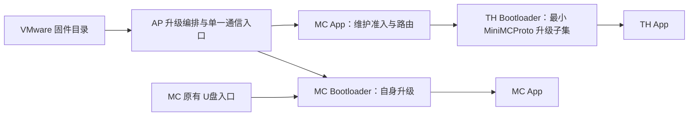

# VMware 文件与 MC U盘升级：多端统一规划讨论稿

| 修订 | 修订人 | 内容 | 状态 |
| --- | --- | --- | --- |
| 1 | AI (Codex)，项目助理 | 汇总用户讨论结论、代码观察及完整方案的交付要求 | 讨论输入；等待 COORD 实际委派专业角色形成完整方案 |
| 2 | AI (Codex)，项目助理 | 增加操作说明书交付；后续测试/HIL 的常规 App 部署统一走升级流程，禁止以 probe-rs 烧录替代 | 讨论输入；待专业角色完整规划 |

本文件是助理整理的方案输入，不能替代 ARCH 和相关端 Owner 的实际技术交付，也不是实现批准。配套 [COORD 收件 prompt](../work_intake/submissions/20261105_minimc_v2_upgrade_coord_planning_prompt.md)。

配套 [升级操作与 HIL 部署说明书草案](../guides/minimc_v2_mcu_upgrade_and_hil_deployment_manual_20261105.md)也是规划输入。由 INTEGRATOR 主责、各端 Owner 补齐实际步骤，随功能交付形成可执行说明书；草案不代表升级工具已经存在。

## 1. 用户已经明确的边界

1. 当前阶段通过 VMware 指定目录中的文件，升级真实 MC、TH App；不以文件复制、模拟器或探针刷写替代最终 MiniMCProto 升级功能。
2. 所有升级串口通信统一使用 **MiniMCProto v2.0**，以当前权威规范 Rev 2.0.3 为输入；TH Bootloader 原 `5A A5` 私有 IAP 不作为新方案的数据通道，不增加协议转换层或私有裸流旁路。
3. **保留 MC 原有 U盘升级能力**。USB Host、文件识别、镜像准入、写入、生效及防重复处理形成完整回归范围，不能只保留驱动。
4. **MC Bootloader 不承担 TH 路由**。TH 升级路径为 AP → MC App → TH Bootloader；MC App 不可用时，先恢复 MC，再处理 TH。
5. **TH Bootloader 最大 16KB（16,384 字节）**，只实现 MiniMCProto 的最小升级子集，不引入完整业务协议栈。
6. **TH 净 App 上限沿用既定 236KB（241,664 字节）**。Boot 分区、App 基址和锚点位置不重新设计；遗留 240KB 参数按既定边界对齐。
7. 本阶段只做多端统一方案。必须先实际调用对应角色、形成完整方案并由用户确认，之后才能进行实现任务拆分、依赖登记和开发派发。
8. **后续测试及 HIL 台架搭建中的常规 MC/TH App 固件部署，统一通过本升级流程，不再使用 probe-rs 烧录，也不能换成其他探针写入工具规避。** 升级能力尚未具备时，相关部署步骤保持阻塞，其他不依赖它的准备可继续；不以临时探针写入宣称升级链路已贯通。

这些已明确事项不重复作为选择题提问。进入升级、命令载荷等可以在统一契约评审中调整，但帧格式仍为 MiniMCProto v2.0，不能各端自行定义。

## 2. 当前输入与只读观察

主规范：[MiniMCProto v2.0 / Rev 2.0.3](../specs/ap_mc_formal_protocol_v2_0_multidevice_routing_draft_20261015.md)，文档编号 `SPEC-PROTO-20261015-153000`，本轮 SHA256 `9f8d4f9607cb3e76cc30b9ee2f971b23c3e0d936611188466a71f4aa15f3ce54`。

| 仓库 | 本轮观察的提交 | 说明 |
| --- | --- | --- |
| project-control | `5686e1931123650bb2251045353c18c8baa00f65` | 规则、协议及历史升级记录的观察基线 |
| soc-ap | `79932746d225bb115010c5545ef3f7499482e137` | AP/FWD；工作树存在其他任务修改，HEAD 不代表所有现场文件或部署身份 |
| mcu-p3 | `891a8bb252814c83992a49b01fbe11ba83b92a1f` | MC/TH App；工作树存在其他任务修改，规划时重新核对 |
| boot/bootloadermc | `4fc171ea61912561949b9a0cfc1da8975e4c39ba` | `soc_debug`；本次 Boot 代码依据 |
| boot/bootloaderth | `769fccbe52464ad7ceb856c5e89cb0d25abbbf87` | `soc_debug`；本次 Boot 代码依据 |
| test_harness | `d14ed04321c6d4f5ddb35a8801604a8af53b5b60` | 后续验证工具能力由 QA 核实 |

以上不是本轮已冻结的发布组合，也没有确认片上 Bootloader 与仓库源码相同。角色接单须重新读取目标仓入口、相关规则及准确版本，登记实际来源和差异。

| 已观察到的代码事实 | 统一方案需要回答什么 |
| --- | --- |
| [MC Boot 主循环](../../../boot/bootloadermc/bootloader/src/main.c)运行 USB Host；[U盘写入路径](../../../boot/bootloadermc/bootloader/src/usbh_user.c)完成镜像识别、写入和改名 | 如何保留该入口并增加 MC 自身的 MiniMCProto 串口升级，共用必要校验和写入逻辑 |
| [TH Boot IAP](../../../boot/bootloaderth/inc/iap.h)使用 `5A A5`、私有命令和累加和；[实现](../../../boot/bootloaderth/src/iap.c)已有首块缓存、整体验证和锚点提交 | 如何替换通信层并保留可复用的 Flash/恢复逻辑，不能声称修改命令号就已完成统一 |
| [MC 协议上限](../../../mcu-p3/motion-controller-mcu/project/inc/minimc_proto.h)当前载荷只有 64B；主规范 OTA_DATA 还有 8B 头部 | 必须统一帧容量、分块长度、缓冲区、DMA 和最坏栈占用；现状不能直接发送规范中的 64B 以上数据块 |
| MC [TH 升级管理器](../../../mcu-p3/motion-controller-mcu/project/marlin/marlin_module/th_upgrade_mgr.c)面向 U盘和旧 IAP，具有开机五秒后停止轮询的策略；[UART 实现](../../../mcu-p3/motion-controller-mcu/project/src/wk_usart.c)已有升级独占接口 | 用户主动文件升级如何进入维护；现有轮询、App 协议解析、旧 IAP 接收及业务转发的所有权如何切换 |
| [TH App](../../../mcu-p3/color-engine-mcu/io_toggle/src/app/mycontrol.c)已有 M997 安全停机和软复位动作 | 通过 MiniMCProto 受控触发并核对 Boot 就绪；不能恢复裸 ASCII 混流 |
| [TH Boot](../../../boot/bootloaderth/inc/flash.h)限制 236KB，但 [MC 准入常量](../../../mcu-p3/motion-controller-mcu/project/inc/th_upgrade_mgr.h)、[TH 打包](../../../boot/bootloaderth/tools/pack_firmware.py)及 [App 链接脚本](../../../mcu-p3/color-engine-mcu/io_toggle/libraries/cmsis/cm4/device_support/startup/gcc/linker/AT32F423xC_FLASH.ld)仍含 240KB | 对齐既定 236KB，不重新讨论容量或扩大分区 |
| Trailer 含 SHA256 及预留签名字段，现有 Boot 校验实际范围不同 | 明确各端校验职责；魔数、CRC、哈希和密码学签名不能混称 |

旧 [2026-10-31 升级方案](../analysis/mcu_firmware_upgrade_design_20261031.md)及 [U-D05 决定](product/first_release_scope_decision_20261029.md)保留为历史输入。其 MC 探针执行器和 TH 私有 IAP 路线不作为新方案的最终通道；冲突及迁移关系由完整方案明确，不能继续套用旧接受结论。

## 3. 建议的系统职责

AP 与 MC Boot 的直接升级链路发生在 MC 进入 Boot 后，与运行态共用物理链路并按维护状态交接。图中不包含 MC Boot 到 TH 的路由。

| 部件/角色 | 完整方案所需的专业输入 |
| --- | --- |
| ARCH，牵头 | 统一架构、协议及分区/镜像契约、模式切换、恢复与跨端一致性；整合各端实际输入 |
| ENG-FWD | AP↔MC、MC↔TH 可靠传输与普通路由规则；统一帧容量、序列号、ACK、超时/重试和模式交接 |
| ENG-MC | MC App 安全进入维护、TH 路由、现有 U盘/串口升级管理器整合，以及 MC 自身进入 Boot 的方式 |
| ENG-TH | TH App 受控停机、进入 Boot、重启后的身份与业务恢复；最小必要 App 改动 |
| ENG_BOOT_MC | 保留 MC U盘功能、增加本机串口升级、Flash/启动保护及恢复；不承担 TH 路由 |
| ENG_BOOT_TH | 替换旧 IAP 通信层，实现最小升级子集，保留必要校验/恢复；提交 16KB 体积预算 |
| INTEGRATOR | 文件投放/封存、统一打包、版本组合、工具链、部署迁移和救援执行流程 |
| ENG-STATE | 运行/维护状态、入口联锁、占用及状态传播；可与 AP 接入角色协作提供短输入 |
| QA 规划角色 | 正常、负例、恢复及 U盘回归的验收设计、工具能力及证据范围；本阶段不执行测试 |

用户界面/HTTP 入口有实际设计需要时再纳入 ENG-UI/ENG-NET；产品歧义有实际缺口时交 PM。不要为已明确的边界再组织一轮泛化需求调查。

MC App 现有从 U盘向 TH 升级的调用也须盘点兼容影响，不能只更新 Boot 协议后遗漏旧调用；具体保留和复用方式在完整方案中说明。此项不增加 MC Boot 的 TH 路由职责。

INTEGRATOR 同时主责升级操作说明书，由 ENG-FWD、MC/TH App 与 Boot Owner 核实各自操作及恢复条件，QA 核对说明书是否足以让非实现者独立完成一次受控升级和台架部署。

## 4. 需要统一冻结的技术契约

### 4.1 统一帧与最小命令集

- 所有串口请求/响应按主规范的帧头、SRC/DST、Flags、CMD、Hop/Route、16 位序列号、长度及 CRC16 处理；MC 普通路由不解析 TH 升级业务载荷，不做私有帧转换。
- 优先复用 OTA_START `0x20`、OTA_DATA `0x21`、OTA_FINISH `0x22`、OTA_STATUS `0x23`，以及必要的 ACK/NACK。TH Boot 不引入路由、温控、运动、G-code 或作业处理。
- 节点/Boot 身份、维护握手和能力识别采用最少必要支持，由 ARCH 与 Boot Owner 在体积预算内冻结；不能因统一帧而链接完整 App 协议模块。
- 节点通过目标地址区分，MC 为 `0x02`、TH 为 `0x03`。App 正常版本查询的 `0x01` 是请求、`0x02` 是报告，不分别代表 MC 和 TH。
- 完整列出四类 OTA 的字节载荷、端序、净荷/整包长度、校验覆盖、状态/错误、重传及响应关联。进入维护、取消和复位若需新增语义，先改统一契约，不由各端代码各定一版。
- 正常传输、入队/缓存、Flash 写入、整体验证、启动新 App 的确认语义分别定义。特别是首块延迟提交时，缓存 ACK 不能冒充已写入 Flash，状态计数也不能混用。

### 4.2 镜像、分区与校验

- 以现有打包资产和 128B Trailer 为输入，统一 Board ID、实际净代码长度、版本、哈希及 CRC 的解释；区分镜像文件、Trailer、传输块、末块填充和真正写入 App 的字节。
- MC App 基址保持 `0x08020000`；TH App 基址保持 `0x08004000`，净 App 最大 236KB，TH 锚点保持 `0x0803F800`。其他既定保留范围由 Owner 核实登记，不挤占或扩展。
- 当前业务升级只覆盖 App。主规范含其他目标组件枚举，不意味着本轮开放运行期 Bootloader 自升级。
- 擦除前完成必要准入。现有 OTA_START 的 16B 元数据与完整 Trailer 如何对应，由 ARCH 冻结，不能未校验目标/长度就擦除。
- 明确包端、AP、Boot 分别完成的 CRC/SHA 校验及回读范围，签名字段是否实际启用如实说明，不将预留字段称为已验签。

### 4.3 TH Boot 的 16KB 硬边界

TH Boot 链接区固定 16KB，统计向量表、代码、只读数据以及有 Flash 装载映像的数据段；同时报告 BIN/ELF/map 的体积和 RAM/栈预算。构建应在超限时失败，不能只凭文件名或单一 section 判断。

精简旧解析器、长日志、通用格式化和未引用模块，按需编译共享的小型协议函数。新链路不同时维护 `5A A5` 和完整 MiniMC 业务栈。必要的长度/地址检查、CRC、写入校验和恢复逻辑不能为压体积删除；体积预算在完整方案中先给出，实际结果待后续构建验证。

### 4.4 维护模式、互斥与恢复

建议主流程：发现文件 → 封存/校验并展示 → 用户确认 → 安全与资源检查 → 受控进入维护/Boot → 握手 → 分块传输 → 整体验证 → 启动 App → 身份与业务恢复核对。

文件发现不等于开始刷写。防止复制未结束或同名替换改变已确认输入。AP 共用既有通信服务，MC/TH 端明确唯一接收/发送所有者；运行采样、作业和新旧升级轮询不能并发消费同一串口。

安全前提使用真实新鲜状态，运动停止、加热输出关闭等沿用现行约束；未知或失效测量不能当安全值。维护模式对上层明确可见，不把升级期间的正常重启显示为业务健康通过。

双节点串行升级，顺序按兼容矩阵确定，通常先 TH 后 MC；MC App 不可用时先恢复 MC。定义超时、丢 ACK、重复块、乱序、断连、复位、掉电和重新开始的处理。只有已有实现及持久化证据支持时才承诺断点续传或自动回滚；部分成功须报告真实版本组合。

## 5. 完整方案的必需交付

ARCH 汇总一份版本化主方案，建议路径 `project-control/docs/architecture/minimc_v2_unified_mcu_upgrade_architecture_20261105.md`，同一事项原地修订并保留修订记录，不为每次讨论新建主方案。

主方案至少包括：

1. 用户已定边界、各端真实能力及旧方案冲突的处理，不把源码存在写成现场已部署。
2. 所涉及角色的实际会话、准确输入、专业意见与未决项；可用简短附录和引用，不要求每个角色重复整份规范。
3. 跨系统架构、链路/模式所有权、正常与恢复时序及兼容矩阵。
4. 唯一的协议和镜像契约、Flash/链接边界、TH Boot 体积预算、初始 Boot 迁移与恢复方法。
5. 各模块影响范围、最小修改预算、风险及粗略工作量；本阶段不提前生成实现卡、实现 depends_on 或派发工程修改。
6. 软件/真实 HIL 分层验收、原 MC U盘回归和原始证据要求，说明现有工具可复用与缺失部分。
7. 实质未决选择及推荐理由；不重复询问 MiniMCProto v2.0、16KB、236KB、不做 MC Boot 路由等已定事项。
8. 可执行说明书的完成计划、责任人、具体入口及发布验证方式，明确测试/HIL 如何消费同一升级流程。实际操作说明在功能实现后补齐并验证，不能用当前草案冒充已可操作。

## 6. COORD 的阶段准入

| 阶段 | 可以做什么 | 下一阶段条件 |
| --- | --- | --- |
| 规划收件 | 查重、关联现有需求/冻结任务；登记最小只读规划委派及接单回执 | 对应角色实际接单，输入与输出边界明确 |
| 专业规划 | 各端只读核查；在 project-control 的规划材料内交付专业输入；ARCH 汇总完整方案 | 角色产物已收件，方案内容齐备，实质缺口如实列明 |
| 用户审阅 | COORD 提交准确 revision/哈希的完整方案与简短摘要 | 用户确认该准确方案及范围；未决项阻断相应部分 |
| 技术拆分与排程 | ARCH 基于已确认方案交付技术任务拆分、依赖、接口、源码基线和允许路径；COORD 据此登记正式卡和资源 | 输入、所用 QA 策略及授权就绪后，才进入实现 |
| 后续实现/验收 | 对应工程角色实施，按实际范围独立验证和收件 | 沿用既有规则，不在本讨论稿中预填执行或接受结果 |

**禁止跳步：** 助理稿、COORD 主会话分析、角色名称或计划别名都不能替代实际专业交付。完整方案尚未形成且未经用户确认时，不先拆实现任务“占位”，不先改代码、编译、部署、烧录、复位或操作串口。

此约束不禁止必要的只读规划委派和接单记录，也不阻断无关的已授权任务。COORD 只组织、收件和升级缺口，不主会话代做 ARCH 或工程实现。

## 7. 与历史任务、权限及验证的衔接

TWIN-26～28 的历史交付、签署和人为冻结保持原样；先查重识别可复用部分及旧协议限制。讨论新方案不自动解除冻结，不把旧私有 IAP/探针路径的软件接受套成新协议验收。

新版 Boot 的首次安装与后续 App 升级分开设计：具体 Boot 镜像、分区、校验、操作及恢复须在后续专项授权内落实；本阶段不触发任何烧录。两个 Boot 仓继续使用 `soc_debug`，MC/TH App 使用实际指定的 `mcu-p3` 分支。

首次 Boot 迁移或升级入口失效后的特殊救援，如确需探针写入，必须另行说明并提交用户决定；不在常规测试/HIL 部署中默认设置例外。此约束针对固件写入，不自行扩大成停用所有调试能力，其他诊断或注入操作仍遵守其原有授权。

沿用 `streamlined-v1` 和现有独立 QA。QA 用例/预期/工具仍按既有非作者检查要求处理，不默认增加每份 QA 报告的二次复核；静态体积和软件通过不外推为真实升级成功。

最终应有真实 MiniMCProto 请求/响应、相关 Debug、制品与部署身份、Flash 校验范围，以及新 App 启动和业务恢复的同一轮证据。Boot 日志可以精简为必要事件和错误码，不强制复制 App 的全量日志格式。U盘路径单独回归，不能只验串口升级。

功能交付时由非实现者按正式说明书实际完成受控部署验证，并保留记录。后续 HIL 执行输入必须包含本轮升级记录及准确制品身份；未完成升级或说明书操作步骤缺失时，不进入依赖该部署的测试，不把旧 SWD 烧录日志改名充当新升级证据。无需因此重复每份报告的审阅或无关整机测试。

根仓合并继续保持此前约定的只准备状态，本专项不切换仓库边界、不重启调度器，也不抢占现有唯一 VMware/台架。
