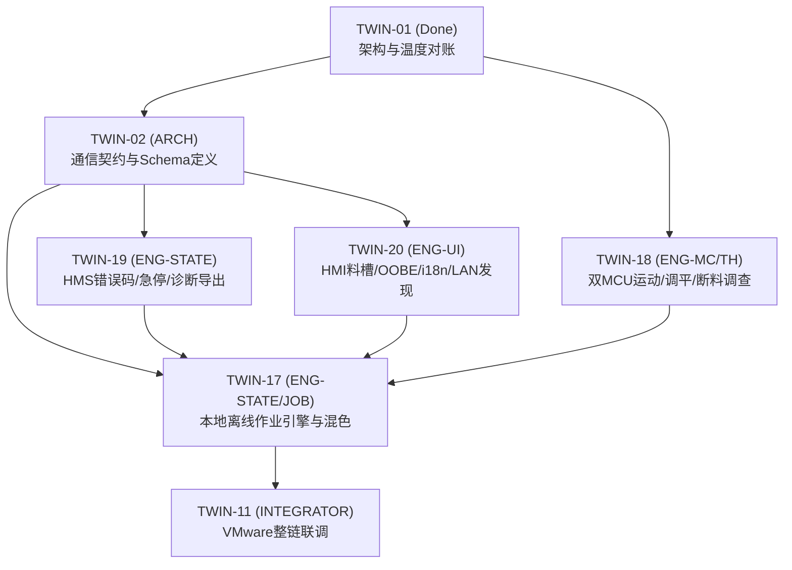

# 首版本地打印闭环与七项子范围需求分解及任务卡规范

## 1. 背景与目标基线

根据用户明确指令及权威决定（`U-D01` 与 `U-D02`）：
1. **整机首版目标**：先开发一台**本地可以正常打印的打印机**，在 VMware 阶段按 1:1 真实微服务架构（真实进程、生命周期管理、Fast DDS / D-Bus / HTTP-SSE 标准三总线通信及连接真实后台的浏览器 HMI）运行并直连物理双 MCU，后续平移至目标 SoC 平台并实板复验；
2. **产品功能分期**：严格遵循 [整机首版范围决定表](first_release_scope_decision_20261029.md) 的 PM 建议分期与决策；
3. **首版纳入范围**：
   - **5 项首版必做**：混色基础（`PM:FEAT-COL-001`）、料槽对应显示与确认（`PM:FEAT-HMI-003`）、硬件双级安全急停（`PM:FEAT-SAF-001`）、全机 HMS 统一错误码（`PM:FEAT-SAF-002`）、脱敏诊断导出（`PM:FEAT-MFG-003`）；
   - **7 项已确认首版子范围 (`U-D01`)**：断料提示与暂停（`COL-007`）、位置与状态读取（`MOT-001`）、调平调查与界面（`MOT-002`）、基础新机检查 OOBE（`HMI-004`）、寿命数据与维护提醒（`SAF-005`）、浏览器语言与主题（`HMI-005`）、极速局域网自发现与直连（`NET-001`）；
   - **其余未决功能**：未明确的完整功能（如 7×7 免调平传感器选型、CoreXY 500mm/s 极限速度、全系统 A/B OTA 等）继续保持“待决定/后续”，不擅自扩大首版范围。
4. **角色协同**：MC 固件工程师（`ENG-MC`）与 TH 工具头工程师（`ENG-TH`）必须实质参与能力、通信接口及验收条件对账。

---

## 2. 详细可验收需求与接口定义

### 2.1 首版必做 5 大能力详细需求

#### 1. `PM:FEAT-COL-001` 主动多通道混色挤出 (首版子范围)
- **需求描述**：支持单一标准材料组合（如 PLA）及可重复样件的双通道色彩比例配置；作业引擎支持流式解析 G-code 换色/混色指令，将混色权重转换为对应的进料比例；
- **接口定义**：MiniMCProto 扩展混色权重控制命令（或利用 SCM 混色宏），定义 `color_ratio_t { uint16_t channel_a_permille; uint16_t channel_b_permille; }`；
- **验收标准**：
  - 正例：解析包含混色比的样例 G-code，下发混色比例正确，状态机稳定流转；
  - 负例：非法通道比例（总和 $\neq 1000$‰）立即报错拒绝，急停状态下立即关断挤出。

#### 2. `PM:FEAT-HMI-003` 可视化多色调色板与料槽映射 (首版子范围)
- **需求描述**：浏览器 HMI 提供料槽材料与颜色配置界面，用户可确认各物理料槽安装的耗材类型及色值，并同步至 AP 状态机 `device-manager`；
- **接口定义**：REST API `GET /api/v1/filament/slots` 与 `POST /api/v1/filament/slots`；
- **验收标准**：
  - 正例：前端修改料槽映射后，后端快照持久化并向前端广播更新；
  - 负例：配置冲突或未支持耗材型号时返回具体原因，不破坏既有槽位数据。

#### 3. `PM:FEAT-SAF-001` 硬件双级安全急停机制 (首版子范围)
- **需求描述**：区分软件级急停（M112、API 软件中断）与物理硬件级急停（开漏急停专线、硬件温控比较器保护回路）。当触发急停时，AP 立即终止发送移动/挤出指令，丢弃所有在途排队指令，向各服务广播 `EMERGENCY_STOP` 状态；
- **接口定义**：D-Bus `org.aisoc.DeviceManager.TriggerEmergencyStop(in string reason)`，MiniMCProto `CMD_EMERGENCY_STOP (0x10)`；
- **验收标准**：
  - 正例：触发急停后，系统在 $\le 50\text{ ms}$ 内切断所有加热/运动指令，HMI 界面弹出红色不可忽视告警；
  - 负例：处于急停状态期间，拒绝接收任何常规开始/恢复指令，必须由人工显式复位。

#### 4. `PM:FEAT-SAF-002` 全机健康监控系统 (HMS 统一错误码，首版子范围)
- **需求描述**：统一定义涵盖串口物理链路、双端传感器（开路/短路/超时）、驱动故障及作业异常的标准十六进制 HMS 错误码；
- **接口定义**：
  - `0x1001`：串口断开 / 找不到设备；
  - `0x1002`：通信连续超时超过阈值；
  - `0x2001`：热床热敏电阻开路；`0x2002`：热床热敏电阻短路；
  - `0x2003`：喷头热敏电阻开路；`0x2004`：喷头热敏电阻短路；
  - `0x3001`：工具头断料触发；
  - `0x4001`：G-code 语法错误；
- **验收标准**：
  - 正例：故障注入时（如拔掉串口或传感器断路），STATE 准确生成并广播对应 HMS 码，HMI 显示排查指引；
  - 负例：故障未解除前禁止清除错误状态。

#### 5. `PM:FEAT-MFG-003` 隐私合规与诊断数据一键脱敏导出 (首版子范围)
- **需求描述**：提供本地一键诊断导出工具 `export_diag_pack`，收集 systemd 核心服务日志、最近通讯 Hex 记录、系统基础信息，自动脱敏清除敏感网络凭据、用户名及私钥后打包为 tar.gz；
- **接口定义**：CLI 工具 `python3 tools/export_diag_pack.py --output /path/to/pack.tar.gz`；
- **验收标准**：
  - 正例：导出压缩包包含完整排查日志与错误上下文；
  - 负例：包内严禁包含明文密码、私钥或敏感系统凭据。

---

### 2.2 七项确认首版子范围 (`U-D01`) 详细需求

| 编号 | 功能子范围 | 责任角色 | 纯软件开发条件 | 实机台架验收条件 |
| :--- | :--- | :--- | :--- | :--- |
| `COL-007` | **断料提示与暂停** | `ENG-TH` (检测), `ENG-MC` (透传), `ENG-STATE` (状态仲裁), `ENG-UI` (提示) | 定义断料事件协议帧、状态机自动暂停挂起、UI 弹窗指引换料 | 真实工具头光电传感器物理触发、实机出料中断响应 |
| `MOT-001` | **位置与状态读取** | `ENG-MC` (上报), `ENG-FWD` (透传), `ENG-STATE` (维护), `ENG-UI` (呈现) | 调查 MC 现有坐标接口（`M114` 或二进制查询帧），AP 解析 X/Y/Z/E 坐标并展示 | 真实步进电机运动后位置坐标反馈核对 |
| `MOT-002` | **调平接口与状态界面**| `ENG-MC` (调平能力), `ENG-TH` (探针数据), `ARCH` (契约), `ENG-UI` (向导) | 调查固件调平命令与网格数据结构，设计调平步骤向导（回零→测点→网格预览）界面 | 真实探针触发与机械床面点位接触实测（待定） |
| `HMI-004` | **基础新机检查 OOBE** | `ENG-UI` (前端向导), `ENG-STATE` (版本/自检接口), `ENG-MC`/`ENG-TH` (版本来源) | 实现 OOBE 向导流，展示服务版本、通信链路及双端温度状态；未检项标“未检查” | 真实设备开机自动链路握手实测 |
| `SAF-005` | **寿命数据与维护提醒** | `ENG-STATE` (统计持久化), `ENG-UI` (提醒面板), `ENG-MC`/`ENG-TH` (计数来源) | 设计运行时长、作业次数结构体，保存在 SQLite/JSON，达到阈值触发 UI 保养提示 | 真实长周期打印时间累积与持久化验证 |
| `HMI-005` | **浏览器语言与主题** | `ENG-UI` (前端), `ENG-MC`/`ENG-TH` (错误码文案边界) | 前端 i18n 资源包（中/英），明亮/暗黑主题 CSS 切换，对齐 HMS 错误码多语言文案 | 浏览器多端渲染与高对比度界面测试 |
| `NET-001` | **极速局域网自发现** | `ENG-NET` (mDNS/Avahi 服务), `ENG-UI` (配对提示) | 在 AP 端集成 mDNS 组播服务广播，支持 `printer-aisoc.local` 直接访问与安全配对 | 真实局域网跨网段/跨设备访问与发现实测 |

---

## 3. MC / TH 工程师能力与协议对账规范

### 3.1 固件职责边界与对账要点
- **MC (AT32F435VGT7)**：
  - 核心职责：热床加热控制、多轴步进电机运动控制、调平算法与步进脉冲生成、TH 透明串口透传；
  - 对账要点：核实 `motion-controller-mcu` 源码中当前坐标查询指令（`0x16` 或 `M114` 扩展）、调平网格存储结构、热床保护硬件配置。
- **TH (AT32F423CCT7)**：
  - 核心职责：喷头挤出头加热控制、挤出机步进电机驱动、断料检测光电开关输入（IO Toggle）、探针信号采集；
  - 对账要点：核实 `color-engine-mcu/io_toggle` 中断料检测输入引脚与去抖逻辑、断料事件向上发送至 MC 的 MiniMCProto 帧格式。
- **软硬件边界隔离原则**：
  - 软件开发与调查不依赖物理硬件到位，可基于源码分析和协议对账先行落地；
  - 实机验收必须在硬件台架与测试环境齐备后单独进行。

---

## 4. 任务分解与已有卡复用设计

### 4.1 现有任务卡复用方案
- `TWIN-01`（Done）：服务拓扑、首切片边界、温度 C1~C6 基线；
- `TWIN-02`（Backlog，准备启动）：双环境通信契约与生成规则（扩展纳入 HMS 错误码、急停、料槽 schema 与位置查询定义）；
- `TWIN-03`~`TWIN-16`：保持原卡规划与职责范围，作为温度及基础微服务基线；
- `TASK-001`~`TASK-018`：作为领域宏观工作包，严格维护其 `child_tasks` 关联。

### 4.2 补充新增 4 张微任务卡规划

为精准闭环首版本地打印与七项子范围，补齐以下 4 张紧凑微任务卡：

1. **`TWIN-17`**：**本地离线作业引擎与基础混色执行规划**
   - 主责：`ENG-STATE`（协力 `JOB`），主工作包：`TASK-011`；
   - 覆盖：`PM:FEAT-COL-001`（混色首版子范围）、离线 G-code 流式解析与作业状态机。
2. **`TWIN-18`**：**双 MCU 运动/调平/断料状态接口调查与协议对账**
   - 主责：`ENG-MC`（协力 `ENG-TH`、`ARCH`），主工作包：`TASK-002`；
   - 覆盖：`PM:FEAT-MOT-001`（位置读取）、`PM:FEAT-MOT-002`（调平调查）、`PM:FEAT-COL-007`（断料事件调查）。
3. **`TWIN-19`**：**全机 HMS 错误码体系、双级急停联动与脱敏诊断导出**
   - 主责：`ENG-STATE`（协力 `ENG-FWD`、`INTEGRATOR`），主工作包：`TASK-008`；
   - 覆盖：`PM:FEAT-SAF-001`（双级急停）、`PM:FEAT-SAF-002`（HMS 统一错误码）、`PM:FEAT-SAF-005`（维护数据持久化）、`PM:FEAT-MFG-003`（脱敏诊断导出）。
4. **`TWIN-20`**：**HMI 料槽映射、新机检查引导、国际化与局域网发现**
   - 主责：`ENG-UI`（协力 `ENG-NET`、`ENG-STATE`），主工作包：`TASK-009`；
   - 覆盖：`PM:FEAT-HMI-003`（料槽调色板映射）、`PM:FEAT-HMI-004`（新机检查向导）、`PM:FEAT-HMI-005`（多语言与主题）、`PM:FEAT-NET-001`（局域网 mDNS 自发现）。

---

## 5. 门禁与验收合规规则

1. **函数规模硬性门禁**：新增自研函数必须严格执行 $\le 50$ 行、参数 $\le 4$ 个；
2. **内存与指针安全**：无动态堆内存分配（禁 `malloc`/`new`），指针解引用独立成行，公共函数 Guard Clause 校验；
3. **软硬件分账**：所有调查与软件任务均须标明适用环境（`isolated-host-or-document`），实机硬件测试留待后续专门联调任务；
4. **双重复核要求**：所有交付必须经过独立 Codex QA 审查及非作者 ARCH 复核，方可闭环收件。
