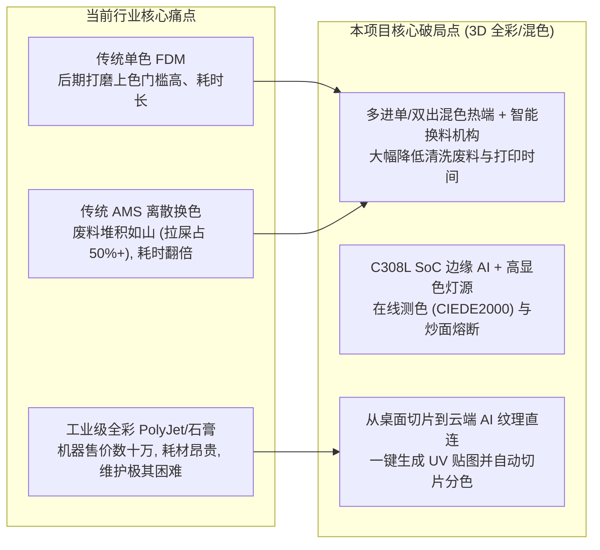
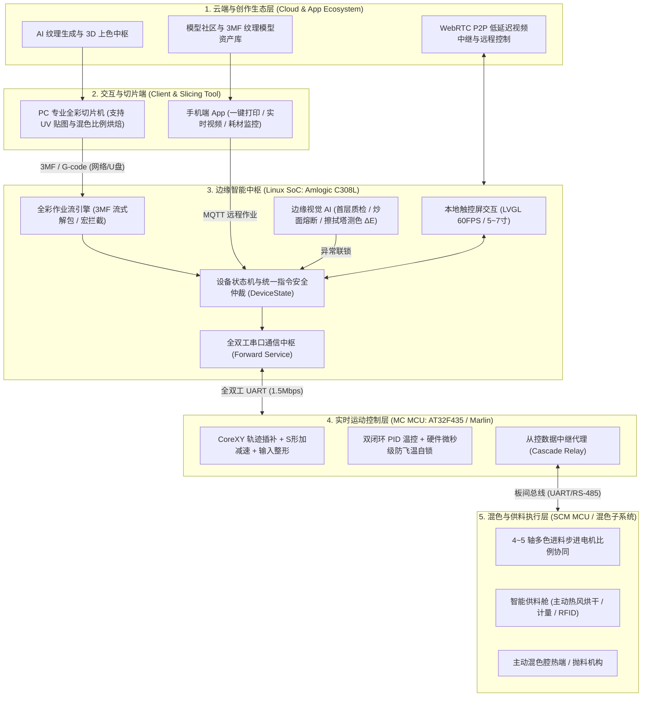
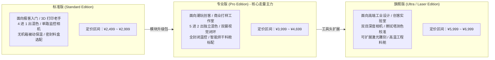
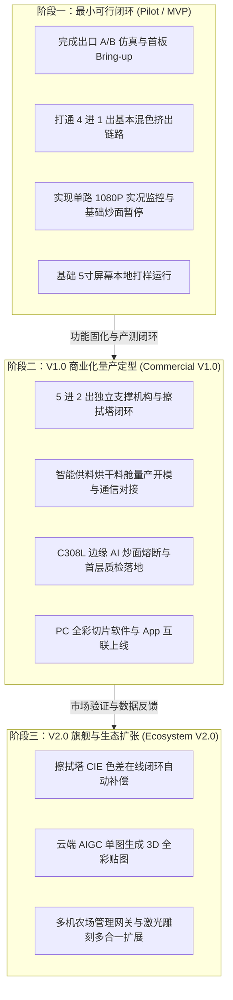

# 3D 全彩打印机全景产品功能目录清单（PM 视角）

> **文档性质**：人类输入基准（HUMAN Input Baseline）· 产品功能目录（Product Feature Catalog）  
> **编写视角**：产品经理（PM）视角，统筹用户价值、业务场景、竞品对标与软硬件工程可行性  
> **基准输入**：
> - 内部资产：[[AI_SoC_协作方案/product_feature_catalog_20261008_083854|全产品候选功能目录]] · [[打印机产品定义和技术架构定义-来源于飞书|飞书产品定义初稿]] · [[amlogic_BSP/3D全彩打印机_C308L系统方案与技术脉络_2026-09-16|C308L系统方案与技术脉络]] · [[3D打印机通信架构与协议全景深度解析_通信内容_拓扑选型与方案评审|通信架构全景解析]] · [[bambu_camera_ai_sensor_replacement_deep_dive_20261026_182313|拓竹摄像头与边缘AI替代昂贵物理传感器方案深度研究报告]]
> - 行业对标：拓竹 Bambu Lab（X1-Carbon / X2D / AMS）、Anycubic（Kobra 3 + ACE Pro）、创想三维（K2 Plus + CFS）、Prusa（XL 工具头切换 / MMU3）、Stratasys（J系列 PolyJet）与 XYZprinting（FDM+喷墨）

---

## 一、 产品愿景、用户画像与市场竞品格局

### 1.1 产品愿景与价值主张
* **产品核心定义**：打造**“免调平、免涂装、低废料、真全彩”**的新一代消费级/准专业级桌面 3D 全彩打印机。
* **核心价值主张（Value Proposition）**：
  1. **告别单调灰白与高门槛手涂**：让二次元手办、文创衍生品、彩色地形成型即全彩，所见即所得。
  2. **终结“换色 1 分钟，拉屎半小时”的废料噩梦**：通过主动多色混色与智能路径优化，将传统多色打印 50%~80% 的耗材浪费降低至 15% 以内。
  3. **边缘视觉 AI 护航，彻底杜绝“翻车与炸机”**：基于 SoC 端侧 NPU（1.0~2.0 TOPS）实时闭环检测，从首层粘结到颜色过渡全程可控。

---

### 1.2 核心用户画像与典型使用场景

| 目标客群 | 典型使用场景 | 核心诉求与痛点 | 杀手级功能特性 |
| :--- | :--- | :--- | :--- |
| **手办/潮玩创客与动漫爱好者** | 打印二次元动漫手办、个性化公仔、桌面盲盒 | 传统单色模型手工涂装要求高、易翻车；希望直接打印成型彩色成品。 | 连续混色与渐变过渡、高保真色差闭环（$\Delta E \le 3.0$）、精细层高（0.08~0.12mm）。 |
| **文创文旅与消费品设计机构** | 彩色建筑沙盘、地貌沙盘、文博文创礼品打样 | 打样交付周期紧；工业全彩外包成本高昂（单件数百上千元）。 | 3MF 纹理贴图直解、大打印尺寸（$256 \times 256 \times 260\text{ mm}$）、断电断料无感续打。 |
| **工业 CMF 设计师 (Color, Material, Finish)** | 消费电子外观手板、多材料软硬结合原型验证 | 需快速验证产品配色与软硬胶结合度（如 ABS + TPU 或工程料 + 可溶支撑）。 | 5 进 2 出独立通道、PVA 可溶支撑配合、工程料保温舱（50~70℃）。 |
| **中小学与高校创客教育** | 教学演示模型、生物解剖模型、分子结构展示 | 设备必须“开箱即用，傻瓜化操控”；安全性要求高，杜绝烫伤与有毒气体。 | 门磁感应保护、空气过滤（HEPA+活性炭）、全自动调平、一键云打印。 |

---

### 1.3 行业竞品全景对比矩阵

| 对比维度 | 拓竹 Bambu Lab X1-C + AMS | Anycubic Kobra 3 + ACE Pro | Prusa XL (多工具头) | 拓竹 X2D (对标下一代) | **本产品（C308L 架构全彩方案）** |
| :--- | :--- | :--- | :--- | :--- | :--- |
| **多色/全彩原理** | 离散耗材拉拔切换（4~16色） | 离散耗材拉拔切换（4~8色） | 物理独立工具头切换（1~5色） | 双喷头 + 多通道切换 | **主动混色腔（4进1出 / 5进2出）+ 离散通道组合** |
| **换色废料与速度** | 废料较多（擦拭塔+抛料）；速度中等 | 废料较多；换色速度中等 | **零擦拭废料**；换头速度极快 | 显著优化废料；极高速度 | **混色梯度过渡 + 抛料机构优化，废料降低 60%+** |
| **算力与上位机** | 双核 ARM + 2.0 TOPS NPU | 双核 Linux (无独立 NPU) | 32-bit STM32 (无 Linux/NPU) | 四核 ARM + 高算力 NPU | **C308L（双核 A35 + 1.0 TOPS ADLA NPU + C3-ISP）** |
| **视觉与色彩闭环** | 舱内 1080P + 微距激光雷达 | 舱内 720P/1080P 监控 | 无标配视觉摄像头 | 双路高速差分视觉系统 | **舱内 1080P MIPI 广角 + 喷头微距 USB 直通 + 擦拭塔测色** |
| **料舱附加价值** | 仅密封与 RFID 识别 | **主动热风循环双加热烘干** | 无密封烘干料舱 | 智能料仓与温湿管控 | **智能供料舱：主动热风烘干 + RFID + 4/5 槽位计量** |

---

## 二、 产品系统架构与数据流全景图

从产品经理视角，系统被解构为五大分层驱动的有机生命体：

---

## 三、 全景功能目录清单（Feature Catalog List）

以下按 **8 大核心业务领域** 展开详细功能清单，包含用户价值、验收标准、实现依赖与产品档位规划。

---

### 模块 1：全彩与耗材流系统 (COLOR & MATERIAL)

> **定位**：3D 全彩打印的核心壁垒，负责从多色原料输入到微米级熔融混色输出的全生命周期控制。

| 功能 ID | 功能名称 | 用户场景与核心价值 | 验收标准与关键指标 | 技术支撑与依赖 | 规划档位 |
| :--- | :--- | :--- | :--- | :--- | :--- |
| **FEAT-COL-001** | **主动多通道混色挤出** | 用户打印带连续色彩过渡（如渐变花瓶、皮肤色阶）的模型，无明显换色接缝。 | 支持 4 通道（标准）或 5 通道（Pro）按百分比（0.1% 精度）动态混合；混色均匀度无明显条纹斑块。 | SCM Marlin 混色算法（`M163`/`M164`）、多步进电机同步控制。 | 全部 |
| **FEAT-COL-002** | **智能擦拭塔与抛料优化** | 换色时清理喷嘴残余混合物，降低废料堆积。 | 综合废料量比传统 AMS 减少 $\ge 50\%$；提供“擦料塔”、“内部填充冲刷”、“抛料机构”三级策略。 | 硬件切刀机构、废料抛料滑道、切片端体积计算。 | 全部 |
| **FEAT-COL-003** | **CIE $L^*a^*b^*$ 在线测色校准** | 在擦拭塔区域定点校验打印实际颜色与切片目标颜色，解决色差与耗材批次偏差。 | 摄像头采集擦拭塔色块，测定 $\Delta E$；当 $\Delta E > 5.0$ 时自动微调挤出补偿或提示人工校准。 | C308L ISP 色彩管线、高显色 LED 灯源（$\text{CRI} \ge 95$）、比色算法。 | Pro / 旗舰 |
| **FEAT-COL-004** | **双喷头软硬/支撑材料隔离** | 打印复杂悬空手办，使用水溶性支撑（PVA），主模型与支撑完全物理隔离，表面无接触瑕疵。 | 喷头 A 负责 PLA/ABS，喷头 B 负责 PVA/TPU；双喷头切换无渗漏、无碰撞，重复定位精度 $\le 0.02\text{ mm}$。 | Pro 版 5 进 2 出独立/协作机械结构。 | Pro / 旗舰 |
| **FEAT-COL-005** | **智能供料密封烘干舱** | 长时间打印吸湿性材料（PA、PVA、PETG），避免拉丝、气泡与堵头。 | 4 仓位独立密封；内置 PTC 主动热风对流加热，温度可达 50~65℃；实时显示舱内相对湿度（RH%）。 | 智能供料箱单片机、温湿度传感器、PTC 加热模块。 | Pro 标配 / 标准选配 |
| **FEAT-COL-006** | **RFID 耗材智能识别** | 放入官方线盘后，无需手动设置耗材类型、颜色与温度参数，自动匹配最佳打印配置。 | 耗材装入后 $\le 2\text{ 秒}$ 识别材料种类（PLA/PETG/ABS）、出厂颜色代码（HEX）、剩余克重。 | 13.56MHz RFID 天线读写模块、线盘内置加密芯片。 | 全部 |
| **FEAT-COL-007** | **断料检测与槽位无感续接** | 某一盘耗材耗尽时，无需暂停等待人工，自动切换同规格备用料槽继续打印。 | 检测到线头脱离供料轮后，自动回抽余料并从备用槽位自动送丝续打，断料接缝强度合格。 | 供料舱光电对射开关、切刀传感器、状态仲裁引擎。 | 全部 |
| **FEAT-COL-008** | **防缠料与供料阻力自检** | 监测线盘打结、阻力过大，提前介入，防止电机丢步导致模型拉断。 | 送丝步进电机电流/霍尔张力检测，阻力突增超过阈值自动刹车并向 App 告警。 | 耗材缓冲器张力传感器、电机失步监测。 | Pro / 旗舰 |

---

### 模块 2：运动控制与成型底座 (MOTION & EXTRUSION)

> **定位**：高速、高精度打印物理平台，确保在高速运动下色彩不错位、机械不振动。

| 功能 ID | 功能名称 | 用户场景与核心价值 | 验收标准与关键指标 | 技术支撑与依赖 | 规划档位 |
| :--- | :--- | :--- | :--- | :--- | :--- |
| **FEAT-MOT-001** | **CoreXY 高速运动机构** | 满足日常极速打样需求，缩短打印时间 60% 以上。 | 最大加速度 $\ge 20000\text{ mm/s}^2$；最大打印速度 $\ge 500\text{ mm/s}$；成型尺寸 $256 \times 256 \times 260\text{ mm}$。 | 全铝合金压铸骨架、双轴金属导轨、三丝轴两光轴 Z 轴。 | 全部 |
| **FEAT-MOT-002** | **全自动免调平 (Auto-Bed Leveling)** | 彻底免除手动旋转旋钮调平与卡纸摩擦操作，真正实现“拆箱即印”。 | 双重复合探测：高频电涡流位移传感器非接触式全床网格扫描（1~2mm 高度高速扫场）+ 喷嘴压敏接触探针绝对零点标定；网格点阵 $\ge 7 \times 7$，首层贴合平整度标准差 $\le 0.03\text{ mm}$；100% 兼容黑色纹理 PEI 等任意底板材质。 | 左右高频电涡流位移传感器、喷嘴压电/压敏应变片、MCU 快速网格插补算法；详见 [[bambu_camera_ai_sensor_replacement_deep_dive_20261026_182313]]。 | 全部 |
| **FEAT-MOT-003** | **主动共振补偿与输入整形** | 消除高速打印在转角处产生的“鬼影”（Ghosting）与振纹。 | 自动测量 XY 轴固有共振频率（20~120Hz），在线生成补偿滤波器，振纹幅度抑制 $\ge 85\%$。 | ADXL345 加速度计高频采样、MCU 固件 Input Shaping 算法。 | 全部 |
| **FEAT-MOT-004** | **主动流速动态补偿与压力提前 (AFRC & PA)** | 消除不同材料粘度与加减速拐角堆料、拉丝，实现免激光雷达的全自动闭环出胶。 | 挤出加减速动态响应时间 $< 5\text{ ms}$；转角边缘垂直度偏差 $\le 0.05\text{ mm}$；支持免测试线打印的实时熔融背压自适应流速补偿。 | 工具头高频电涡流位移传感器（实时采集喷嘴微米形变背压）+ Marlin 线性推进（Linear Advance）；详见 [[bambu_camera_ai_sensor_replacement_deep_dive_20261026_182313]]。 | 全部 |
| **FEAT-MOT-005** | **全封闭温控与空气净化系统** | 打印高温工程材料（ABS/PC/PA）防止模型翘边开裂；保障室内空气健康。 | 舱温被动保温达 50~60℃；内置内循环 + 外排风三层复合滤网（HEPA H13 + 活性炭），TVOC/颗粒物去除率 $\ge 95\%$。 | 封闭式机箱结构、排风风道、VOC 空气质量监测。 | 全部 |
| **FEAT-MOT-006** | **无感碰撞回零电流检测 (Sensorless Homing)** | 取消机械行程限位开关微动触点，简化机身线束并消除触点机械磨损氧化故障。 | 工具头轻碰 CoreXY 机架硬限位瞬间，驱动芯片高频采样相电流突增与反电动势（Back-EMF）跳变，寻零重复定位精度 $\le 0.05\text{ mm}$。 | TMC / AT8236 低内阻步进电机驱动、StallGuard 硬件电流检测比较器；详见 [[Draft-拓竹X2D的31个传感器分析]]。 | 全部 |

---

### 模块 3：智能视觉与边缘 AI 质检 (VISION & EDGE-AI)

> **定位**：利用 C308L 片上专用 NPU 与专业 ISP，打造 7×24 小时无人值守的安全与品质护城河。

| 功能 ID | 功能名称 | 用户场景与核心价值 | 验收标准与关键指标 | 技术支撑与依赖 | 规划档位 |
| :--- | :--- | :--- | :--- | :--- | :--- |
| **FEAT-VIS-001** | **机箱全景实时监控推流** | 用户无论在办公室还是通勤路上，随时查看打印机内部高清动态。 | 1080P @ 30fps，低延迟 WebRTC 直连（局域网延迟 $< 200\text{ms}$，公网 $< 600\text{ms}$）；暗光自动启动高显色补光。 | 2-Lane MIPI-CSI 广角相机、C308L H.264 硬件编码。 | 全部 |
| **FEAT-VIS-002** | **首层质量全盘扫描** | 在第一层成型后全面检查是否有脱盘、起泡、划伤，防止底盘不牢白费数小时。 | 首层打印完毕后，工具头自动移开，全景扫描分析；缺陷检出率 $\ge 90\%$，异常时自动暂停并推送高清照片。 | NPU 首层边缘分割模型、C3-ISP 硬件畸变矫正。 | 全部 |
| **FEAT-VIS-003** | **毫秒级“炒面 / 乱丝”AI 熔断** | 模型脱盘导致喷头乱吐丝时，及时刹车止损，防止刮坏热端或裹头爆头。 | NPU 持续抽帧（1~2 FPS）；连续 3 帧判定为炒面且置信度 $\ge 85\%$ 时，200ms 内触发软硬件急停。 | INT8 轻量化 YOLO 缺陷检测模型、`HARD_ESTOP` GPIO 联锁。 | 全部 |
| **FEAT-VIS-004** | **双喷嘴亚像素视觉标定与微距监控 (Nozzle Offset)** | 针对 Q-Pro 5 进 2 出双喷嘴，彻底免除人工肉眼塞尺对刀，全自动精确对齐左右喷嘴物理装配公差。 | 微距相机拍摄正交测试标线，Zernike 矩算法亚像素边缘解算；物理相对偏差提取精度达 $0.05\sim 0.1$ 像素（对应物理尺寸 $\le 0.01\text{ mm}$）；自动回写下位机 M218 运动学寄存器；同时支持喷嘴结焦与挂料监控。 | 工具头微距摄像头（OV5640/OS04E10）、C308L/RV1126 亚像素机器视觉算法；详见 [[bambu_camera_ai_sensor_replacement_deep_dive_20261026_182313]]。 | Pro / 旗舰 |
| **FEAT-VIS-005** | **高保真专业延时摄影** | 自动记录模型“神奇生长”的全过程，便于在社交媒体分享。 | 每一层换层时工具头自动归位（Parked），在受控照明下定格抓拍；打印完成后本地自动合成 1080P MP4 视频。 | Linux 媒体合成管道、层间触发时序调度。 | 全部 |
| **FEAT-VIS-006** | **底板 ArUco 视觉标记识别与异物防撞** | 用户放错打印板类型或热床上遗留铲刀/残留零件时，自动阻断启动，保护热端与喷嘴。 | 弹簧钢板前唇丝印黑白 ArUco / AprilTag 标记（0 硬件成本），摄像头识别率 $\ge 99.5\%$；自动校验底板材质是否与切片匹配、底板是否贴偏或反装；识别热床高度 $> 2\text{mm}$ 残留异物并拦截。 | 机箱广角 / 工具头相机、ArUco 机器视觉解码库、设备状态机阻断；详见 [[bambu_camera_ai_sensor_replacement_deep_dive_20261026_182313]]。 | 全部 |
| **FEAT-VIS-007** | **2 分钟融料裹头（Blob）防灾熔断** | 彻底防范热端轻微漏料导致融化塑料反卷包裹加热块（裹头），杜绝整套工具头线束报废与火灾。 | 摄像头监视喷嘴与加热块局部 ROI 轮廓面积膨胀；滑动时序窗口连续确诊（2 分钟内持续膨胀超阈值），毫秒级触发 `HARD_ESTOP` GPIO 物理切断加热，并强制 Z 轴下移脱离危险源。 | 轻量化目标形态检测模型、GPIO 硬件急停联锁、异常状态机；详见 [[bambu_camera_ai_sensor_replacement_deep_dive_20261026_182313]]。 | 全部 |

---

### 模块 4：人机交互与本地工作台 (HMI & WORKSTATION)

> **定位**：开箱即用的第一触点，让复杂的多色工程操作变得直观明了。

| 功能 ID | 功能名称 | 用户场景与核心价值 | 验收标准与关键指标 | 技术支撑与依赖 | 规划档位 |
| :--- | :--- | :--- | :--- | :--- | :--- |
| **FEAT-HMI-001** | **5.0/7.0 寸全彩电容触控屏** | 本地操作丝滑无卡顿，界面科技感强，满足工业级抗干扰。 | 分辨率 $1024 \times 600$；IPS 全视角；支持多点电容手势；UI 保持 60 FPS 流畅刷新。 | MIPI-DSI 差分接口、I2C 电容触摸、LVGL 纯 C 图形库。 | 全部 |
| **FEAT-HMI-002** | **3D 模型彩色纹理切片本地预览** | 在屏幕上直观查看当前作业的三维形态与分色效果，避免打错文件。 | 支持从 3MF 文件快速解出多视角缩略图及简易 3D 点云/线框预览；显示各颜色耗材消耗预估。 | DRM/KMS 硬件显存缓冲、3MF 元数据解析器。 | 全部 |
| **FEAT-HMI-003** | **可视化多色调色板与料槽映射** | 用户在屏幕上直观为模型各部件拖拽指定颜色或指定料槽通道。 | 画面实时呈现 4~5 色槽状态；支持拾色器选择 RGB/HEX 代码；支持一键对齐供料舱槽位。 | HMI 交互逻辑组件、DeviceState 数据绑定。 | 全部 |
| **FEAT-HMI-004** | **新机向导与全自动功能自检 (OOBE)** | 小白用户首次开箱，5 分钟内完成联网、装料、自检全流程。 | 步进式图文向导；自动完成轴运动校验、加热测试、振动标定与相机对焦，生成健康打分。 | 自动化出厂自检（OOBE）测试脚本流。 | 全部 |
| **FEAT-HMI-005** | **多语言国际化与暗黑/明亮主题** | 全球化销售，支持欧美、日韩等多语种切换。 | 预置中/英/德/法/日/西等 12 种主流语言；支持一键切换；字库内存占用 $\le 5\text{MB}$。 | 矢量字库或轻量点阵字库支持。 | 全部 |

---

### 模块 5：切片算法与全彩数据管线 (SLICING & COLOR PIPELINE)

> **定位**：连接三维数字创意与底层机电执行的代码中枢。

| 功能 ID | 功能名称 | 用户场景与核心价值 | 验收标准与关键指标 | 技术支撑与依赖 | 规划档位 |
| :--- | :--- | :--- | :--- | :--- | :--- |
| **FEAT-SLC-001** | **标准全彩 3MF 规范无损解析** | 导入来自 Blender、ZBrush、犀牛的模型，保留表面高精度纹理贴图。 | 完整解析 3MF `ColorGroup`、`Texture2D` 与顶点色彩信息；不丢失色彩坐标映射关系。 | 自研或二次开发切片内核（基于 OrcaSlicer/PrusaSlicer 拓展）。 | 全部 |
| **FEAT-SLC-002** | **非线性色彩混合查表算法 (Color LUT)** | 解决不同颜色塑料熔融混合后的“非线性光学减色效应”（物理混色与光电 RGB 偏差）。 | 内置 CMYKW 专用三维色彩查表（LUT），将目标色彩精确反解为各轴进料脉冲比，色准匹配度提升 $\ge 40\%$。 | 色度学算法模型、色彩校准曲线库。 | 全部 |
| **FEAT-SLC-003** | **自适应填充冲刷路径规划** | 换色时的过渡废料不吐在外面，而是吐在模型内部看不到的“填充结构”里。 | 在切片阶段自动计算内部填充容积，优先消化换色过渡料，擦拭塔体积压缩至极限。 | 空间拓扑路径生成算法。 | 全部 |
| **FEAT-SLC-004** | **AI 一键 2D 图片转 3D 全彩贴图** | 普通用户输入一张宠物或人物照片，AI 自动生成立体浮雕或全彩手办贴图。 | 云端/本地工具链支持输入单张图片，在 30 秒内完成三维网格生成与 UV 上色，输出可打印 3MF。 | 云端 AIGC 3D 扩散生成大模型。 | 云端生态 |
| **FEAT-SLC-005** | **零件跳过（Skip Objects）动态路径重构** | 一盘多件打印中，某单个模型因脱盘、炒面失败时，用户在屏幕/App 点击或 AI 自动标记跳过该件，其余零件继续正常打印，绝不停机连坐。 | AP 层 `forward`（`CGparser`）拦截 `M486` 对象标签，内存级过滤剔除该件所有走线；动态清洗回抽并重算 E 轴平滑累加；在穿越坏件残骸区时自动规划平面绕障或强制执行安全 Z-Hop 避障（防 $500\text{ mm/s}$ 撞机）。 | AP 用户态流式解析引擎、M486 切片标签支持、动态路径缝合算法；详见 [[bambu_camera_ai_sensor_replacement_deep_dive_20261026_182313]]。 | 全部 |

---

### 模块 6：端云协同、移动互联与社区生态 (CONNECTIVITY & IOT CLOUD)

> **定位**：跨越物理空间限制，提供无缝的远程创作与社交分享体验。

| 功能 ID | 功能名称 | 用户场景与核心价值 | 验收标准与关键指标 | 技术支撑与依赖 | 规划档位 |
| :--- | :--- | :--- | :--- | :--- | :--- |
| **FEAT-NET-001** | **极速局域网设备自发现与直连** | PC 切片机或手机打开即自动搜索到同一 WiFi 下的打印机，免去繁琐 IP 配置。 | 基于 mDNS / SSDP 协议广播，设备上线 $\le 1\text{ 秒}$ 自动被切片机发现并完成安全配对。 | Linux 网络服务、Avahi / SSDP 服务端。 | 全部 |
| **FEAT-NET-002** | **双频 Wi-Fi 5/6 + 千兆/百兆以太网** | 无论在复杂无线环境还是工业级有线局域网，确保传输大体积 3MF 稳定不掉线。 | 2.4GHz / 5GHz 双频切换，大文件（100MB+）网络传输速率 $\ge 10\text{MB/s}$。 | 板载 Ampak 芯片、RMII/RGMII 硬件接口。 | 全部 |
| **FEAT-NET-003** | **手机 App 全流程远程管控** | 用户出门在外随时查看温度、进度，远程暂停、调速、补光控制。 | 提供 iOS / Android 原生 App；具备离线推送通知（打印完成、断料、AI 报警）。 | 统一 MQTT 物联网通道、APNs / FCM 推送服务。 | 全部 |
| **FEAT-NET-004** | **一键云打印模型社区 (Cloud Printing)** | 用户在手机或网页上浏览海量全彩模型，无需切片电脑，手机点一下“开始打印”即可。 | 云端自动根据当前设备机型完成云切片，分段可靠流式传输至本地存储并自动启动。 | 云端分布式切片集群、文件校验安全管道。 | 全部 |
| **FEAT-NET-005** | **多机矩阵集群管理 (Farm Management)** | 工作室或小型加工厂拥有 10~50 台设备，统一调度与批量排单。 | 单工作台聚合监控所有机台状态，批量下发任务，统计耗材与工时损耗报表。 | MQTT Broker 集群管理网关协议。 | Pro / 旗舰 |

---

### 模块 7：整机安全、健康诊断与运维体系 (SAFETY & DIAGNOSTICS - HMS)

> **定位**：工业级可靠性基石，确保硬件耐用、软件可诊断、人身绝对安全。

| 功能 ID | 功能名称 | 用户场景与核心价值 | 验收标准与关键指标 | 技术支撑与依赖 | 规划档位 |
| :--- | :--- | :--- | :--- | :--- | :--- |
| **FEAT-SAF-001** | **硬件双级安全急停机制 (Dual-Tier E-STOP)** | 发生物理异常时，在微秒/毫秒级物理阻断加热与电机动力回路。 | 第一级：MCU 硬件比较器微秒级切断；第二级：SoC AI 视觉确诊通过 `HARD_ESTOP` GPIO 物理拉低。 | 硬件防飞温回路、独立开漏硬件急停专线。 | 全部 |
| **FEAT-SAF-002** | **全机健康监控系统 (HMS 统一错误码)** | 机器出现任何异常，用户清晰获知原因和自助排查步骤，杜绝生涩报错代码。 | 统一 `HMS-XXXX` 错误码体系；关联屏幕二维码，手机扫码直达售后排查图文向导。 | 状态机聚合（DeviceState）、知识库知识图谱。 | 全部 |
| **FEAT-SAF-003** | **开门物理暂停与防夹手安全保护** | 打印过程中如果儿童或宠物拉开机箱玻璃前门，机器自动暂停并锁闭电机。 | 门磁霍尔传感器触发延迟 $\le 50\text{ms}$，自动执行安全升头并保持当前层位点。 | 机箱门磁霍尔输入、作业引擎暂停挂起逻辑。 | 全部 |
| **FEAT-SAF-004** | **全天候断电断网续打 (Power-Loss Recovery)** | 打印大模型 20 小时突遇停电，来电后精准恢复，挽救数十元耗材与心血。 | 掉电瞬态电容维持，将绝对运动坐标与切片行号瞬间写入安全 EEPROM/eMMC；来电一键恢复。 | 硬件掉电侦测（PVD）、安全位点持久化引擎。 | 全部 |
| **FEAT-SAF-005** | **易损耗材与关键构件寿命预测** | 提前预警皮带松动、轴承磨损、活性炭滤芯饱和与喷嘴磨损。 | 记录各轴运动累积里程、挤出总米数、风扇旋转小时数，周期性提示维护保养。 | 构件寿命统计表、定期保养引导向导。 | 全部 |

---

### 模块 8：生产制造、测试与固件生命周期 (MANUFACTURING & OTA)

> **定位**：支撑规模化量产、产测自动化与出厂后全生命周期功能演进。

| 功能 ID | 功能名称 | 用户场景与核心价值 | 验收标准与关键指标 | 技术支撑与依赖 | 规划档位 |
| :--- | :--- | :--- | :--- | :--- | :--- |
| **FEAT-MFG-001** | **全系统 A/B 分区无损 OTA 升级** | 系统在线升级时即使突遇断电，也能自动回滚，永不变砖。 | Linux 系统采用双分区 A/B 机制；双 MCU 固件经 SoC 协调编排升级；失败自动回滚备份分区。 | SWUpdate 框架、MCU Bootloader 刷写专线。 | 全部 |
| **FEAT-MFG-002** | **产线全自动 FCT 综合测试工装** | 工厂自动化流水线 10 分钟内完成全板与整机功能全检，杜绝不良品流出。 | 通过自动化线束治具，一键检测各路电压、接口通信、摄像头成像、电机通断并烧录出厂序列号。 | 产测专用 Linux 诊断固件、FCT 产测上位机。 | 全部 |
| **FEAT-MFG-003** | **隐私合规与诊断数据一键脱敏导出** | 用户遭遇疑难故障寻求技术支持时，安全导出日志，绝不泄露机箱摄像头隐私。 | 一键生成 `.tar.gz` 诊断日志包；敏感网络凭据、摄像头拍摄图片自动脱敏与加密。 | 诊断打包工具（`export_diag_pack`）。 | 全部 |

---

## 四、 产品档位与 SKU 规划矩阵（Standard / Pro / Ultra）

根据市场竞争节奏与用户支付意愿，规划清晰的“三档阶梯式产品矩阵”，基于同一电控核心平台做差异化物料装配：

### 4.1 核心配置横向对照表

| 硬件 / 软件模块 | 标准版 (Standard) | 专业版 (Pro - 主打款) | 旗舰版 (Ultra) |
| :--- | :--- | :--- | :--- |
| **热端挤出机构** | 4 进 1 出 主动混色热端 | **5 进 2 出 混色 + 独立可溶支撑** | 5 进 2 出 高温硬化钢热端 |
| **智能供料仓** | 外挂 2 盘料架（密封料仓可单独加购） | **4 仓位主动热风烘干料舱（标配）** | 4+4 级联双料舱（共 8 色仓位） |
| **视觉摄像头配置** | 1 路 1080P 机箱全景摄像头 | **双路并发：机箱全景 1080P + 工具头微距** | **三路系统：机箱全景 + 工具头微距 + 俯视激光雷达** |
| **端侧 AI 算力与算法** | 基础炒面检测、首层拍照 | **首层扫描 + 炒面熔断 + 擦拭塔色差校准** | 全功能视觉校准 + 3D 点云拓扑防撞 |
| **机箱结构与温控** | 半开放式结构 / 亚克力外壳 | **一体式全密封铝型材 + 保温前门** | 全密封 + 主动辅助热风循环（最高 65℃） |
| **空气净化滤网** | 基础活性炭滤网 | **三层过滤（HEPA H13 + 活性炭 + 无纺布）** | 工业级双风道强化净化系统 |
| **本地屏幕配置** | 5.0 寸 IPS 电容触控屏 | **7.0 寸 IPS 高清触控屏** | 7.0 寸 IPS 工业级高刷屏 |
| **建议零售价 (RMB)** | **¥ 2,499 ~ 2,799** | **¥ 3,999 ~ 4,299** | **¥ 5,999 ~ 6,499** |

---

## 五、 产品落地实施演进路线（Roadmap）

为了保证项目研发风险受控、质量闭环，产品按以下三个大里程碑阶段推进：

---

## 六、 产品经理核心待决策事项与建议（PM Open Decisions）

为尽快进入实质性工程开发，以下 4 个关键业务决策点需项目管理委员会（PMC）在两周内正式决议：

1. **决策 1：烘干供料舱的产品形态是“一体化装配”还是“独立分离配件”？**
   * *方案 A（强烈推荐）*：采用类似拓竹 AMS / 纵维 ACE Pro 的**分体式独立供料舱**。
     * *理由*：降低主机包装体积与物流破损率；允许入门用户仅买裸机降低首发门槛，后续通过配件持续产生现金流。
2. **决策 2：换色废料机构的工程优先级？**
   * *方案建议*：由于当前硬件测试显示多进单出换色废料较大，建议在第一版模具中**强制预留机械抛料滑梯（Poop Chute）空间**，避免仅靠擦拭塔导致打印大模型时热床有效面积被大幅侵占。
3. **决策 3：色差闭环（$\Delta E$ 测色）的介入深度？**
   * *方案建议*：初期定位为**“定点质检与报警提示”**（检测到严重偏色或混色不匀时暂停提醒用户清洗喷嘴），暂不开放“完全由 AI 在线动态自动改写电机微步进比”，规避算法过度自适应导致的机械累积误差。
4. **决策 4：双摄硬件的规格冻结？**
   * *方案建议*：遵照 2026-09-21 已冻结方案：机箱走 2-Lane MIPI 广角（GC4653，400万像素），工具头微距走 USB 2.0 差分直通（Type-C 脐带缆，TH板无Hub芯片），以最精简的 BOM 架构达到最高可靠性。
