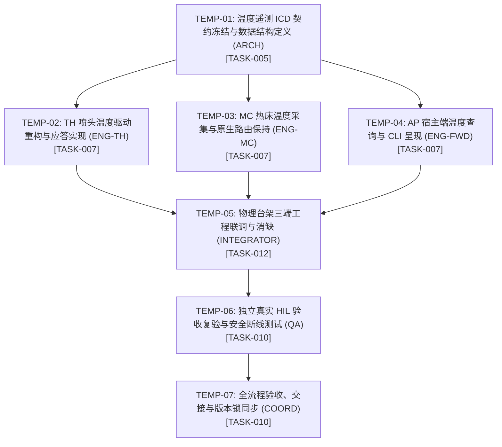

# PL-02 下一产品增量（双端温度遥测）细粒度架构设计与任务拆解

| 字段 | 属性 / 内容 |
| :--- | :--- |
| **文档标识** | `DOC-PL02-DESIGN-20261028` |
| **任务卡片** | [`PL-02`](product_pl02_20261008_083854.md) (设计并拆分下一产品增量，Revision 3) |
| **设计岗位** | `ARCH` (系统架构师视角) |
| **复核岗位** | `PM` (产品功能对账) ＋ `QA` (测试与门禁验证) |
| **前置输入** | 1. [`next_increment_scope_pl01.md`](next_increment_scope_pl01.md) (PL-01 经 HUMAN 锁定的方案 A 范围)<br>2. [`arch_review_report.md`](../../evidence/product_planning/PL-01/arch_review_report.md) (PL-01 架构复核纠偏意见)<br>3. [`ap_mc_formal_protocol_v2_0_multidevice_routing_draft_20261015.md`](../../specs/ap_mc_formal_protocol_v2_0_multidevice_routing_draft_20261015.md) |
| **设计状态** | **Completed / Ready for Review** |

---

## 1. 架构目标与技术纠偏实施 (Architecture Objectives)

依据 PL-01 决策与 ARCH 复核意见，本增量在 AP ↔ MC ↔ TH 已闭环的原生级联底座上，打通首个具备真实物理信号的**双端温度遥测通道**。

### 1.1 关键纠偏实施
1. **操作码安全避让与分层寻址**：
   - 彻底废除草案提议的 `0x10`（该操作码在协议规范中已被 `CMD_SYSTEM_CONTROL` 占用）；
   - 分配未占用的专用操作码：`MINIMC_CMD_GET_TEMP = 0x14`；
   - 严格遵循网络层寻址规范，使用帧头目标地址 `dst_id` 区分节点：
     - `dst_id = 0x02`：查询 MC 主控热床温度；
     - `dst_id = 0x03`：查询 TH 工具头喷头温度（MC 执行原生透明中继转发）；
2. **强电安全硬性锁死 (Hardware Safety Invariant)**：
   - 固件在全生命周期将喷头加热棒（TH）与热床加热（MC）的 PWM 输出占空比硬性锁死为 0%（绝对关断）；
   - 旁路禁用 PID 温度调节控制线程，避免在无温控安全专向审批前启动强电加热；
3. **驱动安全与死等消除**：
   - 彻底重构 TH 存量 `thermistor_adc.c` 中裸 `while(!FLAG)` 轮询，增加带超时退出计数器（`ADC_POLL_TIMEOUT_CYCLES = 10000`）的保护分支；
4. **编码规范硬性门禁对齐**：
   - 所有自研新增与重构代码 100% 遵守：函数规模 $\le 50$ 行、入参个数 $\le 4$ 个、裸机零动态堆内存分配、防御性首行空指针校验、两阶段初始化与编译期结构体布局断言。

---

## 2. 协议与数据结构契约 (ICD Contract)

### 2.1 请求帧格式 (`MINIMC_CMD_GET_TEMP = 0x14`)
- **帧头**：12 字节标准 MiniMCProto 头（`0x55 0xAA`, `ver=2`, `flags=0`, `src_id=0x01 (AP)`, `dst_id=0x02|0x03`, `cmd_id=0x14`, `seq=...`, `payload_len=0`）；
- **载荷**：0 字节（空载荷，仅通过 `dst_id` 寻址）；
- **校验**：2 字节 CRC-16/CCITT-FALSE。全帧长 14 字节。

### 2.2 响应帧载荷结构体 (`minimc_temp_report_payload_t`, 16 字节固定对齐)
```c
#pragma pack(push, 1)
typedef struct {
    uint16_t current_temp_c_x10;   /* 当前温度 (摄氏度 x 10, 如 245 代表 24.5°C; 故障时填 0x7FFF) */
    uint16_t target_temp_c_x10;    /* 目标设定温度 (本增量固定填 0) */
    uint16_t raw_adc_value;        /* 原始 ADC 读数 (0 ~ 4095) */
    uint8_t  sensor_status;        /* 传感器健康状态枚举: 0=OK, 1=OPEN_CIRCUIT, 2=SHORT_CIRCUIT, 3=TIMEOUT */
    uint8_t  heater_duty_percent;  /* 加热输出百分比 (本增量硬性锁死为 0) */
    uint32_t sample_timestamp_ms;  /* 采样单调时间戳 (ms) */
    uint32_t reserved;             /* 字节对齐保留字段 (固定填 0) */
} minimc_temp_report_payload_t;
#pragma pack(pop)

/* 编译期静态断言确保结构体尺寸严格对齐 16 字节 */
static_assert(sizeof(minimc_temp_report_payload_t) == 16, "minimc_temp_report_payload_t must be exactly 16 bytes");
```

### 2.3 传感器故障状态码定义
- `TEMP_STATUS_OK = 0x00`：传感器正常，温度有效；
- `TEMP_STATUS_OPEN_CIRCUIT = 0x01`：开路断线（ADC 读数 $> 4075$），温度置为 `0x7FFF`；
- `TEMP_STATUS_SHORT_CIRCUIT = 0x02`：短路故障（ADC 读数 $< 20$），温度置为 `0x7FFF`；
- `TEMP_STATUS_TIMEOUT = 0x03`：ADC 转换超时。

---

## 3. 微任务拆分全景与依赖关系图 (DAG)

按照“能力垂直切片、契约先行、独立验收、单卡函数 $\le 50$ 行”之原则，将本增量拆解为 7 张原子微任务卡：



---

## 4. 微任务卡定义详表 (Microtask Cards Specification)

| 任务编号 | 任务标题 | 负责角色 | 所属工作包 | 核心交付物 | 前置依赖 | 写入范围 (Write Scope) | 验收与门禁重点 |
| :--- | :--- | :--- | :--- | :--- | :--- | :--- | :--- |
| **TEMP-01** | 温度遥测 ICD 契约冻结与数据结构定义 | `ARCH` | `TASK-005` | 1. `ap_mc_th_telemetry_icd.md`<br>2. 共享头文件 `minimc_telemetry.h` | `PL-02`<br>`CR-11` | `project-control/docs/interfaces/` + `soc-ap/contracts/minimcproto/` + `mcu-p3/**/inc/` | 编译期 `static_assert` 16B 载荷校验，严格避让 `0x10`。 |
| **TEMP-02** | TH 喷头温度驱动重构与应答实现 | `ENG-TH` | `TASK-007` | 1. 重构带超时保护的 `thermistor_adc.c`<br>2. `minimc_proto.c` 支持 `0x14` | `TEMP-01` | `mcu-p3/color-engine-mcu/io_toggle/src/app/` + `mcu-p3/color-engine-mcu/io_toggle/inc/` | 展开 `while(!FLAG)` 死等，NTC 查表函数 $\le 50$ 行，加热 PWM 硬锁定为 0。 |
| **TEMP-03** | MC 热床温度采集与原生路由保持 | `ENG-MC` | `TASK-007` | 1. MC 原生转发 `0x14` (TH 目标)<br>2. 本地响应 `0x14` (MC 目标) | `TEMP-01` | `mcu-p3/motion-controller-mcu/project/src/` + `mcu-p3/motion-controller-mcu/project/inc/` | 维持原生透明转发，对发往 TH 报文零业务解析；Minimal Diff Budget，`make pack` 产出 `fw_mc.bin`。 |
| **TEMP-04** | AP 宿主端温度查询与 CLI 呈现 | `ENG-FWD` | `TASK-007` | 1. `soc-ap` 支持 `--cmd temp`<br>2. 支持 `--target mc\|th\|all`<br>3. 支持 `--json` 格式化 | `TEMP-01` | `soc-ap/CMakeLists.txt` + `soc-ap/core/host/` + `soc-ap/core/forward/` + `soc-ap/tests/` | CMake 构建并通过单元测试，覆盖开路短路错误码解析，防御性空指针校验，函数 $\le 50$ 行。 |
| **TEMP-05** | 物理台架三端工程联调与消缺 | `INTEGRATOR` | `TASK-012` | 1. 物理台架三端联调记录<br>2. 候选清单更新 (RC3) | `TEMP-02`<br>`TEMP-03`<br>`TEMP-04` | `project-control/docs/evidence/temperature_increment/TEMP-05/` + `docs/releases/` | 单一台架操作者，真实串口 `/dev/ttyUSB0` 连通，排查现场兼容性缺陷。 |
| **TEMP-06** | 独立真实 HIL 验收复验与安全断线测试 | `QA` | `TASK-010` | 1. 40 轮温度实测数据<br>2. 断线开路/短路故障注入记录<br>3. 独立 QA 报告 + 独立 ARCH 复核报告 | `TEMP-05` | `project-control/docs/evidence/temperature_increment/TEMP-06/` | HW-G1~HW-G6 严格零虚拟化，真实 SSH/串口调用，断开热敏电阻准确报错，加热引脚占空比实测为 0。 |
| **TEMP-07** | 全流程验收、交接与版本锁同步 | `COORD` | `TASK-010` | 1. MS 里程碑范围更新记录<br>2. `workspace.json` 五仓锁定 | `TEMP-06` | `project-control/.agents/kanban/` + `project-control/docs/handoff/` + `workspace.json` | 闭环收件回执，核销 MS-07/15/21 涉及温度部分，冻结五仓 Git 提交。 |

---

## 5. 资源与防冲突机制 (Conflict Avoidance)

1. **工作区隔离**：
   - MC 与 TH 虽然共存于 `mcu-p3` 仓，但其代码树完全物理隔离（`motion-controller-mcu/` 与 `color-engine-mcu/`），写范围互不重叠；
2. **硬件独占与窗口控制**：
   - 台架物理串口 `/dev/ttyUSB0` 及 ST-Link 探针在联调（TEMP-05）与独立验收（TEMP-06）阶段实行**单操作者排他占用**，严格记录租约时间窗口；
3. **极简修改预算 (Minimal Diff Budget)**：
   - 严禁在本次微任务中引入无关代码重构、代码美化或第三方依赖引入，改动仅聚焦于温度遥测闭环。
