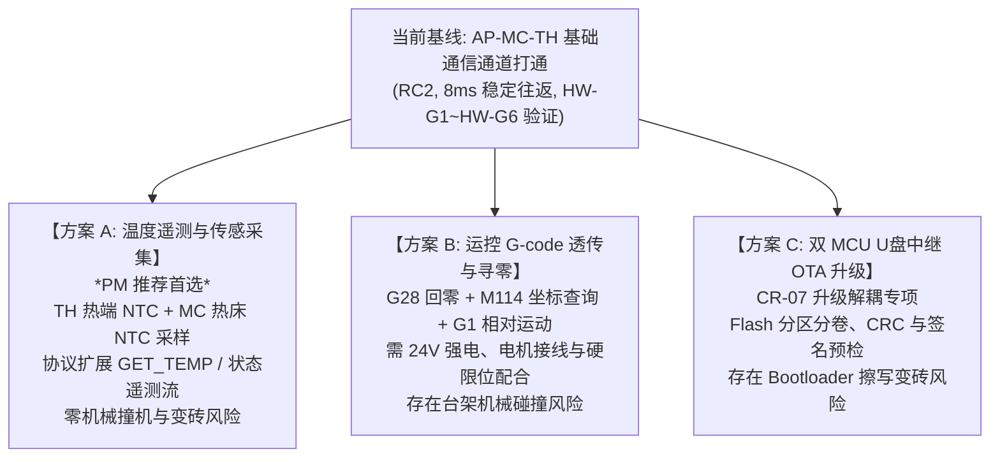

# PL-01 下一产品增量范围草案：双端温度遥测与传感器采集闭环

| 字段 | 属性 / 内容 |
| :--- | :--- |
| **文档标识** | `DOC-PL01-SCOPE-20261028` |
| **任务卡片** | [`PL-01`](product_pl01_20261008_083854.md) (确认下一产品增量范围，Revision 3) |
| **规划岗位** | `PM` (产品经理视角) |
| **复核岗位** | `ARCH` (架构可行性与契约审查) ＋ `HUMAN` (商业与产品范围最终裁决) |
| **依赖输入** | 1. [`full_color_3d_printer_feature_catalog_baseline.md`](full_color_3d_printer_feature_catalog_baseline.md) (PM 44 项) 2. [`product_feature_catalog_baseline.md`](product_feature_catalog_baseline.md) (SOC 73 项) 3. [`workflow_replan_20261028.md`](../../planning/workflow_replan_20261028.md) |
| **当前状态** | **APPROVED by HUMAN (选项 1：方案 A 已锁定)** |
| **HUMAN 决议证据** | 用户在会话 `c67a0b6c-113d-4711-bdbc-5ba7e689319c` 于 2026-10-28 19:09:51 正式确认选择“选项 1” |

---

## 1. 增量选择决策树 (Increment Decision Tree)

在完成 AP-MC-TH 基础只读级联通信（GET_VERSION, PING）之后，系统面临三个垂直演进分支：

---

## 2. 拟选增量范围：方案 A（双端温度遥测与传感器采集）

### 2.1 增量价值主张
作为全彩 3D 打印机首个**具有真实物理实体量输入**的业务增量，打通“传感器物理采样 $\to$ 固件模数转换与热敏查表 $\to$ 板间原生中继转发 $\to$ AP 端语义解析与状态呈现”全流程。

### 2.2 范围划定 (Must / Should / Later / Out)

| 分类 | 功能描述与范围 | 对应目录条目 | 验收判定基准 |
| :--- | :--- | :--- | :--- |
| **MUST** (本轮核心必交) | **1. 双端温度统一查询 (`CMD_GET_TEMP`, 操作码拟定 `0x14` 或标准遥测 `0x40`)**：AP 发送统一温度查询指令，通过帧头 `dst_id`（`0x02` 为 MC，`0x03` 为 TH）区分目标节点，MC 仅做原生透明转发；TH 采样 NTC ADC 并回传摄氏度与原始计数值；MC 采样热床 NTC ADC 并回传； **2. 操作码安全避让与分层**：严禁占用 `0x10`（在正式协议中已硬性分配给 `CMD_SYSTEM_CONTROL`）； **3. 强电加热硬性锁死**：加热棒与热床 PWM 输出占空比在固件全周期强制锁定为 0%（关断），PID 控制算法强制旁路，杜绝起火与飞温风险； **4. 异常与开路/短路防御**：热敏电阻断开（ADC 溢出）或短路时，上报明确故障状态码（`ERR_MINTEMP` / `ERR_MAXTEMP`），禁止伪造正常温度； **5. 驱动安全与编码门禁**：重构存量 ADC 轮询中裸 `while(!FLAG)` 死等代码，展开并增加超时计数保护；新增自研代码 100% 严格遵守 $\le 50$ 行、$\le 4$ 参数、零动态堆分配。 | `SOC:FEAT-HOT-001` `SOC:FEAT-BED-001` `PM:FEAT-COL-001` (前置) | 物理在环回显真实室温读数（如 20~28℃，非 Mock 常量）；断开传感器时准确报错超时或错误码。 |
| **SHOULD** (若资源允许) | **1. 周期性温度广播流 (Periodic Telemetry)**：支持 AP 下发订阅周期，双 MCU 定时推送温度包，减少 AP 高频轮询负载； **2. 协议载荷扩展**：在 MiniMCProto 统一 ICD 中分配专用 `CMD_ID = 0x10`。 | `SOC:FEAT-HOT-002` | RTT 与刷新率稳定（如 1Hz 采样），无 UART 缓冲区溢出。 |
| **LATER** (后续增量排期) | **1. 目标温度设置与 PID 闭环使能 (`M104`/`M140`)**：开启加热棒大功率 PWM 输出与闭环控温； **2. 复杂多轴插补运动 (CoreXY)**； **3. 工具头挤出机多色电机供料**。 | `PM:FEAT-MOT-001` `PM:FEAT-COL-002` | 需等待机械台架限位与加热防飞温安全专项立项后再行接入。 |
| **OUT** (严禁包含) | **1. 生产固件破坏性 OTA 刷写**； **2. 复杂 UI 前端页面开发**； **3. 云端及外网 MQTT 穿透**。 | `PM:FEAT-SYS-003` | 严禁扩大当前宿主程序与嵌入式固件边界。 |

---

## 3. 验收场景与硬性门禁规划

1. **环境与物理设备**：
   - 沿用当前已验收的硬件台架：VMware Ubuntu (`/dev/ttyUSB0`) + AT32F435 MC + AT32F423 TH；
   - 探针与串口映射保持排他；
2. **正向验收用例 (Positive Cases)**：
   - `TEMP-POS-001`: AP 经 MC 级联查询 TH 喷头温度，返回室温读数（如 `24.5°C`），单调 RTT $\le 10\text{ ms}$；
   - `TEMP-POS-002`: AP 查询 MC 热床温度，返回室温读数；
3. **负向与安全用例 (Negative Cases)**：
   - `TEMP-NEG-001`: 拔掉/未接传感器时，返回精确故障码 `TEMP_SENSOR_ERROR`，严禁悬空伪造；
   - `TEMP-NEG-002`: TH 离线时，AP 触发确定性超时并记录恢复。

---

## 4. 下一步流转说明
待 **HUMAN** 确认本范围选择后：
1. PM 冻结本文并记录 HUMAN 签署证据；
2. 调度 ARCH 启动 [`PL-02`](product_pl02_20261008_083854.md)，严格拆解契约微卡、MC 固件微卡、TH 固件微卡与 AP 查询微卡（每卡严格 $\le 50$ 行代码拆解原则）。
