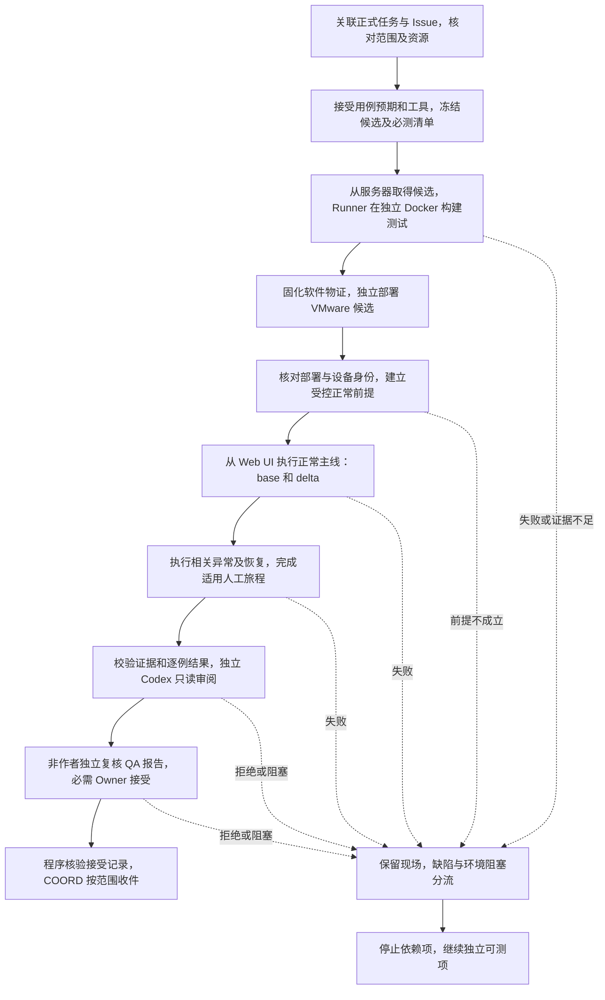

# 独立 QA 自动化与 VMware 真实环境验收建议方案

本文将用户提出的基础回归集、增量用例集、真实部署环境、三类验证结果和失败批准要求合并为可落地方案。建议先复用现有资产，补齐执行能力和收件校验，再逐步扩大覆盖。

本文是待评审建议，不自动改变产品范围、任务状态或现行规则；未启动 Agent、运行构建或测试、操作硬件，也不代表自动化或台架已经验收。现行权威规则有冲突时先由对应 Owner 澄清，不能在测试中自行选择更容易通过的解释。

## 1. 建议增加的关键要求

除用户已提出的内容外，建议补充以下八项：

1. 建立“需求—用户旅程—用例—执行结果—证据—Issue”追踪关系，明确哪些功能尚不能验收，避免只统计已有脚本。
2. 为基础回归建立版本、选例依据和变更审查；修复用例经接受后进入后续基础回归，不能每轮临时挑选有利用例。
3. 明确独立 QA 的人员/会话、源码、构建、部署、测试预期和证据写入边界；工程联调成功不能代替独立验收。
4. 环境和候选先预检，并在运行开始、恢复执行及结束时核对漂移；环境预检也不得预先替产品完成握手或向导。
5. UI 主链路采用真实浏览器输入操作，不能靠调用页面内部函数、注入状态或直接请求后台完成业务步骤。
6. 原始数据、HTTP/IPC、真实报文、设备效果和页面表现按同一操作关联；截图和绿色样式只是部分证据。
7. 明确首次失败、重试、偶发失败、环境阻塞和用例缺陷的处理，不通过重试直到成功来覆盖失败。
8. 将收件条件落实为程序可校验的接受记录，尤其阻止“先写 APPROVED/关闭 Issue，后补 Codex 和物证”。

## 2. 已有资产及当前可确认的边界

下表来自本轮只读源码和文档盘点，仅说明资产存在及可见实现，不是对其可靠性或运行结果的正式签署。

| 资产 | 可复用内容 | 本方案要求补齐或核对的内容 |
| --- | --- | --- |
| [交付门禁](../../.agents/rules/delivery_and_coord_gate.md)、[独立 Codex QA 规则](../../.agents/rules/codex_qa_review.md) | 工程委派、服务器候选、Docker 与 Codex 分工、报告复核和按范围收件 | 在本专项中核验真实执行和实际证据，不能只引用文件名 |
| [E2E 与 Issue 流转规则](../../.agents/rules/e2e_issue_verification_flow.md) | 正常流程优先、正负配对、Issue 派单和独立复验 | Issue 必须关联正式任务；收件校验需要覆盖这种关联 |
| [已有 E2E 计划](e2e_normal_flow_acceptance_plan_20261102.md) | 向导、工作台、运动、温度等用户旅程和用例索引 | 固定版本号、短 commit、地址、时限和协议描述须按当前已接受契约重新核对；不直接当本轮锁定清单 |
| [QA Runner 说明](../../tools/coord_runner/README.md) | Python 确定性运行沙箱、固化物证、独立 Codex 审阅及阻塞恢复 | 默认 Docker 配置没有真实 USB/HIL 执行器；不得据此宣称已经支持完整真实环境验收 |
| [首版用例清单](../../../test_harness/test_cases/twin/first_release_cases.json) | 现有用例编号、业务输入和断言线索 | 逐例核对正式来源、人工步骤、真实设备效果及自动化映射，不能直接按文件声明的总数计覆盖 |
| [OOBE 浏览器脚本](../../../test_harness/hil/tests/test_qa_e2e_oobe_browser.py) | 浏览器采集、向导分步和页面检查 | 当前包含固定固件标识、固定等待及 DOM `.click()`；应审查后迁移为可配置且验证实际可交互的操作 |
| [热插拔脚本](../../../test_harness/hil/tests/test_qa_e2e_hotunplug.py) | 断连、失效值、拒绝控制与恢复断言线索 | 固定 USB 拓扑须替换为唯一设备绑定；驱动 unbind 与物理拔线分别命名，不能互认覆盖 |
| [部署脚本](../../../soc-ap/tools/deploy_twin.sh)与[构建脚本](../../../soc-ap/tools/twin_build/build_vmware.sh) | VMware 构建、打包、服务启动入口 | 启动网关或 HTTP 可访问不等于所有服务、IPC、固件和业务就绪；不得复用未知来源的旧二进制 |
| [端到端架构矩阵](../architecture/end_to_end_feature_flow_closed_loop_matrix.md) | 跨服务触发链、状态、协议和硬件效果的追踪输入 | 与总规范及后续 ICD 逐项对账，尤其区分接收 ACK、执行完成和明确免即时 ACK 的协议场景 |

旧资产按“可直接复用、需要小修、需要替换、暂不适用”分类；保留旧版本及历史证据，新验收使用新 run，不批量推翻已有正确成果。

## 3. 验收目标与范围清单

目标环境为 VMware 中运行真实 AP 服务，经真实通信链路连接 MC、TH。产品功能验收从实际 Web UI 的可见入口发起，并检查服务状态、真实响应及该功能要求的实际效果。纯软件、网络或配置功能按其自身链路验证，不强行添加无关的 MCU 动作。

覆盖范围同时参考[首版范围决定](product/first_release_scope_decision_20261029.md)、[需求分解](product/first_release_requirements_and_task_decomposition_20261029.md)、后续已接受变更和当前页面/API。不能把旧 E2E 计划中的七个模块等同于全部已确认首版范围。

建议建立如下范围表，逐项由 QA、ARCH 和相关 Owner 对账：

| 功能组 | 建议关注的正常主线 | 边界 |
| --- | --- | --- |
| 安装启动和局域网访问 | 独立部署、服务启动、资源加载、发现与直连 | HTTP 200 不代表 mDNS 已验证；需要适用的独立客户端和网络观察 |
| 新机向导及 MC/TH 版本 | 冷启动或后插 USB，主动探测，各板真实版本与连接状态，向导完成和持久化 | ONLINE、传感器健康及可执行作业分别判定 |
| 温度与设备状态 | 真实采样、单位、有效值、新鲜度、单板故障、重连更新 | 不把固定温度、旧缓存或离线缺省版本作为实测 |
| 作业流程 | 合法文件进入、启动、暂停、继续、取消与完成 | 接收或入队 ACK 不直接证明运动完成；空跑不能代表实际打印质量 |
| 位置、点动及调平 | UI 发起、正确目标、真实状态/坐标及网格来源 | “读取已有网格”与“重新执行调平”是不同能力 |
| 断料与恢复 | 正常有料、真实断料提示、暂停和恢复条件 | 模拟状态的结果单独记录，不覆盖物理传感器验收 |
| 料槽和混色配置 | 映射确认、权重校验、保存、刷新及适用重启后的恢复 | 配置保存不代表实际挤出或混色质量通过 |
| HMS、急停与恢复 | 故障传播、控制锁定、实际保护及恢复授权 | 按正式安全契约验收，不能因页面变红就认定断能 |
| 维护和寿命数据 | 正确计数来源、持久化、提醒与确认 | 加速或注入计数只证明对应软件逻辑，不代替真实长周期累积 |
| 诊断导出 | UI 入口、导出成功、可读取、内容完整和脱敏 | 下载按钮成功不代表诊断包可用 |
| 语言、主题和交互 | 各适用页面、错误信息、长文本、保存和刷新 | 核对当前支持语言、屏幕和输入方式，不默认支持任意组合 |
| MC/TH 固件升级 | 指定目录文件识别、目标、执行、生效和版本对账 | 已纳入产品范围不等于当前允许测试；冻结项保持冻结，优先复用现有流程并避免 Bootloader 修改 |

每项填写需求 ID、实现状态、当前可测范围、缺失能力、适用平台、冻结/授权依据和关联任务。未实现的已确认需求必须可见，不能通过删除用例降低分母；未批准的完整功能也不能因页面有按钮就自动进入本轮范围。

当前 Option A 加热 0% 等约束继续适用。本阶段完整覆盖“已接受且可执行的范围”不等于整机首版、本地正常打印或目标 SoC 实板已经完成验收。

## 4. 用例组织：base 与 delta 两部分

### 4.1 基础回归集（base suite）

基础回归保存已接受的稳定行为及历史缺陷的防复发用例。每例具有稳定 ID、revision、需求/契约来源、适用条件、自动化映射、最近有效接受记录和维护 Owner。

既有代码行为不自动等于正确基线。迁入基础集前，应确认其符合当前契约；发现旧错误预期时保留历史，提交更正并接受新 revision，不能把缺陷固化为黄金结果。

为每轮选例记录影响分析，而不是只按修改文件名匹配。推荐规则如下：

| 改动类型 | 至少选择的基础回归 |
| --- | --- |
| 只读文档或不改变行为的说明 | 来源、链接和一致性核对；是否需要运行回归给出依据 |
| 单页面或交互改动 | 对应旅程、有效/无效输入、错误反馈、语言主题、刷新持久化及有关服务链 |
| 版本、协议、单位或公共数据结构 | 所有生产者/消费者、请求响应关联、坏帧/错误、缓存/重连及 UI 显示 |
| 作业或设备关键状态机 | 正常状态转移、准入、重复操作、异常挂起、恢复及有关跨服务旅程 |
| 构建、依赖、启动或部署 | 干净构建、依赖加载、全服务启动/停止、部署后关键主线与配置恢复 |
| 候选发布或系统集成 | 本轮接受范围内完整适用基础集，并核对单模块与组合的差异 |

核心冒烟集是基础集中的执行标签，不再建立第三份重复用例库。至少包含访问产品、真实版本探测、有效遥测和一条已授权的关键用户旅程；具体清单在本轮执行前冻结。

影响范围不明确时，由 ARCH 和 QA 补充分析并扩大相关回归；仍无法界定时阻塞相关批准，不能由实现者单方面排除。未选用例记录不选理由和接受人，不等同于“本轮已通过”。

### 4.2 增量用例集（delta suite）

增量集覆盖任务新增/变更的需求、Issue 原失败现象和验收条款，至少包含正常路径、相关负例、恢复路径及必要边界。每条变更条款都要有可执行判据，或明确不适用及接受依据。

修复后重跑原失败用例、对应正负配对、恢复和必要回归；不能只证明报错消失。修复行为经独立接受后，将有持续价值的增量用例纳入下一版基础集，并保留原 Issue 和用例 revision 的追踪。

同一用例同时命中 base 与 delta 时，只执行一次相同前置下的有效测试，并在两个清单中引用同一个结果；不能重复计数制造覆盖率。

### 4.3 同一锁定候选的含义

base 与 delta 消费同一份候选组合、测试工具/预期版本和有效环境配置，结果分开记录。候选改变必须建立新 run，不能拼接新 delta 与旧 base 后批准新组合。

“同一独立 QA 环境”指同一受控验收体系和可核验的环境版本，并非强制把所有测试塞进同一容器。软件 Docker 沙箱、VMware 真实部署和人工浏览器终端分别登记身份，并共同绑定该候选组合；跨环境无法证明一致时不得汇总批准。

## 5. 三类验证结果与适用性

base/delta 是用例来源分类；以下三类是验证维度，二者相互独立。同一用例可以要求一个或多个维度。

| 维度 | 验证内容 | 不能据此推出的结论 |
| --- | --- | --- |
| 软件自动化 | 单元、协议、状态机、接口和真实浏览器页面行为；环境按例明确为软件设备替身或真实部署 | Mock 或 API 通过不能推出真实板卡或用户交互通过 |
| 真实 HIL | 真实 MC/TH 身份、通信、响应关联及适用执行效果，正常/异常/恢复链路 | 一次版本查询或一帧 ACK 不能覆盖其他物理动作 |
| UI 人工可执行性 | 非实现者依据书面步骤，以声明的测试者能力从可见入口完成操作，理解反馈并能处理失败 | 人工观察、口头说明或页面截图不能替代软件/HIL 物证 |

软件和 HIL 的 UI 操作可以复用浏览器自动化，只要真实设备来源和效果均已核实。仍应单独记录其软件断言及物理断言，不能因同一次脚本执行而混为一个 PASS。

人工验证不要求每个协议边界例都手点。首次建立基线、产品交付、关键旅程变化、UI 自动化方法变化或可用性 Issue 修复时，执行预先冻结的人工核心旅程；其他轮次按影响选择并记录依据。已选为必测的人工步骤未执行时，相关 UI 人工范围不能批准。

若自动化通过而普通测试者无法按步骤完成，应记录可用性/测试文档问题；需开发者补充隐藏操作时，本次人工执行不能判独立完成。明确写在环境准备 SOP 中的安装、连线和授权不算隐藏业务步骤。

## 6. 分工和独立性

不新增常驻角色，复用现有岗位；下表描述职责，不表示会话已经启动。

| 岗位/职责 | 本专项产出 | 独立性边界 |
| --- | --- | --- |
| PM | 核对产品范围、用户目标与人工验收适用范围 | 不凭规划认定硬件能力已实现 |
| ARCH 与模块 Owner | 唯一契约、触发归属、超时/完成语义、影响矩阵与接口接受 | 契约作者不独立自批自己的文档 |
| QA 用例/工具作者 | 用例库、独立预期、自动化和环境操作规程 | 测试工具及预期本身须先经非作者独立复核 |
| ENG-* | 按仓库和路径边界修复业务实现 | 作者自检保留，不替代独立 QA |
| INTEGRATOR | 服务器候选组合、可部署包、依赖/配置清单和工程联调记录 | 联调成功不直接作为独立 QA 运行结果 |
| QA 执行与独立 Codex 审阅 | 独立环境执行、证据核验、分范围结论 | Runner 执行动作，独立 Codex 审阅同一候选及事实；普通 QA 子 Agent 名称不构成独立性 |
| QA 报告非作者复核 | 核对报告、原始物证、候选、范围和未关闭问题 | 使用未参与该报告写作的独立 Codex 会话并绑定报告哈希 |
| COORD | 正式任务、真实会话、资源/台架窗口、接收和最终关闭 | 可启动受控 QA 流程，不代做业务开发，不预写审查结论 |
| 人工测试者 | 依据步骤完成用户旅程并记录阻碍 | 记录实际身份、能力前提和帮助记录，不以角色别名冒充参与 |

工程开发、作者自检和集成仍通过 `invoke_subagent` 委派专门角色；正式独立 QA 走“受控 Runner＋独立 Codex”链路。委派某个 Agent 准备环境或启动 Runner，不等于已完成独立审阅，也不能据其回执直接关闭任务。

不同会话只是独立性的一部分。源码/预期从服务器独立取得，使用隔离输出和独立环境；不复用作者可写工作树、未知构建缓存或作者二进制冒充 QA 重建。正式审阅消费受控导出的只读快照，记录快照、容器证据及准确候选的映射。

物理台架、UART 和探针按实际资源独占。互不冲突的软件工作可按既有并行规则推进；HIL 操作不得争用设备。权限和证据写入隔离需要实际部署，不因文档中的“只读”二字自动成立。

## 7. 推荐执行链

图示用于说明一轮组合接受的依赖，不能解释为软件测试失败后仍正常放行 HIL。软件门禁失败时先分流；不依赖失败项、且已有授权及可信产物的工作可继续。诊断性试验单独登记，不能冒充通过链路。

正常流程优先不等于取消故障测试。安全前检始终先行；正常主线失败先记录并修复，再对新候选完成对应回归与必要故障/恢复验证。就绪前出现短暂 UNKNOWN 是否允许、最迟何时必须就绪，均由准确契约定义；不能要求从启动第一毫秒全绿，也不能无限等待。

## 8. 环境准备、隔离与漂移检查

### 8.1 候选和环境清单

建议维护机器可读的运行清单，字段至少包含：

| 对象 | 绑定内容 |
| --- | --- |
| 任务与测试 | 真实任务 ID/revision、Issue、run ID、base/delta 版本、必测/未选清单及接受记录 |
| 源码与契约 | 各消费仓库 URL/ref/完整 commit、规则/ICD、测试预期和工具 commit；字段按实际仓库登记 |
| 构建与制品 | 编译器、构建配置、依赖锁、镜像 digest、原始构建记录、AP 发布包及固件 SHA256 |
| VMware | VM 唯一标识、快照/镜像标识、OS/内核、资源配额、网卡模式、USB 直通及实际启动记录 |
| 实际部署 | 所有必需进程/服务、真实可执行文件与 Web 静态资源哈希、配置哈希、端口和 IPC 配置 |
| MC/TH | 芯片/板卡唯一身份、各自源码/制品、构建标识映射、部署/烧录或已接受读回证据、现场返回标识 |
| 通信与台架 | 稳定设备标识、实际 tty 路径、波特率、级联拓扑、探针、资源租约和时段 |
| 浏览器与人工终端 | 浏览器及驱动版本、显示尺寸、语言/主题、会话/profile、客户端所在机器和网络 |
| 时间与数据 | UTC 时间、单调计时口径、主机时钟差、测试文件/模型哈希、配置和持久化数据初始状态 |
| 执行与审阅 | 实际 job、执行身份、独立 Codex 会话、实际模型及批准的例外、报告复核和证据引用 |

不把账号令牌、SSH 私钥或认证缓存写入清单。配置记录脱敏哈希和必要取值，凭据由环境安全提供。

设备配置不只一个串口参数，还包括 UI 地址、服务/IPC、浏览器、固件、网络、数据目录、测试文件、证据输出和授权能力。优先复用现有配置加载方式；新增 QA 配置与产品配置职责分开，禁止把测试专用参数混入产品用户流程。

### 8.2 预检和复位

1. 确认服务器候选存在、制品可追溯、设备唯一、台架窗口有效；缺必需条件保持阻塞。
2. 确认部署的是本轮 AP 进程及静态资源，排除旧服务、残留进程、错误端口和浏览器缓存；仅“PID 存在”不够。
3. 确认 MCU 身份映射和部署依据。常量 git_commit 或固定 boot_id 不能独自证明板上固件、真实重启或会话隔离。
4. 核对正常硬件前提及传感器状态；物理能力不足时注明，不能把“假定健康”当实测。
5. 根据用例区分首次使用的干净 profile、已有配置升级、刷新及重启恢复；只能清理本 run 明确拥有的数据，不执行宽泛删除。
6. 保存初始状态和恢复方案。故障后恢复设备绑定、配置与服务，核对读回；恢复失败时台架不可继续出借为健康环境。

冷启动探测例必须捕获服务启动以来的证据，不能用人工预探测“喂好数据”后才开始测向导。必要的独立硬件预检应与产品运行隔离，说明其对复位/会话的影响。

在开始、断点恢复和结束时核对候选、配置、固件、静态资源和设备映射。正常温度、计数等业务变化不是环境漂移；版本、配置、部署或物理身份改变则暂停相关汇总，建立新运行上下文。

恢复 VMware 快照不会自动恢复 MCU Flash、外部文件或实体设备状态，必须分别核验。跨主机时序用 UTC 关联，单机期限用单调时钟测量；无法证明同步精度时，不作超出测量能力的跨机延迟结论。

## 9. 用例规格和完整示例

### 9.1 每例必填内容

| 类别 | 内容 |
| --- | --- |
| 标识与来源 | case ID/revision、base/delta 归属、需求/Issue/任务、正式预期依据及接受版本 |
| 范围与前置 | 软件/HIL/人工适用性、测试角色能力、起始页面、设备/数据状态、授权、前置用例及复位方式 |
| 用户步骤 | 可见页面名称、按钮/标签、输入文件及精确输入；自动化定位映射另记，不只给 CSS 选择器 |
| 逐步断言 | 页面反馈、状态转移、触发源、目标节点、完成信号、持久化和实际效果 |
| 时限 | 每步等待条件、开始/结束事件、超时、容差与来源；契约未接受时标待明确，不能随脚本便利定值 |
| 失败与恢复 | 如何保留现场、停止哪些后续步骤、允许的重试、恢复动作及恢复成功条件 |
| 证据 | 日志/网络/帧/设备效果/截图录像、关联键、采集时段、输出路径、必需与可选项 |

还应标注“UI 主旅程、API 补充、协议测试、故障夹具或环境准备”，避免把 API 脚本计作 UI 覆盖。操作来源标签与软件/HIL/人工三个验证维度分别记录。

### 9.2 示例：新机向导读取真实 MC/TH 版本并进入工作台

以下是规格示例，不是已分配任务或已执行结果。正式 case ID、页面文字、时限和版本字段由本轮冻结清单确定。

| 步骤 | 操作 | 预期与证据 |
| --- | --- | --- |
| 准备 | 启动锁定候选的真实服务，使用本例专用干净浏览器 profile，MC/TH 已按授权连接 | 记录启动、板卡身份和部署证据；自动探测可以在开机发生，但必须属于本轮启动的有效响应 |
| 1 | 从产品首页打开“新机向导” | 向导可见、按钮可操作；截图/浏览器轨迹记录真实入口 |
| 2 | 按页面步骤进入设备/版本检查 | 按已接受 trigger_owner 契约触发或消费本轮有效探测；保存 HTTP/IPC 与真实请求响应关联 |
| 3 | 等待设备检查完成 | 各板版本分别匹配锁定候选及正式映射，状态、来源和新鲜度有效；没有数据时不能显示缺省版本为真实结果 |
| 4 | 继续进入传感器检查 | 仅对实际已检查且有效的项显示正常；版本通过不替传感器通过，未实现/未检查如实显示 |
| 5 | 完成总结并点击完成 | 按契约反馈结果、进入约定工作台，并持久化适用完成标志；保存页面和后台证据 |
| 6 | 按用户方式刷新或重启相应组件 | 验证契约要求保持的配置，重新验证在线状态；禁止旧缓存冒充重连后的实时探测 |

成对补充：未连接、软件先启动后接线、仅 TH 失联、错误/迟到响应、重复点击、失败后重试及刷新恢复。每项明确初始状态，避免前例缓存影响后例。

若当前协议只能表达 Major.Minor，而需求要求展示 2.0.1，则必须先明确 patch 的正式来源或契约缺口。测试不得从预期常量补出 `.1`，也不得将 2.0 的通过写成完整 2.0.1 展示已通过。

## 10. 自动化与观测实现建议

### 10.1 浏览器操作

先评审现有浏览器工具能否满足要求，再决定有界改造或更换，不为了工具统一重写全部脚本。正式 UI 主链路至少满足：

- 使用浏览器输入通道执行鼠标/触摸/键盘操作，检查可见、可用、可命中和无遮挡；避免 DOM `.click()` 绕过用户可操作性。
- 不注入业务状态、直接设置向导完成标志、调用内部处理函数或通过后台 API 代替必测 UI 步骤。允许只读 DOM/网络观察；经接受的环境预置另记并避开本例待验证行为。
- 优先用可见标签、角色或已接受的稳定测试标识定位，定位数据不改变产品语义；不能只检查绿色 class 或出现“ONLINE”字符串。
- 等待具体状态或事件并设置有限超时，不以大段固定 sleep 作为完成判据；采样周期和容差先接受，不能测试失败后临时放宽。
- 保留失败时截图、浏览器日志、请求响应及必要轨迹；证据输出失败必须显式报告，不能忽略后继续批准。

### 10.2 跨层关联与实际效果

| 层面 | 必要观察 |
| --- | --- |
| Web UI | 实际输入、可见反馈、按钮状态、导航、持久化及错误后的下一步 |
| HTTP/SSE/IPC | 请求目标、返回、事件及新鲜度，关联到真实服务和本轮动作 |
| Forward/串口 | 原始 TX/RX、节点、命令、seq、flags、长度、CRC、超时及关联结果 |
| MCU/实体设备 | 现场身份、命令处理和适用物理效果，明确“接收、入队、执行中、完成”的不同阶段 |

复用已有 trace/sequence/job 标识；缺少端到端 ID 时可先用节点、序号、时间窗及日志映射建立可核验关联。必要的新增观测由 Owner 承担有界任务，不能由 QA 私改业务状态促通过。

串口抓取优先复用单一串口所有者的受控收发观测，或采用已核验的非干扰采集方式；不得另开一个读串口进程抢走业务字节。串口日志也须证明来源真实，不能由用例根据预期生成“物理回包”。

动作类测试按契约选择独立效果观察，例如位置反馈配合适用的实体测量/观察；视频可辅助，但不能代替响应关联。当前只具备固件逻辑位置时，结论就限制在该能力，不宣称已经测量实际机械位移。

### 10.3 故障、重复运行及资源

驱动解绑、线缆拔除、单板掉电、超时/坏帧注入分别作为不同场景，明确故障作用层及恢复能力；软件注入不冒充物理事件。故障工具先经过目标唯一绑定、原值保存、异常恢复及读回验证，再在批准窗口使用。

每例定义幂等或复位策略。重试保留第一次失败、原因和全部尝试，不在同一报告中只保留最后 PASS；测试工具修复后锁定新工具版本并建立新 run。候选不变时的证据复用也要确认范围、环境和有效期，重启、固件变化或漂移可能使其失效。

为浏览器、日志、抓包和制品设置资源与保留预算，失败和正式接受物证按策略保存，过程日志可有界轮转。工具不能显著干扰被测时序；观测开销影响性能判据时，先评估测量方法，不能把开销直接从结果中任意扣除。

## 11. 证据包与结果格式

建议沿用 `project-control/docs/evidence/<专项>/runs/<run-id>/` 作为正式证据索引。大型原始文件可以放受控制品存储，Git 保存受保护的定位信息、大小、SHA256、权限与保留要求，不强制把录像和所有镜像写入 Git。

每轮最小包含：

| 文件/记录类别 | 必要内容 |
| --- | --- |
| 锁定与计划 | 候选/环境清单、测试工具及预期版本、base/delta 必测项、未选理由及接受记录 |
| 软件运行物证 | `server_qa.json`、`runtime.log`、真实 Docker Inspect、构建和逐例原始结果 |
| 部署与 HIL 物证 | VM/设备身份、制品与配置核验、部署记录、完整采集窗口内 TX/RX、设备效果及恢复记录 |
| 浏览器和人工记录 | 操作轨迹、相关截图/录像、网络/控制台信息、人工逐步结果、帮助或偏离记录 |
| 结果汇总 | 逐例状态、耗时、实际预期对照、base/delta 归属、三个验证维度及关联 Issue |
| 专业审阅 | 独立 Codex 原始会话、正式结构化结果、实际会话/模型、候选和证据映射 |
| 报告复核与收件 | QA 报告哈希、非作者复核、必需 Owner 接受、程序校验及 COORD 接收范围 |

文件名是建议，实际字段和 schema 须由工具 Owner 接受；缺失项保持缺失，不能用占位文件促通过。报告 SHA256 在报告完成后写入外部清单，避免自引用；被审报告变化则重算哈希并重新复核，旧版本保留。

原始记录与派生报告分离，报告引用原始证据，不反向生成原始证据。哈希证明内容一致性，不独自证明来源真实；可信 job、只读来源、权限和运行记录仍需核验。输出脱敏时保存规则及版本，不能悄悄改变影响结论的关键字段。

逐例状态建议使用 `PASS / FAIL / BLOCKED / NOT_RUN / NOT_APPLICABLE`，这是测试结果，不替代现有正式任务状态。`NOT_APPLICABLE` 必须有明确范围和接受依据；不能将未实现、无设备、超时或未执行改成不适用。

## 12. 失败、阻塞、Issue 和批准

| 观察 | 处理 | 是否允许对应范围批准 |
| --- | --- | --- |
| 正常前提已成立，产品不符合已接受预期 | FAIL，登记/关联缺陷，定位 Owner，保留现场 | 否 |
| 设备、权限、候选、环境或必要来源证据缺失 | BLOCKED，登记解除条件及责任方 | 否 |
| 工具崩溃、用例无效或采集失败，无法判断产品 | 保留错误，记录工具/用例问题；受影响结果阻塞或未执行 | 否 |
| 必测步骤未运行 | NOT_RUN，说明原因与后续安排 | 否 |
| 契约已接受为本范围不适用 | NOT_APPLICABLE，登记依据 | 仅对剩余已冻结范围判断 |
| 软件通过而本范围必需 HIL 或人工验证缺失 | 保留软件结果，未满足的维度阻塞 | 不允许完整批准 |

实际产品失败不能一概归为环境问题；环境证据不足也不能反复要求作者改无关代码。无法确定根因时记录观察和待调查判断，不能将初步推断写成事实。

Issue 只做问题和证据索引，必须关联正式调查/修复/复验任务。不能在 Issue 中内嵌几个 `TASK-*` 标题就替代可被现有调度器发现的任务卡。沿用现有状态、Owner 边界和同因返工计数，不新建平行状态机，不通过换票重置失败记录。

修复产生新候选后，由独立 QA 重跑原失败例、相关正负配对、恢复及必要基础回归；HIL 缺陷返回真实环境复验。恢复业务后还要检查没有残留作业、重复命令或不应自动恢复的动作。

### 12.1 可执行的收件条件

建议由 Runner/接受工具输出结构化校验结果，至少核验：

1. 正式任务、revision、需求/Issue 和准确候选一致，服务器提交实际可取得。
2. 冻结必测清单完整；逐例结果、测试数量与原始运行记录匹配，无零用例或漏项成功。
3. base 与 delta 对应范围均已满足；必须维度采用“且”，不能把软件沙箱与真实 HIL 写成二选一解除条件。
4. 服务器、沙箱、部署、设备及浏览器证据有效，并与受审候选一致；漂移已处理。
5. 独立 Codex 实际会话、正式决定及范围可核验；`BLOCKED`、调用成功或进程退出 0 均不能解释为批准。
6. QA 报告与非作者复核绑定同一份磁盘字节哈希；必要 Owner 接受齐全。
7. 本范围未关闭 FAIL、必测 BLOCKED/NOT_RUN、缺证据及未决冲突为零；重试和接受限制完整可见。
8. 接受事件晚于其所依赖的实际运行、正式审阅及复核完成，引用准确版本；时钟不足以证明顺序时以受控 job 的因果记录核验，不能只信手填时间。

未满足时应拒绝本次收件并给出可执行解除条件，不自动写完整 APPROVED，也不关闭相应 Issue。已有明确软件子范围可独立接受，但不能在失败后临时缩小原组合验收范围制造成功。

程序校验不能只是多写一个可手改的 JSON。最低先实现只读核验并要求每次收件有机器记录；进一步将接受事件存放在作者/COORD不能任意伪造的受控结果入口，所有消费方校验其 job、候选和报告绑定。权限或保护尚未部署时明确记录人工依赖，不能宣称“物理级不可绕过”。相关服务部署按既有授权另行安排。

Issue 标为 fixed 和验收任务完成，均消费有效接受记录。手工改 Markdown 的 closed/verified 字段不应让调度器和下游把它当成可信通过；重复、非缺陷或范围撤销也须有正式处置依据，不能冒充修复通过。

### 12.2 批准结论的推荐写法

结论分别列明：软件批准范围、HIL 批准范围、人工 UI 批准范围、准确候选组合、适用环境、通过/失败/阻塞/未执行项和保留限制。未满足的维度明确未批准。

当前门禁或报告 schema 不能表达这些字段时，先保留待审和补充索引，再由 Owner 修订工具；禁止为了填满 schema 而签 APPROVED。后补审查作为新 run，不能倒填成旧批准当时已有证据。

## 13. 质量度量和偶发失败

优先报告绝对数量、必测清单和缺口，再给比例：

- base/delta 各自的已选、通过、失败、阻塞、未执行及不适用数量；去重后统计。
- 软件、HIL、人工三个维度的适用数量及完成情况；不能相加成单一“总通过率”。
- 需求/用户旅程覆盖与自动化覆盖；用例数量多不直接代表产品覆盖完整。
- 首次执行失败、重试次数、偶发失败复发、执行时间、环境准备时间和环境阻塞原因。
- Issue 原失败例回归、同因复发和关键旅程的剩余未验收项。

偶发失败保留为质量问题，注明是否产品、工具或环境原因。必测用例不能在失败后通过隔离标签静默移出门禁；如需范围调整，先记录依据和批准，保留本轮失败。性能阈值、重复次数、测试周期和证据保留期由本轮契约/计划接受，不凭空承诺固定时间或通过率。

## 14. 文件归属和最小改造方式

建议复用现有仓库边界，不新建独立总平台，也不复制第二套任务看板：

| 位置 | 建议保存内容 |
| --- | --- |
| `project-control/docs/planning/` | 本方案、正式接受后的专项计划和阶段出口 |
| `project-control/.agents/kanban/microtasks/` | 可被当前工具发现的正式实现/验证任务，按现行模板和目录约定建卡 |
| `project-control/docs/issues/` | 问题、正式任务关联、候选和独立复验索引 |
| `test_harness/test_cases/` | 机器可读用例、base/delta 清单、选择依据和人工步骤的统一源；优先引用已有编号 |
| `test_harness/hil/` 与现有静态检查目录 | 浏览器、真实台架适配、故障/恢复工具及其自身检查；不越界修业务代码 |
| `soc-ap/`、`mcu-p3/` | 各 Owner 实现的必要产品修复、受控部署及有界观测能力 |
| `project-control/tools/coord_runner/`、`tools/qa_runner/` | 确定性编排、来源/证据/结果核验和接受记录接口 |
| `project-control/docs/evidence/` | 正式证据索引与报告；大文件由受控制品存储承载 |

人工步骤和自动化引用同一版用例预期，避免分别维护两份互相漂移的验收标准。可以从统一用例源导出人工清单和运行摘要，但生成工具须有版本和检查记录。

规则层只需在现有交付门禁、Issue 规则及模板中补充“base/delta、三维结果、正式任务关联、接受记录”等必要条款，并引用接受后的专项方案。不要把完整脚本细节写进 AGENTS.md；不要批量迁移历史任务或修改旧签署。

## 15. 分阶段落地与专项自身验收

以下是建议工作包，不是已创建任务或派单。COORD 先查重并分配正式 ID/revision，按 Owner、仓库和路径拆卡；旧 TWIN/AUTO 卡仅作为可复用输入，不假定需要重新打开全部已完成任务。

| 阶段 | 交付物 | 阶段出口 |
| --- | --- | --- |
| A：范围与用例冻结 | 功能盘点、契约冲突清单、base 初版、delta 模板、人工核心旅程、选例规则 | 已知范围、预期、适用维度、时限和未决项可核对；缺口不被伪装成通过 |
| B：独立软件链路 | 已接受 Runner、服务器候选获取、Docker、工具版本、Codex 与报告复核实际记录 | 真正完成一轮软件验收；来源或调用失败能阻断收件，其他独立任务可继续 |
| C：VMware 真实台架 | 独立部署、设备/固件身份、浏览器输入、原始 TX/RX 和恢复能力 | 先以“版本探测—有效遥测—向导完成”完成一条真实主线及相关故障恢复，三维结果分开 |
| D：基础集和 Issue 回归 | 当前可验范围的基础集、实际增量修复、影响选择、复验及稳定记录 | base/delta 同候选执行；不能用增量通过覆盖基础失败，不能提前关闭 |
| E：扩展和交付 | 其余已批准且可执行旅程、资源/稳定性、人工独立执行、发布接受包 | 全部本轮必测项满足；冻结/未实现/实板未验项明确，结论不超出 VMware 范围 |

专项工具也必须接受失败路径验证，至少包含以下防绕过场景：

| 注入场景 | 必须观察的结果 |
| --- | --- |
| 缺正式任务关联、必测项缺失或零用例 | 拒绝收件，指出具体缺项 |
| 只有本地候选、错误服务器 commit 或源码/静态资源与部署不一致 | 阻断相关接受，不能只看分支名或本机 HEAD |
| base 失败而 delta 全过 | 本范围不批准，保留两部分真实结果 |
| UI 自动化操作成功但按钮被遮挡或人工需隐藏步骤 | 按实际可操作性失败或记录可用性问题，不能仅凭内部函数执行计通过 |
| 用 Mock、旧缓存或固定标识代替真实设备响应 | 不批准 HIL 或固件身份，指出证据来源问题 |
| UI 显示成功但无本轮有效响应/执行效果 | 用例失败；不能由页面样式抵消 |
| Codex 超时、输出非法、会话或模型来源无法核实 | 记录阻塞，不回退 self、不手工补造批准 |
| 报告与复核的哈希不匹配、复核缺失 | 拒绝收件，禁止沿用旧复核 |
| 必需软件/HIL/人工任一维度未完成 | 不签发完整接受，缺口和解除条件可见 |
| 在途漂移、重试、VM 快照恢复但板上固件未恢复 | 保留旧 run，重新核对相关前提和有效范围 |
| 故障工具异常退出或 USB 重绑定失败 | 台架保持不可用并记录恢复条件，不能继续向其他用例提供健康前提 |
| 先写 closed/APPROVED 再补运行材料 | 下游不采纳提前关闭，受控接受记录验证失败；后续审查另建 run |

具体命令由实施任务在确认实际 Runner、浏览器和设备能力后提供。本方案不编造尚不存在的“一键完整 HIL 验收命令”。

## 16. 评审时应明确的事项

优先由团队完成以下核对，不把普通技术问题转交用户逐票处理：当前完整功能范围及冻结项、冲突契约、必测主线、HIL/人工适用性、可复用脚本、设备身份映射、台架窗口、可执行的构建部署入口、接受工具权限和实际会话来源。

只有确实需要产品决定或外部资源时，向用户提出具体缺项，例如未授权的真实硬件动作、必须新增的台架设备、无法复用现有通道的固件升级方案。既有授权不重复询问，本文也不扩大其范围。

建议首先接受“范围盘点＋一条真实 UI 主线＋拒绝提前关闭”的最小闭环，再逐步扩充基础集。任何阶段完成都以实际候选、环境和独立证据为准；文档存在、脚本能启动或一份 APPROVED 报告都不是专项完成的充分条件。
