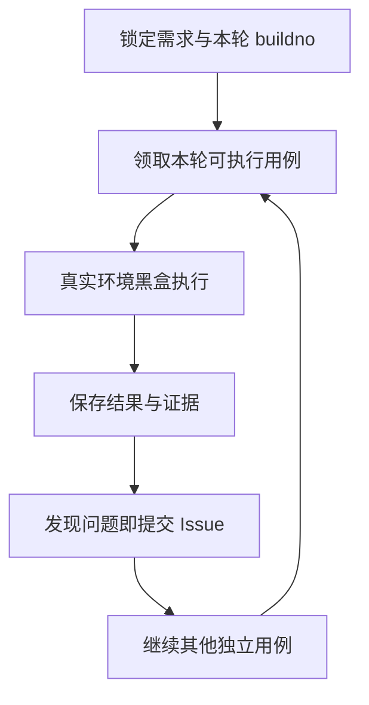
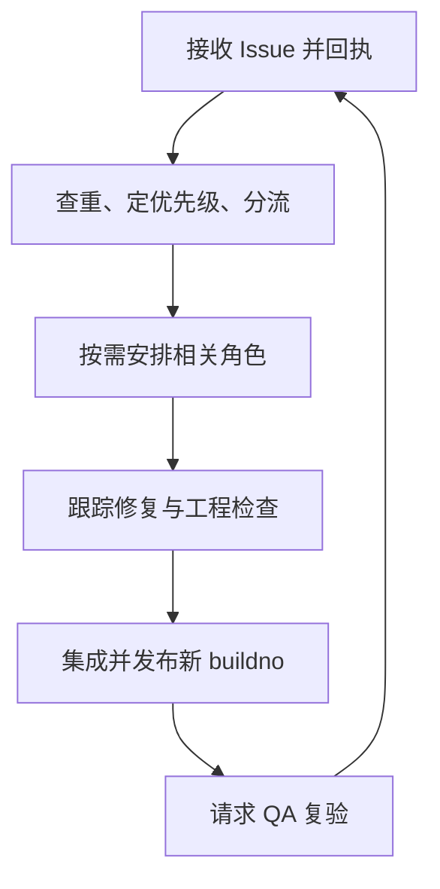
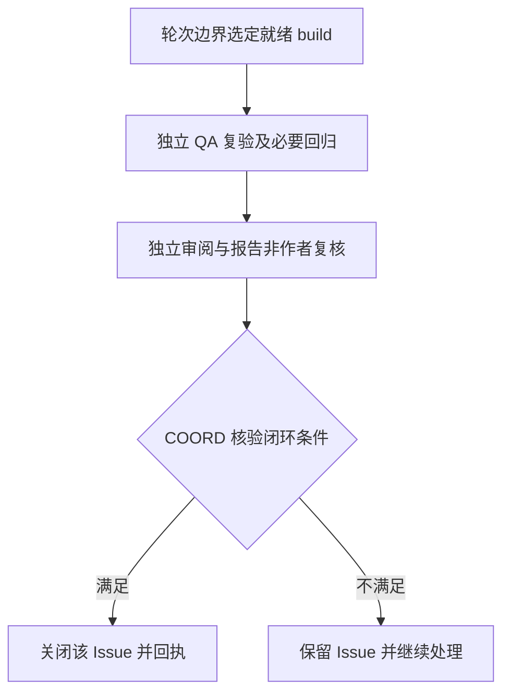

# 独立 QA 自动化与 VMware 真实环境验收建议方案

本版首先确立顶层工作方式：**独立 QA 根据已接受的功能需求，在真实部署环境持续进行黑盒验收并动态提交 Issue；开发 COORD 同时持续接收 Issue，按需组织 PM、ARCH、ENG-*、INTEGRATOR 修复和发布候选，再由独立 QA 复验，由 COORD 据有效验收记录关闭。两条工作线并行推进，只有受影响的用例、任务或资源窗口等待。**

相较[第一版](qa_automation_real_environment_acceptance_proposal_20261102.md)，本版将“测完一批再集中处理问题”的主逻辑改为“边测边反馈、边修边集成、按候选独立复验”；将功能需求包设为黑盒验收的首要输入。原稿保留，基础/增量用例及证据细则按本版整体流程使用。

本次补充固定首版调度策略：**消息随时接收，执行中不换版；仅在本轮结束、当前空闲或整轮无法继续且现场可交接时，按队列选择下一候选统一检查。以候选组合 buildno 关联发现、修复提供和实际验证，但编号达到修复版本且包含有效修复只代表具备复验条件，不代表验证通过。**

**2026-11-03 实施分段：**先独立核验“人工提交一批指令/MD → 一条指令对应一条需求 → AI 形成需求理解和实施概要 → 绑定实际人工批准 → 程序生成分类 YAML，COORD 拆多人任务并持续推进”。人工不维护 YAML；已有有效批准直接引用。暂不把 QA 自动生成 Issue、真实 HIL 调度或 buildno 系统作为这一阶段前置。具体见[第一阶段设计 revision 2](../architecture/coord_intake_dispatch_phase1_design_20261103.md)及[COORD 交接单 revision 2](coord_intake_dispatch_phase1_handoff_20261103.md)。第一阶段接受后再接完整 QA 动态反馈及复验，现有独立 QA/收件规则保持适用。

本文是待评审建议，不自动改变产品范围、任务状态或现行规则；未启动 Agent、运行构建或测试、操作硬件，也不代表自动化或台架已经验收。现行权威规则有冲突时先由对应 Owner 澄清，不能在测试中自行选择更容易通过的解释。

## 1. 顶层设计：需求驱动的两条并行工作线

### 1.1 验收对象与功能需求输入

独立自动化验收以黑盒为主：给定已接受的功能需求、用户操作、真实环境和候选发布包，观察用户可见结果及适用的真实设备效果。不能根据当前源码写出的行为、开发者口述或现有测试输出反向定义预期。

最小输入为三个版本化交付包：

| 输入 | 责任方 | 最少内容 |
| --- | --- | --- |
| 功能需求包 | PM 主责，用户决定为产品授权来源；ARCH 补充已接受技术约束 | 需求 ID/revision、目标用户、使用场景、前置条件、可见入口和操作、正常/拒绝/恢复行为、成功条件、期限及依据、持久化、支持组合、范围和排除项、接受记录 |
| 候选部署包 | INTEGRATOR | 发布序列与候选组合 buildno、AP/静态资源/MC/TH 制品及完整源码映射、配置/依赖、包含的 Issue 修复、已知问题、部署条件和前置软件门禁证据 |
| 独立验收包 | QA 编制，非作者复核 | 从需求推导的用例、独立预期、base/delta 必测选择、人工步骤、环境配置、证据及安全条件、工具版本 |

QA 用例的预期首先追溯到功能需求。外部接口契约补充格式、错误码和时序等细节；内部 ICD、源码和 Diff 主要供架构核对、定位和独立工程审计，不作为黑盒验收的唯一正确答案。黑盒人员原则上不需要阅读业务源码才能知道怎样操作、怎样判通过。

需求输入不完整时不等待全项目需求一次性完善：对已明确、可测的功能先执行；对具体歧义提交需求澄清 Issue，COORD 安排 PM/ARCH 回答并形成接受版本，只有依赖该歧义的断言阻塞。明确已纳入本轮交付而产品缺失的功能应记录失败或能力缺口，不能通过删除需求、缩小清单或一概称“需求不清”回避。

### 1.2 两条工作线和一个正式开发调度入口

| 工作线 | 持续循环 | 产出和权力边界 |
| --- | --- | --- |
| 独立 QA 验收线 | 锁定本轮需求/build → 黑盒实测 → 即时生成/补充 Issue → 继续本轮独立用例 → 轮次边界消费复验队列并选下一 build | 消息持续收件但执行中不换版；维护独立事实和复验结果，不改业务实现或正式开发任务 |
| 开发 COORD 处理线 | 接收新 Issue/回执 → 认领和分流 → 按需调用角色 → 跟踪修复和集成 → 发布修复候选 → 请求独立 QA 复验 → 收件关闭或继续处理 | 唯一维护正式开发任务、Owner、依赖、资源及 Issue 最终处置；不能替 QA 写通过结论 |

QA 侧可以有实际运行控制器负责选例、保存进度、收发事件和台架使用；它是 QA 执行职责，不新增一个有权改开发看板的 COORD。QA 独立性体现在人员/会话、预期、执行环境和结果，而非另建一套互相覆盖的工程调度权。

“COORD 持续工作”指持续处理可运行工作和新事件，不指忙轮询或突破并发上限。等待某个 Issue 的 PM 回答、开发返回或 QA 复验时，仍处理其他 Issue、现有任务和集成准备。实际会话退出时须保存进度；只有持久化运行能力已部署并验收后，才能声称无人值守常驻。

### 1.3 动态 Issue 是两条线之间的正式交付物

QA 发现有证据的问题就提交，不等待本轮全部用例结束、报告定稿或独立 Codex 签发整体验收结论。正式审阅及报告复核仍约束批准和关闭，但不应成为报告缺陷的前置。

每个 QA Issue 最少包含：问题类别、功能需求 ID/revision、case/revision、发布序列及 `found_buildno`、准确候选清单、环境/run/attempt、用户复现步骤、预期与需求依据、实际观察、原始证据引用、影响及建议严重度。根因未知允许提交，不能要求 QA 先定位到具体源码函数。功能失败、可用性、需求歧义、部署/环境和测试工具问题分别标注，不把所有问题一律退给业务工程师。

新观察先保存为耐久的 Issue/发现记录，再通知 COORD；发送失败保留待投递记录，QA 继续安全且独立的用例。经查重属于同一问题时追加新证据，不重复建修复任务；需求或候选不同的观察仍保留自己的来源。

COORD 必须明确回执“已收到/已关联”，给出正式 Issue ID、接收记录、分流负责人、下一动作或阻塞原因。送达和接收不等于同意根因、完成派单或已修复；QA 能查询未接收、已关联、待修复和待复验事项，不能出现“文件已写，开发却不知道”的悬空状态。

### 1.4 按问题性质调用角色，不机械每票遍历全部岗位

| 观察类型 | COORD 优先安排 | 后续路径 |
| --- | --- | --- |
| 需求矛盾、正常预期不清、产品取舍 | PM，必要时 ARCH 和用户决策 | 澄清并接受需求 revision；若属新增需求，按范围变更处理，不把现有失败改成通过 |
| 跨服务缺触发、协议冲突、状态/完成语义不清 | ARCH 和相关生产者/消费者 Owner | 接受有界契约与分工后拆实现任务，不让活跃工程师自行发明接口 |
| 已明确归属的实现缺陷 | 对应 ENG-* | 按原任务/新关联任务规则有界修复、自检和服务器候选，不无条件等待 PM/ARCH |
| 部署、依赖、版本组合、台架配置问题 | INTEGRATOR，必要时 BSP/模块 Owner | 核对环境与实际制品；环境恢复也须交回 QA 复验 |
| 用例/自动化工具缺陷 | QA 工具作者及非作者 Reviewer | 接受新用例/工具 revision，保留原观察；不能由开发者悄悄修改 QA 预期 |
| 修复候选具备前置 | INTEGRATOR 组装，独立 QA 复验 | 原失败例＋相关正负/恢复＋必要 base 回归，通过必要复核后收件 |

优先级依据安全、主流程影响、被阻塞用例/任务及依赖解除价值；兼顾等待时间，避免普通问题长期饥饿。正在运行的任务不因每个新 Issue 被无条件中断；风险需要暂停时，只暂停相关动作并留记录。并行数和租约沿用现行规则，本建议不自行取消当前实现卡并发上限。

### 1.5 用耐久事件交接，不让聊天和共享文件承担全部同步

建议采用逻辑上的三个入口：QA → COORD 的问题收件、开发 → QA 的修复复验请求、QA → COORD 的复验结果。初期可复用受控文件/已有运行器存储和通知能力，不预设必须新建消息中间件或服务平台。

| 事实事件 | 发起方 → 接收方 | 接收方必须采取的动作 |
| --- | --- | --- |
| Issue 已提交/证据已追加 | QA → COORD | 耐久接收、查重、回执并分流，不等待 QA 扫描结束 |
| Issue 已接收/已关联任务 | COORD → QA | QA 记录关联和处理入口，继续当前可执行扫描 |
| 修复候选已就绪 | INTEGRATOR 经 COORD → QA | 绑定发布序列/buildno、Issue 和修复 commits，耐久入队并回执；到固定轮次边界再选版执行 |
| 复验已开始/结果已完成 | QA → COORD | 等待或消费绑定准确候选的结果；失败继续同一 Issue 闭环 |
| 问题已处置/关闭 | COORD → QA | QA 留存处置依据；后续同因复发仍关联原记录 |
| QA 进度/环境阻塞 | QA → COORD | 安排解除条件及相关 Owner；不把整条开发线挂起 |

这些是交接事实，不是新增任务 status。每次交接绑定 event ID、Issue/任务 ID、需求与候选版本、run/attempt、证据定位/哈希、发起者和对应回执。允许重复投递，接收方按事件标识幂等处理，避免重复派单或重复关闭；通知丢失可从耐久待办重新投递。

Issue 和正式任务是业务原件，事件只通知和引用它们，不再复制一份可独立修改的任务状态。QA 写发现/运行证据，COORD 写分流/正式任务/关闭依据；通过单一受控写入入口或分离记录合成索引，避免两个 Agent 并发覆写同一个 Markdown。若沿用 Git，同一写入归属仍串行提交，不能让两个角色共用可写 index。

### 1.6 每轮锁定一个 build，执行中只接收、不换版

一轮测试绑定一个候选组合 buildno、需求/用例版本、冻结必测清单和有效环境上下文；使用一个可追溯 run 承载实际结果。复验原失败例、该版本增量用例及必要基础回归在该轮统一安排，不是每收到一个修复就立刻部署一次。

QA 可继续验证固定组合 C0，开发同时在隔离环境修复并准备 C1。开发的提交、构建、工程联调和候选发布不能自动更新 QA 正在使用的进程、静态资源、配置或固件。执行中的新 Issue、修复通知和候选只进入 queue，QA 可以立即回执，但不触发中途换版或额外插入一轮测试。

在 §1.8 固定轮次边界，QA 从已经就绪的组合中选择下一 build，将其包含且符合复验条件的 Issue 合并进下一轮清单。可以跳过未部署的中间 build，选择包含完整兼容修复的新组合；记录被替代请求、未覆盖 Issue 和选择依据，不把“编号最新”当成一定包含修复或最适合测试的依据。

切换候选建立新 run，旧轮次结果封存，未执行/阻塞项如实保留。旧轮不必全绿才允许下一轮，但不能删去旧轮未执行项，也不能把 C0 结果拼到 C1 上批准。最终实际测试的组合必须包含所声称的有效修复、必要依赖及适用回归。

只有一套 MC/TH 时，QA 与工程联调、刷写或候选部署按台架窗口串行使用；软件分析/开发/构建可以同时进行。需要两条物理测试同时推进时必须具备独立台架。不能通过共享 UART、多开读串口或边测边刷固件实现“并行”。

用例依赖显式登记：向导失败可以阻塞依赖该状态的旅程，但不自动阻塞已具独立合法入口的语言、配置或其他用例。不得靠隐藏脚本绕过必测入口，伪造其前置已满足。通用环境不可信或安全前提丢失时暂停受影响的真实测试，QA 仍可整理证据、编制用例和处理不依赖该环境的工作。

### 1.7 一个 Issue 的关闭与一次发布的完成分开

单个 Issue 可在其修复组合 C1 上取得原失败例、相关正负/恢复、必要回归和独立接受后，由 COORD 关闭；不要求所有其他 Issue 同时修完。后续候选 C2 是否仍保持修复由受影响基础回归持续检查。

最终发布接受则针对明确的最终候选、需求范围和必测清单，完成该组合上的适用 base/delta 及三维验收。不能用 C0 的回归、C1 的某次修复和 C2 的界面截图混合批准最新版本。已有单 Issue 接受可以追溯，但不自动替代最终候选的必测回归。

需求驱动的新增观察和高风险回归可不断进入队列；已冻结 run 的输入不静默改变。新需求/用例 revision 或新增必测项记录变更及影响，安排后续 run。验收完成不等于开发永远停止，而是本次接受范围在指定候选上满足退出条件。

### 1.8 固定检查点和下一轮启动条件

首版只采用以下轮次边界，不做“每用例结束就按优先级切版本”的动态调度：

| 当前情况 | QA 接收和执行策略 |
| --- | --- |
| 正在执行，仍有本轮可执行用例 | 新 Issue 和修复请求耐久入队、回执；继续当前 build，不能因收到通知切换 |
| 本轮执行结束 | 保存逐例结果和证据；检查 queue，有满足前置的新候选时启动下一轮，不要求旧轮全通过 |
| 当前空闲，包括首次启动 | 检查队列/正式验收计划，有就绪候选及冻结清单就启动；没有则等待，不重复跑同一 build 凑轮次 |
| 本轮被产品问题阻塞，已无可执行的独立用例 | 保存失败/阻塞/未执行项，确认现场可交接；有包含解除阻塞修复的新 build 时启动下一轮 |
| 只有个别用例受阻 | 标记相应依赖阻塞，继续本轮其他独立用例，不把局部阻塞当成整轮换版检查点 |
| 设备、权限、台架或来源证据问题导致整轮无法继续 | 先解除环境阻塞并重新预检；提高 buildno 本身不能解除阻塞，不能仅凭新修复通知启动 |

检查点由 QA 运行控制器依据实际执行状态判断，不能只靠 Agent 口头说“空闲”或“阻塞”。任何换版前必须满足：当前用例/动作已结束或已确认安全停止、原始结果及证据已保存、设备/作业状态可确认、资源允许交接、新候选与必要输入可取得。

下一轮的启动同时要求：**处于上述允许调度的状态，现场可交接，候选及环境前置成立，且有正式冻结的下一轮清单。** 复验请求到达只触发收件；轮次边界才触发选版和执行。QA 已选定下一轮 build 后到达的新修复继续留队，不改变该轮冻结输入。

长时间用例可以有进度报告和消息收件，但这些不是换版检查点。超时按原用例判据结束或转阻塞；安全风险按既有约束停止相关动作，确认现场后再判断下一步，不因高优先级修复直接中断运动、写 Flash 等动作。

环境恢复后若仍是同一候选、需求/用例和有效上下文，可按已接受的断点策略恢复原 run；来源或状态无法保持一致时建立新 run 并注明原因。相同 build 的环境重跑须有恢复或复核依据，不解释为软件版本升级。

下一轮选例优先覆盖已就绪 build 中解除主线阻塞的修复、其余待复验 Issue、该版本新增/变更要求和必要基础回归，兼顾等待时间。不要求所有未关闭 Issue 都已修复才启动；尚未被选定 build 有效包含的修复保持待后续版本处理，相关必测缺口仍阻止完整发布批准。

QA 和开发 COORD 都保存当前候选、待办/在途/待回执事件、实际会话、资源租约和恢复位置。出现事件时唤醒或有界轮询，空闲时等待；超时回执、队列堆积和未接收 Issue 要有可见提示及责任方。

事件重放用于恢复交接事实，不直接重放曾经发出的 UI 控制或硬件动作。重启后先核对当前部署、设备、作业及动作完成情况；状态无法确认时保留未知和阻塞，不能盲目重做运动、刷写等操作。

QA 在轮次边界统一安排复验和新功能扫描，不因持续新 Issue 让旧复验永远排不到，也不因每个修复立即中断当前轮次。每次交接/轮次检查点汇报新增问题、已接收/已派单/待复验/已关闭数量、覆盖缺口及当前实际 buildno；开发 COORD 的持续派单不等待这些 QA 检查点。

环境问题不计代码返工；同因失败和返工上限沿用现行门禁。达到升级条件时，COORD 组织相关 ARCH/QA/Owner 对齐，不无意义重复调用；其他无依赖任务继续。没有可执行动作时记录具体等待条件，而非宣称 Agent 在后台无限工作。

### 1.9 用 buildno 关联发现、修复提供和实际验证

buildno 标识一套可部署候选组合，而不是 Issue 编号、一次源码提交、QA 运行次数或固件语义版本。建议由 INTEGRATOR/发布工具在一个明确发布序列内分配唯一递增整数；失败或作废编号保留，不复用。不同发布序列/分支的编号不直接比较，引用时使用“发布序列＋buildno”。

组合清单绑定 AP 程序、Web 静态资源、MC/TH 固件、各自完整 commit、制品 SHA256、构建配置/依赖及包含修复。未改模块可沿用已锁定制品；buildno 增加不要求每次重刷所有板卡，但必须证明现场实际组合与清单一致。同一源码的不同构建配置/制品也不能仅凭 commit 冒充同一 build。

build 一旦就绪，其清单不可原地改写；制品、源码或有效配置改变时发布新 build。QA 计划和运行记录另有自己的版本，不能通过修改用例或报告把旧 build 改成新 build。该机制是发布/验收索引，不自动授权修改 Bootloader 或增加 MCU 协议字段。

| Issue 字段 | 含义及填写责任 |
| --- | --- |
| `found_buildno` | QA 首次发现问题的候选编号，连同发布序列、需求/case 和 run 保存；后续观察追加记录，不覆盖首次发现 |
| `fix_commits` | 开发提供各受影响仓库的完整修复 commit、依赖及修复说明，INTEGRATOR 核对组合包含关系 |
| `fix_available_buildno` | INTEGRATOR 声明首次提供该修复且可部署的候选编号；只有代码已改但未发布时保持未提供，不能充当验证通过 |
| `verified_buildno` | 独立 QA 实际复验通过并完成相应接受的候选编号，绑定 run、逐例结果、证据及审阅/复核；未通过保持为空 |
| `verification_runs` | 所有失败、阻塞和通过尝试的完整索引，保留每次实际 build、环境和结果；不能只保留最后一次成功 |

单模块编译可保留自身构建号，但 QA 统一消费候选组合 buildno。历史接受、同因复发和失效声明保留版本关系，不因重开 Issue 擦除旧验证记录。

某候选 B 具备某 Issue 的修复复验条件，至少同时满足：

1. B 与该修复记录处于可比较的同一发布序列，且 `B.buildno >= fix_available_buildno`。
2. 所有受影响模块都实际包含 `fix_commits` 的修复及必要依赖，组合契约相容；不能只检查 AP 的 HEAD。
3. 没有已知的修复撤回、覆盖、失效或互斥组合记录。commit 是祖先只能说明历史包含，不能单独证明行为一直有效。
4. 服务器候选、制品来源、部署能力和复验需求/用例版本可核验；实际开测前确认现场确实运行 B。

若修复以 cherry-pick 等方式进入其他历史，须由 Owner 记录原修复与实际 commit 的等价映射和接受依据，不能仅凭编号跨分支推定支持。跨发布序列时另记目标序列的首次修复 buildno，不能沿用原序列的整数门槛。不能核实映射时保持待核对。

以上检查只能得到“开发声明该 build 含修复且满足复验前置”，不能写成“QA 已通过”。是否仍存在回退或行为缺陷，必须由黑盒复验和基础回归判断；COORD 仅消费实际接受记录关闭 Issue。

例如同一发布序列在 build 40 发现问题，开发在 build 42 首次提供修复，QA 到下一轮选择 build 45：只有确认 45 实际包含该修复和依赖且无已知失效后，才将该 Issue 纳入复验；真正通过后记录 `verified_buildno: 45`，保留 `found_buildno: 40` 和 `fix_available_buildno: 42`。不要求 42、43、44 逐个测试，也不把这些未测版本标为通过。

## 2. 已有资产及当前可确认的边界

下表沿用第一版的只读源码和文档盘点，作为本版复用线索；新执行前核对实际版本。它仅说明资产存在及当时可见实现，不是对其可靠性或运行结果的正式签署。

| 资产 | 可复用内容 | 本方案要求补齐或核对的内容 |
| --- | --- | --- |
| [交付门禁](../../.agents/rules/delivery_and_coord_gate.md)、[独立 Codex QA 规则](../../.agents/rules/codex_qa_review.md) | 工程委派、服务器候选、Docker 与 Codex 分工、报告复核和按范围收件 | 在本专项中核验真实执行和实际证据，不能只引用文件名 |
| [E2E 与 Issue 流转规则](../../.agents/rules/e2e_issue_verification_flow.md) | 正常流程优先、正负配对、Issue 派单和独立复验 | Issue 必须关联正式任务；收件校验需要覆盖这种关联 |
| [已有 E2E 计划](e2e_normal_flow_acceptance_plan_20261102.md) | 向导、工作台、运动、温度等用户旅程和用例索引 | 固定版本号、短 commit、地址、时限和协议描述须按当前已接受契约重新核对；不直接当本轮锁定清单 |
| [QA Runner 说明](../../tools/coord_runner/README.md) | Python 确定性运行沙箱、固化物证、独立 Codex 审阅及阻塞恢复 | 默认 Docker 配置没有真实 USB/HIL 执行器；不得据此宣称已经支持完整真实环境验收 |
| [首版用例清单](../../../test_harness/test_cases/twin/first_release_cases.json) | 现有用例编号、业务输入和断言线索 | 逐例核对正式来源、人工步骤、真实设备效果及自动化映射，不能直接按文件声明的总数计覆盖 |
| [OOBE 浏览器脚本](../../../test_harness/hil/tests/test_qa_e2e_oobe_browser.py) | 浏览器采集、向导分步和页面检查 | 当前包含固定固件标识、固定等待及 DOM `.click()`；应审查后迁移为可配置且验证实际可交互的操作 |
| [热插拔脚本](../../../test_harness/hil/tests/test_qa_e2e_hotunplug.py) | 断连、失效值、拒绝控制与恢复断言线索 | 固定 USB 拓扑须替换为唯一设备绑定；驱动 unbind 与物理拔线分别命名，不能互认覆盖 |
| [部署脚本](../../../soc-ap/tools/deploy_twin.sh)与[构建脚本](../../../soc-ap/tools/twin_build/build_vmware.sh) | VMware 构建、打包、服务启动入口 | 启动网关或 HTTP 可访问不等于所有服务、IPC、固件和业务就绪；不得复用未知来源的旧二进制 |
| [端到端架构矩阵](../architecture/end_to_end_feature_flow_closed_loop_matrix.md) | 跨服务触发链、状态、协议和硬件效果的追踪输入 | 与总规范及后续 ICD 逐项对账，尤其区分接收 ACK、执行完成和明确免即时 ACK 的协议场景 |

旧资产按“可直接复用、需要小修、需要替换、暂不适用”分类；保留旧版本及历史证据，新验收使用新 run，不批量推翻已有正确成果。

## 3. 验收目标与范围清单

目标环境为 VMware 中运行真实 AP 服务，经真实通信链路连接 MC、TH。产品功能验收从已接受需求规定的实际 Web UI 可见入口发起，给出用户输入，观察外部可见结果、真实响应及适用设备效果。需求明确为公开 API、网络发现或其他入口的功能按相应黑盒入口验证；API 补测不能替代该功能必需的 UI 旅程。

黑盒正确性依赖功能需求包，不以服务内部如何实现为前提。服务状态、协议帧和内部日志可以解释失败及支撑硬件真实性，但“内部函数返回成功”本身不能替代用户看到/设备发生的预期结果。工程的源码审计、单元测试和软件门禁保留为独立支持链路，不混算成需求黑盒覆盖。

覆盖范围同时参考[首版范围决定](product/first_release_scope_decision_20261029.md)、[需求分解](product/first_release_requirements_and_task_decomposition_20261029.md)、后续已接受变更和当前页面/API。不能把旧 E2E 计划中的七个模块等同于全部已确认首版范围。

建议建立如下范围表，逐项由 QA、ARCH 和相关 Owner 对账：

| 功能组 | 建议关注的正常主线 | 边界 |
| --- | --- | --- |
| 安装启动和局域网访问 | 独立部署、服务启动、资源加载、发现与直连 | HTTP 200 不代表 mDNS 已验证；需要适用的独立客户端和网络观察 |
| 新机向导及 MC/TH 版本 | 冷启动或后插 USB，主动探测，各板真实版本与连接状态，向导完成和持久化 | ONLINE、传感器健康及可执行作业分别判定 |
| 温度与设备状态 | 真实采样、单位、有效值、新鲜度、单板故障、重连更新 | 不把固定温度、旧缓存或离线缺省版本作为实测 |
| 作业流程 | 合法文件进入、启动、暂停、继续、取消与完成 | 接收或入队 ACK 不直接证明运动完成；空跑不能代表实际打印质量 |
| 位置、点动及调平 | UI 发起、正确目标、真实状态/坐标及网格来源 | “读取已有网格”与“重新执行调平”是不同能力 |
| 断料与恢复 | 正常有料、真实断料提示、暂停和恢复条件 | 模拟状态的结果单独记录，不覆盖物理传感器验收 |
| 料槽和混色配置 | 映射确认、权重校验、保存、刷新及适用重启后的恢复 | 配置保存不代表实际挤出或混色质量通过 |
| HMS、急停与恢复 | 故障传播、控制锁定、实际保护及恢复授权 | 按正式安全契约验收，不能因页面变红就认定断能 |
| 维护和寿命数据 | 正确计数来源、持久化、提醒与确认 | 加速或注入计数只证明对应软件逻辑，不代替真实长周期累积 |
| 诊断导出 | UI 入口、导出成功、可读取、内容完整和脱敏 | 下载按钮成功不代表诊断包可用 |
| 语言、主题和交互 | 各适用页面、错误信息、长文本、保存和刷新 | 核对当前支持语言、屏幕和输入方式，不默认支持任意组合 |
| MC/TH 固件升级 | 指定目录文件识别、目标、执行、生效和版本对账 | 已纳入产品范围不等于当前允许测试；冻结项保持冻结，优先复用现有流程并避免 Bootloader 修改 |

每项填写需求 ID、实现状态、当前可测范围、缺失能力、适用平台、冻结/授权依据和关联任务。未实现的已确认需求必须可见，不能通过删除用例降低分母；未批准的完整功能也不能因页面有按钮就自动进入本轮范围。

当前 Option A 加热 0% 等约束继续适用。本阶段完整覆盖“已接受且可执行的范围”不等于整机首版、本地正常打印或目标 SoC 实板已经完成验收。

## 4. 用例组织：base 与 delta 两部分

### 4.1 基础回归集（base suite）

基础回归保存已接受功能需求所规定的稳定行为及历史缺陷的防复发用例。每例具有稳定 ID、revision、需求来源及补充契约、适用条件、自动化映射、最近有效接受记录和维护 Owner。黑盒基础集按用户可观察行为组织，不按当前源码函数清单组织。

既有代码行为不自动等于正确基线。迁入基础集前，应确认其符合当前契约；发现旧错误预期时保留历史，提交更正并接受新 revision，不能把缺陷固化为黄金结果。

为每轮选例记录影响分析，而不是只按修改文件名匹配。推荐规则如下：

| 改动类型 | 至少选择的基础回归 |
| --- | --- |
| 只读文档或不改变行为的说明 | 来源、链接和一致性核对；是否需要运行回归给出依据 |
| 单页面或交互改动 | 对应旅程、有效/无效输入、错误反馈、语言主题、刷新持久化及有关服务链 |
| 版本、协议、单位或公共数据结构 | 所有生产者/消费者、请求响应关联、坏帧/错误、缓存/重连及 UI 显示 |
| 作业或设备关键状态机 | 正常状态转移、准入、重复操作、异常挂起、恢复及有关跨服务旅程 |
| 构建、依赖、启动或部署 | 干净构建、依赖加载、全服务启动/停止、部署后关键主线与配置恢复 |
| 候选发布或系统集成 | 本轮接受范围内完整适用基础集，并核对单模块与组合的差异 |

核心冒烟集是基础集中的执行标签，不再建立第三份重复用例库。至少包含访问产品、真实版本探测、有效遥测和一条已授权的关键用户旅程；具体清单在本轮执行前冻结。

影响范围不明确时，由 ARCH 和 QA 补充分析并扩大相关回归；仍无法界定时阻塞相关批准，不能由实现者单方面排除。未选用例记录不选理由和接受人，不等同于“本轮已通过”。

### 4.2 增量用例集（delta suite）

增量集覆盖任务新增/变更的需求、Issue 原失败现象和验收条款，至少包含正常路径、相关负例、恢复路径及必要边界。每条变更条款都要有可执行判据，或明确不适用及接受依据。

修复后重跑原失败用例、对应正负配对、恢复和必要回归；不能只证明报错消失。修复行为经独立接受后，将有持续价值的增量用例纳入下一版基础集，并保留原 Issue 和用例 revision 的追踪。

同一用例同时命中 base 与 delta 时，只执行一次相同前置下的有效测试，并在两个清单中引用同一个结果；不能重复计数制造覆盖率。

### 4.3 同一锁定候选的含义

同一验收 run 的 base 与 delta 消费同一份功能需求版本、发布序列/buildno、候选清单、测试工具/预期版本和有效环境配置，结果分开记录。QA 对 C0 的扫描与开发对 C1 的修复可以并行；新候选在 §1.8 固定轮次边界安排，换版建立新 run，不能拼接新 delta 与旧 base 后批准新组合。

“同一独立 QA 环境”指同一受控验收体系和可核验的环境版本，并非强制把所有测试塞进同一容器。软件 Docker 沙箱、VMware 真实部署和人工浏览器终端分别登记身份，并共同绑定该候选组合；跨环境无法证明一致时不得汇总批准。

## 5. 三类验证结果与适用性

base/delta 是用例来源分类；以下三类是验证维度，二者相互独立。同一用例可以要求一个或多个维度。

| 维度 | 验证内容 | 不能据此推出的结论 |
| --- | --- | --- |
| 软件自动化 | 黑盒部分验证用户输入、公开接口及浏览器外部行为；单元、源码和内部状态机检查作为独立工程支持结果另列；环境明确为软件设备替身或真实部署 | 内部单元通过、Mock 或 API 补测不能推出真实用户主线和板卡通过 |
| 真实 HIL | 真实 MC/TH 身份、通信、响应关联及适用执行效果，正常/异常/恢复链路 | 一次版本查询或一帧 ACK 不能覆盖其他物理动作 |
| UI 人工可执行性 | 非实现者依据书面步骤，以声明的测试者能力从可见入口完成操作，理解反馈并能处理失败 | 人工观察、口头说明或页面截图不能替代软件/HIL 物证 |

软件和 HIL 的 UI 操作可以复用浏览器自动化，只要真实设备来源和效果均已核实。仍应单独记录其软件断言及物理断言，不能因同一次脚本执行而混为一个 PASS。

人工验证不要求每个协议边界例都手点。首次建立基线、产品交付、关键旅程变化、UI 自动化方法变化或可用性 Issue 修复时，执行预先冻结的人工核心旅程；其他轮次按影响选择并记录依据。已选为必测的人工步骤未执行时，相关 UI 人工范围不能批准。

若自动化通过而普通测试者无法按步骤完成，应记录可用性/测试文档问题；需开发者补充隐藏操作时，本次人工执行不能判独立完成。明确写在环境准备 SOP 中的安装、连线和授权不算隐藏业务步骤。

## 6. 分工和独立性

保留唯一开发 COORD，独立 QA 验收线按现有 QA 岗位落实运行和审阅职责。下表描述职责，不表示常驻调度器或实际会话已经启动。

| 岗位/职责 | 本专项产出 | 独立性边界 |
| --- | --- | --- |
| PM | 提供并维护已接受功能需求包，处理 QA 提出的需求/可用性歧义，核对人工验收适用范围 | 不凭规划认定硬件能力已实现，不为消除失败单方面改低预期 |
| ARCH 与模块 Owner | 唯一契约、触发归属、超时/完成语义、影响矩阵与接口接受 | 契约作者不独立自批自己的文档 |
| QA 用例/工具作者 | 根据功能需求独立编制黑盒用例、预期、自动化和环境操作规程 | 不照抄实现作为正确答案；工具及预期本身须经非作者独立复核 |
| ENG-* | 按仓库和路径边界修复业务实现 | 作者自检保留，不替代独立 QA |
| INTEGRATOR | 发布序列/buildno、不可改写的服务器候选组合、Issue 修复映射、部署包和工程联调记录 | 证明首次提供修复，不能填写 QA 的实际通过版本；联调不代替独立验收 |
| QA 持续执行与独立 Codex 审阅 | 扫描和复验队列、黑盒执行、动态 Issue、结果和证据，独立审阅后给分范围结论 | 发现先提交，不等待最终批准；Runner 执行动作，独立 Codex 审阅同一需求/候选及事实 |
| QA 报告非作者复核 | 核对报告、原始物证、候选、范围和未关闭问题 | 使用未参与该报告写作的独立 Codex 会话并绑定报告哈希 |
| 开发 COORD | 持续消费 Issue/回执，按需调度 PM/ARCH/ENG/INTEGRATOR，维护正式任务与资源，交回修复候选并最终关闭 | 某票等待不停止其他就绪工作；不代做业务开发，不预写 QA 结论 |
| 人工测试者 | 依据步骤完成用户旅程并记录阻碍 | 记录实际身份、能力前提和帮助记录，不以角色别名冒充参与 |

工程开发、作者自检和集成仍通过 `invoke_subagent` 委派专门角色；正式独立 QA 走“受控 Runner＋独立 Codex”链路。委派某个 Agent 准备环境或启动 Runner，不等于已完成独立审阅，也不能据其回执直接关闭任务。

不同会话只是独立性的一部分。源码/预期从服务器独立取得，使用隔离输出和独立环境；不复用作者可写工作树、未知构建缓存或作者二进制冒充 QA 重建。正式审阅消费受控导出的只读快照，记录快照、容器证据及准确候选的映射。

物理台架、UART 和探针按实际资源独占。互不冲突的软件工作可按既有并行规则推进；HIL 操作不得争用设备。权限和证据写入隔离需要实际部署，不因文档中的“只读”二字自动成立。

## 7. 顶层并行流程与反馈闭环

以下分开阅读两条同时运行的工作线，再看它们如何交接和关闭 Issue。每张图只表达一个局部流程，采用纵向布局。

### 7.1 QA 线：持续验收，发现即报

没有问题时只记录结果，不创建 Issue。有问题时只阻塞依赖该失败的用例，不等待整批问题修完才继续。上图循环仅覆盖本轮仍可执行的用例；本轮结束、空闲或已无独立用例可测时按 §1.8 检查 queue。修复通知随时入队回执，但执行中不换版，不按每个用例结束触发复验。

### 7.2 开发线：COORD 持续接收和调度

需求问题交 PM，架构/契约问题交 ARCH，明确实现缺陷交对应 ENG，集成部署交 INTEGRATOR。不是每票都依次调用所有角色。某票等待角色返回或 QA 复验时，COORD 继续处理其他就绪工作，不等整轮验收结束才派单。

### 7.3 两条线怎样交接

| 次序 | 方向 | 交付与回执 |
| --- | --- | --- |
| 1 | QA → COORD | 提交 Issue、需求/用例、`found_buildno` 和候选 C0 证据；COORD 回执接收及正式关联 |
| 2 | COORD → QA | 提交 `fix_available_buildno`、修复 commits、候选清单及复验请求；QA 回执入队，到固定轮次边界统一处理 |
| 3 | QA → COORD | 返回实际所测 build 的逐例结果、原始证据和必要独立审阅/复核；通过后绑定 `verified_buildno` |
| 4 | COORD → QA | 满足条件后关闭该 Issue 并回执；未满足则继续处理并说明原因 |

每次交接都有耐久记录、准确版本和接收回执。QA 提交问题不需要等待整轮报告批准；修复或关闭也不需要用户在两条线之间逐次转贴。

### 7.4 Issue 怎样关闭

软件构建/隔离、服务器候选和必需 Owner 接受等既有门禁仍在对应交付点执行。单个 Issue 满足条件即可关闭，不必等待其他问题全解决；最终发布另按最终候选的完整必测清单接受。关闭记录回给 QA 只更新问题索引，不能把原失败的 C0 结果改为 PASS。

例如 QA 在 C0 发现“向导设备检查超时”，即时提交 Issue；开发 COORD 查重后安排相关角色调查和修复。QA 仍在 C0 测试具备合法独立入口的其他需求。INTEGRATOR 发布 C1 后，通知先入队；到本轮结束/空闲，或整轮已无法继续且现场可交接时，QA 才选择 C1 或包含该修复的后续 build，在新 run 统一复验相关 Issue、正负配对和必要回归。结果连同报告复核交 COORD 收件，无需用户逐次转贴。

正常流程优先不等于遇到失败便停整轮，也不取消相关异常/恢复。安全前检先行，按功能的正常路径和局部依赖推进；受阻功能交回开发，独立功能继续。出现短暂 UNKNOWN 是否允许、何时必须就绪，应由需求和已接受契约明确；不能要求启动即全绿，也不能无限等待。

## 8. 环境准备、隔离与漂移检查

### 8.1 候选和环境清单

建议维护机器可读的运行清单，字段至少包含：

| 对象 | 绑定内容 |
| --- | --- |
| 发布与修复索引 | 发布序列、候选组合 buildno、不可改写的清单定位/哈希、对应 Issue 的修复 commits 和首次提供版本 |
| 需求、任务与测试 | 功能需求包 ID/revision、需求接受记录、真实任务 ID/revision、Issue、run ID、base/delta 版本、必测/未选清单 |
| 源码与契约 | 各消费仓库 URL/ref/完整 commit、规则/ICD、测试预期和工具 commit；字段按实际仓库登记 |
| 构建与制品 | 编译器、构建配置、依赖锁、镜像 digest、原始构建记录、AP 发布包及固件 SHA256 |
| VMware | VM 唯一标识、快照/镜像标识、OS/内核、资源配额、网卡模式、USB 直通及实际启动记录 |
| 实际部署 | 所有必需进程/服务、真实可执行文件与 Web 静态资源哈希、配置哈希、端口和 IPC 配置 |
| MC/TH | 芯片/板卡唯一身份、各自源码/制品、构建标识映射、部署/烧录或已接受读回证据、现场返回标识 |
| 通信与台架 | 稳定设备标识、实际 tty 路径、波特率、级联拓扑、探针、资源租约和时段 |
| 浏览器与人工终端 | 浏览器及驱动版本、显示尺寸、语言/主题、会话/profile、客户端所在机器和网络 |
| 时间与数据 | UTC 时间、单调计时口径、主机时钟差、测试文件/模型哈希、配置和持久化数据初始状态 |
| 执行与审阅 | 实际 job、执行身份、独立 Codex 会话、实际模型及批准的例外、报告复核和证据引用 |

不把账号令牌、SSH 私钥或认证缓存写入清单。配置记录脱敏哈希和必要取值，凭据由环境安全提供。

设备配置不只一个串口参数，还包括 UI 地址、服务/IPC、浏览器、固件、网络、数据目录、测试文件、证据输出和授权能力。优先复用现有配置加载方式；新增 QA 配置与产品配置职责分开，禁止把测试专用参数混入产品用户流程。

### 8.2 预检和复位

1. 确认服务器候选存在、制品可追溯、设备唯一、台架窗口有效；缺必需条件保持阻塞。
2. 确认部署的是本轮 AP 进程及静态资源，排除旧服务、残留进程、错误端口和浏览器缓存；仅“PID 存在”不够。
3. 确认 MCU 身份映射和部署依据。常量 git_commit 或固定 boot_id 不能独自证明板上固件、真实重启或会话隔离。
4. 核对正常硬件前提及传感器状态；物理能力不足时注明，不能把“假定健康”当实测。
5. 根据用例区分首次使用的干净 profile、已有配置升级、刷新及重启恢复；只能清理本 run 明确拥有的数据，不执行宽泛删除。
6. 保存初始状态和恢复方案。故障后恢复设备绑定、配置与服务，核对读回；恢复失败时台架不可继续出借为健康环境。

冷启动探测例必须捕获服务启动以来的证据，不能用人工预探测“喂好数据”后才开始测向导。必要的独立硬件预检应与产品运行隔离，说明其对复位/会话的影响。

在开始、断点恢复和结束时核对候选、配置、固件、静态资源和设备映射。正常温度、计数等业务变化不是环境漂移；版本、配置、部署或物理身份改变则暂停相关汇总，建立新运行上下文。

恢复 VMware 快照不会自动恢复 MCU Flash、外部文件或实体设备状态，必须分别核验。跨主机时序用 UTC 关联，单机期限用单调时钟测量；无法证明同步精度时，不作超出测量能力的跨机延迟结论。

## 9. 用例规格和完整示例

### 9.1 每例必填内容

| 类别 | 内容 |
| --- | --- |
| 标识与来源 | case ID/revision、base/delta 归属、功能需求 ID/revision 和接受记录、Issue/任务；接口契约仅作必要补充 |
| 范围与前置 | 软件/HIL/人工适用性、测试角色能力、起始页面、设备/数据状态、授权、前置用例及复位方式 |
| 用户步骤 | 可见页面名称、按钮/标签、输入文件及精确输入；自动化定位映射另记，不只给 CSS 选择器 |
| 逐步断言 | 以需求定义的外部行为为准：页面反馈、可见状态、公开结果、持久化和实际效果；必要时核对契约约定的目标/响应，不要求知道内部函数结构 |
| 时限 | 每步等待条件、开始/结束事件、超时、容差与来源；契约未接受时标待明确，不能随脚本便利定值 |
| 失败与恢复 | 如何保留现场、停止哪些后续步骤、允许的重试、恢复动作及恢复成功条件 |
| 证据 | 日志/网络/帧/设备效果/截图录像、关联键、采集时段、输出路径、必需与可选项 |

还应标注“UI 主旅程、API 补充、协议测试、故障夹具或环境准备”，避免把 API 脚本计作 UI 覆盖。操作来源标签与软件/HIL/人工三个验证维度分别记录。

### 9.2 示例：新机向导读取真实 MC/TH 版本并进入工作台

以下是规格示例，不是已分配任务或已执行结果。正式 case ID、页面文字、时限和版本字段由本轮接受的功能需求及冻结清单确定。需求应先明确“用户进入设备检查后，系统主动获取两个板卡的真实版本，分别反馈结果，并按已接受的就绪条件允许继续”，不能仅给 QA 一份内部函数名或接口列表。

| 步骤 | 操作 | 预期与证据 |
| --- | --- | --- |
| 准备 | 启动锁定候选的真实服务，使用本例专用干净浏览器 profile，MC/TH 已按授权连接 | 记录启动、板卡身份和部署证据；自动探测可以在开机发生，但必须属于本轮启动的有效响应 |
| 1 | 从产品首页打开“新机向导” | 向导可见、按钮可操作；截图/浏览器轨迹记录真实入口 |
| 2 | 按页面步骤进入设备/版本检查 | 按已接受 trigger_owner 契约触发或消费本轮有效探测；保存 HTTP/IPC 与真实请求响应关联 |
| 3 | 等待设备检查完成 | 各板版本分别匹配锁定候选及正式映射，状态、来源和新鲜度有效；没有数据时不能显示缺省版本为真实结果 |
| 4 | 继续进入传感器检查 | 仅对实际已检查且有效的项显示正常；版本通过不替传感器通过，未实现/未检查如实显示 |
| 5 | 完成总结并点击完成 | 按契约反馈结果、进入约定工作台，并持久化适用完成标志；保存页面和后台证据 |
| 6 | 按用户方式刷新或重启相应组件 | 验证契约要求保持的配置，重新验证在线状态；禁止旧缓存冒充重连后的实时探测 |

成对补充：未连接、软件先启动后接线、仅 TH 失联、错误/迟到响应、重复点击、失败后重试及刷新恢复。每项明确初始状态，避免前例缓存影响后例。

若当前协议只能表达 Major.Minor，而需求要求展示 2.0.1，则必须先明确 patch 的正式来源或契约缺口。测试不得从预期常量补出 `.1`，也不得将 2.0 的通过写成完整 2.0.1 展示已通过。

## 10. 自动化与观测实现建议

### 10.1 浏览器操作

先评审现有浏览器工具能否满足要求，再决定有界改造或更换，不为了工具统一重写全部脚本。正式 UI 主链路至少满足：

- 使用浏览器输入通道执行鼠标/触摸/键盘操作，检查可见、可用、可命中和无遮挡；避免 DOM `.click()` 绕过用户可操作性。
- 不注入业务状态、直接设置向导完成标志、调用内部处理函数或通过后台 API 代替必测 UI 步骤。允许只读 DOM/网络观察；经接受的环境预置另记并避开本例待验证行为。
- 优先用可见标签、角色或已接受的稳定测试标识定位，定位数据不改变产品语义；不能只检查绿色 class 或出现“ONLINE”字符串。
- 等待具体状态或事件并设置有限超时，不以大段固定 sleep 作为完成判据；采样周期和容差先接受，不能测试失败后临时放宽。
- 保留失败时截图、浏览器日志、请求响应及必要轨迹；证据输出失败必须显式报告，不能忽略后继续批准。

### 10.2 黑盒判定、硬件真实性与定位信息分开

| 层面 | 观测用途及要求 |
| --- | --- |
| Web UI 和需求规定的公开入口 | 黑盒主断言：实际输入、可见反馈、结果、导航、持久化及错误后的下一步 |
| 实体设备和外部测量 | HIL 主断言：真实目标、实际效果、故障与恢复；不把界面或服务自报成功等同于物理成功 |
| HTTP/SSE 与真实线路 TX/RX | 适用的公开契约核对和 HIL 来源证明；绑定本轮动作、目标与响应，原始帧要求沿用现有门禁 |
| 内部 IPC、状态及实现日志 | 辅助定位和工程审计，能取则关联保存；不能据其实现行为重写用户需求或独立预期 |

黑盒 QA 可以在不知道内部算法和代码结构的情况下判断产品外部行为失败并提交 Issue。缺少内部诊断信息不应阻止缺陷进入 COORD；对最后 HIL 批准必需的真实来源/原始帧等证据仍须补齐，不能因“黑盒”降低既有真实性门禁。公开结果与内部自报矛盾时记录矛盾，不选择更容易通过的一侧。

复用已有 trace/sequence/job 标识；缺少端到端 ID 时可先用节点、序号、时间窗及日志映射建立可核验关联。必要的新增观测由 Owner 承担有界任务，不能由 QA 私改业务状态促通过。

串口抓取优先复用单一串口所有者的受控收发观测，或采用已核验的非干扰采集方式；不得另开一个读串口进程抢走业务字节。串口日志也须证明来源真实，不能由用例根据预期生成“物理回包”。

动作类测试按契约选择独立效果观察，例如位置反馈配合适用的实体测量/观察；视频可辅助，但不能代替响应关联。当前只具备固件逻辑位置时，结论就限制在该能力，不宣称已经测量实际机械位移。

### 10.3 故障、重复运行及资源

驱动解绑、线缆拔除、单板掉电、超时/坏帧注入分别作为不同场景，明确故障作用层及恢复能力；软件注入不冒充物理事件。故障工具先经过目标唯一绑定、原值保存、异常恢复及读回验证，再在批准窗口使用。

每例定义幂等或复位策略。重试保留第一次失败、原因和全部尝试，不在同一报告中只保留最后 PASS；测试工具修复后锁定新工具版本并建立新 run。候选不变时的证据复用也要确认范围、环境和有效期，重启、固件变化或漂移可能使其失效。

为浏览器、日志、抓包和制品设置资源与保留预算，失败和正式接受物证按策略保存，过程日志可有界轮转。工具不能显著干扰被测时序；观测开销影响性能判据时，先评估测量方法，不能把开销直接从结果中任意扣除。

## 11. 证据包与结果格式

建议沿用 `project-control/docs/evidence/<专项>/runs/<run-id>/` 作为正式证据索引。大型原始文件可以放受控制品存储，Git 保存受保护的定位信息、大小、SHA256、权限与保留要求，不强制把录像和所有镜像写入 Git。

证据随用例完成而耐久保存，Issue 可引用已完成且可核验的片段；不等待整轮证据包定稿才反馈开发。后续追加独立记录或新索引版本，不覆盖已经交接的事实。正式批准时再核验该范围全部必需证据、独立审阅和复核齐备。

每轮最小包含：

| 文件/记录类别 | 必要内容 |
| --- | --- |
| 锁定与计划 | 功能需求包、发布序列/buildno、候选/环境清单、测试工具及独立预期版本、base/delta 必测项、未选理由及接受记录 |
| 软件运行物证 | `server_qa.json`、`runtime.log`、真实 Docker Inspect、构建和逐例原始结果 |
| 部署与 HIL 物证 | VM/设备身份、制品与配置核验、部署记录、完整采集窗口内 TX/RX、设备效果及恢复记录 |
| 浏览器和人工记录 | 操作轨迹、相关截图/录像、网络/控制台信息、人工逐步结果、帮助或偏离记录 |
| 结果汇总 | 逐例状态、耗时、实际预期对照、base/delta 归属、三个验证维度及关联 Issue |
| 交接记录 | Issue 的发现 build、修复提供 build/commits、实际验证 build/run、接收回执、正式任务关联、复验与关闭依据；记录重投、去重和中间 build 跳过原因 |
| 专业审阅 | 独立 Codex 原始会话、正式结构化结果、实际会话/模型、候选和证据映射 |
| 报告复核与收件 | QA 报告哈希、非作者复核、必需 Owner 接受、程序校验及 COORD 接收范围 |

文件名是建议，实际字段和 schema 须由工具 Owner 接受；缺失项保持缺失，不能用占位文件促通过。报告 SHA256 在报告完成后写入外部清单，避免自引用；被审报告变化则重算哈希并重新复核，旧版本保留。

原始记录与派生报告分离，报告引用原始证据，不反向生成原始证据。哈希证明内容一致性，不独自证明来源真实；可信 job、只读来源、权限和运行记录仍需核验。输出脱敏时保存规则及版本，不能悄悄改变影响结论的关键字段。

逐例状态建议使用 `PASS / FAIL / BLOCKED / NOT_RUN / NOT_APPLICABLE`，这是测试结果，不替代现有正式任务状态。`NOT_APPLICABLE` 必须有明确范围和接受依据；不能将未实现、无设备、超时或未执行改成不适用。

## 12. 失败、阻塞、Issue 和批准

### 12.1 每次发现即时流转，验收和开发同时推进

以下结果用于决定该例及关联依赖是否可继续，不用于暂停整个验收扫描或开发队列。局部失败的 Issue 在本轮 QA 最终报告完成前就进入开发 COORD；COORD 可以基于可信原始观察启动调查，但不能把尚未复验的修复签成已通过。

| 观察 | 处理 | 是否允许对应范围批准 |
| --- | --- | --- |
| 正常前提已成立，产品不符合已接受预期 | FAIL，登记/关联缺陷，定位 Owner，保留现场 | 否 |
| 设备、权限、候选、环境或必要来源证据缺失 | BLOCKED，登记解除条件及责任方 | 否 |
| 工具崩溃、用例无效或采集失败，无法判断产品 | 保留错误，记录工具/用例问题；受影响结果阻塞或未执行 | 否 |
| 必测步骤未运行 | NOT_RUN，说明原因与后续安排 | 否 |
| 契约已接受为本范围不适用 | NOT_APPLICABLE，登记依据 | 仅对剩余已冻结范围判断 |
| 软件通过而本范围必需 HIL 或人工验证缺失 | 保留软件结果，未满足的维度阻塞 | 不允许完整批准 |

实际产品失败不能一概归为环境问题；环境证据不足也不能反复要求作者改无关代码。无法确定根因时记录观察和待调查判断，不能将初步推断写成事实。

Issue 是 QA 向开发 COORD 交付问题及跟踪闭环的业务原件，工程执行仍必须关联正式调查/修复/复验任务。不能在 Issue 中内嵌几个 `TASK-*` 标题就替代可被现有调度器发现的任务卡。沿用现有状态、Owner 边界和同因返工计数，不新建平行任务状态机，不通过换票重置失败记录。

协作上必须能查询“已报告、已接收、正在分流/处理、待候选、待复验、复验结果、已处置”的事实；这些从 Issue、正式任务及事件投影得出，字段由 Owner 接受，不直接当成新的任务 status。

每次跨线交付至少绑定下列内容：

| 交接 | 必要信息 |
| --- | --- |
| QA 提交 Issue | 功能需求及用例 revision、发布序列/`found_buildno`/候选清单、run/attempt、复现、预期/实际、证据、影响；根因可未知 |
| COORD 接收与派单 | 接收/去重回执、正式 Issue/任务 ID/revision、实际处理者、分类/优先级、下一检查点或外部依赖 |
| 开发提交复验 | 关联 Issue、修复说明和 `fix_commits`、发布序列/`fix_available_buildno`/服务器候选清单、需求/契约变更、独立工程检查、部署前置和建议影响项 |
| QA 返回复验 | 实际需求/发布序列/buildno/run、原失败例及相关 base/delta、环境与证据、独立审阅/复核、剩余失败/阻塞；通过后填写 `verified_buildno` |
| COORD 关闭并回执 | 准确接受记录、候选及报告哈希、必需 Owner 接受、适用范围、仍影响的下游和历史记录引用 |

开发者可建议回归范围，但不能替 QA 确定通过结果或删除需求断言。QA 对复验请求确认入队，仅在 §1.8 固定轮次边界拾取；候选或证据不完整则标出缺项等待补齐。COORD 继续其他就绪工作，不在一个等待调用中锁住整个调度循环。

修复产生新候选后，由独立 QA 重跑原失败例、相关正负配对、恢复及必要基础回归；HIL 缺陷返回真实环境复验。恢复业务后还要检查没有残留作业、重复命令或不应自动恢复的动作。

复验失败或同因复发时，保留新观察、准确候选和尝试，回到同一 Issue 的处理链；复验阻塞时由 COORD 解决对应环境/资源，不把它写成修复失败或关闭。重复、非缺陷、需求撤销等走带依据的处置，并将结果反馈 QA；不能通过改问题名称抹去原失败。

### 12.2 可执行的收件条件

建议由 Runner/接受工具输出结构化校验结果，至少核验：

1. 正式任务、revision、功能需求包、Issue、复验请求、发布序列/buildno 与准确候选清单一致，服务器提交实际可取得；需求变更有正式接受依据。
2. 冻结必测清单完整；逐例结果、测试数量与原始运行记录匹配，无零用例或漏项成功。
3. base 与 delta 对应范围均已满足；必须维度采用“且”，不能把软件沙箱与真实 HIL 写成二选一解除条件。
4. 服务器、沙箱、部署、设备及浏览器证据有效，并与受审候选一致；漂移已处理。
5. 独立 Codex 实际会话、正式决定及范围可核验；`BLOCKED`、调用成功或进程退出 0 均不能解释为批准。
6. QA 报告与非作者复核绑定同一份磁盘字节哈希；必要 Owner 接受齐全。
7. 本范围未关闭 FAIL、必测 BLOCKED/NOT_RUN、缺证据及未决冲突为零；重试和接受限制完整可见。`buildno >= fix_available_buildno` 及 commit 包含关系不能替代实际通过记录。
8. 接受事件晚于其所依赖的实际运行、正式审阅及复核完成，引用准确版本；时钟不足以证明顺序时以受控 job 的因果记录核验，不能只信手填时间。

未满足时应拒绝本次收件并给出可执行解除条件，不自动写完整 APPROVED，也不关闭相应 Issue。已有明确软件子范围可独立接受，但不能在失败后临时缩小原组合验收范围制造成功。

程序校验不能只是多写一个可手改的 JSON。最低先实现只读核验并要求每次收件有机器记录；进一步将接受事件存放在作者/COORD不能任意伪造的受控结果入口，所有消费方校验其 job、候选和报告绑定。权限或保护尚未部署时明确记录人工依赖，不能宣称“物理级不可绕过”。相关服务部署按既有授权另行安排。

Issue 标为 fixed 和验收任务完成，均消费有效接受记录。单 Issue 或一批同候选 Issue 可使用逐项映射的独立报告及复核，不必等待整轮所有功能都完成才关闭已经满足条件的问题。手工改 Markdown 的 closed/verified 字段不应让调度器和下游把它当成可信通过；重复、非缺陷或范围撤销也须有正式处置依据，不能冒充修复通过。

### 12.3 批准结论的推荐写法

结论分别列明：功能需求版本、发布序列及实际验证 buildno、已验证用户行为、软件/HIL/人工 UI 批准范围、准确候选组合、环境、逐例结果和限制。明确是单 Issue 复验、部分功能接受还是本次整体发布接受，未满足的维度明确未批准；不能把仅满足修复包含条件写成验证通过或 Issue 已修复。

当前门禁或报告 schema 不能表达这些字段时，先保留待审和补充索引，再由 Owner 修订工具；禁止为了填满 schema 而签 APPROVED。后补审查作为新 run，不能倒填成旧批准当时已有证据。

## 13. 质量度量和偶发失败

优先报告绝对数量、必测清单和缺口，再给比例：

- base/delta 各自的已选、通过、失败、阻塞、未执行及不适用数量；去重后统计。
- 软件、HIL、人工三个维度的适用数量及完成情况；不能相加成单一“总通过率”。
- 需求/用户旅程覆盖与自动化覆盖；用例数量多不直接代表产品覆盖完整。
- 首次执行失败、重试次数、偶发失败复发、执行时间、环境准备时间和环境阻塞原因。
- Issue 原失败例回归、同因复发和关键旅程的剩余未验收项。
- 新 Issue 待投递/待接收数量、接收等待时间、开发在途与待复验积压、候选切换和台架占用；区分“QA 已报告”与“COORD 已收件”。
- 当前发布序列/buildno、轮次执行/空闲/整轮阻塞情况、下一轮选版依据，以及已声明含修复但尚未实际验证的 Issue 数量。
- 因需求未明确而受阻的功能、PM/ARCH 澄清进度，以及从发现到修复候选、复验和关闭的各段耗时。

偶发失败保留为质量问题，注明是否产品、工具或环境原因。必测用例不能在失败后通过隔离标签静默移出门禁；如需范围调整，先记录依据和批准，保留本轮失败。性能阈值、重复次数、测试周期和证据保留期由本轮契约/计划接受，不凭空承诺固定时间或通过率。

## 14. 文件归属和最小改造方式

建议复用现有仓库边界，不新建独立总平台，也不复制第二套任务看板：

| 位置 | 建议保存内容 |
| --- | --- |
| `project-control/docs/planning/` | 本方案、正式接受后的专项计划和阶段出口 |
| `project-control/.agents/kanban/microtasks/` | 可被当前工具发现的正式实现/验证任务，按现行模板和目录约定建卡 |
| `project-control/docs/issues/` | QA 问题交付原件、接收/正式任务关联、候选、独立复验和处置索引；明确分角色写入边界 |
| `test_harness/test_cases/` | 机器可读用例、base/delta 清单、选择依据和人工步骤的统一源；优先引用已有编号 |
| `test_harness/hil/` 与现有静态检查目录 | 浏览器、真实台架适配、故障/恢复工具及其自身检查；不越界修业务代码 |
| `soc-ap/`、`mcu-p3/` | 各 Owner 实现的必要产品修复、受控部署及有界观测能力 |
| `project-control/tools/coord_runner/`、`tools/qa_runner/` | 两条循环的交接适配、耐久队列/回执、固定轮次调度、build 清单/修复包含核对、确定性执行和接受记录；优先复用已有能力 |
| `project-control/docs/evidence/` | 正式证据索引与报告；大文件由受控制品存储承载 |

人工步骤和自动化引用同一版用例预期，避免分别维护两份互相漂移的验收标准。可以从统一用例源导出人工清单和运行摘要，但生成工具须有版本和检查记录。

规则层只需在现有交付门禁、Issue 规则及模板中补充“功能需求输入、两条并行循环、动态 Issue 回执、固定轮次调度、buildno 与修复/验证映射、base/delta、三维结果和接受记录”等必要条款，并引用接受后的专项方案。不要把完整脚本细节写进 AGENTS.md；不要批量迁移历史任务或修改旧签署。本文字段先作为方案约定，不能声称现有 schema、版本工具或 Runner 已实现它们。

## 15. 分阶段落地与专项自身验收

下表描述完整 QA 跨线能力的落地安排；三类人工入口自动调度已单独拆为上述第一阶段，不要求其等待本表的 QA 自动入队和真实台架能力全部完成。

以下是建议工作包，不是已创建任务或派单。COORD 先查重并分配正式 ID/revision，按 Owner、仓库和路径拆卡；旧 TWIN/AUTO 卡仅作为可复用输入，不假定需要重新打开全部已完成任务。

| 阶段 | 交付物 | 阶段出口 |
| --- | --- | --- |
| A：建立最小输入和交接协议 | 已接受功能需求、黑盒用例、组合 buildno/不可改写清单、Issue 三类版本记录及固定轮次边界 | 不等全项目需求完备；最小可测范围可以启动，两条工作线都有明确接收入口 |
| B：打通两条实际循环 | QA 扫描、动态 Issue、COORD 查重分流和真实角色调用、修复候选、独立复验、耐久事件和回执 | 用真实记录证明“一个 Issue 被处理时，QA 继续另一独立用例；一个角色等待时，COORD 处理另一就绪工作” |
| C：接入真实台架和既有独立门禁 | 独立 Docker/服务器候选/Codex、VMware 部署、设备身份、浏览器输入、真实效果/帧及窗口切换 | 在“版本探测—有效遥测—向导完成”等已授权主线验证两条线交接；单台架不被同时改写，三维结果分开 |
| D：扩充基础集和复验调度 | 需求覆盖、base/delta、轮次边界批量选版、build 包含核对、环境阻塞恢复 | 缺陷即时反馈、下一轮统一验证；不会因单例受阻换版，不会以修复声明替代验证通过 |
| E：验证恢复与发布出口 | 断点/消息重投/幂等/会话恢复、最终候选完整接受包 | 通知不丢、任务不重复派、硬件动作不盲目重放；发布只消费同一最终候选的有效结果 |

专项工具也必须接受失败路径验证，至少包含以下防绕过场景：

| 注入场景 | 必须观察的结果 |
| --- | --- |
| 功能需求缺失或存在矛盾 | 相关断言阻塞并生成澄清 Issue，COORD 安排 PM/ARCH；其他明确需求继续，不能照代码编造预期 |
| 黑盒 QA 仅有外部失败和复现，不知道内部根因 | Issue 可以被接收并进入调查，不能要求 QA 先修代码或跑完整批测试 |
| 连续产生多个 Issue，一个正在等角色或复验 | QA 继续独立用例，COORD 处理其他可运行 Issue/原有任务；相关依赖才等待 |
| Issue 通知丢失、重复到达或进程重启 | 耐久记录可重投并获回执，接收幂等，不丢问题、不重复建修复任务 |
| 开发在 QA 测 C0 时准备/发布 C1 | 通知入队并回执，C0 不被热替换；只有本轮结束/空闲或整轮已无法继续且满足交接条件才选下一 build |
| 只有一个用例被阻塞，仍有本轮独立用例 | 继续当前 build，不借“阻塞”提前启动修复轮次 |
| 环境故障时有更高 buildno 到达 | 保持相关阻塞并先恢复环境；不能以版本更高为由开测 |
| 修复在 build 42 提供，下一轮选 build 45 | 核对同序列、各模块有效修复/依赖及现场清单；通过后记 verified_buildno=45，42 不被补写为已测 |
| 编号达标但缺修复 commit、缺依赖或已知修复撤回 | 不满足该 Issue 的复验条件，指出缺口；未验证修复不能被计作已支持通过 |
| 后续 commit 撤销了历史修复，但修复仍在祖先链 | 不能仅凭祖先或 buildno 放行，核对失效记录并以实际回归结果判断 |
| AP 为新版本但 MC/TH 或静态资源不匹配组合清单 | 部署预检失败或阻塞，不能按 AP 的编号认定整套候选正确 |
| 同一 buildno 的制品/配置被原地替换 | 来源核验失败，要求新 build 及清单，不沿用旧 run 结果 |
| 共享一个台架，开发申请工程联调或固件更新 | 独占窗口交接，不争用 UART，不把物理操作串行误写成软件工作也必须全部等待 |
| 某 Issue 在 C1 已通过，另一个仍未解决 | 满足闭环条件的 Issue 可先关闭；最终发布仍核对其实际候选上的全部必测项 |
| 缺正式任务关联、必测项缺失或零用例 | 拒绝收件，指出具体缺项 |
| 只有本地候选、错误服务器 commit 或源码/静态资源与部署不一致 | 阻断相关接受，不能只看分支名或本机 HEAD |
| base 失败而 delta 全过 | 本范围不批准，保留两部分真实结果 |
| UI 自动化操作成功但按钮被遮挡或人工需隐藏步骤 | 按实际可操作性失败或记录可用性问题，不能仅凭内部函数执行计通过 |
| 用 Mock、旧缓存或固定标识代替真实设备响应 | 不批准 HIL 或固件身份，指出证据来源问题 |
| UI 显示成功但无本轮有效响应/执行效果 | 用例失败；不能由页面样式抵消 |
| Codex 超时、输出非法、会话或模型来源无法核实 | 记录阻塞，不回退 self、不手工补造批准 |
| 报告与复核的哈希不匹配、复核缺失 | 拒绝收件，禁止沿用旧复核 |
| 必需软件/HIL/人工任一维度未完成 | 不签发完整接受，缺口和解除条件可见 |
| 在途漂移、重试、VM 快照恢复但板上固件未恢复 | 保留旧 run，重新核对相关前提和有效范围 |
| 故障工具异常退出或 USB 重绑定失败 | 台架保持不可用并记录恢复条件，不能继续向其他用例提供健康前提 |
| 先写 closed/APPROVED 再补运行材料 | 下游不采纳提前关闭，受控接受记录验证失败；后续审查另建 run |

具体命令由实施任务在确认实际 Runner、浏览器和设备能力后提供。本方案不编造尚不存在的“一键完整 HIL 验收命令”。

## 16. 评审时应明确的事项

优先评审顶层职责和交接：需求由谁交付、QA 如何推导黑盒预期、Issue 如何即时送达开发 COORD、谁回执/派单、组合 buildno 如何分配及绑定有效修复、QA 如何在固定轮次边界选版、何种实际验证记录才能关闭。先确认这些逻辑，再确定工具实现。

随后由团队完成当前功能范围及冻结项、冲突契约、必测主线、HIL/人工适用性、可复用脚本、设备身份映射、台架窗口、构建部署入口、接受工具权限和实际会话来源的核对，不把普通技术问题转交用户逐票处理。

只有确实需要产品决定或外部资源时，向用户提出具体缺项，例如未授权的真实硬件动作、必须新增的台架设备、无法复用现有通道的固件升级方案。既有授权不重复询问，本文也不扩大其范围。

建议首先接受“功能需求输入 → 固定 build 的独立黑盒轮次 → 动态 Issue → 开发 COORD 持续修复 → 发布组合 buildno 并入队 → 固定边界启动下一轮统一复验 → 记录实际验证 build → 有据关闭”的最小跨线闭环，再逐步扩充基础集和自动化。任何阶段完成都以实际候选、环境和独立证据为准；文档存在、编号达标或一份 APPROVED 报告都不是专项完成的充分条件。
