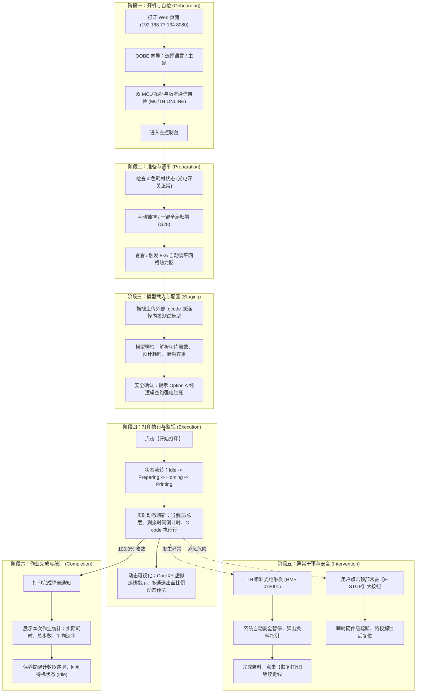
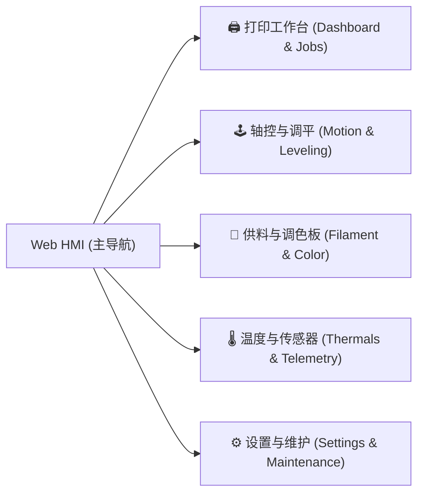
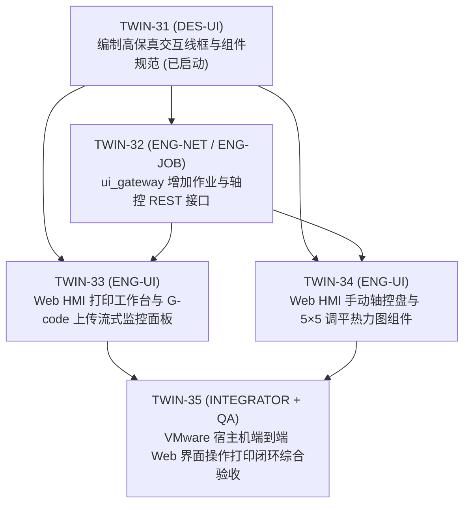

# AI-SoC Web HMI 端到端交互设计方案与全流程打印体验规划

> **设计背景与驱动：**
> 在 VMware 孪生运行与首版实机联调中，项目负责人指出：“端到端的体验没有规划好，缺少一个 UI 交互设计师角色负责交互的设计；增加该角色并基于已有功能整体规划当前 UI 设计，能够从 Web 页面完整体验 3D 打印机”。
> 本文档由 **`DES-UI`（UI/UX 交互设计师）** 编制，系统梳理底层已具备的全部能力资产，重构信息架构，打通从“设备开箱 -> 参数校准 -> 模型载入 -> 流式空跑 -> 实时监控 -> 异常干预 -> 样件完成”的端到端用户操作主航道。

---

## 1. 现有系统功能底座资产矩阵 (Available System Capabilities)

当前 AI-SoC 系统的底层微服务、契约与物理/孪生硬件已具备极为扎实的工程基础，但此前多以独立研发单测或割裂的技术标签呈现。DES-UI 将这些底座能力完整串联进 Web 体验中：

| 领域 / 模块 | 已闭环技术能力 (Backend & Firmware) | 对应任务证据 | 前端此前状态 | DES-UI 重构后的交互映射 |
| --- | --- | --- | --- | --- |
| **打印作业与运控** | C11/C++17 离线作业执行器，G-code 逐行流式解析（`G0/G1/G28/M104/M109/M140/M190/M163/M164/M112`），CoreXY 微米换算，128B 快照（行号、进度千分比、耗时） | `TWIN-23` `TWIN-30` | ⚠️ **完全缺失**（无文件上传、无打印主控制台） | **重构为核心首屏【🖨️ 打印工作台】**：支持拖拽上传 G-code、内置经典测试模型库、开始/暂停/恢复/取消按钮、流式走线实时进度条。 |
| **温度与强电安全** | 双 MCU 实时温度（0.1°C 精度、centi-C 自适应），Option A 强电硬锁死（0% Duty Lockout 纯逻辑空跑不烧丝） | `TWIN-15` `TWIN-16` `TWIN-22` | 独立二级标签页 | **双级呈现**：顶部状态栏全局常驻温度胶囊（`🔥 喷嘴` / `🛏️ 热床`）+ 【🌡️ 温度与传感器】详细温控曲线与防飞温安全标识。 |
| **运动控制与调平** | MC 0x16 20B 轴坐标与运动状态回传（微米级 X/Y/Z/E），MC 0x18 5×5 自动调平网格（25点高程偏差） | `TWIN-21` `TWIN-24` `TWIN-25` | ⚠️ **界面缺失** | **新增【🕹️ 轴控与调平】面板**：手动三轴对焦点触控罗盘（0.1~100mm 步长）、一键 G28 归零、5×5 调平彩色高程热力图渲染。 |
| **供料与多色混色** | 4 通道供料槽（0~10000 混色权重分配），TH 光电断料传感器（PD2 硬件中断）与 HMS 0x3001 联动 | `TWIN-17` `TWIN-18` `TWIN-20` | 平铺料槽表单 | **升级【🎨 供料与调色板】**：4 色立体线盘动态剩余量、断料光电传感器实时信号灯、混色色样实时渐变预览。 |
| **安全与健康 (HMS)** | 全机 24 类 HMS 统一错误码体系、Level 1/2 双级急停熔断、特权复位 | `TWIN-19` | 静态错误码表 | **全局安全中枢**：顶部醒目常驻 **红色 E-STOP 紧急急停大按钮**（1 击即停）+ 右侧全局 HMS 抽屉通知横幅。 |
| **开箱与网络** | OOBE 4 步开箱向导、mDNS 局域网服务发现、中英双语、深色/浅色/赛博朋克主题 | `TWIN-20` | 已有模态弹窗 | **无缝接入**：首屏开箱向导与日常工作台顺畅衔接，支持设置页随时重新启动。 |

---

## 2. 端到端用户全旅程地图 (End-to-End User Journey Map)

---

## 3. 全新信息架构与界面布局设计 (Information Architecture)

整个 Web HMI 控制台划分为 **“全局常驻顶栏 (Header)” + “五大核心功能标签页 (Tabs)” + “全局告警/急停抽屉 (Global Overlays)”**。

### 3.1 全局常驻顶栏 (Global Persistent Header)
无论用户切换到哪个标签页，顶栏始终固定在屏幕最顶部，提供最核心的机器状态与最高的安全掌控力：
- **机器标识与模式**：`AI-SoC 3D HMI` | `VMware Twin · Option A 纯逻辑空跑`；
- **核心通信与状态**：连接指示绿灯（`Connected`）+ 权威状态机世代号（`GEN: 550`）；
- **核心温度胶囊**：
  - `🔥 喷嘴: 122.3 °C`（点击可平滑滚动至温度详情面板）；
  - `🛏️ 热床: 24.5 °C`；
- **全局安全第一控制点（最高视觉权重）**：
  - **红色高亮 `🛑 E-STOP 紧急急停` 按钮**：采用醒目红底白字带警示条纹，单击立即触发 `M112` 熔断；
- **健康通知入口**：`🔔 HMS 告警铃铛`（带未读徽标数字，点击从右侧滑出告警排查抽屉）；
- **环境切换**：语言（中/英）、主题（暗黑/浅色/赛博朋克）、全屏触控切换。

---

### 3.2 五大核心标签页规划

#### 标签页 1：🖨️ 打印工作台 (Print Dashboard & Jobs) —— 【默认主航道】
作为用户进入控制台后的核心操作区，提供 3D 打印全生命周期一站式掌控：
1. **左侧：实时打印状态仪表盘**
   - **状态大徽标**：`IDLE (空闲就绪)` / `PRINTING (正在打印)` / `PAUSED (已暂停)` / `ERROR (异常)`；
   - **大环形进度条**：显示 0.0% ~ 100.0% 完成度，中心显示当前层高（如 `Layer 42 / 350`）与剩余时间倒计时（如 `剩余 00:18:24`）；
   - **作业详情卡片**：当前模型文件名、切片预估耗时、已打印时间、当前 G-code 指令行（如 `G1 X120.5 Y45.2 E1.8 F3000`）；
   - **流式空跑监视指示器**：直观展示 Option A 强电锁死状态（`强电 0% 锁定 · 纯逻辑走线中`）；
   - **主控按钮群**：
     - 空闲时：`▶ 开始打印`；
     - 打印中：`⏸ 暂停打印`、`⏹ 取消作业`；
     - 暂停时：`▶ 继续打印`、`⏹ 终止作业`。
2. **右侧：G-code 作业文件中心**
   - **拖拽上传区 (Drop Zone)**：支持将 `.gcode` 文件直接拖拽入浏览器或点击选择文件；
   - **本地模型库列表**：展示存储在设备中的作业文件，显示文件大小、切片日期、预计用时；
   - **内置经典测试样例一键载入**：
     - 🚢 `3DBenchy.gcode`（经典小船综合测试）；
     - 🧊 `CalibrationCube.gcode`（20mm 尺寸与回零标定样块）；
     - 🎨 `ColorSwatch_4Color.gcode`（4 色混色渐变测试样板）；
   - **选中模型元数据卡片**：展示模型切片信息与预估耗材用量。

---

#### 标签页 2：🕹️ 轴控与调平 (Motion Control & Bed Leveling)
专为打印前准备、机器标定与手动调试设计：
1. **左侧：CoreXY 三轴手动控制盘 (Jogger)**
   - **X/Y 坐标罗盘**：四向方向箭头（+X, -X, +Y, -Y），步长选择器（`0.1mm`、`1mm`、`10mm`、`100mm`）；
   - **Z 轴独立升降滑轨**：上升 / 下降按钮，支持婴儿步（Baby-stepping，`0.05mm` 微调）；
   - **当前物理坐标微米级数字仪表**：
     - `X: 125.00 mm` | `Y: 100.25 mm` | `Z: 0.20 mm` | `E: 14.50 mm`；
   - **归零控制按钮组**：
     - `🏠 全部归零 (G28)`；
     - 单独归零：`Home X`、`Home Y`、`Home Z`。
2. **右侧：5×5 自动调平高程热力图 (Leveling Mesh)**
   - **25 点彩色矩阵热力图**：将 MC 固件 `0x18` 上报的 25 点高程偏差数据直观渲染为高程网格（平整处为绿色 $\pm 0.02\text{mm}$，过高处为橙红色 $+0.25\text{mm}$，过低处为深蓝色 $-0.20\text{mm}$）；
   - **网格极值统计**：显示热床倾斜度（Tilt）、最大偏差（Max Variance）、均方根平整度（RMS）；
   - **操作按钮**：`📐 重新触发自动调平校准`。

---

#### 标签页 3：🎨 供料与调色板 (Filament & Color Mixing)
围绕 4 通道主动混色挤出系统（CMYK）打造：
1. **4 通道线盘状态卡片 (Spool Palette)**
   - 槽位 1~4（青色 Cyan / 洋红 Magenta / 黄色 Yellow / 黑色 Black）；
   - 动态耗材余量指示条（以克/米计量）；
   - 光电断料传感器状态灯（🟢 正常在位 / 🔴 断料缺料）；
2. **混色比例配置与动态预览**
   - 4 轴动态比例分配滑块（总和强制恒定为 $10000$ 权重）；
   - 实时混合色样本 Swatch 预览（所见即所得动态计算 RGB 混色）；
   - 预设混色方案保存与调用（纯色单吐、双色平分、全彩渐变）。

---

#### 标签页 4：🌡️ 温度与传感器 (Thermals & Telemetry)
1. **实时双温图表 (Temperature Plot)**
   - 喷嘴与热床过去 5 分钟的温度历史平滑曲线（1Hz 采样）；
   - 目标设定值与实际采集值对照；
2. **物理/固件版本拓扑树 (Device Topology & Degradation)**
   - MC 运动控制板：`v1.0 (0xA6791332)`，心跳状态 `ONLINE`，更新于 1.2 秒前；
   - TH 工具头板：`v1.0 (0x6356C05A)`，心跳状态 `ONLINE`，更新于 0.8 秒前；
   - Option A 强电硬锁死警示徽标：`0% Heating Duty Locked (Safe Dry-Run)`。

---

#### 标签页 5：⚙️ 设置与维护 (Settings & Maintenance)
1. **网络与连接**：mDNS 局域网广播状态（`aisoc-printer.local`）、IP 地址；
2. **全周期维护保养提醒**：
   - 导轨丝杆润滑保养（倒计时 120 小时）；
   - 喷嘴积碳清理提醒；
3. **系统诊断与向导**：
   - `🚀 重新运行开箱引导向导 (OOBE)`；
   - `📥 一键导出脱敏诊断日志包`。

---

## 4. 下一步工程任务拆解与派发规划 (Roadmap & Work Packages)

为落实上述端到端闭环交互设计，避免“只有设计文档无工程落地”，COORD 规划以下紧凑迭代任务链：

### 任务卡分解清单

1. **`TWIN-31` (DES-UI，设计规划)**：
   - **标题**：Web HMI 全流程打印交互原型规范与组件状态设计
   - **交付物**：高保真 DOM/CSS 交互组件样式规范、按键防抖与触控热区准则、空状态与异常弹窗状态机。
2. **`TWIN-32` (ENG-NET / ENG-JOB，后端网关扩展)**：
   - **标题**：`ui_gateway` 作业管理与手动运控 REST API 扩展
   - **范围**：
     - `POST /api/v1/jobs/upload`（支持 `.gcode` 多部分文件上传并落盘）；
     - `GET /api/v1/jobs/list`（查询已上传文件与内置样例库）；
     - `POST /api/v1/jobs/start`、`POST /api/v1/jobs/pause`、`POST /api/v1/jobs/resume`、`POST /api/v1/jobs/cancel`；
     - `GET /api/v1/jobs/status`（导出 128B 执行器快照）；
     - `POST /api/v1/motion/jog`（X/Y/Z/E 微米轴控）、`POST /api/v1/motion/home`（G28 归零）。
3. **`TWIN-33` (ENG-UI，前端工作台实现)**：
   - **标题**：Web HMI 核心打印工作台与 G-code 上传/流式进度组件实现
   - **范围**：在前端落地默认首页【🖨️ 打印工作台】，接入拖拽上传、内置模型选择、大进度环、开始/暂停/终止按钮与流式走线实时进度条。
4. **`TWIN-34` (ENG-UI，前端轴控与调平实现)**：
   - **标题**：Web HMI 手动轴控盘与 5×5 调平网格热力图组件实现
   - **范围**：实现 X/Y 罗盘与 Z 轴升降触控组件、实时坐标数字屏、5×5 调平网格 25 点高程热力图渲染与自动调平触发交互。
5. **`TWIN-35` (INTEGRATOR + QA，全链路收件验收)**：
   - **标题**：VMware 宿主机端到端 Web 界面操作打印闭环综合验收
   - **范围**：在 `http://192.168.77.134:8080` 真实环境中，通过浏览器执行完整闭环测试：
     1. 从网页上传或选择测试模型（如 `3DBenchy.gcode`）；
     2. 观察回零自检与流式模拟空跑启动；
     3. 实时监视进度环、当前层高、微米坐标跳动与强电 0% 硬锁死；
     4. 测试网页端“暂停/继续”与“顶部红色 E-STOP 急停”；
     5. 完整跑完至 100% 收敛并出具独立 QA 体验验收报告。
