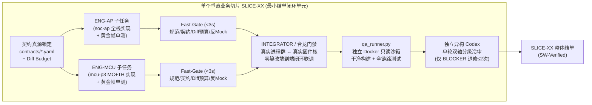
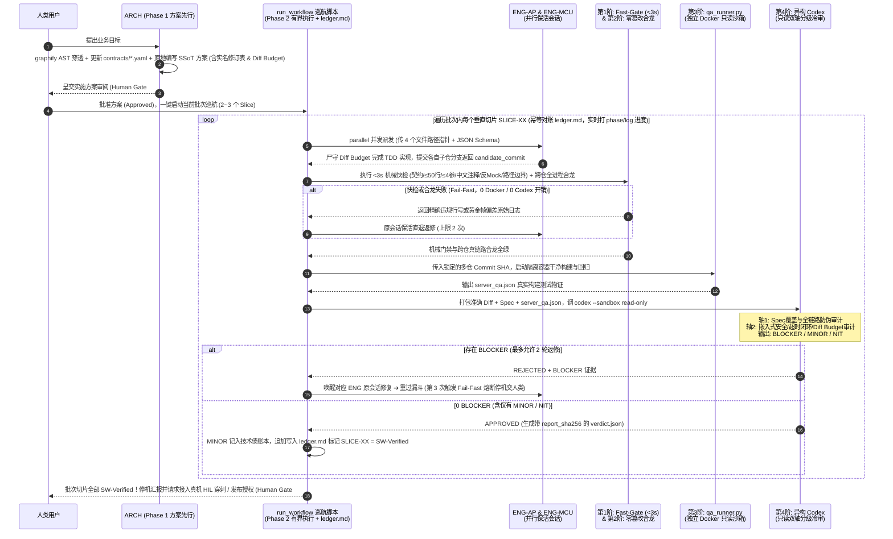

# AI SoC V2 研发治理、角色矩阵与任务编排穿透式重构方案

## 修订历史 (Revision History)

| 版本 | 修订时间 | 修订人 (Agent / Author) | 变更摘要 | 评审审批状态 |
| :--- | :--- | :--- | :--- | :--- |
| v1.0 | 2026-11-14 14:33 | `AI (Antigravity-CLI)` | 基于 `/grill-me` 六轮决策收敛与 `~/agents/skillslab/` 穿透评估生成首版重构方案（8 角色矩阵、7 专属 Skill、垂直切片连坐、`run_workflow` 四阶漏斗门禁） | 已审阅反馈 |
| v1.1 | 2026-11-14 14:56 | `AI (Antigravity-CLI)` | 吸收 [agents/mcu-p3/AGENTS.md](file:///home/sushaohua/workspace/ai_soc_project/agents/mcu-p3/AGENTS.md) 的“底层认知与执行硬约束”与“两阶段实施方案先行闭环”至根 [AGENTS.md](file:///home/sushaohua/workspace/ai_soc_project/AGENTS.md)；在本方案原地合入两阶段 SSoT 协议、实名修订履历、最小修改预算（Diff Budget）、线性 Rebase 冲突熔断及验证回滚预案 | 已分步批准 `AGENTS.md` 部分 |
| v1.2 | 2026-11-14 15:13 | `AI (Antigravity-CLI)` | 按用户指令先行独立完成根仓 [AGENTS.md](file:///home/sushaohua/workspace/ai_soc_project/AGENTS.md) 校验与本地原子提交（Commit `05df87a`，`10/10` 根测试与 `56/56` QA Runner 测试全绿）；其余 Step 1~4（角色/门禁/`run_workflow`/`skillslab` 迁移）保持挂起待后续更新批准 | `AGENTS.md` 已闭环；其余待批 (`On Hold`) |
| v1.3 | 2026-11-14 15:27 | `AI (Antigravity-CLI)` | 按根 [AGENTS.md](file:///home/sushaohua/workspace/ai_soc_project/AGENTS.md) §2.1 两阶段 SSoT 归档与时间戳命名规则，将原方案改名归档至根 `docs/`（`docs/v2_governance_and_orchestration_implementationplan_20261114_152634.md`）作为唯一真相源（SSoT）；Step 1~4 保持挂起待后续更新批准 | 已归档 SSoT；其余待批 (`On Hold`) |
| v1.4 | 2026-11-14 15:37 | `AI (Antigravity-CLI)` | 用户下达 `[Approved]` 正式批准指令，启动 Phase 2 有界连续执行（Step 1 封存旧运行器与未结微票 ➔ Step 2 规则瘦身与 V2 无状态门禁/工作流实现 ➔ Step 3 7 专属 Skill 双仓落位与 `graphify` AST 图谱构建 ➔ Step 4 首份 `Batch-01` 深度拆解方案产出） | **已批准执行 (`Approved`)** |
| v1.5 | 2026-11-14 16:30 | `AI (Antigravity-CLI)` | 完成 Step 1~4 落地与门禁核验（归档旧 `coord_runner` 与 23 张未结旧卡；落地 V2 无状态门禁与工作流 `895 <= 900` 行、`30/30` 单测 PASS；部署 7 项专属 Skill 与 5 业务仓 `graphify` AST 图谱） | 已提交初版结单 |
| v1.6 | 2026-11-14 16:37 | `AI (Antigravity-CLI)` | 按用户明确边界指令（`这次只修改流程，不涉及业务`）裁剪移除 Step 4 业务批次草稿（`Batch-01` 方案与 `SLICE-01~03.yaml`），确保本轮交付严格收敛于纯 V2 研发治理、规则、无状态门禁、工作流模板与 Skill 体系，0 业务改动 | **纯流程重构已闭环 (`Completed`)** |

> [!IMPORTANT]
> **总体设计北极星：高效流转，用确定性流程与代码结构硬性控制犯错。**
> 本方案彻底淘汰上一版“水平切碎微角色 + 6,373 行重型状态机 + 150 行哈希表文书防错”模式，确立 **“5 大底层认知硬约束 + 两阶段 SSoT 方案审批闭环 + 8 席仓级深模块角色 + AST 图谱与单一机器契约源 + 垂直切片连坐合龙 + `run_workflow` 全自动批次巡航”** 新架构。

---

## 一、 上一版体系穿透式病灶诊断（基于真实仓库物证）

对现有 [project-control](file:///home/sushaohua/workspace/ai_soc_project/project-control) 看板、证据链与工具源码的穿透核查表明，上一版的“浅、散、肿”是由三个底层结构缺陷必然导致的系统性结果：

| 核心痛点 | 仓库真实物证定位 | 深层结构性根因 |
| :--- | :--- | :--- |
| **1. 每个 Agent 只保自己一块，全程无人兜底** | 见 [end_to_end_physical_link_remediation_plan_20261104.md](file:///home/sushaohua/workspace/ai_soc_project/project-control/docs/planning/end_to_end_physical_link_remediation_plan_20261104.md#L29-L45)： • `ui_gateway` 在本地 RAM 硬编码 `s_job.is_homed = true` 与正弦假坐标自嗨； • `twin46_mc_bridge.c:144` 偷偷篡改 `frame[5] = 0x14U` 掩盖 AP/MCU 命令码错位； • `mc_debug_notify_*` 生产固件 **0 调用**，`debug_reconciliation_probe.py` 用 `ctypes` 后门塞伪日志过账。 | **水平切碎微角色 + 单仓微票独立结单**：[02_模块与Agent职责.md](file:///home/sushaohua/workspace/ai_soc_project/project-control/.agents/rules/02_模块与Agent职责.md) 将单仓 `soc-ap` 拆成 **9 个水平微角色**（共 19 角色）。每个 Agent 被狭窄 `allowed_paths` 困在局部层，为了让自己那张微票单测变绿，最佳博弈策略就是在接缝处写 Mock/假状态/桥接补丁交差。 |
| **2. `ARCH` 拆解流于表面，频频漏掉真实链路** | • `TWIN-43` 只改了 CLI 用的 `serial_posix.cpp`，漏改守护进程实际调用的 `forward_uart.cpp`（`921600` 静默跌落 `B115200`）； • AP 与 MCU 各自手抄协议宏，酿成 `0x14/0x15`、`0x12`（急停 vs 移动）严重冲突； • 未发现 `Marlin_main.c` 串口入口被整段注释。 | **缺物理检索实证（Physical Retrieval）+ 缺 AST 图谱穿透 + 缺机器可读单一契约源**：`ARCH` 依赖旧文档印象按模块层派票，既无本地 AST 调用链取证，也无代码化协议真源，各端手抄 Markdown 表格必然漂移。 |
| **3. 流程极度臃肿，算力耗在填表而非拦错** | • `coord_runner/` 膨胀至 **24 个模块、6,373 行代码**（却如其 [README.md](file:///home/sushaohua/workspace/ai_soc_project/project-control/tools/coord_runner/README.md#L43) 自述，连工程师 Agent 自动派发都未接通）； • [TWIN-61.md](file:///home/sushaohua/workspace/ai_soc_project/project-control/.agents/kanban/microtasks/vmware_soc_twin/TWIN-61.md) 单卡 180 行（路径写 4 遍、挂 6 个流水号、锁 10+ 个文档 SHA-256），碎片化草稿横飞，反复刷到 **`qa_07`（7 轮重型 QA）**； • `work_intake.py` 因 `NON_HUMAN_SUBMITTER` 拒收 Codex 抓到的真实 HIL 缺陷；SQLite 租约与卡面状态脑裂。 | **用文书官僚代替机械刹车**：缺少秒级前置静态门禁，把低级规范问题全部推给最昂贵的“Docker 全量编译 + 多席位 Codex 盲审”；同时缺少“同一方案原地迭代（In-place SSoT）”约束，制造了大量多文件对账负担。 |

---

## 二、 顶层底座铁律：五大底层认知硬约束与两阶段协议（已前置合入根 `AGENTS.md`）

参考 [agents/mcu-p3/AGENTS.md](file:///home/sushaohua/workspace/ai_soc_project/agents/mcu-p3/AGENTS.md) 经实战检验的固件治理内核，已将以下两层基石提炼适配为全工作区最高宪法写入根 [AGENTS.md](file:///home/sushaohua/workspace/ai_soc_project/AGENTS.md)（自动注入所有主会话与子 Agent 的 `<user_rules>`）：

1. **五大底层认知与执行硬约束 (Foundational Invariants)**：
   - **Anti-Sycophancy（反谄媚与事实裁决）**：受质疑时严禁盲目道歉迎合，必须先调工具独立检索/编译实证，开门见山摆事实证据。
   - **Physical Retrieval Invariant（外部实体物理核验）**：严禁臆造 API、协议命令码/帧布局、寄存器位、时钟/VTOR 参数；断言前必做物理核验，无法核验显式标 `[UNVERIFIED]`（正式交付代码中出现未消解 `[UNVERIFIED]` 直接阻断）。
   - **Minimal Necessary Diff & Anti-Fake（优先最小化修改现有逻辑与反造假）**：优先在现有调用链做最小必要修改（存量开源代码如 Marlin 严格遵循 **Minimal Diff Budget**，严禁大范围无关重构）；绝对禁止内存假状态、改字节测试垫片（Shim）与 0 调用悬空钩子。
   - **Fail-Fast（错误与冲突立即熔断）**：构建、测试、门禁或 `git rebase` 冲突报错时立即停机保现场、贴原始日志，严禁脑补绕过或强行覆盖冲突。
   - **Workspace Confinement（工作区与软链接硬隔离）**：严禁未获显式路径授权探测根工作区外部（`../`）；合法跟随工作区软链接，严禁跳出目标目录或触碰 `agents/` 内非本项目的其他工程目录。
2. **强制两阶段协议：实施方案先行与审批闭环 (Mandatory Two-Phase Protocol)**：
   - **Phase 1（实施方案先行与单一真相源 SSoT）**：一切写操作前先产出时间戳方案 `{task_summary}_implementationplan_{YYYYMMDD_HHMMSS}.md`；**禁止改写历史结项文档、同一任务多轮讨论强制原地更新（In-place Update）**；头部强制维护标注**具体 AI 客户端/引擎实体**（如 `AI (Antigravity-CLI)`、`AI (Codex)`，禁填模糊 `"AI"`）的修订历史表；必填 AST 核实文件清单、软硬件契约推演、**最小修改预算（Diff Budget）** 与回滚预案；**未经用户明确批准严禁改任何代码**。
   - **Phase 2（获批后的有界执行与连续巡航）**：在获批方案圈定的仓库、分支与 Diff Budget 内精准执行（批次计划一经批准即授权 `run_workflow` 连续跑完该批切片，直至批次完工、触及物理/发布红线或返修熔断）；耗时 $>1\text{ min}$ 任务必打动态进度日志；线性 `rebase` 对齐；未经真实构建测试严禁报绿。

---

## 三、 重构模块 1：角色分配矩阵与 `skillslab` 技能蒸馏落位

### 3.1 19 角色收敛至 8 席“仓级深模块闭环”角色矩阵

借鉴 [codebase-design](file:///home/sushaohua/agents/skillslab/skills/skills/engineering/codebase-design/SKILL.md) 的**深模块（窄接口隐藏深实现，减少跨模块接缝）**原则，彻底废除按代码目录切碎的水平微角色，严格按**物理代码库、运行态隔离边界与独立审查红线**收敛为 **8 个核心角色**（原 `PM`、`DES-UI` 降级为按需调用的组合式 Skill）：

| 新角色 ID | 合并/替代的原角色 | 唯一写入范围（Repo & 分支硬边界） | 核心职责与防错边界（端到端包干范围） | 推荐模型档位 |
| :--- | :--- | :--- | :--- | :--- |
| **`COORD`** | `COORD`（去文书化） | 仅 `project-control/`（含 `slices/`、`docs/`）及获授权时更新根 `workspace.json`；**5 大业务仓 100% 只读** | 主持两阶段协议审批入口、触发 `run_workflow` 批次自动巡航、维护 `ledger.md` 账本、管控 HIL 台架独占窗口与发布汇总。严禁手改业务代码或绕过门禁退出码。 | 主会话旗舰模型（Carbon / Pro） |
| **`ARCH`** | `ARCH`（吸收原 `PM` 规格合成职责） | 仅 `project-control/docs/planning/`、`docs/architecture/`、`contracts/`、`slices/`；**业务仓只读** | 执行 Phase 1 深度规划：基于 `graphify` AST 图谱穿透全栈真实调用链；维护 `contracts/` 机器可读单一协议真源；对复杂接缝执行 `Design-It-Twice`；输出并原地迭代带实名修订表与 **Diff Budget** 的垂直切片方案。 | 旗舰推理模型（Carbon / Pro） |
| **`ENG-AP`** | 合并原 `ENG-UI` / `ENG-NET` / `ENG-STATE` / `ENG-JOB` / `ENG-FWD` / `ENG-DBUS` / `ENG-DDS` / `ENG-MQTT` / `ENG-BSP`（**9 合 1**） | 仅 `soc-ap/`（`main` 或切片工作树） | **AP 全栈闭环包干**：一人贯通 Web 前端 ➔ `ui_gateway` ➔ D-Bus/DDS IPC ➔ `device_manager` ➔ `forward_service_daemon` 物理串口帧收发。彻底消灭网关层造假内存状态应付下游的动机。 | 标准/主力编码模型（多模块贯通） |
| **`ENG-MCU`** | 合并原 `ENG-MC` + `ENG-TH` + `ENG-COLOR`（**同仓合一**） | 仅 `mcu-p3/`（锁定开发分支 `feat/soc-debug`） | **双板应用固件闭环包干**：统一负责 MC（AT32F435 + Marlin 运动/温控核心 + `USART6` 级联路由，Marlin 存量遵守 Minimal Diff Budget）与 TH（AT32F423 工具头控制）端到端闭环及真实 `[MC-DBG]`/`[TH-DBG]` 埋点。 | 标准/主力编码模型（嵌入式 C） |
| **`ENG_BOOT_MC`** | `ENG_BOOT_MC`（独立保留） | 仅 `boot/bootloadermc/`（严格锁定 `soc_debug`，禁写 `main`） | MC 板 16KB Bootloader 启动、VTOR `0x08020000` 跳转、128B Trailer 预验签、MiniMCProto v2 升级接收、2KB 扇区擦写与掉电恢复。 | 主力高可靠模型（安全关键） |
| **`ENG_BOOT_TH`** | `ENG_BOOT_TH`（独立保留） | 仅 `boot/bootloaderth/`（严格锁定 `soc_debug`，禁写 `main`） | TH 板 Bootloader 启动、VTOR `0x08004000` 跳转、级联升级接收、预验签后擦写与防变砖自愈。 | 主力高可靠模型（安全关键） |
| **`INTEGRATOR`** | `INTEGRATOR` + 原 `ENG-SIM` | `test_harness/`（及经明确切片授权的 `soc-ap/tools/deploy_*.sh` 跨仓编排脚本） | 负责跨仓全进程零篡改合龙联调（真实守护进程群 ↔ 真实固件协议/业务核）、固件打包脚本、清洁重部署编排及 HIL 台架联通性预检与部署手册。**严禁编写改包桥接或伪日志注入器**。 | 标准/主力编码模型 |
| **`QA`** | 独立 `QA`（沙箱 + 异构 Codex + HIL） | 仅 `project-control/docs/evidence/`；审阅会话强制 `--sandbox read-only` | 阶段 1：`qa_runner.py` 在隔离 Docker 容器对锁定 Commit 执行干净构建与全链路回归；阶段 2：独立异构 Codex 会话执行双轴分级冷审；阶段 3：里程碑真机 HIL 正负配对实测。 | 异构独立模型（Codex 只读冷审） |

### 3.2 全流程 RACI 责任分配表

*图例：`R` = 执行主责（Responsible），`A` = 最终拍板/准出负责（Accountable），`C` = 协同输入（Consulted），`I` = 知情（Informed）*

| 生命周期阶段 | 人类用户 | `COORD` | `ARCH` | `ENG-AP` / `ENG-MCU` / `ENG_BOOT_*` | `INTEGRATOR` | 独立 `QA` |
| :--- | :---: | :---: | :---: | :---: | :---: | :---: |
| **1. Phase 1 实施方案先行、AST 穿透与机器契约定义** | **A**（1次审批闭环） | C | **R**（原地迭代 SSoT） | — | — | — |
| **2. Phase 2 单仓子任务契约驱动并行 TDD 实现** | I | I（工作流托管） | C（契约仲裁） | **R / A**（严守 Diff Budget） | — | — |
| **3. 秒级机械门禁（`Fast-Gate` `<3s`）** | — | **A**（脚本硬拦截） | — | **R**（不过当场自修） | — | — |
| **4. 跨仓全进程零篡改合龙联调** | — | **A**（脚本硬拦截） | — | C（定责返修） | **R** | — |
| **5. Docker 干净沙箱 + 异构 Codex 双轴冷审** | I（熔断时介入） | **A**（凭 `verdict.json` 收件） | — | C（仅 `BLOCKER` 返修≤2次） | — | **R** |
| **6. 业务域真机 HIL 穿刺与线性 `rebase` 发布** | **A**（物理/发布红线授权） | C（排期与冲突熔断监控） | — | C（问题修复） | R（环境部署就绪） | **R**（独立实测取证） |

### 3.3 参考库 `~/agents/skillslab/` 穿透评估与双仓蒸馏挂载矩阵

剔除 `~/agents/skillslab/`（5 套库、75+ 个 Skill）中的同名触发冲突与无关领域技能，融合本项目两阶段协议与嵌入式红线，蒸馏为 **7 个无冲突专属 Skill + 本地 `graphify` CLI**，按双仓隔离挂载：

| 序号 | 新蒸馏专属 Skill / 工具名 | 吸收融合的 `skillslab` 与内部规范精华 | 剔除的冲突/水土不服项 | 物理挂载位置（按仓精准可见） | 绑定角色 |
| :---: | :--- | :--- | :--- | :--- | :--- |
| **工具** | **`graphify` 本地 AST 图谱 CLI** | [graphify](file:///home/sushaohua/agents/skillslab/graphify/README.md)（零 Token 本地 tree-sitter AST 解析、`path`/`explain`/`query`）+ [understand-diff](file:///home/sushaohua/agents/skillslab/Understand-Anything/understand-anything-plugin/skills/understand-diff/SKILL.md) 爆炸半径核查 | 剔除 `Understand-Anything` 全仓高 Token LLM 重扫与云端遥测 | 本机 CLI 工具 + 各子仓 `.gitignore` 忽略 `graphify-out/` | `ARCH`、`QA`、`ENG-*` |
| **S1** | **`arch-deep-spec`** | [codebase-design](file:///home/sushaohua/agents/skillslab/skills/skills/engineering/codebase-design/SKILL.md)（`DESIGN-IT-TWICE`）+ [grill-with-docs](file:///home/sushaohua/agents/skillslab/skills/skills/engineering/grill-with-docs/SKILL.md)（`GLOSSARY.md`）+ [to-tickets](file:///home/sushaohua/agents/skillslab/skills/skills/engineering/to-tickets/SKILL.md)（垂直切片）+ [writing-plans](file:///home/sushaohua/agents/skillslab/superpowers/skills/writing-plans/SKILL.md) + **本项目两阶段 SSoT 方案规范（实名修订表、软硬件契约推演、Diff Budget）** | 剔除 `to-spec`“禁写文件路径”教条（嵌入式必须锚定精确文件与符号） | `project-control/.agents/skills/arch-deep-spec/` | `ARCH` |
| **S2** | **`slice-batch-orchestrator`** | 内置 [run-workflow](file:///home/sushaohua/.gemini/antigravity-cli/builtin/skills/run-workflow/SKILL.md) 原语 + [subagent-driven-development](file:///home/sushaohua/agents/skillslab/superpowers/skills/subagent-driven-development/SKILL.md)（`ledger.md` 幂等续跑、文件指针传参、2轮保活返修熔断、长任务动态进度日志） | 剔除根仓盲建 `worktree`（适配 7 子仓独立目录模型）与逐微票串行外审 | `project-control/.agents/skills/slice-batch-orchestrator/` | `COORD` |
| **S3** | **`two-axis-qa-audit`** | [code-review](file:///home/sushaohua/agents/skillslab/skills/skills/engineering/code-review/SKILL.md)（`Spec/契约真实性` 与 `嵌入式安全/Diff Budget` 双轴独立审查）+ `understand-diff` 受影响调用链核查 | 剔除已由 `Fast-Gate` 机械拦截的行长/参数计数重复人工挑刺 | `project-control/.agents/skills/two-axis-qa-audit/` | `QA`（Codex 审阅内核） |
| **S4** | **`hil-and-issue-triage`** | [triage](file:///home/sushaohua/agents/skillslab/skills/skills/engineering/triage/SKILL.md) + [e2e_issue_verification_flow.md](file:///home/sushaohua/workspace/ai_soc_project/project-control/.agents/rules/e2e_issue_verification_flow.md)（正负成对验收、根因去重归并） | 剔除 GitHub Labels 强绑定与 `NON_HUMAN_SUBMITTER` 人工提单死锁 | `project-control/.agents/skills/hil-and-issue-triage/` | `COORD`、`QA`、`INTEGRATOR` |
| **S5** | **`contract-vertical-tdd`** | [test-driven-development](file:///home/sushaohua/agents/skillslab/superpowers/skills/test-driven-development/SKILL.md) + [verification-before-completion](file:///home/sushaohua/agents/skillslab/superpowers/skills/verification-before-completion/SKILL.md) + **物理核验铁律、Minimal Diff Budget、黄金字节向量反 Mock、线性 Rebase 冲突熔断** | 剔除纯 Web 单测套路，注入自研模块 `≤50行/≤4参`/零堆/超时保护/中文注释自检 | `agents/{soc-ap,mcu-p3,bootloadermc,bootloaderth,test_harness}/.agents/skills/` | `ENG-AP`、`ENG-MCU`、`ENG_BOOT_*`、`INTEGRATOR` |
| **S6** | **`systematic-link-debugging`** | [systematic-debugging](file:///home/sushaohua/agents/skillslab/superpowers/skills/systematic-debugging/SKILL.md)（4 阶段根因追踪）+ [diagnosing-bugs](file:///home/sushaohua/agents/skillslab/skills/skills/engineering/diagnosing-bugs/SKILL.md)（红灯复现 ➔ 最小化 ➔ 埋点取证 ➔ 回归） | 定制 `AP UART ↔ MC USART2 ↔ Marlin ↔ USART6 ↔ TH` 物理抓包与串口预热时序规范 | `agents/{soc-ap,mcu-p3,test_harness}/.agents/skills/` | `ENG-AP`、`ENG-MCU`、`INTEGRATOR` |
| **S7** | **`hmi-frontend-design`** | [frontend-design](file:///home/sushaohua/agents/skillslab/best-skills/skills/frontend-design/SKILL.md) + [prototype](file:///home/sushaohua/agents/skillslab/skills/skills/engineering/prototype/SKILL.md)（单文件多变体交互原型比选） | **仅挂载于 `agents/soc-ap/`**，避免 MCU 与 Bootloader 角色加载前端规则浪费 Token | `agents/soc-ap/.agents/skills/hmi-frontend-design/` | `ENG-AP` |

---

## 四、 重构模块 2：任务编排逻辑（深拆解 + 垂直连坐 + 代码化巡航）

### 4.1 `ARCH` 深度拆解四要素（融合两阶段协议 Phase 1）

1. **`graphify` AST 穿透取证（物理核验铁律落地）**
   - 动笔前必须查询本地 `graphify` AST 图谱，在方案中输出 **《端到端真实符号调用链与现状断点核实表》**（列明 `仓:文件路径:函数名` 与 `EXTRACTED` 调用边），彻底杜绝漏掉守护进程、中断回调或 Marlin 队列。关键接缝启用 `Design-It-Twice` 多方案比选。
2. **`project-control/contracts/` 机器可读单一契约真源（Contract-as-Data）**
   - 在 `project-control/contracts/minimc_v2_contract.yaml` 集中维护唯一命令码、载荷结构、超时阈值与**正/负十六进制黄金帧向量**，由 `tools/sync_contracts.py` 一键生成并毫秒级强校验各仓 `.h`/`.py`，机械消灭 `0x14/0x15` 手抄漂移。
3. **软硬件契约推演与最小修改预算（Diff Budget）**
   - 方案必须显式推演时钟/中断/内存/VTOR/串口吞吐与 ACK 超时闭环，并为每个子仓设定明确的 **最小修改预算（预计改动文件集合与存量模块如 Marlin 的零无关重构红线）**。
4. **原地迭代 SSoT 垂直切片执行书**
   - 单一文档 `{summary}_implementationplan_{YYYYMMDD_HHMMSS}.md` 原地迭代更新，包含实名修订履历、`Global Constraints`、Top-5 隐含失效模式（`Review Focus`）及拓扑有序的 `SLICE-01..N`（声明精确 `Consumes/Produces` 签名与验收判据）。

### 4.2 “垂直切片（Vertical Slice）连坐闭环”两级编排逻辑

- **纵向切窄，禁止横向切层**：每个 `SLICE-XX` 必须穿刺一条窄而完整的业务链；禁止拆出纯局部接口或空钩子微票。
- **单仓不结单，合龙连坐制**：单仓过 `Fast-Gate` 仅进 `Subtask-Ready`，**绝不单独跑 Codex QA 或单独标 `Done`**；必须跨仓全进程零篡改合龙联调全绿后，整个切片才打包进一次 Docker 沙箱与 Codex 审查。
- **合龙定责直退**：合龙失败按黄金帧日志直接退回违约端 Agent 修复，严禁在 `test_harness` 写改包桥接掩盖。

### 4.3 推倒重来：基于 `run_workflow` + `ledger.md` 的代码化自动巡航架构

彻底封存退役 6,373 行 `coord_runner` 与 SQLite 状态库，改用 `run_workflow` Python 脚本（`project-control/tools/workflow/run_slice_batch.py`）承载 Phase 2 有界执行：

1. **不可跳步的代码化流水线**：在同一个 Python 脚本内硬编码串联 `账本幂等对账 ➔ parallel(ENG-AP, ENG-MCU) ➔ Fast-Gate ➔ 零篡改合龙 ➔ Docker qa_runner ➔ Codex 冷审 ➔ 账本落盘推进下一 Slice`。任何非 0 退出码立即进入 Fail-Fast 保活返修分支（`await eng_agent(...)`，上限 2 轮）或停机熔断，物理杜绝跳步。
2. **多子仓物理正交并发与线性历史保护**：同切片内 `soc-ap/`、`mcu-p3/`、`boot/*` 物理目录完全正交，使用 `workspace="inherit"` + `Fast-Gate` 路径越界扫描即可安全并发；推送远端前统一执行 `git rebase` 线性对齐，遇冲突立即 Fail-Fast 停机保现场交人工仲裁。
3. **极简 ~25 行 `SLICE-XX.yaml` + 追加式 `ledger.md`**：取代旧版 180 行微票与 SQLite，仅锁 **Git Commit SHA** 与 **QA 报告哈希**（废除全部 Markdown 文档 SHA-256 锁）；长耗时步骤通过 `phase()` 与 `log()` 持续输出动态进度，中断重跑毫秒级跳过已绿节点。
4. **稀疏文件指针传参**：向子 Agent 仅传 4 个文件路径指针（获批方案路径、本切片 YAML、契约头文件、报告输出路径），配合 `schema={...}` 平台级 JSON 强校验，零历史上下文污染。

---

## 五、 重构模块 3：五大核心工作流与门禁瘦身设计

### 5.1 砍掉的臃肿负担 vs 强化的防错硬闸门总览

| 维度 | 🗑️ 彻底砍掉的臃肿官僚项 | 🛡️ 新增/保留的硬核防错闸门 |
| :--- | :--- | :--- |
| **规划与审批** | 砍掉 5~6 轮多角色会签往返、碎片化多份草稿、`REQ/DEM/CONFIRM/APPR` 单号嵌套、Markdown 文档 SHA-256 锁 | **强化两阶段 SSoT 协议**：单一时间戳方案原地更新 + 实名 AI 实体修订表 + `graphify` AST 取证 + `contracts/` 单一协议真源 + Diff Budget；1 次审批即授整批巡航权 |
| **卡片与状态** | 砍掉 6,373 行 `coord_runner`、SQLite 租约库、`cas_writer`、`1800s` 超时锁、150 行四重路径微票 | **新增** ~25 行 `SLICE-XX.yaml` + 追加式 `ledger.md` + `run_workflow` 代码化强制顺序编排；保留 **Git Commit SHA 锁** 与线性 Rebase 约束 |
| **代码规范与防伪** | 砍掉靠人工/Codex 多轮来回挑注释、行数、参数个数 | **新增 `<3s` 本地确定性 `Fast-Gate` 脚本**：机械拦截契约不一致、自研函数 `>50行/>4参`、存量超 Diff Budget、缺中文注释、残留 `[UNVERIFIED]`、0调用悬空函数、测试桥改字节、路径/分支越界 |
| **独立 QA 审查** | 砍掉逐微票独立跑 Docker、砍掉 legacy 双重报告复核、砍掉无分级 MINOR 一票否决 | **保留并提效**：整个垂直切片合龙后仅跑 **1 次** `qa_runner.py` Docker 干净构建测试 + **1 次**异构 `Codex --sandbox read-only` 双轴审查；实行 `BLOCKER / MINOR / NIT` 三级判定与 **2 次返修熔断** |
| **真机 HIL 与提单** | 砍掉 `NON_HUMAN_SUBMITTER`（禁止 AI 提单死锁）、砍掉脱离硬件连跑几十张卡的盲目空转 | **新增双态准出与业务域真机穿刺**：常规切片标 `SW-Verified` 连续巡航，每 2~3 切片（1 个业务域）或底层改动强制停机跑真机 HIL 升为 `HIL-Verified` |

### 5.2 核心流程闭环时序（两阶段协议 + `run_workflow` 四阶漏斗 + HIL 穿刺）

> [!TIP]
> **全流程仅保留 2 道人工停机闸门**：
> - **Human Gate #1（Phase 1 方案审批闭环）**：批次 SSoT 方案审阅拍板，未获批绝不动一行代码；一旦获批即授权批次内切片全自动连续推进。
> - **Human Gate #2（物理硬件 / 线性变基冲突 / 远端发布 / 2次熔断红线）**：真机刷写/上电运动加热（常规部署统一走 MiniMCProto v2 升级，探针仅限首次刷 Boot 或救援并须单次授权）、2 轮 `BLOCKER` 未决熔断、`rebase` 冲突仲裁，以及最终 `publish` 推送远端。

---

## 六、 一刀切落地实施计划、最小修改预算与回滚预案（按两阶段协议制定）

本重构方案本身严格遵循根 [AGENTS.md](file:///home/sushaohua/workspace/ai_soc_project/AGENTS.md) 两阶段协议要求，列明本次治理底座切换的精确文件清单、最小修改预算（Diff Budget）与验收回滚标准：

### 6.1 影响仓库、精确文件清单与最小修改预算 (Diff Budget)

- **业务代码零触碰红线**：本次治理重构 **100% 不修改** `soc-ap/`、`mcu-p3/`、`test_harness/`、`boot/bootloadermc/`、`boot/bootloaderth/` 任何业务源码与构建逻辑（5 大业务仓仅在 `.gitignore` 按需追加 1 行 `graphify-out/` 忽略规则）。
- **根入口仓（`ai-soc-workspace`）**：
  - [AGENTS.md](file:///home/sushaohua/workspace/ai_soc_project/AGENTS.md)：**✅ 已按先期授权独立提交闭环（Commit `05df87a`）**，完整合入五大底层认知硬约束、两阶段 SSoT 协议、线性 Rebase 冲突熔断与核心禁令；后续 Step 2 获批后再同步 V2 门禁脚本路径引用；
  - `docs/`：归档正式定稿版 V2 治理重构方案原件（`docs/v2_governance_and_orchestration_implementationplan_20261114_152634.md`）。
- **控制仓（`project-control/`）**：
  - 封存搬迁（纯 `git mv`，零逻辑篡改）：`tools/coord_runner/**`、`tools/check_task_graph.py` 移入 `tools/legacy/`；23 张未完结历史微票移入 `.agents/kanban/archive_v1/`（103 张已 `Done` 历史卡原地不动）；
  - 规则更新：原地精简更新 [02_模块与Agent职责.md](file:///home/sushaohua/workspace/ai_soc_project/project-control/.agents/rules/02_模块与Agent职责.md)、[delivery_and_coord_gate.md](file:///home/sushaohua/workspace/ai_soc_project/project-control/.agents/rules/delivery_and_coord_gate.md)、[codex_qa_review.md](file:///home/sushaohua/workspace/ai_soc_project/project-control/.agents/rules/codex_qa_review.md)；
  - 新增轻量无状态工具集（严格执行单函数 `≤50行`、入参 `≤4个`、全中文文档字符串与注释，总新增代码预算 **$\le 900$ 行**，约为旧 `coord_runner` 的 **1/7**）：
    1. `contracts/minimc_v2_contract.yaml` + `tools/sync_contracts.py`（单一契约源生成/校验器）；
    2. `tools/gates/fast_gate.py`（`<3s` 机械规范/契约/反Mock/路径边界快检）；
    3. `tools/gates/codex_review.py` + `tools/gates/slice_gate.py`（串联 `Fast-Gate ➔ 既有 qa_runner.py ➔ Codex 双轴分级冷审`）；
    4. `tools/workflow/run_slice_batch.py` + `slices/TEMPLATE_SLICE.yaml`（`run_workflow` 幂等批次巡航脚本与 ~25 行切片模板）；
    5. `tools/test_v2_gates.py`（覆盖上述全部门禁与断点续跑的单元测试）；
  - 公共专属技能：在 `.agents/skills/` 新建 `arch-deep-spec`、`slice-batch-orchestrator`、`two-axis-qa-audit`、`hil-and-issue-triage`（退役旧 `coord-task-handoff`）。
- **规则托管仓（`agents/`）**：
  - 严格限定在本项目 5 个子目录（`soc-ap/`、`mcu-p3/`、`test_harness/`、`bootloadermc/`、`bootloaderth/`）的 `.agents/skills/` 下部署 `contract-vertical-tdd`、`systematic-link-debugging` 与 `hmi-frontend-design`（仅 `soc-ap/`），绝不触碰 `agents/` 内其他无关外部目录。

### 6.2 分步执行与验收判据 (Pass Criteria)

| 步骤 ID | 执行内容 | 客观验收命令与 Pass Criteria |
| :---: | :--- | :--- |
| **Step 1** | 旧 `coord_runner` 与 23 张未完结旧卡归档封存，同步快照至 `project-control/docs/planning/` | `git -C project-control status` 确认 `Done` 历史卡与历史证据 0 修改；旧代码完整保留于 `tools/legacy/` |
| **Step 2** | 规则瘦身与 V2 无状态门禁三件套（`sync_contracts`、`fast_gate`、`slice_gate`）+ `run_slice_batch.py` 实现 | 1. 跑 `fast_gate.py` 自检新增 Python 工具（100% 满足 `≤50行/≤4参` 与全中文注释）； 2. `pytest project-control/tools/test_v2_gates.py project-control/tools/test_qa_runner.py` 全部 PASS |
| **Step 3** | 7 大蒸馏 Skill 双仓落位 + 本机 `graphify` 安装与 5 业务仓首版 AST 图谱构建 | 1. 核验 `project-control` 与 `agents` 软链接可达且 `agents/` 其他项目目录 `git diff` 为空； 2. 对 `soc-ap` 与 `mcu-p3` 实跑 `graphify explain` / `path` 成功输出真实 AST 调用边 |
| **Step 4** | ~~首批次业务实战衔接~~（已按用户指令裁剪） | 按用户 `这次只修改流程，不涉及业务` 指令移除 `Batch-01` 业务方案与 `SLICE-01~03.yaml`，仅保留纯流程模板 `TEMPLATE_SLICE.yaml` 与空账本 `ledger.md` |

### 6.3 风险与安全回滚预案 (Rollback Plan)

- **零破坏可逆性**：所有修改均在本地独立仓库分支按原子提交落盘（未获你指令前绝不 `push` 远端）；旧版 `coord_runner` 与未完结卡片均通过 `git mv` 无损归档于 `tools/legacy/` 与 `archive_v1/`。
- **一键回滚**：若任一验证环节不达预期，仅需在 `project-control`、`agents` 与根仓执行 `git reset --hard <当前基线 Commit>` 即可毫秒级完整恢复至重构前状态，5 大业务代码仓始终保持干净零污染。
