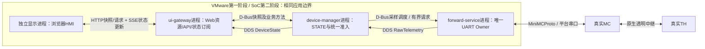

# VMware → SoC 两阶段应用孪生开发方案

## 1. 已确认的开发方向

用户于2026-10-29明确：第一阶段在VMware上模拟SoC，必须具备可显示、可操作的应用或Web界面；功能模块、独立进程、进程管理、通信和用户交互尽量1:1运行；第二阶段迁移到实体SoC，目标是主要通过编译器/工具链、平台配置和启动部署适配完成迁移。

此处“孪生”指**应用系统结构与行为尽量同构**，不是仅画界面、输出CLI结果或替换业务数据。用户方向已确认；本文具体服务划分、总线映射和数值预算为ARCH设计提案，仍需受影响Owner和独立QA接受。既有产品范围、MC/TH硬件门禁和正式协议继续适用；不因要求整体架构就自动批准全部产品候选。

当前已有MC/TH实物时，VMware上的应用通过真实MiniMCProto/UART对接它们，保留原生中继及真实HIL要求。无对应SoC外设的能力可用独立、明确标识的测试替身验证软件分支；替身必须使用相同契约且记录来源，不能通过替身签署MC/TH或目标板硬件验收，不改变既有D24/D25。

## 2. 两阶段交付

| 对象 | 第一阶段：VMware应用孪生 | 第二阶段：目标SoC迁移 |
| --- | --- | --- |
| 业务代码 | 运行准备迁移的真实模块代码、状态机、准入、作业逻辑；按已选增量逐步实现 | 使用同一业务源码与已接受版本；不得重新写第二套业务 |
| 进程拓扑 | 按已接受目标拓扑拆成独立可启动进程，跑真实IPC | 保持相同服务边界及逻辑依赖；必要变化另记ADR和受影响复验 |
| 显示交互 | 独立显示应用；当前浏览器形式连接真实UI服务，服务连接实际后台模块 | 优先复用相同Web资源、API及交互；本地浏览器壳、显示/触控和GPU适配由平台提供 |
| 服务管理 | 实际启动、停止、健康/就绪、退出、重启、日志和配置加载 | 保持相同生命周期语义与逻辑依赖；只适配目标启动机制/路径/账户 |
| 通信 | 第一阶段就运行选定的真实D-Bus/DDS/HTTP等通道、schema与错误语义 | 保持契约、权限语义、QoS/队列策略；地址、网卡、发现和权限配置按平台调整 |
| 设备边界 | 当前用USB直通串口接真实MC/TH；不存在的SoC特有外设标明不可用/测试替身 | 绑定目标UART、Pinmux、驱动、摄像头/NPU等平台实现；不能把主机替身当目标驱动 |
| 构建发布 | 使用主机编译器、准确依赖、部署profile和候选清单，避免硬编码个人路径 | 交叉工具链/sysroot、目标依赖及BSP；保持源码/契约/配置来源可追溯 |
| 验收 | 软件及VMware+真实MC/TH联合验收，记录适用范围 | 实体板启动、触控/显示/设备、资源与性能、故障恢复重新实测 |

“只改编译器和启动脚本”是降低迁移成本的设计目标，不是未经验证的保证。x86/ARM ABI、libc、依赖库、驱动、启动系统、GPU/触控、NPU与资源性能可能要求平台适配。业务层不能散布平台判断；差异应集中在工具链、部署profile、平台接口及其实现中，逐项登记例外。

## 3. 首个业务切片的进程与接口提案

图中的进程、IPC是供Owner评审的目标提案，不声称已实现。温度只读先实现所需方法与Topic；图形界面可展示和提交当前已授权业务请求，不提前开放加热、运动或作业动作。

| 进程 | 责任与代码Owner | 隔离/通信要求 |
| --- | --- | --- |
| browser-hmi | ENG-UI：显示、输入、导航、加载/过期/故障提示 | 不访问UART，不在前端复制STATE/JOB；重启界面不重启采集与业务 |
| ui-gateway | 业务Web适配归ENG-NET，与ENG-UI确认浏览器契约；INTEGRATOR装配 | HTTP请求转换为同一STATE业务API；桥接状态更新，不成为第二状态权威；CORS/认证/本地与远程权限需实际契约 |
| device-manager | ENG-STATE：整机状态、质量与新鲜度、能力及准入 | 数据权威唯一；发布版本化状态，断链/重启/旧数据语义清晰；不直接打开UART |
| forward-service | ENG-FWD：MiniMCProto、唯一UART、事务关联、流控和重连 | 一条有界串行事务链；其他进程不能绕过它操作设备；IPC失败与设备失败分别报告 |

浏览器可先在VMware桌面窗口运行；开发时也可用宿主机浏览器访问VMware中同一个ui-gateway地址，属于同一显示实现的开发访问方式。最终SoC显示壳、分辨率、触控仍待硬件输入，不从开发浏览器推定兼容。

若后续产品选择JOB、外部网关、MEDIA/AI或配置/升级，分别评估独立服务及权限，在VMware阶段同步实现它们目标生命周期和接口；不要把未选模块先做空进程、假就绪或假业务返回。通信SDK作为库被各服务使用；D-Bus系统总线是基础设施，DDS不要求再虚构一个业务Broker进程。

## 4. 孪生一致性要求

| 必须尽量保持一致 | 允许通过平台profile调整 | 不可从VMware推导 |
| --- | --- | --- |
| 功能范围、服务边界、权威状态、业务行为、API/IDL/XML/JSON schema与版本 | CPU架构/编译器/sysroot、库构建、串口设备名、安装与持久化路径 | 目标板资源可承载性、硬实时延迟、电气可靠性 |
| 消息字段/单位/枚举、命令准入/关联、超时和过期语义、队列上限及恢复策略 | 监听/发现地址、网卡、账户/权限配置、适配器绑定 | 显示/触控/GPU/NPU/摄像头驱动功能和性能 |
| UI源码/资源、导航、错误提示、公开业务接口和消息内容 | 浏览器启动参数、窗口/全屏、分辨率与输入适配 | 真实上电/掉电、热/机械保护效果 |
| 逻辑服务依赖、ready与health定义、重启退避、故障降级和日志字段 | 服务管理器的具体unit或init脚本 | 主机硬件替身所代表功能的物理接受 |

同一套跨进程接口必须在第一阶段就实际使用。进程内回调、命令行拉起一次查询、前端定时造数可以用于独立调试，但不能替代第一阶段的进程/IPC/管理及显示接受条件。已有soc-ap查询CLI可作为独立诊断工具和库复用线索；常驻服务应复用已验证逻辑，并按契约重构生命周期，不能将临时CLI轮询桥接宣称为已完成目标进程架构。

## 5. 进程管理、数据与配置

1. INTEGRATOR维护一份逻辑服务清单：服务ID、可执行文件、所需接口/schema、运行账户/设备权限、启动条件、ready/health、停止期限、重启退避、日志/持久化目录、资源预算。VMware和SoC各有profile，业务模块不读取个人SSH或绝对开发路径。
2. 优先在两环境使用相同受支持服务管理方式；若目标BSP尚不明确，先冻结逻辑生命周期契约。最终选择systemd或其他管理器及实际版本由INTEGRATOR/BSP提供证据；目标不同则明确部署适配和复验，不声称仅复制unit必能启动。
3. 基础IPC就绪后FWD/STATE可各自启动；设备/状态尚不可用时返回明确NOT_READY/UNKNOWN，UI仍可显示初始化页面。不能为“等到正常数据”形成循环启动依赖。ready表示接口可服务，设备健康与业务可执行是另外的状态。
4. UI断开不停止后台采集；STATE/FWD重启分别变化代次并重建有效关联。UI服务重连后获取权威快照，旧缓存必须有年龄/来源，不回退假数据；非幂等命令不因断链或重启自动重放。
5. 服务端时间与浏览器时钟不得直接相减。STATE输出自己的数据年龄/有效期限语义；浏览器按收到快照后的本地单调经过时间更新显示，必要时加传输延迟上界。UI连接丢失应单独提示，不把“页面还在刷新”当设备数据新鲜。
6. 中间件版本及schema、生成器、依赖、QoS与资源配置一起锁定。候选版本建议见[选型记录](soc_ipc_selection_and_hmi_prototype_20261029.md)，实际IPC契约由ARCH、通信与业务Owner接受。VMware阶段不能以目标板未到为由用另一种IPC代替已选通道后称同构完成。

## 6. 执行安排与阶段出口

| 工作 | 交给谁 | 第一阶段交付及闭环 |
| --- | --- | --- |
| 目标服务拓扑/IPC/状态和权限契约 | ARCH，FWD/STATE/UI/NET/通信Owner参与，独立QA | 修订旧同进程方案，接受服务清单、IDL/XML/HTTP契约及未决项；现有温度C1～C6按影响定向对账，不重造历史接受 |
| 相同生命周期与双profile构建部署 | INTEGRATOR + BSP | 主机实际启动/停止/重启脚本、健康接口、工具链入口；未知目标sysroot/profile标待交付，不造成功 |
| 常驻业务服务和接口 | FWD、STATE，各自独立写范围 | 基于同一契约实际跨进程运行；验证采样、关联、故障、过期、资源上限和恢复 |
| 显示与UI网关 | UI + NET | 可运行的显示应用/Web界面，经真实服务链获取状态与提交已授权意图；截图、导航和错误交互可复核 |
| 组合与独立验收 | INTEGRATOR装配；独立Codex QA；QA产物由非作者复核；COORD收件 | 锁源码/各进程制品/界面资源/配置/工具与真实MC/TH版本，保存实际运行、双向Hex和交互/故障日志 |

**第一阶段出口**：已选业务在VMware内真实运行；目标进程边界及实际IPC已接受并运行，显示是可见的独立应用；真实MC/TH结果驱动界面，交互进入同一准入路径；分别验证显示、网关、STATE、FWD退出/重启、设备失联、过期和恢复，记录实际重启退避/资源/权限；候选与原始证据逐项绑定，由COORD按准确范围接受。未实现模块继续未完成，不以界面按钮或进程名代替功能。

**第二阶段入口及出口**：取得准确SoC/BSP/sysroot和硬件交接；以同一源码/契约/界面资源交叉构建及目标profile部署，绑定驱动与设备身份。复跑业务和故障用例，实测实屏触控/GPU/外设、CPU/RAM/磁盘/带宽及延迟；记录所有平台差异和实际源码差异。只有目标板证据通过才接受目标板能力，VMware阶段的通过按其原范围保留。

当前本文件只记录用户方向与ARCH提案，不代表服务已开发、IPC已接通或硬件通过。不改现有正式任务状态；COORD按真实输入和Owner/独立检查登记派单。

## 7. 相关文档

- [架构输入确认表](soc_system_architecture_input_register_20261029.md)：两阶段方向已确认，目标硬件、首版范围和数值预算等仍待补充。
- [温度模块架构提案](../interfaces/soc_temperature_module_architecture_icd_draft_20261028.md)：revision 2按本次方向调整；旧revision 1及其签署只适用原哈希。
- [B0基线](../baseline/B0_方案基线.md)、[软硬件交接](../operations/ap_mc_th_software_hardware_handover.md)：保留协议、硬件和真实HIL边界。

## 2026-10-29 任务接续

用户已要求按本方向更新全部任务。当前按[两阶段执行总表](vmware_soc_twin_task_execution_20261029.md)推进TWIN-01～16，全部Backlog未派单；旧卡复用和未覆盖范围逐卡登记。先由ARCH处理架构/温度C1～C6与可执行契约，再交各Owner；VM真实应用和SoC实板分别接受。本次新增文字/修订不继承此前准确哈希的审阅结论。
