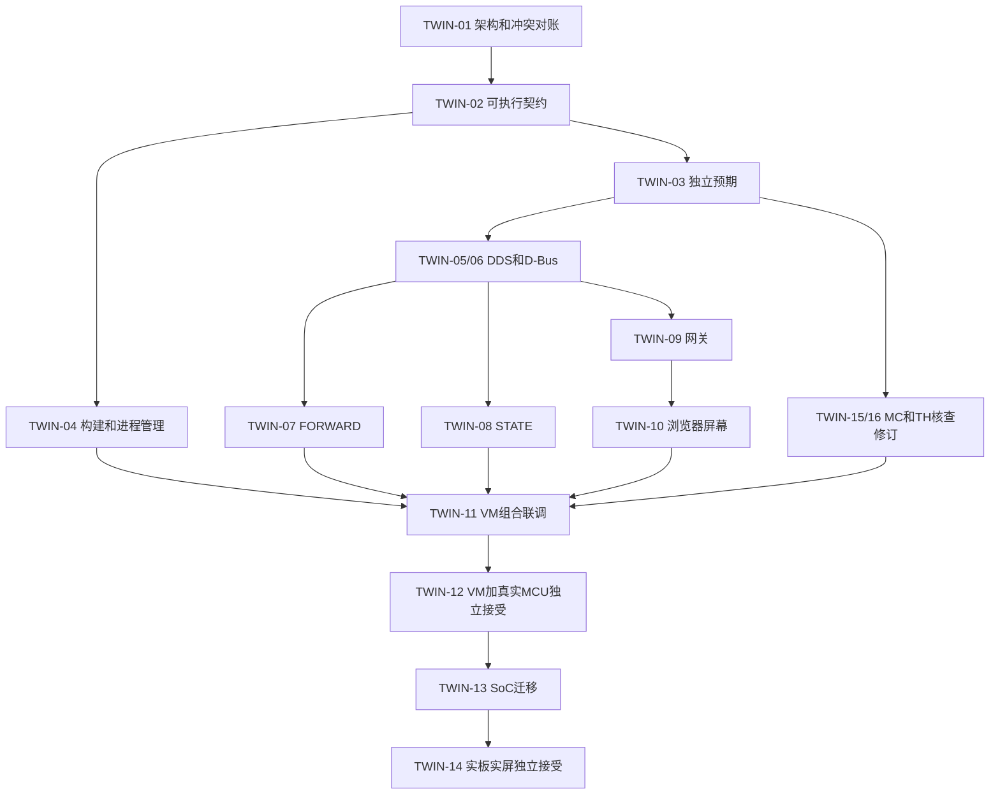

# VMware与SoC两阶段任务执行与闭环总表

> **2026-10-29 COORD执行入口更新：** 按[总控执行清单](coord_autorun_tasklist_20261029.md)与[服务器沙箱QA门禁](../../.agents/rules/delivery_and_coord_gate.md)落实AUTO-01/02、在途工作核对及TWIN-01疑点复核，再按本表业务依赖接续。本表为既有业务规划快照，实际状态以卡片为准；本次不覆盖其他会话的签署或状态。

本轮把已确认的[两阶段方向](vmware_soc_twin_development_plan_20261029.md)落实为能力任务。第一阶段就在VMware运行真实业务模块、目标进程边界、生命周期管理、实际IPC和可见浏览器交互；第二阶段迁移同一业务源码、契约及UI资源并实板复验。历史CLI/温度HIL可对账复用，不能代替新阶段出口。编译器/profile/启动适配是迁移目标，板级驱动、ABI、GPU/触控和性能以实测为准。

## 1. 范围与当前状态

新增16张能力卡全部Backlog，未创建作者/Reviewer会话、未发租约、未运行服务或硬件。全量18个工作包已修订范围/主归属；未完成旧卡增加接续关系，Done卡字节及签署原样保留，由第6节逐卡给出适用范围。历史回执不是本次规划修订或未来实现的批准。

先沿用已选温度只读切片验证完整架构。首切片候选为forward-service、device-manager（STATE）、ui-gateway及浏览器HMI；候选链是浏览器HTTP/SSE↔网关，网关D-Bus↔STATE，STATE D-Bus→FORWARD，FORWARD DDS→STATE，STATE DDS→网关。最终拓扑、各字段及SDK版本须在TWIN-01/02由ARCH和各Owner接受。完整产品模块以实现/规划/暂缓登记；未选JOB、MEDIA、AI、MQTT不设空进程充数，不将产品目录全量批准。

温度提案C1～C6涉及flags、单位/有符号范围、故障哨兵、命令分配、传感依据/物理保护及RTT口径。TWIN-01先核准确输入和影响，02形成可执行契约，15/16由MC/TH Owner定向修订或有证据地接受不改实现复用；07由FWD Owner适配。争议未澄清前不得继续消费对应字段。历史Done原样保留，不表示新字段已接受。

## 2. 任务与主归属

| 任务 | 能力交付 | 主责岗位 | 唯一主工作包 | 直接前置 | 阶段 |
| --- | --- | --- | --- | --- | --- |
| [TWIN-01](../../.agents/kanban/microtasks/vmware_soc_twin/TWIN-01.md) | 整体服务架构与温度冲突逐项对账 | ARCH | TASK-005 | CR-11 | cross-stage |
| [TWIN-02](../../.agents/kanban/microtasks/vmware_soc_twin/TWIN-02.md) | 双环境可执行通信契约与生成规则 | ARCH | TASK-013 | TWIN-01 | cross-stage |
| [TWIN-03](../../.agents/kanban/microtasks/vmware_soc_twin/TWIN-03.md) | 独立黄金预期与两阶段故障验收用例 | QA | TASK-010 | TWIN-02 | cross-stage |
| [TWIN-04](../../.agents/kanban/microtasks/vmware_soc_twin/TWIN-04.md) | VMware构建配置与同构服务生命周期 | INTEGRATOR | TASK-004 | TWIN-02 | vmware-twin |
| [TWIN-05](../../.agents/kanban/microtasks/vmware_soc_twin/TWIN-05.md) | DDS跨进程SDK与有界QoS | ENG-DDS | TASK-014 | TWIN-02, TWIN-03 | vmware-twin |
| [TWIN-06](../../.agents/kanban/microtasks/vmware_soc_twin/TWIN-06.md) | D-Bus跨进程SDK与权限超时 | ENG-DBUS | TASK-015 | TWIN-02, TWIN-03 | vmware-twin |
| [TWIN-07](../../.agents/kanban/microtasks/vmware_soc_twin/TWIN-07.md) | FORWARD常驻服务与唯一UART通路 | ENG-FWD | TASK-007 | TWIN-02, TWIN-03, TWIN-05, TWIN-06, TEMP-04 | vmware-twin |
| [TWIN-08](../../.agents/kanban/microtasks/vmware_soc_twin/TWIN-08.md) | STATE权威快照与统一请求准入 | ENG-STATE | TASK-008 | TWIN-02, TWIN-03, TWIN-05, TWIN-06 | vmware-twin |
| [TWIN-09](../../.agents/kanban/microtasks/vmware_soc_twin/TWIN-09.md) | UI网关真实HTTP与SSE通信 | ENG-NET | TASK-009 | TWIN-02, TWIN-03, TWIN-05, TWIN-06 | vmware-twin |
| [TWIN-10](../../.agents/kanban/microtasks/vmware_soc_twin/TWIN-10.md) | 浏览器交互屏幕接入真实业务接口 | ENG-UI | TASK-009 | TWIN-02, TWIN-03, TWIN-09 | vmware-twin |
| [TWIN-11](../../.agents/kanban/microtasks/vmware_soc_twin/TWIN-11.md) | VMware整链联调与候选交接 | INTEGRATOR | TASK-012 | TWIN-04, TWIN-07, TWIN-08, TWIN-09, TWIN-10, TWIN-15, TWIN-16 | vmware-twin |
| [TWIN-12](../../.agents/kanban/microtasks/vmware_soc_twin/TWIN-12.md) | VMware应用孪生与真实MCU独立验收 | QA | TASK-010 | TWIN-03, TWIN-11 | vmware-twin |
| [TWIN-13](../../.agents/kanban/microtasks/vmware_soc_twin/TWIN-13.md) | SoC平台迁移与实板候选交接 | BSP | TASK-003 | TWIN-04, TWIN-12 | soc-migration |
| [TWIN-14](../../.agents/kanban/microtasks/vmware_soc_twin/TWIN-14.md) | SoC实屏实板独立验收与阶段二收件 | QA | TASK-010 | TWIN-03, TWIN-12, TWIN-13 | soc-migration |
| [TWIN-15](../../.agents/kanban/microtasks/vmware_soc_twin/TWIN-15.md) | MC温度契约复核与必要修订 | ENG-MC | TASK-002 | TWIN-02, TWIN-03, TEMP-03 | vmware-twin |
| [TWIN-16](../../.agents/kanban/microtasks/vmware_soc_twin/TWIN-16.md) | TH温度契约复核与必要修订 | ENG-TH | TASK-002 | TWIN-02, TWIN-03, TEMP-02 | vmware-twin |
| [TWIN-17](../../.agents/kanban/microtasks/vmware_soc_twin/TWIN-17.md) | 本地离线作业引擎与基础混色执行规划 | ENG-STATE | TASK-011 | TWIN-02 | vmware-twin |
| [TWIN-18](../../.agents/kanban/microtasks/vmware_soc_twin/TWIN-18.md) | 双MCU运动/调平/断料状态接口调查与协议对账 | ENG-MC | TASK-002 | TWIN-01 | cross-stage |
| [TWIN-19](../../.agents/kanban/microtasks/vmware_soc_twin/TWIN-19.md) | 全机HMS错误码体系、双级急停联动与脱敏诊断导出 | ENG-STATE | TASK-008 | TWIN-02 | vmware-twin |
| [TWIN-20](../../.agents/kanban/microtasks/vmware_soc_twin/TWIN-20.md) | HMI料槽映射、新机检查引导、国际化与局域网发现 | ENG-UI | TASK-009 | TWIN-02 | vmware-twin |

序号是稳定ID，15/16在02/03后执行并阻断11，不能按编号顺序跳过。ARCH负责01/02，通信岗位负责05/06，FWD/STATE/NET/UI负责07～10，INTEGRATOR负责04/11及与BSP配合13，独立QA负责03/12/14；COORD全程派单、核版本、安排独立检查和最终收件。岗位是计划，不是现有运行Agent。

## 3. 开工门与共享文件

COORD下一张先落实TWIN-01。Ready前登记：实际作者及非作者检查会话、准确输入/dirty diff及哈希、前置接受证据、具体写白名单、隔离worktree与构建输出、可执行正反例命令和有效租约。全部新卡当前缺这些运行绑定，保持Backlog；计划命令字段不是已实现命令，结构exit0不是开工或验收通过。

最多两张实现卡并行。可按04+03、05+06、07+08、09+端固件安排，实际取决于前置和资源。MC与TH共仓仍需隔离worktree；共享头/根CMake/配置/生成文件由ARCH/INTEGRATOR确定唯一写入者并串行更新。新构建入口规划于runtime/build，若必须改现有根CMake，先把准确文件加入04的白名单并检查既有TEMP票的写重叠/依赖，不能让多个Owner越界抢写。任务正文“复用”不自动扩张写权限。

物理UART、探针、台架只有一名实际操作者和占用窗口，不能并行运行CLI与forward-service抢UART。寄存器/烧录/上电/加热授权按现行HW-G；本文不执行这些操作。故障修复退回原Owner，按新候选复验，不让QA改业务促通过。

## 4. 双阶段验收与收件

| 出口 | 必交证据 | 接受者 |
| --- | --- | --- |
| 契约/SDK与各能力 | 机器可读schema、语义与生成规则、对应代码和制品、正反例日志、版本/资源上限；全部必需Owner和独立检查绑定准确对象 | 各Owner/独立QA；COORD核收 |
| VMware / TWIN-12 | 真实服务树和管理状态、真实D-Bus/DDS及HTTP/SSE、可见界面实际交互、采样来源/有效性、逐服务退出重启/慢消费者/断链恢复；真实MC/TH身份及双向Hex；源码/dirty diff/制品/配置/候选哈希 | 独立Codex QA；其报告由非作者ARCH复核；COORD记录本阶段范围与缺项 |
| SoC / TWIN-14 | 同一业务源/契约/UI的交叉构建、目标profile/服务管理、真实板/显示触控/GPU/串口与外设、业务及故障复跑、目标CPU/RAM/磁盘/带宽/延迟及迁移diff | 独立Codex QA、非作者ARCH复核及所需硬件/BSP Owner；COORD第二阶段收件 |

软件替身用例、VMware真实应用、真实MC/TH HIL、SoC实板四类分账。正常物理查询须有有效关联响应及真实双向Hex，零有效回包拒绝；中继不得伪造下游业务应答。浏览器本地时钟不得直接减服务单调时间，断链必须标明失联/过期；已收请求、业务接受、设备完成分开。

候选提交→独立审查→适用运行验证→必需签署及报告非作者复核→COORD核制品/报告哈希和接收回执→按同一准确对象推进Review/Verify/Done。第一阶段通过不关闭第二阶段；部分通过不关闭整个工作包。独立Codex默认gpt-6-luna，计划别名/模型不冒充实际会话/实际模型。

## 5. 输入缺口与处理

[输入登记表](soc_system_architecture_input_register_20261029.md)中的两阶段方向已由用户确认，不重复询问。P01/P02目标SoC/BSP/sysroot、目标屏规格/本地浏览器运行环境与目标资源/延迟预算仍待真实资料；它们阻断对应目标部署/最终验收，不阻止VM设计和目标无关开发。TWIN-01须先批准VM测量口径与临时预算，目标预算单列待测；不得无依据承诺硬实时。

完整产品S01等由PM/HUMAN继续收敛，当前温度只读架构增量不等待所有远期功能。若新契约要求改固件，15/16只处理明确差异；若确认无需修改，也必须锁定准确固件及可复用证据，并在11/12复验新组合。

## 6. 原有86张卡逐卡处理

以下为本轮输入快照的原卡状态，实时状态以原卡及主看板为准。完整机器清单见[coverage.json](../evidence/twin_task_alignment_20261029/task_coverage.json)，本次前像/检查/独立审查见[证据入口](../evidence/twin_task_alignment_20261029/README.md)。关联表示部分覆盖，不能取代原卡全部验收或充当前置已接受。

| 原卡 | 输入状态 | 本轮能力关联 | 处理方式 |
| --- | --- | --- | --- |
| [CR-00](../../.agents/kanban/microtasks/cascade_recovery/CR-00.md) | Done | TWIN-01, TWIN-11, TWIN-12 | 保留原卡与签署；仅按原候选/范围复用；不代表孪生或SoC接受 |
| [CR-01](../../.agents/kanban/microtasks/cascade_recovery/CR-01.md) | Done | TWIN-01, TWIN-11, TWIN-12 | 保留原卡与签署；仅按原候选/范围复用；不代表孪生或SoC接受 |
| [CR-02](../../.agents/kanban/microtasks/cascade_recovery/CR-02.md) | Done | TWIN-01, TWIN-11, TWIN-12 | 保留原卡与签署；仅按原候选/范围复用；不代表孪生或SoC接受 |
| [CR-02Q](../../.agents/kanban/microtasks/cascade_recovery/CR-02Q.md) | Done | TWIN-01, TWIN-11, TWIN-12 | 保留原卡与签署；仅按原候选/范围复用；不代表孪生或SoC接受 |
| [CR-02T](../../.agents/kanban/microtasks/cascade_recovery/CR-02T.md) | Done | TWIN-01, TWIN-11, TWIN-12 | 保留原卡与签署；仅按原候选/范围复用；不代表孪生或SoC接受 |
| [CR-03](../../.agents/kanban/microtasks/cascade_recovery/CR-03.md) | Done | TWIN-01, TWIN-11, TWIN-12 | 保留原卡与签署；仅按原候选/范围复用；不代表孪生或SoC接受 |
| [CR-04](../../.agents/kanban/microtasks/cascade_recovery/CR-04.md) | Done | TWIN-01, TWIN-11, TWIN-12 | 保留原卡与签署；仅按原候选/范围复用；不代表孪生或SoC接受 |
| [CR-05](../../.agents/kanban/microtasks/cascade_recovery/CR-05.md) | Done | TWIN-01, TWIN-11, TWIN-12 | 保留原卡与签署；仅按原候选/范围复用；不代表孪生或SoC接受 |
| [CR-06](../../.agents/kanban/microtasks/cascade_recovery/CR-06.md) | Done | TWIN-01, TWIN-11, TWIN-12 | 保留原卡与签署；仅按原候选/范围复用；不代表孪生或SoC接受 |
| [CR-07](../../.agents/kanban/microtasks/cascade_recovery/CR-07.md) | Backlog | TWIN-01, TWIN-11, TWIN-12 | 保留原卡与签署；仅按原候选/范围复用；不代表孪生或SoC接受 |
| [CR-08](../../.agents/kanban/microtasks/cascade_recovery/CR-08.md) | Done | TWIN-01, TWIN-11, TWIN-12 | 保留原卡与签署；仅按原候选/范围复用；不代表孪生或SoC接受 |
| [CR-09](../../.agents/kanban/microtasks/cascade_recovery/CR-09.md) | Done | TWIN-01, TWIN-11, TWIN-12 | 保留原卡与签署；仅按原候选/范围复用；不代表孪生或SoC接受 |
| [CR-10](../../.agents/kanban/microtasks/cascade_recovery/CR-10.md) | Done | TWIN-01, TWIN-11, TWIN-12 | 保留原卡与签署；仅按原候选/范围复用；不代表孪生或SoC接受 |
| [CR-11](../../.agents/kanban/microtasks/cascade_recovery/CR-11.md) | Done | TWIN-01, TWIN-11, TWIN-12 | 保留原卡与签署；仅按原候选/范围复用；不代表孪生或SoC接受 |
| [CR-12](../../.agents/kanban/microtasks/cascade_recovery/CR-12.md) | Done | TWIN-01, TWIN-11, TWIN-12 | 保留原卡与签署；仅按原候选/范围复用；不代表孪生或SoC接受 |
| [MCQ-0105](../../.agents/kanban/microtasks/mc_firmware/MCQ-0105.md) | Done | TWIN-01, TWIN-11, TWIN-12 | 保留原卡与签署；仅按原候选/范围复用；不代表孪生或SoC接受 |
| [MCQ-0106](../../.agents/kanban/microtasks/mc_firmware/MCQ-0106.md) | Done | TWIN-01, TWIN-11, TWIN-12 | 保留原卡与签署；仅按原候选/范围复用；不代表孪生或SoC接受 |
| [MS-01](../../.agents/kanban/milestones/marlin_ms01_20261007_214108.md) | Backlog | TWIN-01, TWIN-04 | 保留原状态与剩余范围；重叠能力按TWIN对账后执行，不重复派单、不自动核销 |
| [MS-02](../../.agents/kanban/milestones/marlin_ms02_20261007_214108.md) | Backlog | TWIN-04 | 保留原状态与剩余范围；重叠能力按TWIN对账后执行，不重复派单、不自动核销 |
| [MS-03](../../.agents/kanban/milestones/marlin_ms03_20261007_214108.md) | Backlog | TWIN-01, TWIN-15 | 保留原状态与剩余范围；重叠能力按TWIN对账后执行，不重复派单、不自动核销 |
| [MS-04](../../.agents/kanban/milestones/marlin_ms04_20261007_214108.md) | Backlog | TWIN-11, TWIN-12 | 保留原状态与剩余范围；重叠能力按TWIN对账后执行，不重复派单、不自动核销 |
| [MS-05](../../.agents/kanban/milestones/marlin_ms05_20261007_214108.md) | Backlog | TWIN-01, TWIN-02 | 保留原状态与剩余范围；重叠能力按TWIN对账后执行，不重复派单、不自动核销 |
| [MS-06](../../.agents/kanban/milestones/marlin_ms06_20261007_214108.md) | Backlog | TWIN-03 | 保留原状态与剩余范围；重叠能力按TWIN对账后执行，不重复派单、不自动核销 |
| [MS-07](../../.agents/kanban/milestones/marlin_ms07_20261007_214108.md) | Done | TWIN-07 | 保留原卡与签署；仅按原候选/范围复用；不代表孪生或SoC接受 |
| [MS-08](../../.agents/kanban/milestones/marlin_ms08_20261007_214108.md) | Backlog | TWIN-07, TWIN-15 | 保留原状态与剩余范围；重叠能力按TWIN对账后执行，不重复派单、不自动核销 |
| [MS-09](../../.agents/kanban/milestones/marlin_ms09_20261007_214108.md) | Backlog | TWIN-03, TWIN-12 | 保留原状态与剩余范围；重叠能力按TWIN对账后执行，不重复派单、不自动核销 |
| [MS-10](../../.agents/kanban/milestones/marlin_ms10_20261007_214108.md) | Backlog | TWIN-07, TWIN-12 | 保留原状态与剩余范围；重叠能力按TWIN对账后执行，不重复派单、不自动核销 |
| [MS-11](../../.agents/kanban/milestones/marlin_ms11_20261007_214108.md) | Backlog | TWIN-11, TWIN-12 | 保留原状态与剩余范围；重叠能力按TWIN对账后执行，不重复派单、不自动核销 |
| [MS-12](../../.agents/kanban/milestones/marlin_ms12_20261007_214108.md) | Backlog | TWIN-01, TWIN-16 | 保留原状态与剩余范围；重叠能力按TWIN对账后执行，不重复派单、不自动核销 |
| [MS-13](../../.agents/kanban/milestones/marlin_ms13_20261007_214108.md) | Backlog | TWIN-11, TWIN-12 | 保留原状态与剩余范围；重叠能力按TWIN对账后执行，不重复派单、不自动核销 |
| [MS-14](../../.agents/kanban/milestones/marlin_ms14_20261007_214108.md) | Backlog | TWIN-15, TWIN-16 | 保留原状态与剩余范围；重叠能力按TWIN对账后执行，不重复派单、不自动核销 |
| [MS-15](../../.agents/kanban/milestones/marlin_ms15_20261007_214108.md) | Backlog | TWIN-07, TWIN-08 | 保留原状态与剩余范围；重叠能力按TWIN对账后执行，不重复派单、不自动核销 |
| [MS-16](../../.agents/kanban/milestones/marlin_ms16_20261007_214108.md) | Backlog | TWIN-03, TWIN-12 | 保留原状态与剩余范围；重叠能力按TWIN对账后执行，不重复派单、不自动核销 |
| [MS-17](../../.agents/kanban/milestones/marlin_ms17_20261007_214108.md) | Backlog | TWIN-12 | 保留原状态与剩余范围；重叠能力按TWIN对账后执行，不重复派单、不自动核销 |
| [MS-18](../../.agents/kanban/milestones/marlin_ms18_20261008_083854.md) | Backlog | TWIN-04 | 保留原状态与剩余范围；重叠能力按TWIN对账后执行，不重复派单、不自动核销 |
| [MS-19](../../.agents/kanban/milestones/marlin_ms19_20261008_083854.md) | Backlog | TWIN-03 | 保留原状态与剩余范围；重叠能力按TWIN对账后执行，不重复派单、不自动核销 |
| [MS-20](../../.agents/kanban/milestones/marlin_ms20_20261008_083854.md) | Backlog | TWIN-11 | 保留原状态与剩余范围；重叠能力按TWIN对账后执行，不重复派单、不自动核销 |
| [MS-21](../../.agents/kanban/milestones/marlin_ms21_20261008_083854.md) | Backlog | TWIN-11 | 保留原状态与剩余范围；重叠能力按TWIN对账后执行，不重复派单、不自动核销 |
| [MS-22](../../.agents/kanban/milestones/marlin_ms22_20261008_083854.md) | Verify |  | 保留原状态与剩余范围；重叠能力按TWIN对账后执行，不重复派单、不自动核销 |
| [PL-01](../../docs/planning/product/product_pl01_20261008_083854.md) | Done | TWIN-01, TWIN-02, TWIN-11, TWIN-12 | 保留原卡与签署；仅按原候选/范围复用；不代表孪生或SoC接受 |
| [PL-02](../../docs/planning/product/product_pl02_20261008_083854.md) | Done | TWIN-01, TWIN-02, TWIN-11, TWIN-12 | 保留原卡与签署；仅按原候选/范围复用；不代表孪生或SoC接受 |
| [TASK-001](../../docs/planning/work_packages/TASK-001_收敛%20FDM%20产品需求和验收.md) | Backlog |  | 工作包按两阶段修订；不直接派单；新子票不自动完成整个工作包 |
| [TASK-002](../../docs/planning/work_packages/TASK-002_交接现有双%20MCU%20能力与协议.md) | Backlog |  | 工作包按两阶段修订；不直接派单；新子票不自动完成整个工作包 |
| [TASK-003](../../docs/planning/work_packages/TASK-003_核查%20AP%20硬件和%20BSP%20基线.md) | Backlog |  | 工作包按两阶段修订；不直接派单；新子票不自动完成整个工作包 |
| [TASK-004](../../docs/planning/work_packages/TASK-004_锁定源码和可复现构建.md) | Backlog |  | 工作包按两阶段修订；不直接派单；新子票不自动完成整个工作包 |
| [TASK-005](../../docs/planning/work_packages/TASK-005_冻结第一版控制和%20AP-MCU%20契约.md) | Backlog |  | 工作包按两阶段修订；不直接派单；新子票不自动完成整个工作包 |
| [TASK-006](../../docs/planning/work_packages/TASK-006_实现独立模拟%20MCU%20和异常夹具.md) | Backlog |  | 工作包按两阶段修订；不直接派单；新子票不自动完成整个工作包 |
| [TASK-007](../../docs/planning/work_packages/TASK-007_实现%20forward%20协议与传输.md) | Backlog |  | 工作包按两阶段修订；不直接派单；新子票不自动完成整个工作包 |
| [TASK-008](../../docs/planning/work_packages/TASK-008_实现整机状态和统一指令准入.md) | Backlog |  | 工作包按两阶段修订；不直接派单；新子票不自动完成整个工作包 |
| [TASK-009](../../docs/planning/work_packages/TASK-009_实现模拟控制%20UI%20闭环.md) | Backlog |  | 工作包按两阶段修订；不直接派单；新子票不自动完成整个工作包 |
| [TASK-010](../../docs/planning/work_packages/TASK-010_验收首个多%20Agent%20端到端试点.md) | Backlog |  | 工作包按两阶段修订；不直接派单；新子票不自动完成整个工作包 |
| [TASK-011](../../docs/planning/work_packages/TASK-011_实现离线作业引擎和混色样例.md) | Backlog |  | 工作包按两阶段修订；不直接派单；新子票不自动完成整个工作包 |
| [TASK-012](../../docs/planning/work_packages/TASK-012_接入真实板和%20MCU%20并验证闭环.md) | Backlog |  | 工作包按两阶段修订；不直接派单；新子票不自动完成整个工作包 |
| [TASK-013](../../docs/planning/work_packages/TASK-013_冻结%20DDS%20D-Bus%20MQTT%20通信契约.md) | Backlog |  | 工作包按两阶段修订；不直接派单；新子票不自动完成整个工作包 |
| [TASK-014](../../docs/planning/work_packages/TASK-014_实现%20DDS%20底座和统一%20SDK.md) | Backlog |  | 工作包按两阶段修订；不直接派单；新子票不自动完成整个工作包 |
| [TASK-015](../../docs/planning/work_packages/TASK-015_实现%20D-Bus%20底座和统一%20SDK.md) | Backlog |  | 工作包按两阶段修订；不直接派单；新子票不自动完成整个工作包 |
| [TASK-016](../../docs/planning/work_packages/TASK-016_实现%20MQTT%20传输底座和会话恢复.md) | Backlog |  | 工作包按两阶段修订；不直接派单；新子票不自动完成整个工作包 |
| [TASK-017](../../docs/planning/work_packages/TASK-017_验收三总线和统一控制路径.md) | Backlog |  | 工作包按两阶段修订；不直接派单；新子票不自动完成整个工作包 |
| [TASK-018](../../docs/planning/work_packages/TASK-018_接入%20MQTT%20网关业务映射和授权.md) | Backlog |  | 工作包按两阶段修订；不直接派单；新子票不自动完成整个工作包 |
| [TEMP-01](../../.agents/kanban/microtasks/temperature_telemetry/TEMP-01.md) | Done | TWIN-01, TWIN-02, TWIN-11, TWIN-12 | 保留原卡与签署；仅按原候选/范围复用；不代表孪生或SoC接受 |
| [TEMP-02](../../.agents/kanban/microtasks/temperature_telemetry/TEMP-02.md) | Done | TWIN-01, TWIN-02, TWIN-11, TWIN-12 | 保留原卡与签署；仅按原候选/范围复用；不代表孪生或SoC接受 |
| [TEMP-03](../../.agents/kanban/microtasks/temperature_telemetry/TEMP-03.md) | Done | TWIN-01, TWIN-02, TWIN-11, TWIN-12 | 保留原卡与签署；仅按原候选/范围复用；不代表孪生或SoC接受 |
| [TEMP-04](../../.agents/kanban/microtasks/temperature_telemetry/TEMP-04.md) | Done | TWIN-01, TWIN-02, TWIN-11, TWIN-12 | 保留原卡与签署；仅按原候选/范围复用；不代表孪生或SoC接受 |
| [TEMP-05](../../.agents/kanban/microtasks/temperature_telemetry/TEMP-05.md) | Done | TWIN-01, TWIN-02, TWIN-11, TWIN-12 | 保留原卡与签署；仅按原候选/范围复用；不代表孪生或SoC接受 |
| [TEMP-06](../../.agents/kanban/microtasks/temperature_telemetry/TEMP-06.md) | Done | TWIN-01, TWIN-02, TWIN-11, TWIN-12 | 保留原卡与签署；仅按原候选/范围复用；不代表孪生或SoC接受 |
| [TEMP-07](../../.agents/kanban/microtasks/temperature_telemetry/TEMP-07.md) | Done | TWIN-01, TWIN-02, TWIN-11, TWIN-12 | 保留原卡与签署；仅按原候选/范围复用；不代表孪生或SoC接受 |
| [V2-P01A](../../.agents/kanban/microtasks/minimc_v2/V2-P01A.md) | Done | TWIN-01, TWIN-11, TWIN-12 | 保留原卡与签署；仅按原候选/范围复用；不代表孪生或SoC接受 |
| [V2-P01B](../../.agents/kanban/microtasks/minimc_v2/V2-P01B.md) | Done | TWIN-01, TWIN-11, TWIN-12 | 保留原卡与签署；仅按原候选/范围复用；不代表孪生或SoC接受 |
| [V2-P01C](../../.agents/kanban/microtasks/minimc_v2/V2-P01C.md) | Done | TWIN-01, TWIN-11, TWIN-12 | 保留原卡与签署；仅按原候选/范围复用；不代表孪生或SoC接受 |
| [V2-P01D](../../.agents/kanban/microtasks/minimc_v2/V2-P01D.md) | Done | TWIN-01, TWIN-11, TWIN-12 | 保留原卡与签署；仅按原候选/范围复用；不代表孪生或SoC接受 |
| [V2-P02A](../../.agents/kanban/microtasks/minimc_v2/V2-P02A.md) | Done | TWIN-01, TWIN-11, TWIN-12 | 保留原卡与签署；仅按原候选/范围复用；不代表孪生或SoC接受 |
| [V2-P02B](../../.agents/kanban/microtasks/minimc_v2/V2-P02B.md) | Done | TWIN-01, TWIN-11, TWIN-12 | 保留原卡与签署；仅按原候选/范围复用；不代表孪生或SoC接受 |
| [V2-P02C](../../.agents/kanban/microtasks/minimc_v2/V2-P02C.md) | Done | TWIN-01, TWIN-11, TWIN-12 | 保留原卡与签署；仅按原候选/范围复用；不代表孪生或SoC接受 |
| [V2-P03A](../../.agents/kanban/microtasks/minimc_v2/V2-P03A.md) | Done | TWIN-01, TWIN-11, TWIN-12 | 保留原卡与签署；仅按原候选/范围复用；不代表孪生或SoC接受 |
| [V2-P03B](../../.agents/kanban/microtasks/minimc_v2/V2-P03B.md) | Done | TWIN-01, TWIN-11, TWIN-12 | 保留原卡与签署；仅按原候选/范围复用；不代表孪生或SoC接受 |
| [V2-P03C](../../.agents/kanban/microtasks/minimc_v2/V2-P03C.md) | Done | TWIN-01, TWIN-11, TWIN-12 | 保留原卡与签署；仅按原候选/范围复用；不代表孪生或SoC接受 |
| [V2-P03D](../../.agents/kanban/microtasks/minimc_v2/V2-P03D.md) | Done | TWIN-01, TWIN-11, TWIN-12 | 保留原卡与签署；仅按原候选/范围复用；不代表孪生或SoC接受 |
| [V2-P03E](../../.agents/kanban/microtasks/minimc_v2/V2-P03E.md) | Done | TWIN-01, TWIN-11, TWIN-12 | 保留原卡与签署；仅按原候选/范围复用；不代表孪生或SoC接受 |
| [V2-P03F](../../.agents/kanban/microtasks/minimc_v2/V2-P03F.md) | Done | TWIN-01, TWIN-11, TWIN-12 | 保留原卡与签署；仅按原候选/范围复用；不代表孪生或SoC接受 |
| [V2-P04A](../../.agents/kanban/microtasks/minimc_v2/V2-P04A.md) | Done | TWIN-01, TWIN-11, TWIN-12 | 保留原卡与签署；仅按原候选/范围复用；不代表孪生或SoC接受 |
| [V2-P04B](../../.agents/kanban/microtasks/minimc_v2/V2-P04B.md) | Done | TWIN-01, TWIN-11, TWIN-12 | 保留原卡与签署；仅按原候选/范围复用；不代表孪生或SoC接受 |
| [V2-P04C](../../.agents/kanban/microtasks/minimc_v2/V2-P04C.md) | Done | TWIN-01, TWIN-11, TWIN-12 | 保留原卡与签署；仅按原候选/范围复用；不代表孪生或SoC接受 |
| [V2-P04D](../../.agents/kanban/microtasks/minimc_v2/V2-P04D.md) | Done | TWIN-01, TWIN-11, TWIN-12 | 保留原卡与签署；仅按原候选/范围复用；不代表孪生或SoC接受 |
| [V2-P0506](../../.agents/kanban/microtasks/minimc_v2/V2-P0506.md) | Done | TWIN-01, TWIN-11, TWIN-12 | 保留原卡与签署；仅按原候选/范围复用；不代表孪生或SoC接受 |
| [V2-P05A](../../.agents/kanban/microtasks/minimc_v2/V2-P05A.md) | Done | TWIN-01, TWIN-11, TWIN-12 | 保留原卡与签署；仅按原候选/范围复用；不代表孪生或SoC接受 |
| [V2-P05B](../../.agents/kanban/microtasks/minimc_v2/V2-P05B.md) | Done | TWIN-01, TWIN-11, TWIN-12 | 保留原卡与签署；仅按原候选/范围复用；不代表孪生或SoC接受 |
