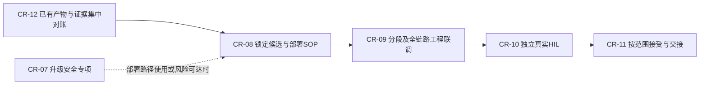

# 执行复盘与任务分工重排

> **后续派单口径更新（2026-10-29）：** 本文保留原日期的最小查询/级联范围和历史接受，当前两阶段增量转由[孪生执行总表](vmware_soc_twin_task_execution_20261029.md)编排。旧版“暂不做UI/IPC”不再作为当前VM阶段出口；协议、安全、独立性与真实HIL要求继续适用。本文新增接续说明不属于历史报告所审字节。

本次调整当前 AP–MC–TH 只读级联的组织方式，以及后续产品增量的拆分原则。已完成任务、历史签署和产品批准范围分别保留。旧恢复方案的协议、安全、真实 HIL 和独立性要求继续有效；其中第 5 节“接口/桩/构建/单函数逐张独立验收”的未来派单要求由本文替代。

## 1. 审阅发现及证据

| 发现 | 已观察到的证据 | 本次处理 |
| --- | --- | --- |
| 颗粒度来回失衡 | V2 初版 25 张，6 张归档后由 V2-P0506 收敛；旧恢复方案仍要求 A～E 逐张验收 | 新工作按可独立验收的能力拆票，函数阶段留在卡内检查点 |
| 岗位有定义、实际派单未体现 | 基线 14 张 CR 卡的 proposed_owner/executor.role 均为 COORD | 未执行卡恢复到实际专业岗位；COORD 负责调度和收件 |
| 方案签署被复用为产物签署 | CR-06 及未执行 CR-07～11 引用方案 review-02，artifact_version 为 sha256:verified | 历史签署留存并限制消费；未执行卡清空占位结果；CR-12 集中对账 |
| 卡片与看板漂移 | 看板仍称 V2 25 张、部分 Backlog；20 张有效卡实际全 Done | 刷新当前投影，标明只读汇总及适用限制 |
| 联调输入不可直接执行 | CR-09 只有笼统正反例、任务图命令，无物理步骤；CR-08 未列候选/SOP为交付 | 明确候选清单、单一台架操作者、分段定位和原作者修复流程 |
| 无关专项容易占住主线 | CR-07 升级治理被列为当前下一票；旧方案原本规定仅所选部署路径需要时阻断联调 | 在 CR-08 明确部署方式和可达性；有升级路径依赖或风险时才将 CR-07 纳入该路径硬前置 |
| 状态/证据控制不能靠绿色结构检查 | 本次 baseline graph exit_code=0，但上述占位签署仍存在，MS-14 还使用非标准 Blocked 状态 | 结构检查与内容接受分开；当前未知接受项由 CR-12 审核 |

输入快照和当时 78 张卡的字段/哈希见 [input_inventory.json](../evidence/workflow_replan_20261028/input_inventory.json)，结构检查见 [graph_before.json](../evidence/workflow_replan_20261028/graph_before.json)。既有失败依据为[流程核查](../evidence/cascade_recovery_plan_20261027/workflow/cascade_workflow_gap_audit_20261027.md)和[候选裁决](../decisions/cascade_candidate_adjudication_20261027.md)。本轮核对实际卡与证据适用范围，未重新审计全部业务源码。历史资料缺少完整 token 和逐票等待统计，不能给出已节省数量。

## 2. 角色与会话分配

| 角色 | 本轮负责 | 启动方式与边界 |
| --- | --- | --- |
| COORD＋INTEGRATOR | 排序、候选装配、资源、收件和状态 | 可由同一主会话承担这两项组织工作；对自己写的候选文档安排独立检查 |
| ARCH | 契约冲突、跨端责任、证据复用范围 | 按需介入，不为每张简单卡重复做全架构报告 |
| ENG-FWD | AP 查询、串口事务、日志与恢复 | 单一 AP 写入 Owner，修复回该作者 |
| ENG-MC | MC 原生路由、ISR/DMA、升级治理 | 单一 MC 写入 Owner；不代 TH 生成业务应答 |
| ENG-TH | TH 原生应答与板端恢复 | 单一 TH 写入 Owner；与 MC 共仓时使用隔离工作区 |
| QA 作者 | 独立预期、夹具、采集器 | 与业务作者分开；自己的产物由另一独立 Codex 作 ARCH 复核 |
| 独立 Reviewer / Verifier | 检查准确候选、运行预期和真实 HIL | 默认 gpt-6-luna，未参与被审产物写作；计划别名不表示已启动 |

最多两张实现卡并行；独立审阅可使用第三个执行槽，主会话协调。角色可以兼任，作者与其独立 Reviewer 必须分开。无需同时启动所有长期岗位。共同契约由 ARCH 协调各端接受；同一个非作者审阅会话可审同一冻结候选内多票，逐票列 revision、哈希、角色结论和限制，不复制一个签署到所有卡。

台架只有一名实际操作者。其他端 Owner 在有定位问题时参与，按现有授权操作；主会话不会因本文获得烧录、复位、故障注入或外部发布权限。MC/TH 共仓共享文件、UART、ST-Link、构建输出分别排他登记，不靠不同角色名规避冲突。

## 3. 拆票及检查粒度

拆票依据是负责人/写范围、契约版本、独立预期所有权、硬件资源或可单独验收的能力发生变化。同一作者、同一仓库、同一契约下的声明、实现、构建和本地测试，优先放入一张有界能力卡，用内部检查点推进。函数 ≤50 行、参数 ≤4 个继续逐函数执行，与“一函数一任务”无关。

输入未知先调查；正式接口变化先由生产者/消费者接受；QA 独立预期和业务实现保持不同作者。将最终组合 HIL、升级等不同风险合入单板实现仍不允许。已有完成卡不为追求数量而重拆；未执行卡如需合并，必须登记 supersedes、输入/交付和各独立门禁，禁止靠合票绕过失败。

作者完成最小闭环后一次提交准确候选，由独立 Reviewer 对同一版本审查。仅变更受影响部分时执行对应复验；相同哈希、相同适用范围且未撤回的证据复用。共享候选可联合审，但逐项结果分开。QA 作者报告按既有政策接受一次独立复核，避免无依据地递归追加第三、第四层同类 QA。

## 4. 当前任务重新排序

| 卡 | 主责及必要协作 | 本轮交付与使用条件 |
| --- | --- | --- |
| CR-12（新增） | ARCH 对账；相关 Owner 确认；独立 Codex QA。QA 所写产物另由非作者 ARCH 复核 | 一份复用矩阵：CR-02/02Q/02T/03/04/05/06 的准确产物、签署适用范围、实际测试及缺项。不能把方案批准认作实现批准。只补缺失检查或定向修复，不重做全部已完成工作 |
| CR-07 | ENG-MC，按升级接口需要 ENG-TH 协作；独立 QA | 一张有界升级安全能力卡，含容量、ACK关联、文件预检与排他；未选定升级契约和实际作者前 Backlog。与只读主线分开排期 |
| CR-08 | INTEGRATOR，ARCH/各端 Owner 接受，独立 QA | AP 准确版本、MC/TH 双固件及配置/哈希、部署身份方法、联调 SOP、已接受工具和预期。先做部署路径决定：若升级路径需要或会被本轮触发，则等待 CR-07；若采用现有已授权 SWD 等路径，须列该路径自己的门禁和隔离升级路径的证据 |
| CR-09 | INTEGRATOR 主持并单一操作者；FWD/MC/TH 按故障参加 | 先 AP↔MC，再 MC↔TH，最后 AP→MC→TH→MC→AP；最小可交换候选就检查，不等全产品功能完成。失败按段定位，代码修复交回端 Owner，修后新哈希重进候选 |
| CR-10 | 独立 Codex QA；QA 报告由另一非作者复核 | 冻结 CR-09 稳定候选后独立执行正常、目标身份/事务关联、TH失联与恢复；保留真实 TX/RX；软件夹具结果不能替代 HIL |
| CR-11 | COORD＋INTEGRATOR | 逐项核对必需签署、实际版本和接收记录，更新符合条件的 MS 里程碑适用范围；源码恢复锁与硬件验收分别登记 |

CR-07～11 原占位作者、租约、输入消费版本及签署保存在[原卡快照](../evidence/workflow_replan_20261028/baseline/.agents/kanban/microtasks/cascade_recovery/)。新 revision 均从 Backlog 开始，不填造实际 Owner、检查会话或本票候选。CR-00～06 和既有 V2/MCQ 完成历史保留；其中被撤回/不完整的接受关系在 CR-12 澄清前限制下游消费。

当前 CR 执行卡与 MS 原任务存在重叠，恢复期不再重复派 MS-07/14/15/16/17/21 的相同只读级联部分。MS 仍保存原始验收范围及其他依赖；CR-10 仅覆盖 GET_VERSION/PING 和约定故障恢复，不能据此关闭温度、完整 TH 状态或全部原 MS 出口。CR-11 对照原卡逐项决定可接受部分及剩余任务。

PM 44 项、SOC 73 项是[已登记输入](../baseline/product_feature_catalog_sync_20261028.md)。PL-01 先请 HUMAN 选定下一增量和 Must/Should/Later/Out，PL-02 才按本文原则拆卡。视觉新增项、UI、Job、三总线等未选范围保持候选，避免一次展开全部远期任务。

## 5. 执行成本控制

一次派单只给任务卡、相关契约段落、输入哈希清单、范围、验收和收件入口。已有会话对未变文件复用阅读；新会话仍须读取授权及当前有效规则。报告只保留一份权威摘要和原始日志，卡片与看板引用它，不复制整段日志和重复结论。

同一作者可连续承担相关任务以复用上下文，每次仍只有一张活跃实现卡；独立 Reviewer 可继续审同一作者的新候选，但不得参与写作。默认 30 分钟交一次简短检查点，构建/硬件窗口另按实际安排；这不是完工承诺。最多两次有证据的修正仍失败时保存根因与下一步，不反复盲跑。

从下一次实际 run 记录开始/结束、执行和等待分钟、读入文件数、评审轮次、返工原因及实际可得 token 数；取不到的指标写 null。先以一次 CR-12→CR-10 的实际数据比较交接与返工成本，不承诺未经测量的节省比例。

## 6. 本次审查与后续开工

本变更只修改控制资料和任务分配，未修改业务代码、构建固件、连接硬件或发布。结构/链接/哈希自检与独立方案评审分别存入 `docs/evidence/workflow_replan_20261028/`。方案评审通过不表示 CR-12 或硬件工作完成。当前执行细卡均待实际人员、准确候选、必要 Owner 接受和资源落实后再 Ready。
