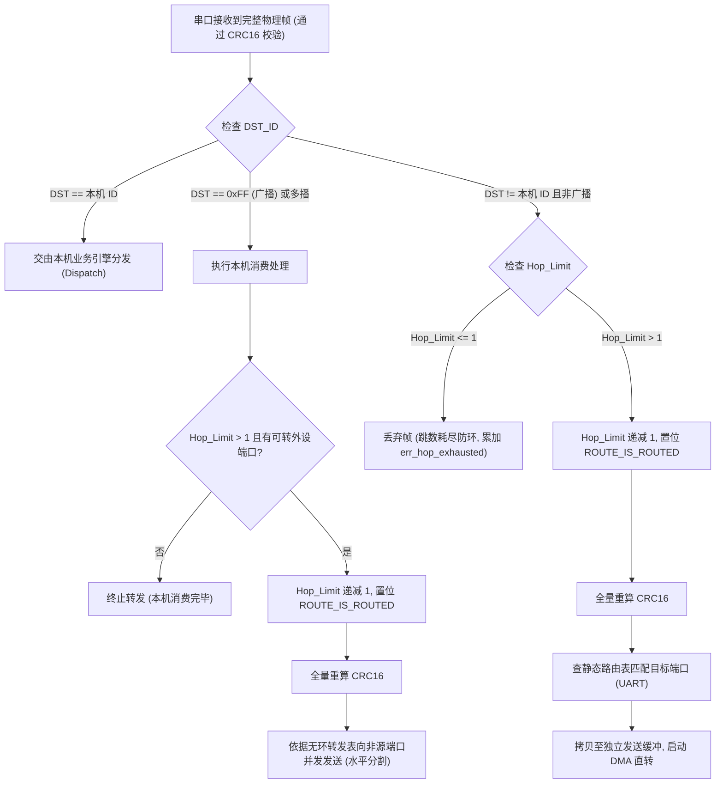
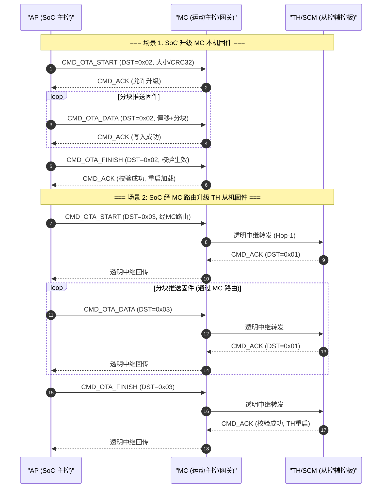

# AP 与 多 MCU 高可靠路由通信协议形式化规范 (MiniMCProto v2.0 全系统正式通信基线)

> [!IMPORTANT] 【系统权威通信基线 / ACTIVE MASTER BASELINE】
> **替代与废止声明**：本规范（MiniMCProto v2.0）已正式确立为全系统多设备通信总基线，**全面替代并废止**历史基线草案 **[[ap_mc_formal_protocol_specification_baseline|MiniMCProto v1.0/v1.2 8字节版]]**。
> **架构决议**：依据 [[AI_SoC_协作方案/baseline/B0_方案基线#D20|B0_方案基线 D20 决策]]，全系统统一采用绿地架构（Greenfield Architecture），彻底解除对旧版协议的向后兼容负担。
> **闭环追踪**：本规范已系统性吸收并闭环了 [[AI_SoC_协作方案/formal_protocol_review_20261009_210204]] 与 [[minimcproto_v2_review_20261016_005623]] 中的全量 16 项技术评审问题（详见末尾附录）。

> **文档编号**：`SPEC-PROTO-20261015-153000` (Rev 2.0.3 - Active Master Baseline)  
> **文档性质**：**系统正式通信架构基线 (Active Master Communication Baseline)**  
> **架构基准原则**：**纯净绿地设计（Greenfield Architecture），无历史兼容包袱**。当前方案处于未开始编码的方案设计初期，全系统各节点（AP、MC、SCM/TH）统一步调基于本规范进行首发研发与部署。彻底剔除对历史草案的向后兼容，保持协议栈纯粹、轻量、高可靠。  
> **第一阶段重点**：**系统维护与全网固件版本升级 (OTA)**。上位 SoC (AP) 作为全系统固件分发与版本控制中枢，**MC 与 TH 均统一从 SoC 获得固件版本并执行升级**：  
> • **MC 升级路径**：AP 直连 MC (`DST=0x02`)，由 MC 本机接收校验并刷新 Flash；  
> • **TH 升级路径**：AP 经 MC 网关路由寻址 TH (`SRC=0x01, DST=0x03`)，MC 无状态透明转发固件数据，TH 独立接收校验并刷新 Flash。  
> **目标通信拓扑**：  
> • **AP 端 (上位主控)**：Amlogic C302X / C308L (ARM Cortex-A35 / Linux OS)  
> • **MC 端 (运动主控)**：ArteryTek AT32F435 系列 (兼容 AT32F435VMT7 / AT32F435VGT7，ARM Cortex-M4 @ 288MHz, Marlin 运控 + 核心路由网关)  
> • **SCM/TH 端 (从控辅控一体板)**：多色供料与工具头一体从控机 (遵照 B0 方案基线 D21 决策，当前物理硬件中 SCM 与 TH 为同一物理从控板，分配统一节点地址 `0x03`，集成多色供料 MMU 与挤出/热端温控功能)  
> • **TH 扩展板 (预留)**：预留物理独立工具头扩展从机地址 `0x04` (`MINIMC_DEV_RESERVED_TH_EXT`)，支持未来多从机物理硬件解耦。  
> **核心演进**：引入 **12 字节 32-bit 自然对齐路由帧头**，实现多串口设备透明寻址、端到端独立会话、中间节点零业务解析存储转发与广播防环。

---

## 1. 物理帧定界与 12 字节硬件级自然对齐架构

### 1.1 物理帧整体拓扑

MiniMCProto v2.0 采用 **12 字节定长帧头 + 显式定长载荷 + 尾部 CRC-16** 架构。帧头由 3 个严格的 32-bit Word 构成，天然实现 32-bit / 4 字节自然对齐：

```
 0                   1                   2                   3
 0 1 2 3 4 5 6 7 8 9 0 1 2 3 4 5 6 7 8 9 0 1 2 3 4 5 6 7 8 9 0 1
+-+-+-+-+-+-+-+-+-+-+-+-+-+-+-+-+-+-+-+-+-+-+-+-+-+-+-+-+-+-+-+-+
|  SOF_1 (0x55) |  SOF_2 (0xAA) |  SRC_ID (8-bit|  DST_ID (8-bit| <- Word 0: 物理定界与设备寻址
+-+-+-+-+-+-+-+-+-+-+-+-+-+-+-+-+-+-+-+-+-+-+-+-+-+-+-+-+-+-+-+-+
|  Flags (8-bit)|  Command ID   | Hop_Limit(8-b)| Route_Ctrl(8b)| <- Word 1: 控制标志与路由策略
+-+-+-+-+-+-+-+-+-+-+-+-+-+-+-+-+-+-+-+-+-+-+-+-+-+-+-+-+-+-+-+-+
|  Sequence Number (16-bit seq) | Payload Length (16-bit L)     | <- Word 2: 端到端序号与载荷长
+-+-+-+-+-+-+-+-+-+-+-+-+-+-+-+-+-+-+-+-+-+-+-+-+-+-+-+-+-+-+-+-+
| Payload Data (起始于 Offset 0x0C, 天然 32-bit 边界, 0 .. L-1) | <- 载荷起始
+-+-+-+-+-+-+-+-+-+-+-+-+-+-+-+-+-+-+-+-+-+-+-+-+-+-+-+-+-+-+-+-+
| ... Payload continued (若 L > 0)              |  CRC16 (Low)  |
+-+-+-+-+-+-+-+-+-+-+-+-+-+-+-+-+-+-+-+-+-+-+-+-+-+-+-+-+-+-+-+-+
|  CRC16 (High) |
+-+-+-+-+-+-+-+-+
```

### 1.2 逐字节偏移映射表 (12-Byte Header Offset Map)

| 偏移 (Offset) | 字段名称             | 宽度  | 类型          | 规范约束与对齐说明                                                |
| :---------- | :--------------- | :-- | :---------- | :------------------------------------------------------- |
| `0x00`      | `sof_1`          | 1B  | `uint8_t`   | 固定同步魔数 `0x55`                                            |
| `0x01`      | `sof_2`          | 1B  | `uint8_t`   | 固定同步魔数 `0xAA`                                            |
| `0x02`      | `src_id`         | 1B  | `uint8_t`   | 源设备逻辑地址（见第 2 章全局地址表）                                     |
| `0x03`      | `dst_id`         | 1B  | `uint8_t`   | 目的设备逻辑地址（单播、组播或 `0xFF` 广播）                               |
| `0x04`      | `flags`          | 1B  | `uint8_t`   | 控制标志位（ACK 请求、响应标示、版本号、优先级）                               |
| `0x05`      | `cmd_id`         | 1B  | `uint8_t`   | 操作码 (Command ID)                                         |
| `0x06`      | `hop_limit`      | 1B  | `uint8_t`   | 存活跳数 (TTL)：初始建议 `0x04`，每转发一跳减 1，为 0 丢弃防环路                |
| `0x07`      | `route_ctrl`     | 1B  | `uint8_t`   | 路由策略（Bit 0: 强制主链路, Bit 1: 允许故障改道, Bit 2: 已路由）            |
| `0x08`      | `seq_lo`         | 1B  | `uint8_t`   | 16-bit 端到端流水号低 8 位；位于偶数偏移 `0x08`，天然 16-bit 对齐            |
| `0x09`      | `seq_hi`         | 1B  | `uint8_t`   | 16-bit 端到端流水号高 8 位 ($0 \le seq \le 65535$)，Little-Endian |
| `0x0A`      | `payload_len_lo` | 1B  | `uint8_t`   | 16-bit 载荷长低 8 位；位于偶数偏移 `0x0A`，天然 16-bit 对齐               |
| `0x0B`      | `payload_len_hi` | 1B  | `uint8_t`   | 16-bit 载荷长高 8 位 ($0 \le L \le 1024$)，Little-Endian       |
| **`0x0C`**  | **`payload[0]`** | $L$ | `uint8_t[]` | **载荷数据起始地址：精确落于 12 字节 (32-bit) 边界**                      |
| $L + 12$    | `crc16_lo`       | 1B  | `uint8_t`   | CRC-16 低 8 位 (Little-Endian)                             |
| $L + 13$    | `crc16_hi`       | 1B  | `uint8_t`   | CRC-16 高 8 位                                             |

### 1.3 物理长度与内存安全反序列化原则

1. **物理长度恒等式**：
   $$\text{Frame\_Total\_Length} = 12\text{ (Header)} + L\text{ (Payload)} + 2\text{ (CRC16)} = L + 14\text{ 字节}$$
   * 最小空载帧（$L=0$）：**14 字节**；
   * 最大物理帧（$L=1024$）：**1038 字节**。
2. **线缆紧凑封包与宿主对齐访问规约**：
   * 传输线缆上的物理帧严格采用紧凑连续字节流（`__attribute__((packed))`）；
   * 接收端缓冲区首地址必须声明为 `alignas(4)`，确保载荷基址（偏移量 `0x0C`）处于 32 位整型自然对齐边界；
   * **反序列化铁律**：严禁直接将接收缓冲指针强制转换为含有多字节整型的结构体指针进行解引用；接收端和发送端必须使用显式端序转换与字段提取函数（如 `memcpy` 或端序安全读写辅助函数），杜绝因对齐假设引发的硬件总线异常（Bus Fault / HardFault）。

### 1.4 Flags 与 Route_Ctrl 详细位定义

#### 1. Flags (偏移 `0x04`)
| Bit | 标识名称 | 含义与规约 |
| :--- | :--- | :--- |
| `Bit 0` | `WANTS_ACK` | 1 = 要求对端回送确认应答 (ACK)；0 = 单向遥测/广播，不回 ACK |
| `Bit 1` | `IS_RESPONSE` | 1 = 本帧为应答报文 (ACK/NACK/查询回复)；0 = 主动请求 |
| `Bit 2..3` | `PROTO_VERSION` | **协议主版本号：MiniMCProto v2.0 严格固定为 `0b01` (十进制 1，掩码 `0x04`)**。发送端构建物理帧时必须叠加此版本位（`flags |= 0x04`）；接收端做硬校验，非 `0b01` 直接作为非法帧丢弃 |
| `Bit 4` | `IS_PRIORITY` | 1 = 高优先级特权报文 (如急停)；0 = 普通数据流 |
| `Bit 5..7` | `RESERVED` | 发送端必须置 0，接收端做保留位清零断言 |

#### 2. Route_Ctrl (偏移 `0x07`)
| Bit | 标识名称 | 含义与规约 |
| :--- | :--- | :--- |
| `Bit 0` | `ROUTE_FORCE_PRIMARY` | 1 = 强制走主串口链路，禁止中间节点改道 |
| `Bit 1` | `ROUTE_ALLOW_REROUTE` | 1 = 允许中间节点在主链路故障时改走备份链路 |
| `Bit 2` | `ROUTE_IS_ROUTED` | 1 = 本帧已被中间节点中继转发过；0 = 直连原始帧 |
| `Bit 3..7` | `ROUTE_RESERVED` | 保留位，发送端必须置 0 |

**路由标志裁决与互斥契约**：
* 若 `ROUTE_FORCE_PRIMARY == 1`：优先级最高，强制主链路，禁止任何中间节点改道；
* 若 `ROUTE_FORCE_PRIMARY == 0 && ROUTE_ALLOW_REROUTE == 1`：允许节点在主路径故障时路由至备份链路；
* 若两者均为 0：执行系统默认静态路由表策略；
* **非法标志组合**：若两者同时置 1（`0x03`），网关判定为非法控制组合，直接丢弃该帧并递增 `err_route_invalid_ctrl` 错误计数。
* 任何中间网关转发数据包时，**必须将 `ROUTE_IS_ROUTED` (Bit 2) 置 1**，表明该帧已被中继。

---

## 2. 设备寻址与多路径路由机制规范

### 2.1 全局逻辑设备地址表

依据 [[AI_SoC_协作方案/baseline/B0_方案基线]] D21 决策（SCM 供料辅控与 TH 工具头为同一块物理从控板），逻辑地址表规范如下：

| 地址 (ID)     | 宏定义标识                        | 设备物理实体与角色定义                                  |
| :---------- | :--------------------------- | :------------------------------------------- |
| `0x00`      | `MINIMC_DEV_INVALID`         | 非法/未初始化地址                                    |
| `0x01`      | `MINIMC_DEV_AP`              | 上位主控 (Amlogic C302X/C308L / Linux 系统)        |
| `0x02`      | `MINIMC_DEV_MC`              | 核心运动控制器 (AT32F435 / Marlin 运控 + 核心路由网关)      |
| `0x03`      | `MINIMC_DEV_SCM_TH`          | **从控辅控一体板** (集成 MMU 多色供料与工具温控，经 MC 次级串口透明级联) |
| `0x04`      | `MINIMC_DEV_RESERVED_TH_EXT` | **预留物理独立工具头扩展板** (用于未来硬件解耦架构)                |
| `0x05`      | `MINIMC_DEV_CHAMBER`         | 机舱/热床/电源控制从机 MCU                             |
| `0x06~0xEF` | `MINIMC_DEV_EXPANSION`       | 预留后续扩展从机设备                                   |
| `0xF0~0xFE` | `MINIMC_DEV_MULTICAST`       | 多播组地址 (如 0xF1=所有从机执行器 MCU)                   |
| `0xFF`      | `MINIMC_DEV_BROADCAST`       | **全网广播地址**（全网急停、全局时间基准同步）                    |

### 2.2 中间节点路由与转发机制 (Store-and-Forward Routing)

中间路由节点（如 MC 承担 AP 与 SCM 之间的网关）严格遵守**链路层存储转发与防环契约**：



#### 路由转发核心铁律：
1. **中继免拆包与零业务解析**：当 `dst_id != local_id` 时，网关**严禁解析 `cmd_id`，严禁解包 Payload，严禁修改业务 `seq`**。
2. **防环路硬性兜底**：
   * `hop_limit <= 1` 时禁止继续转发，网关就地销毁并累加 `err_hop_exhausted` 计数；
   * **水平分割 (Split Horizon)**：广播与转发帧**严禁回发至接收该帧的入口端口**（即出口端口严格与入口端口互斥）；
   * 首版采用树型静态无环转发表，中间节点可维护轻量级 `(src_id, seq)` 最近 16 条广播去重缓存环，彻底阻断环路泛洪。
3. **异构链路适配范围**：v2.0 首发版本限定为全 UART 串口拓扑（波特率建议 921600 或 115200）。CAN 总线级联由于涉及帧分段重组与 CAN-ID 映射，标识为 `[FUTURE_EXTENSION]`，在发布专项 CAN 适配子规范前暂不启用。
4. **原生端到端透明路由**：协议原生支持透明路由寻址，AP 访问从控辅控板 SCM/TH 时直接构建端到端标准物理帧（`SRC=0x01, DST=0x03`），中间网关 MC 根据目的地址无状态线速直转，杜绝任何应用层隧道封装或虚拟通道映射。

---

## 3. CRC-16 校验规约与重算机制

### 3.1 形式化算法参数

* **算法标准**：`CRC-16/CCITT-FALSE`
* **多项式 (Polynomial)**：`0x1021` ($x^{16} + x^{12} + x^5 + 1$)
* **初始值 (Initial Value)**：`0xFFFF`
* **输入位反转 (Reflect In)**：`False` (MSB First)
* **输出位反转 (Reflect Out)**：`False`
* **结果异或值 (XOR Out)**：`0x0000`
* **计算覆盖域**：偏移量 `0x00` (`sof_1`) 至偏移量 $L+11$ (`payload` 尾字节)，共 $12 + L$ 字节。
* **物理端序**：低字节在前 (`crc16_lo`)，高字节在后 (`crc16_hi`)。

### 3.2 接收端有效性判定规约 (消除 Zero-CRC 歧义)

小端线缆传输下，规范明确规定接收端使用**显式比对准则**，严禁使用“整帧残余为 0”作为判定依据：

$$\text{calculated\_crc} = \text{CRC16}(\text{raw\_bytes}[0 \dots 11 + L])$$
$$\text{received\_crc} = \text{raw\_bytes}[12 + L] \mid (\text{raw\_bytes}[13 + L] \ll 8)$$
$$\text{is\_valid} = (\text{calculated\_crc} == \text{received\_crc})$$

### 3.3 快速查表法与网关全量重算

中间节点修改了 `hop_limit` 与 `route_ctrl` 后，**必须对修改后的 12 字节帧头与原载荷执行全量查表重算**，将计算所得的新 CRC 小端写入末尾两字节后再提交 DMA 发送。

```c
// 256 项标准查表 (存储于 Flash)，Index 249 (0xF9) 严格修正为 0x7E36
static const uint16_t crc16_table[256] = {
    0x0000, 0x1021, 0x2042, 0x3063, 0x4084, 0x50A5, 0x60C6, 0x70E7,
    0x8108, 0x9129, 0xA14A, 0xB16B, 0xC18C, 0xD1AD, 0xE1CE, 0xF1EF,
    0x1231, 0x0210, 0x3273, 0x2252, 0x52B5, 0x4294, 0x72F7, 0x62D6,
    0x9339, 0x8318, 0xB37B, 0xA35A, 0xD3BD, 0xC39C, 0xF3FF, 0xE3DE,
    0x2462, 0x3443, 0x0420, 0x1401, 0x64E6, 0x74C7, 0x44A4, 0x5485,
    0xA56A, 0xB54B, 0x8528, 0x9509, 0xE5EE, 0xF5CF, 0xC5AC, 0xD58D,
    0x3653, 0x2672, 0x1611, 0x0630, 0x76D7, 0x66F6, 0x5695, 0x46B4,
    0xB75B, 0xA77A, 0x9719, 0x8738, 0xF7DF, 0xE7FE, 0xD79D, 0xC7BC,
    0x48C4, 0x58E5, 0x6886, 0x78A7, 0x0840, 0x1861, 0x2802, 0x3823,
    0xC9CC, 0xD9ED, 0xE98E, 0xF9AF, 0x8948, 0x9969, 0xA90A, 0xB92B,
    0x5AF5, 0x4AD4, 0x7AB7, 0x6A96, 0x1A71, 0x0A50, 0x3A33, 0x2A12,
    0xDBFD, 0xCBDC, 0xFBBF, 0xEB9E, 0x9B79, 0x8B58, 0xBB3B, 0xAB1A,
    0x6CA6, 0x7C87, 0x4CE4, 0x5CC5, 0x2C22, 0x3C03, 0x0C60, 0x1C41,
    0xEDAE, 0xFD8F, 0xCDEC, 0xDDCD, 0xAD2A, 0xBD0B, 0x8D68, 0x9D49,
    0x7E97, 0x6EB6, 0x5ED5, 0x4EF4, 0x3E13, 0x2E32, 0x1E51, 0x0E70,
    0xFF9F, 0xEFBE, 0xDFDD, 0xCFFC, 0xBF1B, 0xAF3A, 0x9F59, 0x8F78,
    0x9188, 0x81A9, 0xB1CA, 0xA1EB, 0xD10C, 0xC12D, 0xF14E, 0xE16F,
    0x1080, 0x00A1, 0x30C2, 0x20E3, 0x5004, 0x4025, 0x7046, 0x6067,
    0x83B9, 0x9398, 0xA3FB, 0xB3DA, 0xC33D, 0xD31C, 0xE37F, 0xF35E,
    0x02B1, 0x1290, 0x22F3, 0x32D2, 0x4235, 0x5214, 0x6277, 0x7256,
    0xB5EA, 0xA5CB, 0x95A8, 0x8589, 0xF56E, 0xE54F, 0xD52C, 0xC50D,
    0x34E2, 0x24C3, 0x14A0, 0x0481, 0x7466, 0x6447, 0x5424, 0x4405,
    0xA7DB, 0xB7FA, 0x8799, 0x97B8, 0xE75F, 0xF77E, 0xC71D, 0xD73C,
    0x26D3, 0x36F2, 0x0691, 0x16B0, 0x6657, 0x7676, 0x4615, 0x5634,
    0xD94C, 0xC96D, 0xF90E, 0xE92F, 0x99C8, 0x89E9, 0xB98A, 0xA9AB,
    0x5844, 0x4865, 0x7806, 0x6827, 0x18C0, 0x08E1, 0x3882, 0x28A3,
    0xCB7D, 0xDB5C, 0xEB3F, 0xFB1E, 0x8BF9, 0x9BD8, 0xABBB, 0xBB9A,
    0x4A75, 0x5A54, 0x6A37, 0x7A16, 0x0AF1, 0x1AD0, 0x2AB3, 0x3A92,
    0xFD2E, 0xED0F, 0xDD6C, 0xCD4D, 0xBDAA, 0xAD8B, 0x9DE8, 0x8DC9,
    0x7C26, 0x6C07, 0x5C64, 0x4C45, 0x3CA2, 0x2C83, 0x1CE0, 0x0CC1,
    0xEF1F, 0xFF3E, 0xCF5D, 0xDF7C, 0xAF9B, 0xBFBA, 0x8FD9, 0x9FF8,
    0x6E17, 0x7E36, 0x4E55, 0x5E74, 0x2E93, 0x3EB2, 0x0ED1, 0x1EF0
};

static inline uint16_t minimc_calc_crc16(const uint8_t *data, uint16_t len) {
    uint16_t crc = 0xFFFF;
    while (len--) {
        crc = (crc << 8) ^ crc16_table[((crc >> 8) ^ (*data++)) & 0xFF];
    }
    return crc;
}
```

---

## 4. 端到端会话管理与流控可靠性模型

### 4.1 端到端 Peer-to-Peer 独立序列号与会话模型

#### 1. 会话建立与重启隔离 (Session Epoch)
为杜绝节点重启后旧滞留报文（相同 seq）被误判为合法请求，协议引入 **启动代次 (Session Epoch / Boot ID)**：
* 节点启动后生成 32-bit `boot_id`（由硬件真随机数或开机计数器生成）；
* 在首包版本协商（`CMD_GET_VERSION` / `CMD_VERSION_REPORT`）时同步该 ID；
* 任何一端检测到对端 `boot_id` 变更，立即重置对应 Peer 的会话上下文，清空未决请求和旧缓存，从初始序列号重新开始同步。

#### 2. 停等式可靠传输 (Stop-and-Wait Model)
首版可靠请求采用**单在途停等模型 (In-Flight Limit = 1)**：
* 发送端在任一时刻针对同一 Peer 仅允许存在 1 个未确认的可靠请求（`WANTS_ACK=1`）；
* 收到对应的应答报文（`IS_RESPONSE=1`）或重试超时后，才允许发送下一个可靠请求。

#### 3. 报文分类与序列号 (Sequence Number) 权责分离
* **可靠请求报文 (`WANTS_ACK=1, IS_RESPONSE=0`)**：单调自增消耗本端发起的 `tx_seq`；接收端按 `rx_expected_seq` 执行连续性检查；
* **响应报文 (`IS_RESPONSE=1`)**：**回显对应请求的 `seq`**（即 `resp.seq = req.seq`），**不消耗独立请求序列号**，同时将 SRC 与 DST 互换；
* **单向通知/遥测/日志 (`WANTS_ACK=0, IS_RESPONSE=0`)**：不纳入可靠停等窗口，不推进接收端的 `rx_expected_seq`，丢包不阻塞后续可靠事务；
* **广播报文 (`DST=0xFF`)**：使用发送端的全局广播计数，接收端不推进点对点单播的 `rx_expected_seq`。

#### 4. 会话上下文数据结构
```c
#define MINIMC_MAX_PEERS 8

typedef struct {
    uint8_t  peer_id;            // 对端设备逻辑地址
    uint32_t session_epoch;      // 当前会话代次标识 (Boot ID)
    uint16_t tx_seq;             // 本端发起请求的自增流水号
    uint16_t rx_expected_seq;    // 本端期望接收的下一个请求流水号
    uint8_t  remote_credits;     // 对端规划器空闲槽位快照
    uint32_t last_activity_ms;   // 最后交互时间戳
    
    // 最近一次已受理请求与终态应答缓存 (用于旧请求重传时的幂等快速回显)
    uint16_t last_req_seq;       // 缓存的原请求序号
    uint8_t  last_req_cmd;       // 缓存的原请求指令码
    uint8_t  last_resp_cmd;      // 缓存的响应指令码 (CMD_ACK/CMD_PONG/CMD_VERSION_REPORT等)
    uint16_t last_resp_len;      // 缓存的响应载荷长度
    uint8_t  last_resp_payload[16]; // 缓存的响应载荷数据 (扩至 16B 以支持 VERSION_REPORT)
    bool     has_last_resp;      // 缓存是否有效
} minimc_peer_session_t;
```

#### 5. 模 65536 无符号差值判重与幂等处理逻辑
使用显式无符号 16 位模减运算判定序列号距离：
$$\text{diff} = (\text{uint16\_t})(seq_{\text{recv}} - seq_{\text{expected}})$$

* **$\text{diff} == 0$（预期有序新帧）**：业务校验通过，提交底层处理，记录受理结果，推进 `rx_expected_seq++`；
* **$1 \le \text{diff} \le 32767$（超前乱序帧）**：丢弃该帧，回发 `CMD_NACK`（错误码 `0x03 ERR_SEQ_OUT_OF_WINDOW`，携带当前期望的 `expected_seq`）；
* **$\text{diff} == 32768$（半空间中点歧义帧）**：序列号处于半周期正反盲区，判定为非法顺序，安全丢弃并回发 `CMD_NACK (0x09 ERR_SEQ_AMBIGUOUS)`；
* **$32769 \le \text{diff} \le 65535$（历史重发包，等效 $-32767 \dots -1$）**：
  * 若 `session->has_last_resp && seq_recv == session->last_req_seq && cmd_recv == session->last_req_cmd`：确凿命中最近一次已完成的事务，**立即重发缓存的响应帧，严禁将载荷二次提交给 Marlin 规划器或动作队列**；
  * 若未命中缓存（更早的历史过时包）：已超出单在途缓存范围，回发 `CMD_NACK (0x08 ERR_STALE_REQUEST_EXPIRED)`，通知对端按当前最新状态同步，严禁编造 ACK。

---

### 4.2 信用点双轨流控与探活机制

1. **双轨信用单位定义**：
   * **物理接收缓冲信用 (`rx_fifo_free_units`)**：以 **64 字节** 为基准单位，衡量接收端串口底层 RX FIFO/DMA 缓冲区的物理可用空间。发送 `CMD_STREAM_CHUNK` 或大帧切片前，发送方在途总字节数不得超过 `rx_fifo_free_units * 64` 字节；
   * **运控规划器信用 (`planner_buf_free`)**：表示 **Marlin 运动规划器剩余可用 Block 槽位 (0~32)**，专用于应用层切片运动流控。
2. **零信用挂起与探活恢复**：
   * 当接收方上报 `rx_fifo_free_units == 0` 或 `planner_buf_free == 0` 时，发送方暂停推送对应数据流；
   * 启动 **200ms 周期性 PING 探活**（控制类指令不受数据信用归零影响）；
   * 接收端在 PONG 报文（扩充为 12 字节，内嵌信用字段）中回显最新信用点，发送端收到后解除阻塞恢复发送。

---

## 5. 命令登记表与载荷规约 (Command Registry & Payloads)

### 5.1 统一命令总表

> **版本位说明**：下表中“必须置位 Flags”列出的是业务必须位；在物理线缆发送时，**所有 v2.0 帧均必须按 §1.4 叠加主版本号 `PROTO_VERSION=0b01`（即 `flags |= 0x04`）**。

| Cmd ID | 指令名称                   | 传输方向        | 业务必须 Flags    | 载荷长度        | 预期应答       | 功能描述                           |
| :----- | :--------------------- | :---------- | :------------ | :---------- | :--------- | :----------------------------- |
| `0x00` | `CMD_ACK`              | 双向          | `IS_RESPONSE` | 固定 4 字节     | 无          | 确认应答，携带接收端流控信用点                |
| `0x06` | `CMD_NACK`             | 双向          | `IS_RESPONSE` | 固定 3 字节     | 无          | 否定应答，携带标准错误码与期望流水号             |
| `0x01` | `CMD_GET_VERSION`      | 主 $\to$ 从   | `WANTS_ACK`   | 0 字节        | `0x02`     | 查询固件版本、代次与协议能力                 |
| `0x02` | `CMD_VERSION_REPORT`   | 从 $\to$ 主   | `IS_RESPONSE` | 固定 16 字节    | 无          | 回报版本号、Boot ID、Commit Hash 与能力集 |
| `0x03` | `CMD_PING`             | 双向          | `WANTS_ACK`   | 固定 4 字节     | `0x04`     | 链路心跳与时延测量 (携带发起时间戳)            |
| `0x04` | `CMD_PONG`             | 双向          | `IS_RESPONSE` | 固定 12 字节    | 无          | 心跳应答 (回显双时间戳与最新信用点)            |
| `0x10` | `CMD_SYSTEM_CONTROL`   | 主 $\to$ 从   | `WANTS_ACK`   | 固定 3 字节     | `CMD_ACK`  | 系统控制 (Reboot / Bootloader 跳转)  |
| `0x12` | `CMD_EMERGENCY_STOP`   | 主 $\to$ 全网  | `IS_PRIORITY` | 固定 2 字节     | **无即时ACK** | 全网广播急停 (携带原因码，禁止 WANTS_ACK)    |
| `0x20` | `CMD_OTA_START`        | 主 $\to$ 从   | `WANTS_ACK`   | 固定 16 字节    | `CMD_ACK`  | 固件升级握手 (总长/CRC32/版本/组件类型)      |
| `0x21` | `CMD_OTA_DATA`         | 主 $\to$ 从   | `WANTS_ACK`   | 8 ~ 1024 字节 | `CMD_ACK`  | 固件数据分块传输 (8B分块头 + 固件Bin数据)     |
| `0x22` | `CMD_OTA_FINISH`       | 主 $\to$ 从   | `WANTS_ACK`   | 固定 8 字节     | `CMD_ACK`  | 固件传输结束与全量校验 (触发重启生效)           |
| `0x23` | `CMD_OTA_STATUS`       | 双向          | `WANTS_ACK`   | 0 或 8 字节    | `0x23`/ACK | 升级进度与断点状态查询 (已写入字节/阶段)         |
| `0x31` | `CMD_STREAM_CHUNK`     | AP $\to$ MC | `WANTS_ACK`   | 8 ~ 1024 字节 | `CMD_ACK`  | 批量切片数据原子入队 (8B 事务头 + 数据)       |
| `0x40` | `CMD_TELEMETRY_REPORT` | 从 $\to$ 主   | 0 (单向广播)      | 固定 36 字节    | 无          | 综合状态与传感器遥测 (36B 真正内部自然对齐)      |
| `0x50` | `CMD_ALARM_EVENT`      | 从 $\to$ 主   | `WANTS_ACK`   | 固定 8 字节     | `CMD_ACK`  | 硬件告警与异常事件上报                    |
| `0x07` | `CMD_LOG_MESSAGE`      | 从 $\to$ 主   | 0 (单向广播)      | 2 ~ 128 字节  | 无          | 异步调试日志输出 (2B 模块头 + UTF-8 文本)   |

---

### 5.2 核心载荷精确结构体规约

以下结构体在物理线缆上使用 Little-Endian 端序传输，使用 `__attribute__((packed))` 约束紧凑物理尺寸。

#### 1. 确认与否定应答载荷
```c
// CMD_ACK 载荷 (固定 4 字节，彻底消除 2~4 字节歧义)
struct __attribute__((packed)) minimc_payload_ack {
    uint8_t  planner_buf_free;    // Marlin 规划器空闲槽位 (0~32)
    uint8_t  rx_fifo_free_units;  // 接收缓冲区物理空闲量 (以 64B 为单位)
    uint16_t reserved;            // 保留对齐补位，发送端置 0
};

// CMD_NACK 载荷 (固定 3 字节)
struct __attribute__((packed)) minimc_payload_nack {
    uint8_t  error_code;          // 标准错误码 (见下文枚举)
    uint16_t expected_seq;        // 接收端期望的下一个正确 16-bit seq
};

// 标准 NACK 错误码定义
enum {
    MINIMC_ERR_CRC                 = 0x01, // 帧校验和错误 (仅用于诊断统计)
    MINIMC_ERR_MTU_EXCEEDED        = 0x02, // 载荷长度超过 1024 字节
    MINIMC_ERR_SEQ_OUT_OF_WINDOW   = 0x03, // 序号超前越界 (乱序)
    MINIMC_ERR_UNKNOWN_CMD         = 0x04, // 不支持的操作码
    MINIMC_ERR_DEVICE_BUSY         = 0x05, // 接收端繁忙 (队列已满，稍后重试)
    MINIMC_ERR_COMMAND_REJECTED    = 0x06, // 命令参数校验失败被拒绝
    MINIMC_ERR_ROUTING_CONGESTION  = 0x07, // 路由节点拥塞丢弃
    MINIMC_ERR_STALE_EXPIRED       = 0x08, // 历史重传已过时脱离缓存
    MINIMC_ERR_SEQ_AMBIGUOUS       = 0x09, // 序号处于半周期分界盲区
    MINIMC_ERR_OTA_ERASE_FAIL      = 0x10, // Flash 扇区擦除失败
    MINIMC_ERR_OTA_WRITE_FAIL      = 0x11, // Flash 编程写入失败
    MINIMC_ERR_OTA_CRC_MISMATCH    = 0x12, // 固件全量 CRC32 校验不匹配
    MINIMC_ERR_OTA_INVALID_OFFSET  = 0x13, // 固件数据分块偏移不连续或越界
    MINIMC_ERR_OTA_IMAGE_OVERSIZE  = 0x14  // 固件尺寸超过 Flash 分区限制
};
```

#### 2. 版本协商报文 (`CMD_GET_VERSION` / `CMD_VERSION_REPORT`)
`CMD_GET_VERSION` 无载荷（$L=0$）。`CMD_VERSION_REPORT` 为固定 16 字节：
```c
struct __attribute__((packed)) minimc_payload_version_report {
    uint8_t  proto_ver_major;     // 协议主版本 (2)
    uint8_t  proto_ver_minor;     // 协议次版本 (0)
    uint8_t  firmware_major;      // 固件主版本
    uint8_t  firmware_minor;      // 固件次版本
    uint32_t boot_id;             // 启动会话代次标识 (Session Epoch)
    uint32_t git_commit_short;    // Git Commit 缩写哈希 (小端整型)
    uint32_t capability_flags;    // 节点能力集位图
};
```

#### 3. 心跳探活报文 (`CMD_PING` / `CMD_PONG`)
```c
// CMD_PING (固定 4 字节)
struct __attribute__((packed)) minimc_payload_ping {
    uint32_t t_originate_ms;      // 发送端发起时间戳
};

// CMD_PONG (固定 12 字节，内嵌信用字段，天然 4 字节自然对齐)
struct __attribute__((packed)) minimc_payload_pong {
    uint32_t t_originate_ms;      // 原样回显发送端时间戳
    uint32_t t_receive_ms;        // 接收端响应时间戳
    uint8_t  planner_buf_free;    // Marlin 规划器空闲槽位 (0~32)
    uint8_t  rx_fifo_free_units;  // 接收缓冲区物理空闲量 (以 64B 为单位)
    uint16_t reserved;            // 对齐填充，置 0
};
```

#### 4. 系统控制与全网急停报文
```c
// CMD_SYSTEM_CONTROL (固定 3 字节)
struct __attribute__((packed)) minimc_payload_sys_ctrl {
    uint8_t  action;              // 0=Noop, 1=Reboot, 2=JumpToBootloader
    uint16_t delay_ms;            // 延迟执行时间 (ms)
};

// CMD_EMERGENCY_STOP (固定 2 字节)
struct __attribute__((packed)) minimc_payload_estop {
    uint16_t reason_code;         // 停机原因码 (0x0001:AP用户指令, 0x0002:温控失控, 0x0003:碰撞告警)
};
```

> **全网广播急停响应铁律**：
> 1. `CMD_EMERGENCY_STOP` 广播帧（`DST=0xFF`）的 Flags **严格禁止置位 `WANTS_ACK`**（`WANTS_ACK=0`）；
> 2. 全网所有节点接收后，**严禁产生即时并发 ACK 回传**，以防物理链路发生 ACK 风暴雪崩；
> 3. 各节点收到急停帧后，立即进入硬件安全停机（切断所有加热管、禁用所有步进电机驱动器使能引脚、清空所有在途动作队列、主状态机锁存为 `MINIMC_STATE_KILLED`）；
> 4. AP 随后通过单播轮询状态或被动监听各节点的 `CMD_ALARM_EVENT` 确认急停落地。

#### 5. 系统维护之固件在线升级 (OTA) 载荷规约与时序

根据系统第一阶段维护规约，**上位 SoC (AP) 作为全系统固件分发与版本控制中枢，MC 与 TH 均直接从 SoC 获得固件版本**。
* **MC 升级路径**：AP 直连 MC (`DST=0x02`)，MC 本机校验并烧录自身 Flash；
* **TH 升级路径**：AP 通过 MC 网关透明路由中继至 TH (`SRC=0x01, DST=0x03`)，MC 零业务解包线速中继转发，TH 独立校验并烧录自身 Flash。



##### (1) 固件升级握手 (`CMD_OTA_START = 0x20`)
载荷固定为 **16 字节**（天然 4 字节自然对齐）：
```c
struct __attribute__((packed)) minimc_payload_ota_start {
    uint8_t  target_device;       // 目标设备地址: 0x02=MC, 0x03=TH/SCM
    uint8_t  target_component;    // 目标分区类型: 1=Main App, 2=Bootloader, 3=Config
    uint8_t  force_flag;          // 强制刷写标志: 0=常规校验, 1=忽略降级警告强制刷写
    uint8_t  reserved;            // 对齐填充，置 0
    uint32_t fw_size_bytes;       // 固件物理总字节数 (0 ~ 1048576)
    uint32_t fw_crc32;            // 固件镜像全量 CRC32 校验和 (IEEE 802.3 标准)
    uint32_t new_version_raw;     // 目标新版本号 (Major.Minor.Patch.Build 打包数值)
};
```
* **处理规约**：接收端校验 `fw_size_bytes` 是否超出 Flash 分区容量、检查电量与安全联锁；擦除目标扇区成功后回送 `CMD_ACK`；若忙或容量超限回送 `CMD_NACK`。

##### (2) 固件数据分块传输 (`CMD_OTA_DATA = 0x21`)
载荷由 **8 字节定长头 + 变长固件数据块** 组成（首部严格 4 字节自然对齐）：
```c
struct __attribute__((packed)) minimc_payload_ota_data {
    uint32_t offset;              // 当前数据块在固件中的起始字节偏移 (0 ~ fw_size-1)
    uint16_t chunk_bytes;         // 紧随其后的固件实际数据长度 (64 ~ 1016 字节)
    uint16_t chunk_crc16;         // 当前分块数据独立 CRC-16 校验 (CCITT-FALSE)
    uint8_t  firmware_bytes[];    // 纯二进制固件数据
};
```
* **处理规约**：严格停等确认（In-Flight=1）。接收端比对 `offset` 是否与当前期望写入位置严格一致；校验 `chunk_crc16`；写入 Flash 成功后回送 `CMD_ACK`，携带最新接收信用。若写入失败或分块乱序，回送对应 `CMD_NACK`。

##### (3) 固件传输结束与校验应用 (`CMD_OTA_FINISH = 0x22`)
载荷固定为 **8 字节**（天然 4 字节自然对齐）：
```c
struct __attribute__((packed)) minimc_payload_ota_finish {
    uint32_t fw_crc32;            // 全量固件 CRC32 校验和 (二次确认一致性)
    uint8_t  action_after_verify; // 校验通过后动作: 0=不动作, 1=立即重启加载新App
    uint8_t  reserved[3];         // 对齐填充，置 0
};
```
* **处理规约**：接收端从 Flash 物理回读整块镜像，全量比对 CRC32。比对成功写入启动标志并回送 `CMD_ACK`；若指定 `action_after_verify == 1`，延迟 100ms 后触发系统软复位生效。

##### (4) 固件升级进度与状态查询 (`CMD_OTA_STATUS = 0x23`)
AP 可主动下发查询请求（载荷 0B），接收端回显固定 **8 字节** 状态（亦可作为单向通知上报）：
```c
struct __attribute__((packed)) minimc_payload_ota_status {
    uint8_t  ota_state;           // 0=IDLE, 1=ERASING, 2=RECEIVING, 3=VERIFYING, 4=SUCCESS, 5=ERROR
    uint8_t  error_code;          // 故障代码: 0=OK, 其它见标准 NACK 错误码
    uint16_t reserved;            // 对齐填充，置 0
    uint32_t bytes_written;       // 已成功写入 Flash 的物理字节数 (断点续传恢复基准)
};
```

#### 6. 切片流与切片块原子入队载荷 (`CMD_STREAM_CHUNK`)
载荷由 **8 字节固定事务头 + 紧随其后的 G-code 文本数据** 组成：
```c
struct __attribute__((packed)) minimc_payload_stream_chunk {
    uint16_t job_id;              // 打印作业唯一编号 (作业切换时变更)
    uint16_t chunk_seq;           // 块序号 (从 0 开始单调递增)
    uint16_t text_bytes;          // 紧随其后的 G-code 文本字节数 (0 ~ 1016)
    uint8_t  chunk_flags;         // Bit 0: LAST_CHUNK, Bit 1: BARRIER, 其余保留 0
    uint8_t  reserved;            // 对齐填充，置 0
    uint8_t  gcode_text[];        // G-code 纯文本 (以 LF 分隔各完整行)
};
```

**原子入队 (All-or-Nothing) 事务契约**：
* 接收端收到 `CMD_STREAM_CHUNK` 后，首先根据 `text_bytes` 校验文本边界，**严禁将其作为以 `\0` 结尾的 C 字符串直接处理**；
* 检查 Marlin 内部输入行队列是否有充足空间容纳整块中的所有完整 G-code 行；
* 若空间不足，**整块严禁部分解析/部分入队**，直接回发 `CMD_NACK (0x05 ERR_DEVICE_BUSY)`；
* 只有当整块数据完整解析且全部提交至内部队列后，方可回发 `CMD_ACK`。

#### 6. 机器综合状态遥测载荷 (`CMD_TELEMETRY_REPORT = 0x40`)
为彻底解决历史对齐缺陷（V2-13），遥测载荷对内部字段顺序进行**重排优化**，确保在 36 字节总长下，**内部所有 32 位整型、16 位整型严格落于其自身类型的自然对齐偏移上**：

```c
struct __attribute__((packed)) minimc_payload_telemetry {
    // [0x00 ~ 0x0F] 4 个 32 位整型 (全部处于 4 字节整数倍自然对齐偏移: 0, 4, 8, 12)
    int32_t  pos_x_um;           // 0x00: X 轴当前规划坐标 (微米 um)
    int32_t  pos_y_um;           // 0x04: Y 轴当前规划坐标 (微米 um)
    int32_t  pos_z_um;           // 0x08: Z 轴当前规划坐标 (微米 um)
    int32_t  pos_e_um;           // 0x0C: E 轴当前规划坐标 (微米 um)

    // [0x10 ~ 0x19] 5 个 16 位整型 (全部处于 2 字节整数倍自然对齐偏移: 16, 18, 20, 22, 24)
    int16_t  tool0_temp_c10;     // 0x10: 热端当前温度 (0.1℃, 0x7FFF=无效/离线)
    int16_t  tool0_target_c10;   // 0x12: 热端目标温度 (0.1℃)
    int16_t  bed_temp_c10;       // 0x14: 热床当前温度 (0.1℃, 0x7FFF=无效/离线)
    int16_t  bed_target_c10;     // 0x16: 热床目标温度 (0.1℃)
    int16_t  chamber_temp_c10;   // 0x18: 机舱当前温度 (0.1℃, 0x7FFF=无效/离线)

    // [0x1A ~ 0x1B] 1 个 16 位位图 (处于 2 字节自然对齐偏移: 26)
    uint16_t validity_bitmap;    // 0x1A: 传感器有效性位图 (Bit0=T0, Bit1=BED, Bit2=CHAMBER, Bit3=PROBE)

    // [0x1C ~ 0x23] 状态字节与保留字节 (单字节对齐，共 8 字节)
    uint8_t  mc_state;           // 0x1C: 机器主状态: 0=IDLE, 1=HOMING, 2=HEATING, 3=PRINTING, 4=PAUSED, 5=ERROR, 6=KILLED
    uint8_t  homed_flags;        // 0x1D: 回零标志: Bit0=X, Bit1=Y, Bit2=Z
    uint8_t  fan_speed;          // 0x1E: 冷却风扇 PWM (0~255)
    uint8_t  feedrate_pct;       // 0x1F: 打印速度比例 (100 = 100%)
    uint8_t  planner_buf_free;   // 0x20: 规划器剩余槽位 (0~32)
    uint8_t  reserved[3];        // 0x21~0x23: 补齐填充，总长精确锁定 36 字节
};
```

> **传感器有效性仲裁规约**：`validity_bitmap` 中的对应位为最高权威仲裁标识。若对应 Bit 为 0，表示该传感器硬件未就绪或已离线，上位机必须忽略其温度数值并按离线渲染；若 Bit 为 1 且数值为 `0x7FFF`，表示读取故障。

#### 7. 告警事件与日志载荷
```c
// CMD_ALARM_EVENT (固定 8 字节)
struct __attribute__((packed)) minimc_payload_alarm {
    uint8_t  alarm_level;        // 1=INFO, 2=WARNING, 3=CRITICAL_ERROR
    uint8_t  subsystem_id;       // 故障子系统 (1=HEATER, 2=MOTION, 3=COMM, 4=MMU)
    uint16_t error_code;         // 具体告警代码
    uint32_t param;              // 附加参数
};

// CMD_LOG_MESSAGE (变长 2 ~ 128 字节)
struct __attribute__((packed)) minimc_payload_log {
    uint8_t  level;              // 日志级别 (0=DEBUG, 1=INFO, 2=WARN, 3=ERROR)
    uint8_t  module_id;          // 模块 ID
    char     message[];          // UTF-8 格式日志字符串 (按帧长 L - 2 取文本)
};
```

---

## 6. 有限状态机 (FSM) 形式化状态转移矩阵

接收状态机严格按以下矩阵驱动。
* **超时判定先检后刷铁律**：`feed_byte(B, now)` 调用时，**必须先判断 `(state != STATE_WAIT_SOF1 && (now - last_byte_rx_ms) > 50ms)`**；若超时成立，先将状态机重置为 `STATE_WAIT_SOF1`，然后再以重置后的状态处理当前接收字节 `B`，最后保存 `last_byte_rx_ms = now`。
* **头部末字节保存**：在 `count == 9` 分支中，**必须先执行 `header_raw[9] = B` 保存末字节**，候选长度通过 `L = header_raw[8] | (B << 8)` 获得，再进行分支转移。
* **CRC Guard 计算**：在接收 CRC 高字节时，候选 CRC 为 `cand_crc = crc_lo | (B << 8)`，与计算值对比通过后再保存 `crc_hi = B` 并触发分发。

| 当前状态                     | 输入事件 / 接收字节 | 判定保护条件 (Guard)                  | 执行动作 (Action)                               | 下一状态                     |
| :----------------------- | :---------- | :------------------------------ | :------------------------------------------ | :----------------------- |
| **`STATE_WAIT_SOF1`**    | 接收字节 `B`    | `B == 0x55`                     | 刷新 `last_byte_rx_ms`，`count = 1`            | **`STATE_WAIT_SOF2`**    |
| **`STATE_WAIT_SOF1`**    | 接收字节 `B`    | `B != 0x55`                     | 刷新 `last_byte_rx_ms`，丢弃噪声字节                 | **`STATE_WAIT_SOF1`**    |
| **`STATE_WAIT_SOF2`**    | 接收字节 `B`    | `B == 0xAA`                     | 刷新时间，`count = 0`，清空头部临时缓冲                   | **`STATE_READ_HEADER`**  |
| **`STATE_WAIT_SOF2`**    | 接收字节 `B`    | `B == 0x55`                     | 刷新时间，维持 `count = 1` 前导同步                    | **`STATE_WAIT_SOF2`**    |
| **`STATE_WAIT_SOF2`**    | 接收字节 `B`    | 其它值                             | 刷新时间，复位状态机                                  | **`STATE_WAIT_SOF1`**    |
| **`STATE_READ_HEADER`**  | 接收字节 `B`    | `count < 9`                     | 刷新时间，`header_raw[count++] = B`              | **`STATE_READ_HEADER`**  |
| **`STATE_READ_HEADER`**  | 接收字节 `B`    | `count == 9` 且候选 $L > 1024$     | 刷新时间，`header_raw[9] = B`，超限丢弃，累加 `err_mtu`  | **`STATE_WAIT_SOF1`**    |
| **`STATE_READ_HEADER`**  | 接收字节 `B`    | `count == 9` 且候选 $L == 0$       | 刷新时间，`header_raw[9] = B`，空载荷，`count = 0`    | **`STATE_READ_CRC`**     |
| **`STATE_READ_HEADER`**  | 接收字节 `B`    | `count == 9` 且 $0 < L \le 1024$ | 刷新时间，`header_raw[9] = B`，准备接收载荷，`count = 0` | **`STATE_READ_PAYLOAD`** |
| **`STATE_READ_PAYLOAD`** | 接收字节 `B`    | `count < L - 1`                 | 刷新时间，`payload_buf[count++] = B`             | **`STATE_READ_PAYLOAD`** |
| **`STATE_READ_PAYLOAD`** | 接收字节 `B`    | `count == L - 1`                | 刷新时间，`payload_buf[count] = B`，`count = 0`   | **`STATE_READ_CRC`**     |
| **`STATE_READ_CRC`**     | 接收字节 `B`    | `count == 0`                    | 刷新时间，`crc_lo = B`，`count = 1`               | **`STATE_READ_CRC`**     |
| **`STATE_READ_CRC`**     | 接收字节 `B`    | `count == 1` 且候选 CRC 匹配成功       | 刷新时间，`crc_hi = B`，触发**分发/路由引擎**             | **`STATE_WAIT_SOF1`**    |
| **`STATE_READ_CRC`**     | 接收字节 `B`    | `count == 1` 且候选 CRC 匹配失败       | 刷新时间，静默丢弃，累加 `err_crc`                      | **`STATE_WAIT_SOF1`**    |
| **任意非空闲状态**              | 定时轮询        | `now - last_byte_rx_ms > 50ms`  | **字节间超时复位**：强制重置状态机                         | **`STATE_WAIT_SOF1`**    |

---

## 7. 独立黄金测试向量 (Golden Test Vectors - 严格对齐 v2.0 版本位)

编解码器与路由实现必须在独立无硬件测试夹具中 100% 跑通以下基准向量（**全部物理帧的 Flags 均严格包含 `PROTO_VERSION=0b01`，即 `flags |= 0x04`**）：

### V01：AP $\to$ MC 版本查询空载请求 (14 字节)
* **协议语义**：`SRC=0x01 (AP)`, `DST=0x02 (MC)`, `Flags=0x05 (WANTS_ACK | VER_2_0)`, `Cmd=0x01 (GET_VER)`, `Hop=0x04`, `Route=0x00`, `Seq=0x0000`, `Len=0x0000`
* **完整物理线缆 Hex**：
  ```
  55 AA 01 02 05 01 04 00 00 00 00 00 F9 1E
  ```
* **校验断言**：计算所得 CRC-16 为 `0x1EF9` (低位 `0xF9` 先发)；比对成功。

### V02 入站：AP 经 MC 转发至 SCM/TH 的心跳 Ping 请求 (18 字节)
* **协议语义**：`SRC=0x01 (AP)`, `DST=0x03 (SCM_TH)`, `Flags=0x05 (WANTS_ACK | VER_2_0)`, `Cmd=0x03 (PING)`, `Hop=0x04`, `Route=0x00`, `Seq=0x0001`, `Len=0x0004`, 载荷时间戳 `0x12345678`
* **完整物理线缆 Hex**：
  ```
  55 AA 01 03 05 03 04 00 01 00 04 00 78 56 34 12 66 B0
  ```
* **校验断言**：计算所得 CRC-16 为 `0xB066` (低位 `0x66` 先发)；MC 网关识别 `DST=0x03` 进入中继转发流程。

### V02 出站：MC 转发至次级串口的出站物理帧 (18 字节)
* **转发动作**：`Hop_Limit` 由 `0x04` 减至 `0x03`，`Route_Ctrl` 叠加置位 `ROUTE_IS_ROUTED (0x04)`，全量重算 CRC-16 为 `0x3073`。
* **完整物理线缆 Hex**：
  ```
  55 AA 01 03 05 03 03 04 01 00 04 00 78 56 34 12 73 30
  ```
* **校验断言**：低位 `0x73` 先发；从机 SCM/TH 成功接收并识别被路由标记。

### V03：AP $\to$ MC 切片数据块发送 (25 字节，CMD_STREAM_CHUNK)
* **协议语义**：`SRC=0x01 (AP)`, `DST=0x02 (MC)`, `Flags=0x05 (WANTS_ACK | VER_2_0)`, `Cmd=0x31 (STREAM_CHUNK)`, `Hop=0x04`, `Route=0x00`, `Seq=0x0002`, `Len=0x000B (11字节)`, 载荷包含 8 字节事务头（Job=1, Chunk=0, TextLen=3）+ `"G28"`
* **完整物理线缆 Hex**：
  ```
  55 AA 01 02 05 31 04 00 02 00 0B 00 01 00 00 00 03 00 00 00 47 32 38 A0 DA
  ```
* **校验断言**：计算所得 CRC-16 为 `0xDAA0` (低位 `0xA0` 先发)；MC 接收后提交非阻塞队列。  
*(注：前期草案曾探索过的单行纯文本指令 `Cmd=0x30 (17字节)` 为 `55 AA 01 02 05 30 04 00 02 00 03 00 47 32 38 45 F1`，现已遵照指令集精简原则统一收敛至 `CMD_STREAM_CHUNK` 事务通道)*

### V04：全网特权急停广播请求 (14 字节)
* **协议语义**：`SRC=0x01 (AP)`, `DST=0xFF (BROADCAST)`, `Flags=0x14 (IS_PRIORITY | VER_2_0)`, `Cmd=0x12 (EMERGENCY_STOP)`, `Hop=0x04`, `Route=0x00`, `Seq=0x0000`, `Len=0x0000`
* **完整物理线缆 Hex**：
  ```
  55 AA 01 FF 14 12 04 00 00 00 00 00 3D C1
  ```
* **校验断言**：计算所得 CRC-16 为 `0xC13D` (低位 `0x3D` 先发)；全网节点收到后立即执行本地停机并按水平分割原则泛洪转发。

---

## 8. C11 标准头文件接口参考规范 (`minimc_proto.h`)

```c
#ifndef MINIMC_PROTO_H
#define MINIMC_PROTO_H

#include <stdint.h>
#include <stdbool.h>
#include <stddef.h>
#include <stdalign.h>

#define MINIMC_MAX_PAYLOAD        1024
#define MINIMC_HEADER_SIZE       12     // 规范级 12 字节自然对齐帧头
#define MINIMC_CRC_SIZE          2
#define MINIMC_MAX_FRAME_SIZE    (MINIMC_HEADER_SIZE + MINIMC_MAX_PAYLOAD + MINIMC_CRC_SIZE)
#define MINIMC_TIMEOUT_MS        50

#define MINIMC_SOF1              0x55
#define MINIMC_SOF2              0xAA

#define MINIMC_PROTO_VERSION_2   0x01   // Bit 2..3 = 0b01 -> 0x04 in Flags

// 核心命令代码枚举 (系统维护、固件升级与运控核心指令)
typedef enum {
    MINIMC_CMD_ACK              = 0x00, // 确认应答 (携带流控信用)
    MINIMC_CMD_GET_VERSION      = 0x01, // 查询固件版本与代次
    MINIMC_CMD_VERSION_REPORT   = 0x02, // 版本与能力回报
    MINIMC_CMD_PING             = 0x03, // 链路心跳与时延测量
    MINIMC_CMD_PONG             = 0x04, // 心跳应答 (回显双时间戳+信用)
    MINIMC_CMD_NACK             = 0x06, // 否定应答 (携带错误码与期望seq)
    MINIMC_CMD_LOG_MESSAGE      = 0x07, // 异步调试日志输出
    MINIMC_CMD_SYSTEM_CONTROL   = 0x10, // 系统控制 (Reboot/Bootloader)
    MINIMC_CMD_EMERGENCY_STOP   = 0x12, // 全网广播急停 (无即时ACK)
    MINIMC_CMD_OTA_START        = 0x20, // 固件升级开始握手与校验
    MINIMC_CMD_OTA_DATA         = 0x21, // 固件分块数据传输
    MINIMC_CMD_OTA_FINISH       = 0x22, // 固件传输结束与校验应用
    MINIMC_CMD_OTA_STATUS       = 0x23, // 固件升级进度与状态查询
    MINIMC_CMD_STREAM_CHUNK     = 0x31, // 切片数据批量原子入队
    MINIMC_CMD_TELEMETRY_REPORT = 0x40, // 综合状态与传感器遥测
    MINIMC_CMD_ALARM_EVENT      = 0x50  // 硬件告警与异常事件
} minimc_cmd_t;

// OTA 固件升级载荷定义
struct __attribute__((packed)) minimc_payload_ota_start {
    uint8_t  target_device;       // 0x02=MC, 0x03=TH/SCM
    uint8_t  target_component;    // 1=Main App, 2=Bootloader, 3=Config
    uint8_t  force_flag;          // 0=常规, 1=强制
    uint8_t  reserved;            // 0
    uint32_t fw_size_bytes;       // 总大小
    uint32_t fw_crc32;            // 全量 CRC32
    uint32_t new_version_raw;     // 新版本号
};

struct __attribute__((packed)) minimc_payload_ota_data {
    uint32_t offset;              // 起始偏移
    uint16_t chunk_bytes;         // 数据长度
    uint16_t chunk_crc16;         // 分块 CRC16
    uint8_t  firmware_bytes[];    // 二进制数据
};

struct __attribute__((packed)) minimc_payload_ota_finish {
    uint32_t fw_crc32;            // 全量 CRC32
    uint8_t  action_after_verify; // 0=无动作, 1=重启生效
    uint8_t  reserved[3];         // 0
};

struct __attribute__((packed)) minimc_payload_ota_status {
    uint8_t  ota_state;           // 0=IDLE, 1=ERASING, 2=RECEIVING, 3=VERIFYING, 4=SUCCESS, 5=ERROR
    uint8_t  error_code;          // 错误码
    uint16_t reserved;            // 0
    uint32_t bytes_written;       // 已写入 Flash 字节数
};

// 12 字节紧凑帧头 (线缆物理布局)
typedef struct __attribute__((packed)) {
    uint8_t  sof_1;          // 0x00: 0x55
    uint8_t  sof_2;          // 0x01: 0xAA
    uint8_t  src_id;         // 0x02: 源设备地址
    uint8_t  dst_id;         // 0x03: 目的设备地址
    uint8_t  flags;          // 0x04: 控制标志 (包含版本位)
    uint8_t  cmd_id;         // 0x05: 指令码
    uint8_t  hop_limit;      // 0x06: TTL 跳数
    uint8_t  route_ctrl;     // 0x07: 路由控制策略
    uint16_t seq;            // 0x08~0x09: 端到端流水号
    uint16_t payload_len;    // 0x0A~0x0B: 载荷长度
} minimc_header_t;

typedef enum {
    MINIMC_STATE_WAIT_SOF1 = 0,
    MINIMC_STATE_WAIT_SOF2,
    MINIMC_STATE_READ_HEADER,
    MINIMC_STATE_READ_PAYLOAD,
    MINIMC_STATE_READ_CRC
} minimc_rx_state_t;

// 转发缓冲池槽位结构 (保证异步 DMA 发送的数据所有权隔离)
typedef struct {
    uint8_t  egress_port;
    uint8_t  tx_buf[MINIMC_MAX_FRAME_SIZE];
    uint16_t tx_len;
    volatile bool in_flight;
} minimc_route_tx_slot_t;

// 状态机上下文对象
typedef struct minimc_fsm {
    minimc_rx_state_t state;
    uint16_t          count;
    uint32_t          last_byte_rx_ms;
    uint8_t           local_device_id;
    uint8_t           ingress_port;   // 正在接收该帧的物理端口 ID
    
    minimc_header_t   header;
    uint8_t           header_raw[10]; // 保存除 SOF 外的 10 字节头数据
    
    alignas(4) uint8_t payload_buf[MINIMC_MAX_PAYLOAD];
    uint8_t           crc_buf[2];

    // 统计指标
    uint32_t          stat_rx_frames;
    uint32_t          stat_crc_errors;
    uint32_t          stat_timeout_resets;
    uint32_t          stat_routed_frames;
    uint32_t          stat_hop_exhausted;

    // 本机业务分发回调
    void (*on_frame_dispatch)(struct minimc_fsm *fsm, const minimc_header_t *hdr, 
                              const uint8_t *payload, uint16_t len);
    
    // 路由中继转发回调 (增加 ingress_port 以落实水平分割，网关内部拷贝至专用 tx_slot 避免 DMA 踩踏)
    void (*on_route_forward)(struct minimc_fsm *fsm, uint8_t ingress_port, 
                             const minimc_header_t *hdr, const uint8_t *payload, uint16_t len);
} minimc_fsm_t;

void minimc_fsm_init(minimc_fsm_t *fsm, uint8_t local_id, uint8_t ingress_port);
void minimc_fsm_reset(minimc_fsm_t *fsm);
void minimc_fsm_feed_byte(minimc_fsm_t *fsm, uint8_t byte, uint32_t now_ms);
void minimc_fsm_poll_timeout(minimc_fsm_t *fsm, uint32_t now_ms);

#endif // MINIMC_PROTO_H
```

---

## 附录：评审技术问题闭环追踪表 (Review Issue Mapping)

| 评审编号 | 优先级 | 评审提出问题核心 | 本修订稿闭环落实方案 | 对应章节 |
| :--- | :--- | :--- | :--- | :--- |
| **V2-01** | P0 | SCM 与 TH 被拆为两个实体，违背 D21 基线 | 遵循 D21 决策，统一物理地址为 `0x03 (SCM_TH)` 一体板；预留 `0x04` 供未来独立扩展；型号解耦 | §2.1 |
| **V2-02** | P0 | 四个黄金帧缺少 v2.0 版本位，严格解析会被拒 | 修正 Flags：V01~V03 设为 `0x05`，V04 设为 `0x14`；同步重算 CRC 并提供出站中继向量 | §1.4, §7 |
| **V2-03** | P0 | 广播分支绕过 Hop 检查，缺重复抑制与防环 | 重构 Mermaid 流程图；单播/广播/组播统一 Hop 检查递减、置位 routed、重算 CRC、水平分割 | §2.2 |
| **V2-04** | P0 | 版本字段移位，缺旧版识别与切换契约 | **【架构裁决：绿地设计不适用】** 项目处于未编码的方案初期，全系统统一步调采用 v2.0 绿地设计，无需向后兼容 v1.x，彻底移除旧版探测、动态降级与协商包袱，协议格式全局唯一确定 | 概述, §1.4 |
| **V2-05** | P0 | `(SRC,DST)` 无法隔离重启、会话复用及回绕 | 引入 `Session Epoch (Boot ID)` 隔离会话；改用无符号 16 位模减明确区分新帧、乱序、歧义与重传 | §4.1 |
| **V2-06** | P0 | 任意旧 seq 回原结果与 4 字节单条缓存矛盾 | 规范 Stop-and-Wait 停等传输；扩充缓存至 16B 记录命令码与响应，过期旧请求回 NACK | §4.1 |
| **V2-07** | P0 | 请求、应答、通知共用 seq 导致死锁或混乱 | 明确权责：请求自增 seq；响应回显原 seq 不消耗计数；通知与广播不纳入有序窗口 | §4.1 |
| **V2-08** | P0 | PONG 无信用字段，规划器槽位无法授权切片字节 | PONG 载荷扩至 12B 内嵌信用；流控区分串口物理 FIFO 字节信用与运控 Block 槽位信用 | §4.2, §5.2 |
| **V2-09** | P0 | ACK 长度冲突 (2~4B)，其他命令缺可互通契约 | ACK 固定为 4B；补齐所有 13 条命令的精确 C 结构体、端序、字段定义与标准错误码 | §5.1, §5.2 |
| **V2-10** | P0 | Chunk“原子入队”缺事务边界和作业身份 | 引入 8 字节 Chunk 事务头（含 job_id, chunk_seq 等）；定义全有或全无入队契约与行完整性要求 | §5.1, §5.2 |
| **V2-11** | P0 | FSM 缺末头字节保存、CRC guard 顺序与超时错位 | 补齐 `count==9` 保存 `header_raw[9]`；纠正候选 CRC guard 构造；实行字符超时“先检后刷” | §6 |
| **V2-12** | P0 | 广播急停 ACK 冲突，优先位无法打断物理在途大帧 | 明确广播急停 `WANTS_ACK=0` 严禁即时回传 ACK；给出波特率与帧时延物理上界分析 | §5.1, §5.2 |
| **V2-13** | P1 | 36 字节总长内部字段未自然对齐 | 重构遥测内部字段布局（4B->2B->1B），实现结构体内部每一个多字节整型绝对自然对齐 | §5.2 |
| **V2-14** | P1 | 路由标志冲突、失败处置、CAN 适配未闭合 | 确立 FORCE_PRIMARY 优先裁决；网关转发失败静默丢弃加计数；CAN 列为未来扩展 | §1.4, §2.2 |
| **V2-15** | P1 | 异步 DMA 转发缺缓冲所有权，多端口存在竞态 | 严禁直接中继 FSM 缓冲；引入独立发送缓冲池与完成归还机制；扩充接口增加 `ingress_port` | §2.2, §8 |
| **V2-16** | P1 | 端点角色权限未定义，状态枚举缺 KILLED=6 | 遥测状态补回 `KILLED=6`；补充静态角色与指令权限矩阵；澄清“存储转发”延迟边界 | §2.1, §5.2 |
