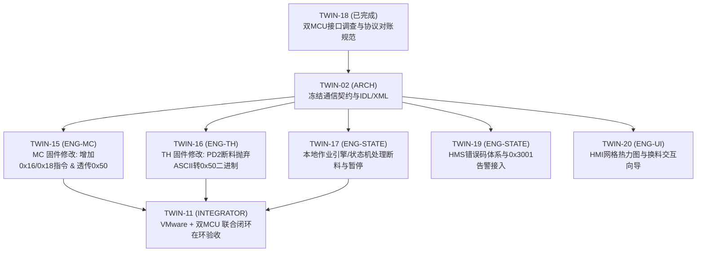

# 双MCU运动控制、自动调平与断料检测接口调查与协议对账规范

## 1. 概述与调查方法论

根据整机首版规划 `REQ-DECOMP-FIRST-RELEASE-20261029` 及任务卡 `TWIN-18`（主工作包 `TASK-002`），本调查报告由运控固件工程师（`ENG-MC`）联合工具头工程师（`ENG-TH`）与系统架构师（`ARCH`）共同完成。

### 1.1 调查核心原则
1. **真实源码唯实原则（Zero Fabrication）**：所有接口、引脚、数据结构与控制流分析均直接采掘自 `mcu-p3` 真实固件源码库（MC 运控主控代码位于 `mcu-p3/motion-controller-mcu/`，TH 工具头从控代码位于 `mcu-p3/color-engine-mcu/io_toggle/`），所有断言均精确标注代码文件绝对/相对路径及具体行号，杜绝伪造与主观臆测。
2. **纯软件开发与实机台架验收严格分离**：
   - **纯软件开发与文档对账阶段（Isolated Document/Twin Stage）**：基于代码静态分析、协议结构体对账、帧解析器单元测试及 VMware 虚拟串口闭环，不依赖物理电机运转、探针触碰与真实耗材拉断。
   - **实机台架验收阶段（Physical HIL Bench Stage）**：必须在具备物理 CoreXY 机械机构、物理限位/探针传感器及真实加热挤出条件下的专用台架上执行。
3. **C/C++ 工程硬性门禁合规**：严格遵循 `project-control/.agents/rules/c_cpp_coding_standard.md`，对建议新增/重构的自研接口保持 $\le 50$ 行、参数 $\le 4$ 个，零动态堆内存分配，指针显式防御性校验。

---

## 2. MC 主控 (AT32F435VGT7) 运动学与当前坐标查询接口调查

### 2.1 运动学配置与多轴架构
MC 芯片为 **ArteryTek AT32F435VGT7**（ARM Cortex-M4F @ 288MHz），运行移植优化的 Marlin 运控系统。

* **运动学模式**：CoreXY 机构。
  - 源码锚点：[`mcu-p3/motion-controller-mcu/project/marlin/configure.h#L39`](file:///home/sushaohua/workspace/ai_soc_project/mcu-p3/motion-controller-mcu/project/marlin/configure.h#L39)
  - 配置宏：`#define COREXY // 启动COREXY模式`。
* **轴数与轴枚举定义**：
  - 源码锚点：[`mcu-p3/motion-controller-mcu/project/marlin/configure.h#L22`](file:///home/sushaohua/workspace/ai_soc_project/mcu-p3/motion-controller-mcu/project/marlin/configure.h#L22)
  - 轴数量宏：`#define NUM_AXIS 9`。
  - 枚举结构体锚点：[`mcu-p3/motion-controller-mcu/project/marlin/marlin_core/Marlin.h#L174-L185`](file:///home/sushaohua/workspace/ai_soc_project/mcu-p3/motion-controller-mcu/project/marlin/marlin_core/Marlin.h#L174-L185)
  ```c
  enum AxisEnum
  {
    X_AXIS = 0,
    Y_AXIS = 1,
    Z_AXIS = 2,
    A_AXIS = 3,
    B_AXIS = 4,
    C_AXIS = 5,
    D_AXIS = 6,
    X_HEAD = 7,
    Y_HEAD = 8
  };
  ```
  - **各轴语义说明**：
    - `X_AXIS (0)`, `Y_AXIS (1)`, `Z_AXIS (2)`：笛卡尔空间三维物理坐标；
    - `A_AXIS (3)`, `B_AXIS (4)`, `C_AXIS (5)`, `D_AXIS (6)`：多通道供料与挤出轴（A/B/C/D 对应四色供料电机通道）；
    - `X_HEAD (7)`, `Y_HEAD (8)`：CoreXY 机构计算下喷头真实物理位移映射轴。

### 2.2 坐标存储变量、数值单位与换算度量

MC 固件中存在两套平行的坐标度量系统：**规划器浮点毫米（Millimeters）** 与 **步进器整型步数（Steps）**。

| 变量名称 | 声明位置 | 数据类型 | 单位与分辨率 | 物理含义与访问规则 |
| :--- | :--- | :--- | :--- | :--- |
| `current_position` | [`Marlin_main.c#L392`](file:///home/sushaohua/workspace/ai_soc_project/mcu-p3/motion-controller-mcu/project/marlin/marlin_core/Marlin_main.c#L392) | `volatile float[9]` | 毫米 (`mm`, 浮点数) | 当前逻辑工具头坐标（含工作台倾斜补偿前基准位移） |
| `destination` | [`Marlin_main.c#L521`](file:///home/sushaohua/workspace/ai_soc_project/mcu-p3/motion-controller-mcu/project/marlin/marlin_core/Marlin_main.c#L521) | `static float[9]` | 毫米 (`mm`, 浮点数) | 当前插补段的目标终点坐标 |
| `position` | [`planner.c#L102`](file:///home/sushaohua/workspace/ai_soc_project/mcu-p3/motion-controller-mcu/project/marlin/marlin_core/planner.c#L102) | `long[9]` | 步数 (`steps`, 整数) | 梯形规划器内的目标脉冲位置（`mm * axis_steps_per_unit`） |
| `count_position` | [`stepper.c#L93`](file:///home/sushaohua/workspace/ai_soc_project/mcu-p3/motion-controller-mcu/project/marlin/marlin_core/stepper.c#L93) | `volatile long[9]` | 步数 (`steps`, 整数) | 步进电机底层中断累积脉冲计数（随每步脉冲自增/自减） |
| `axis_steps_per_unit` | [`planner.c#L72`](file:///home/sushaohua/workspace/ai_soc_project/mcu-p3/motion-controller-mcu/project/marlin/marlin_core/planner.c#L72) | `float[9]` | 步/毫米 (`steps/mm`) | 脉冲换算比率（受微步与机械传动比决定） |

### 2.3 底层坐标读取函数 API 调查

在固件中，获取当前物理步进位置有如下已实现的 API 函数：

1. **`st_get_position(uint8_t axis)`**：
   - 源码锚点：[`mcu-p3/motion-controller-mcu/project/marlin/marlin_core/stepper.c#L1336-L1343`](file:///home/sushaohua/workspace/ai_soc_project/mcu-p3/motion-controller-mcu/project/marlin/marlin_core/stepper.c#L1336-L1343)
   - 函数声明：[`stepper.h#L82`](file:///home/sushaohua/workspace/ai_soc_project/mcu-p3/motion-controller-mcu/project/marlin/marlin_core/stepper.h#L82)
   - 返回值：指定轴当前的步数脉冲绝对计数 `count_pos`（`long`）；
   - 并发保护：函数内部通过 `CRITICAL_SECTION_START` / `CRITICAL_SECTION_END`（关闭全局中断）保护读取过程，防止滴答中断撕裂多字节数据。
2. **`st_get_position_mm(uint8_t axis)`**：
   - 源码锚点：[`mcu-p3/motion-controller-mcu/project/marlin/marlin_core/stepper.c#L1346-L1350`](file:///home/sushaohua/workspace/ai_soc_project/mcu-p3/motion-controller-mcu/project/marlin/marlin_core/stepper.c#L1346-L1350)
   - 函数声明：[`stepper.h#L86`](file:///home/sushaohua/workspace/ai_soc_project/mcu-p3/motion-controller-mcu/project/marlin/marlin_core/stepper.h#L86)
   - 计算公式：`st_get_position(axis) / axis_steps_per_unit[axis]`；
   - 返回值：指定轴经过步数比率换算后的实时物理位置（`float`，毫米）。

### 2.4 存量 M114 指令实现剖析与局限性

在 Marlin 核心中，存在标准 `M114` G-code 命令解析：
* **源码锚点**：[`mcu-p3/motion-controller-mcu/project/marlin/marlin_core/Marlin_main.c#L3551-L3568`](file:///home/sushaohua/workspace/ai_soc_project/mcu-p3/motion-controller-mcu/project/marlin/marlin_core/Marlin_main.c#L3551-L3568)
* **输出内容**：
  ```c
  case 114: // M114
    SERIAL_PROTOCOLPGM("X:");
    SERIAL_PROTOCOL(current_position[X_AXIS]);
    SERIAL_PROTOCOLPGM(" Y:");
    SERIAL_PROTOCOL(current_position[Y_AXIS]);
    SERIAL_PROTOCOLPGM(" Z:");
    SERIAL_PROTOCOL(current_position[Z_AXIS]);
    SERIAL_PROTOCOLPGM(" E:");
    SERIAL_PROTOCOL(current_position[E_AXIS]);

    SERIAL_PROTOCOLPGM(MSG_COUNT_X);
    SERIAL_PROTOCOL(float(st_get_position(X_AXIS))/axis_steps_per_unit[X_AXIS]);
    SERIAL_PROTOCOLPGM(" Y:");
    SERIAL_PROTOCOL(float(st_get_position(Y_AXIS))/axis_steps_per_unit[Y_AXIS]);
    SERIAL_PROTOCOLPGM(" Z:");
    SERIAL_PROTOCOL(float(st_get_position(Z_AXIS))/axis_steps_per_unit[Z_AXIS]);

    SERIAL_PROTOCOLLN("");
  ```
* **存在的技术局限与缺陷**：
  1. **输出通道错位**：`SERIAL_PROTOCOL` 宏重定向至调试串口（USART1，COM8），而非与 AP 通信的 MiniMCProto 链路（USART2，DMA1_CH2）；
  2. **纯 ASCII 文本开销与非确定性**：字符串拼接解析效率极低，浮点数文本转换引入 CPU 额外抖动，破坏实时运控；
  3. **缺乏原子结构**：AP 无法进行强类型 CRC 校验与反序列化，容易与上位日志及调试输出混淆。

### 2.5 MiniMCProto v2.0 协议集成现状与位置指令缺失

在 `mcu-p3/motion-controller-mcu/project/src/minimc_proto.c` 与 `inc/minimc_proto.h` 中：
* **帧头格式**：严格实现 12 字节自然对齐头（SOF1=`0x55`, SOF2=`0xAA`, `flags |= 0x04`, `seq`, `len`, CRC16）；
* **当前已实现指令**：
  - `MINIMC_CMD_GET_VERSION (0x01)` $\to$ `MINIMC_CMD_VERSION_REPORT (0x02)`（[`minimc_proto.c#L190-L227`](file:///home/sushaohua/workspace/ai_soc_project/mcu-p3/motion-controller-mcu/project/src/minimc_proto.c#L190-L227)）
  - `MINIMC_CMD_PING (0x03)` $\to$ `MINIMC_CMD_PONG (0x04)`（[`minimc_proto.c#L229-L273`](file:///home/sushaohua/workspace/ai_soc_project/mcu-p3/motion-controller-mcu/project/src/minimc_proto.c#L229-L273)）
  - `MINIMC_CMD_GET_TEMP (0x14)` $\to$ `MINIMC_CMD_TEMP_REPORT (0x14)`（[`minimc_proto.c#L299-L339`](file:///home/sushaohua/workspace/ai_soc_project/mcu-p3/motion-controller-mcu/project/src/minimc_proto.c#L299-L339)）
* **对账结论**：**MC 固件中当前完全缺失二进制位置查询指令处理分支**。若收到未识别的指令，MC 在 [`minimc_proto.c#L381`](file:///home/sushaohua/workspace/ai_soc_project/mcu-p3/motion-controller-mcu/project/src/minimc_proto.c#L381) 统一回送 `build_nack_resp(seq, 0x04U)`（`0x04` = 未知命令）。

---

## 3. MC 主控 (AT32F435VGT7) 自动调平网格与插补算法调查

### 3.1 自动床面调平 (ABL) 配置基线
MC 固件中完整包含了网格型自动床面调平支持代码：
* **使能宏与模式**：
  - 源码锚点：[`mcu-p3/motion-controller-mcu/project/marlin/configure.h#L199-L238`](file:///home/sushaohua/workspace/ai_soc_project/mcu-p3/motion-controller-mcu/project/marlin/configure.h#L199-L238)
  - `#define ENABLE_AUTO_BED_LEVELING`（L199）
  - `#define AUTO_BED_LEVELING_GRID`（L216）
  - `#define AUTO_BED_LEVELING_GRID_POINTS 5`（L237，定义为 $5 \times 5$ 共计 25 个采样测点）
  - `#define NONLINEAR_BED_LEVELING`（L238，开启非线性网格高程插补）
* **物理探测矩形范围**：
  - `LEFT_PROBE_BED_POSITION 20`
  - `RIGHT_PROBE_BED_POSITION 220`
  - `FRONT_PROBE_BED_POSITION 20`
  - `BACK_PROBE_BED_POSITION 220`
  - 网格步距计算：
    $$xGridSpacing = \frac{220 - 20}{5 - 1} = 50.0\text{ mm},\quad yGridSpacing = \frac{220 - 20}{5 - 1} = 50.0\text{ mm}$$
* **探针偏移量**：
  - `#define X_PROBE_OFFSET_FROM_EXTRUDER 10`
  - `#define Y_PROBE_OFFSET_FROM_EXTRUDER 10`
  - `#define Z_PROBE_OFFSET_FROM_EXTRUDER 0`

### 3.2 运行时网格数据结构与持久化存储

* **内存网格缓冲区**：
  - 源码锚点：[`mcu-p3/motion-controller-mcu/project/marlin/marlin_core/Marlin_main.c#L528-L530`](file:///home/sushaohua/workspace/ai_soc_project/mcu-p3/motion-controller-mcu/project/marlin/marlin_core/Marlin_main.c#L528-L530)
  ```c
  #ifdef NONLINEAR_BED_LEVELING
  float bed_level[AUTO_BED_LEVELING_GRID_POINTS][AUTO_BED_LEVELING_GRID_POINTS];
  float bed_level_before = 0.0;
  float bed_measure[AUTO_BED_LEVELING_GRID_POINTS][AUTO_BED_LEVELING_GRID_POINTS];
  #endif
  ```
  - `bed_level[5][5]`（100 字节）：存储 25 个采样点相对于基准平面的高度偏差浮点值；
  - `bed_measure[5][5]`：暂存探测触发时的原始 Z 轴坐标；
* **倾斜平面旋转矩阵**：
  - 源码锚点：[`mcu-p3/motion-controller-mcu/project/marlin/marlin_core/planner.c#L94`](file:///home/sushaohua/workspace/ai_soc_project/mcu-p3/motion-controller-mcu/project/marlin/marlin_core/planner.c#L94) 与 [`planner.h#L86`](file:///home/sushaohua/workspace/ai_soc_project/mcu-p3/motion-controller-mcu/project/marlin/marlin_core/planner.h#L86)
  - 结构体：`matrix_3x3 plan_bed_level_matrix`；
* **EEPROM 存储映射**：
  - 源码锚点：[`mcu-p3/motion-controller-mcu/project/marlin/marlin_core/ConfigurationStore.c#L491-L496`](file:///home/sushaohua/workspace/ai_soc_project/mcu-p3/motion-controller-mcu/project/marlin/marlin_core/ConfigurationStore.c#L491-L496)
  - 读取地址：`AUTO_LEVEL + y * 4 + x * 4 * AUTO_BED_LEVELING_GRID_POINTS`；
  - 拟合平面系数持久化：[`Marlin_main.c#L2775-L2776`](file:///home/sushaohua/workspace/ai_soc_project/mcu-p3/motion-controller-mcu/project/marlin/marlin_core/Marlin_main.c#L2775-L2776)，将最小二乘平面方程 $z = ax + by + d$ 的系数 `a`、`b` 写入 `AUTO_LEVEL_1` 与 `AUTO_LEVEL_2`。

### 3.3 G29 自动调平执行流程与最小二乘拟合

G29 指令入口位于 [`Marlin_main.c#L2646-L2834`](file:///home/sushaohua/workspace/ai_soc_project/mcu-p3/motion-controller-mcu/project/marlin/marlin_core/Marlin_main.c#L2646-L2834)：
1. **安全前置检查**：检查 X/Y 轴是否已回零（`axis_known_position`），未回零则直接中断退出；
2. **蛇形测点循环 (Serpentine Scan)**：
   - Y 轴外层循环 `yCount` 从 0 到 4；
   - X 轴内层循环根据 `yCount % 2` 自动反转扫描方向（偶进行 0 到 4，奇进行 4 到 0），最小化空走行程；
   - 每次测点调用 `measured_z = probe_pt(xProbe, yProbe, z_before)`（[`Marlin_main.c#L2735`](file:///home/sushaohua/workspace/ai_soc_project/mcu-p3/motion-controller-mcu/project/marlin/marlin_core/Marlin_main.c#L2735)），记录至 `bed_level[yCount][xCount]`；
3. **QR 分解最小二乘平面拟合**：
   - 构造 25 阶观测矩阵 `eqnAMatrix` 与观测向量 `eqnBVector`；
   - 调用 `plane_equation_coefficients = qr_solve(25, 3, eqnAMatrix, eqnBVector)`（[`Marlin_main.c#L2764`](file:///home/sushaohua/workspace/ai_soc_project/mcu-p3/motion-controller-mcu/project/marlin/marlin_core/Marlin_main.c#L2764)）；
   - 更新全局旋转矩阵 `set_bed_level_equation_lsq(plane_equation_coefficients)`。

### 3.4 运控执行时的双重实时高程补偿

固件在执行步进脉冲规划时，存在双重实时补偿：
1. **宏观刚体平面倾斜旋转补偿**：
   - 源码锚点：[`planner.c#L664`](file:///home/sushaohua/workspace/ai_soc_project/mcu-p3/motion-controller-mcu/project/marlin/marlin_core/planner.c#L664)
   - 函数：`apply_rotation_xyz(plan_bed_level_matrix, &x, &y, &z);`
   - 对每个输入的笛卡尔空间直线段端点应用 3x3 矩阵旋转；
2. **微观非线性双线性网格插补 (Bilinear Interpolation)**：
   - 源码锚点：[`Marlin_main.c#L4864-L4900`](file:///home/sushaohua/workspace/ai_soc_project/mcu-p3/motion-controller-mcu/project/marlin/marlin_core/Marlin_main.c#L4864-L4900)
   - 函数：`void adjust_delta(float cartesian[3])`
   - 计算逻辑：
     ```c
     int half = (AUTO_BED_LEVELING_GRID_POINTS - 1) / 2;
     float grid_x = max(0.001-half, min(half-0.001, cartesian[X_AXIS] / AUTO_BED_LEVELING_GRID_POINTS));
     float grid_y = max(0.001-half, min(half-0.001, cartesian[Y_AXIS] / AUTO_BED_LEVELING_GRID_POINTS));
     int floor_x = floor(grid_x);
     int floor_y = floor(grid_y);
     float ratio_x = grid_x - floor_x;
     float ratio_y = grid_y - floor_y;
     float z1 = bed_level[floor_x+half][floor_y+half];
     float z2 = bed_level[floor_x+half][floor_y+half+1];
     float z3 = bed_level[floor_x+half+1][floor_y+half];
     float z4 = bed_level[floor_x+half+1][floor_y+half+1];
     float left = (1-ratio_y)*z1 + ratio_y*z2;
     float right = (1-ratio_y)*z3 + ratio_y*z4;
     float offset = (1-ratio_x)*left + ratio_x*right;

     delta[X_AXIS] += offset;
     delta[Y_AXIS] += offset;
     delta[Z_AXIS] += offset;
     ```

### 3.5 调平传感器硬件引脚与通信缺失

* **物理探针引脚**：
  - 源码锚点：[`at32f435_437_wk_config.h#L267-L268`](file:///home/sushaohua/workspace/ai_soc_project/mcu-p3/motion-controller-mcu/project/inc/at32f435_437_wk_config.h#L267-L268) 及 [`pins.h#L253`](file:///home/sushaohua/workspace/ai_soc_project/mcu-p3/motion-controller-mcu/project/marlin/marlin_core/pins.h#L253)
  - 物理配置：`Z_LIMIT_PIN` 为 **`GPIO_PINS_1`**，端口为 **`GPIOE`**（PE1）；
  - 探测执行：`run_z_probe()`（[`Marlin_main.c#L1478`](file:///home/sushaohua/workspace/ai_soc_project/mcu-p3/motion-controller-mcu/project/marlin/marlin_core/Marlin_main.c#L1478)）以恒定进给速率下压 Z 轴，直至读取到 PE1 电平翻转（`stepper.c#L784-L788`）。
* **上位接口缺失**：
  - MC 现行固件没有任何向 AP 导出 `bed_level[5][5]` 网格或汇报调平进度的 MiniMCProto 报文。
  - `print_bed_level()` 在 [`Marlin_main.c#L1742`](file:///home/sushaohua/workspace/ai_soc_project/mcu-p3/motion-controller-mcu/project/marlin/marlin_core/Marlin_main.c#L1742) 中被整体注释，处于休眠死代码状态。

---

## 4. TH 从控 (AT32F423CCT7) 断料检测与事件上报机制调查

### 4.1 断料传感器物理引脚与电气特性
从控芯片为 **ArteryTek AT32F423CCT7**（ARM Cortex-M4 @ 150MHz），负责挤出机工具头温控与耗材检测。

* **引脚映射**：
  - 源码锚点：[`mcu-p3/color-engine-mcu/io_toggle/inc/pins.h#L19-L20`](file:///home/sushaohua/workspace/ai_soc_project/mcu-p3/color-engine-mcu/io_toggle/inc/pins.h#L19-L20)
  ```c
  #define A_LIMIT_PIN    GPIO_PINS_2		//A axis Material break detection
  #define A_LIMIT_GPIO_PORT    GPIOD
  ```
* **电平读取宏与有效极性**：
  - 源码锚点：[`pins.h#L45`](file:///home/sushaohua/workspace/ai_soc_project/mcu-p3/color-engine-mcu/io_toggle/inc/pins.h#L45)
  ```c
  #define A_DET gpio_input_data_bit_read(A_LIMIT_GPIO_PORT, A_LIMIT_PIN)			//默认低电平
  ```
  - **电气极性定义**（详见 [`motherboard.c#L19`](file:///home/sushaohua/workspace/ai_soc_project/mcu-p3/color-engine-mcu/io_toggle/src/app/motherboard.c#L19) 与 [`mycontrol.c#L3252`](file:///home/sushaohua/workspace/ai_soc_project/mcu-p3/color-engine-mcu/io_toggle/src/app/mycontrol.c#L3252)）：
    - **高电平 (`1`)**：检测到耗材存在（`FILAMENT_NORMAL`）；
    - **低电平 (`0`)**：断料或无料状态（`FILAMENT_ERROR`）。

### 4.2 中断 (EXINT) vs 轮询 (Polling) 机制核实

通过对 `mcu-p3/color-engine-mcu/io_toggle/src/bsp/` 目录的全面核查：
* **`wk_exint.c` 中断配置**：
  - 源码锚点：[`mcu-p3/color-engine-mcu/io_toggle/src/bsp/wk_exint.c#L57-L76`](file:///home/sushaohua/workspace/ai_soc_project/mcu-p3/color-engine-mcu/io_toggle/src/bsp/wk_exint.c#L57-L76)
  - 唯一配置的外部中断线为 `EXINT_LINE_14`（连接 PC14 `BlackOut_Det_PIN`），用于超级电容断电掉电紧急保护。
* **核查结论**：**断料检测（PD2）未连接任何 EXINT 硬件中断，而是 100% 运行在主循环定时器软件轮询模式下**。

### 4.3 滤波防抖机制与时间窗口剖析

断料逻辑位于 [`mcu-p3/color-engine-mcu/io_toggle/src/app/motherboard.c#L10-L137`](file:///home/sushaohua/workspace/ai_soc_project/mcu-p3/color-engine-mcu/io_toggle/src/app/motherboard.c#L10-L137)：
* **采样周期定义**：
  - 宏定义：[`motherboard.c#L10`](file:///home/sushaohua/workspace/ai_soc_project/mcu-p3/color-engine-mcu/io_toggle/src/app/motherboard.c#L10)
  ```c
  #define FILAMENTCHECK_UPDATE_RATE_US 1000000UL // 1,000,000 微秒 = 1.0 秒
  #define FILAMENT_LOW_SAMPLES          10U      // 10 次连续低电平样本
  ```
* **主循环驱动与状态机**：
  - TH 主循环 [`main.c#L72`](file:///home/sushaohua/workspace/ai_soc_project/mcu-p3/color-engine-mcu/io_toggle/src/user/main.c#L72) 周期调用 `Board_manage()`；
  - `Board_manage()` 利用单调时钟检查 `Timeout_hasElapsed(&filament_check_timeout)`，**精确以 1Hz（每秒一次）触发 `FilamentCheckDeal()`**；
  - **滤波去抖算法 (`FilamentCheckDeal`)**：
    ```c
    static void FilamentCheckDeal(void)
    {
      if (Board_getFilamentStatus() == FILAMENT_NORMAL)
      {
        filament_status = FILAMENT_NORMAL;
        filament_low_samples = 0;
        filament_error_count = 0;
        return;
      }

      if (filament_low_samples < UINT8_MAX)
        filament_low_samples++;

      if (filament_low_samples < FILAMENT_LOW_SAMPLES)
        return;

      filament_status = FILAMENT_ERROR;
      if (filament_error_count < UINT8_MAX)
        filament_error_count++;

      if (filament_error_count >= 1U)	// 确认断料事件发生
      {
        filament_error_count = 0;
        filament_low_samples = 0;
        Board_pauseFilament();
      }
    }
    ```
* **防抖时间开销测算**：
  $$\text{Latency} = 10 \times 1.0\text{ s} = 10.0\text{ 秒}$$
  > [!WARNING]
  > **工程隐患与风险**：10 秒确认窗口对于高速打印场景（如 200~300mm/s）过长，会导致喷头在断料后空打 10 秒并继续抽空熔融腔内耗材，加剧堵头风险。建议在后续固件演进中将采样周期缩短至 50~100ms，防抖采样点收敛至 5 次（总延迟 250~500ms）。

### 4.4 TH 向 MC 的事件上报流与非规范通信现状

当断料被确认时，执行 `Board_pauseFilament()`：
* **源码锚点**：[`mcu-p3/color-engine-mcu/io_toggle/src/app/motherboard.c#L42-L65`](file:///home/sushaohua/workspace/ai_soc_project/mcu-p3/color-engine-mcu/io_toggle/src/app/motherboard.c#L42-L65)
* **执行步骤**：
  1. 标记 `printer_status = 1`，`filament_paused = true`；
  2. 阻塞等待当前电机执行队列排空：`st_synchronize();`；
  3. **向物理级联串口发送原始 ASCII 字符串**：
     ```c
     send_quick("filaout\r\n"); // 向主控435发送从控断料检测信号 (motherboard.c:64)
     ```

### 4.5 MC 端的接收识别与级联响应

MC 端接收到 TH 回传的字符流时：
* **主循环轮询分发**：[`mcu-p3/motion-controller-mcu/project/marlin/marlin_core/motherboard.c#L343-L350`](file:///home/sushaohua/workspace/ai_soc_project/mcu-p3/motion-controller-mcu/project/marlin/marlin_core/motherboard.c#L343-L350)
  ```c
  uint8_t rx_frame[FORWARD_UART_RX_BUF_SIZE];
  uint16_t rx_len = forward_uart_rx_read(rx_frame, sizeof(rx_frame));
  if(rx_len > 0)
  {
      FilamentCheckUart(rx_frame, rx_len); // 断料: 搜 filaout
  }
  ```
* **子串比对与停机触发**：[`filament_runout.c#L107-L120`](file:///home/sushaohua/workspace/ai_soc_project/mcu-p3/motion-controller-mcu/project/marlin/marlin_core/filament_runout.c#L107-L120)
  ```c
  void FilamentCheckUart(const uint8_t *buf, uint16_t len)
  {
      if(buf_contains(buf, len, "filaout"))
      {
          FilamentRunoutTrigger();
      }
  }
  ```
* **`FilamentRunoutTrigger()` 执行动作**（[`filament_runout.c#L39-L57`](file:///home/sushaohua/workspace/ai_soc_project/mcu-p3/motion-controller-mcu/project/marlin/marlin_core/filament_runout.c#L39-L57)）：
  - 挂起 SD 打印：`is_paused = true; sd_printing = false; pauseprintflag = true;`
  - 切换迪文屏页面至换料指引页：`gui_showPage(PAGE_TIPS_REPLACE_MATERIALS_ID, NULL);`
  - 切换氛围灯为断料报警色：`RGB_Set(PANEL_filament);`
  - 标记全局断料错误：`FilamentRunError = true;`

### 4.6 架构断层核查：级联混合链路与 AP 盲区

> [!CAUTION]
> **全系统通信断层发现**：
> 1. 当前 MC 与 TH 之间的串口（USART6 $\leftrightarrow$ USART1，921600波特率）工作在**“MiniMCProto 二进制协议与原始 ASCII 文本混部”**的非规范状态；
> 2. TH 发出的 `"filaout\r\n"` 是裸 ASCII 字符串，MC 的 `minimc_proto.c` 接收解析器检测到无 `0x55 0xAA` 同步字后将其丢弃或转交文本缓冲区，由 `motherboard.c` 旁路搜寻字符串子串处理；
> 3. **AP（上位 SoC）对此断料事件完全处于信息盲区**！MC 与 TH 均**未向 AP 发送任何 MiniMCProto 二进制通知包**；
> 4. 若在 VMware 孪生中直接脱离迪文屏由上位 `forward-service` 和 `device-manager` 驱动，上位状态机将无法接收到断料暂停事件，导致作业引擎假死或继续下发 G-code。

### 4.7 TH 工具头探针 (BLTouch / Leveling Probe) 引脚核查

* 源码核查：[`mcu-p3/color-engine-mcu/io_toggle/inc/pins.h#L83`](file:///home/sushaohua/workspace/ai_soc_project/mcu-p3/color-engine-mcu/io_toggle/inc/pins.h#L83) 与 [`pins.h#L18`](file:///home/sushaohua/workspace/ai_soc_project/mcu-p3/color-engine-mcu/io_toggle/inc/pins.h#L18)
* 定义状态：`#define Z_LEVEL_PIN 0`，`#define Z_LIMIT_PIN UNUSED_GPIO_PIN`；
* **核查结论**：**当前从控 TH 硬件上未启用任何调平传感器引脚或 BLTouch 舵机控制通道**。全机物理调平输入完全汇聚在 MC 主控板的 `PE1` 引脚上。

---

## 5. 三项功能协议对账总矩阵 (Protocol Reconciliation Matrix)

针对首版 7 项子范围中的 `MOT-001`（位置读取）、`MOT-002`（调平调查）及 `COL-007`（断料事件），本节建立跨端协议对账映射：

| 特性编号与名称 | 当前单片机实现现状 (代码锚点与数据形态) | MiniMCProto 正式规范目标 (CMD / Flags / 载荷定义) | AP 消费与分发路径 (DDS / D-Bus / HTTP-SSE) | 纯软件/孪生验证条件 (Isolated Twin/Doc) | 物理硬件在环验收条件 (Physical HIL) |
| :--- | :--- | :--- | :--- | :--- | :--- |
| **`MOT-001`**<br/>当前位置与状态读取 | 存在 `current_position[9]`（浮点毫米，[`Marlin_main.c#L392`](file:///home/sushaohua/workspace/ai_soc_project/mcu-p3/motion-controller-mcu/project/marlin/marlin_core/Marlin_main.c#L392)）；`M114` 仅向调试串口输出 ASCII 文本，`minimc_proto.c` **无位置查询指令** | **CMD ID: `0x40`** (`CMD_TELEMETRY_REPORT`) 或 **`0x16`** (`CMD_POS_QUERY`);<br/>Flags: `0x06` (Response);<br/>载荷: 包含 `int32_t pos_x_um`, `pos_y_um`, `pos_z_um`, `pos_e_um` (微米, 1mm=1000um), `mc_state`, `homed_flags` | **DDS**: `telemetry/motion_status`<br/>(`aisoc::MotionStatusTelemetry`);<br/>**D-Bus**: `GetDeviceState()`;<br/>**SSE**: `event: motion_update`<br/>`{"x":10.5,"y":20.0,"z":0.2}` | 运行 Mock 串口或虚拟单片机，下发 0x16 查询帧，验证 AP 正确解析微米并显示浮点毫米 | 连接真实 AT32F435 板，发送 G1 移动指令后，回读坐标与步进电机实际物理移动量一致 |
| **`MOT-002`**<br/>调平网格与状态界面 | 具备 $5 \times 5$ 网格 `bed_level[5][5]`（[`Marlin_main.c#L528`](file:///home/sushaohua/workspace/ai_soc_project/mcu-p3/motion-controller-mcu/project/marlin/marlin_core/Marlin_main.c#L528)）与双线性插补；`print_bed_level()` 被注释，**无协议导出接口** | **CMD ID: `0x18`** (`CMD_LEVEL_GRID_QUERY`);<br/>Flags: `0x06` (Response);<br/>载荷: 固定 52 字节 (`uint8_t grid_size_x`, `grid_size_y`, `int16_t z_offsets_um[25]`)，高度分辨率为 1um (0.001mm) | **D-Bus**: `org.aisoc.DeviceInterface.GetLevelingGrid()`;<br/>**HTTP**: `GET /api/v1/calibration/mesh`;<br/>**Web HMI**: 渲染 5x5 热力网格图与调平向导 | 注入模拟的 25 点高程矩阵 JSON，验证 HMI 正确绘制 3D/热力拓扑图且无内存泄露 | 真实探针在 PE1 下压接触床面 25 点，实测各点形变与 EEPROM 保存读出一致 |
| **`COL-007`**<br/>断料提示与挂起暂停 | TH 读取 PD2 `A_DET`（[`pins.h#L45`](file:///home/sushaohua/workspace/ai_soc_project/mcu-p3/color-engine-mcu/io_toggle/inc/pins.h#L45)），10秒防抖后向串口发送 ASCII 文本 `"filaout\r\n"`；**无二进制协议报文** | **CMD ID: `0x50`** (`CMD_ALARM_EVENT`);<br/>Flags: `0x05` (Req, Wants ACK);<br/>载荷: 8 字节 (`alarm_level=2`, `subsystem=4`, `error_code=0x3001`, `param=0`);<br/>**HMS 错误码**: `0x3001` (`HMS_ERR_FILAMENT_RUNOUT`) | **DDS**: `telemetry/filament_status`;<br/>**D-Bus**: `org.aisoc.HmsInterface.AlarmRaised`;<br/>**SSE**: `event: alarm_event`<br/>`{"code":"0x3001","desc":"Runout"}`;<br/>**HMI**: 弹窗阻断并显示换料指引 | AP 端发送模拟 0x50 告警帧，验证 `device-manager` 状态机转为 PAUSED，HMI 弹出换料弹窗 | 打印过程中物理抽离 PD2 处耗材，验证 10s 内整机暂停降速，无撞机堵头 |

---

## 6. MiniMCProto 规范报文设计定义 (面向 TWIN-15 / TWIN-16 / TWIN-17)

为在后续任务中彻底打通运动、调平与断料闭环，正式规范新增以下二进制报文定义：

### 6.1 运动位置查询报文 (`CMD_POS_QUERY = 0x16`)

* **请求帧（AP $\to$ MC）**：
  - `DST_ID`: `0x02` (MC), `CMD_ID`: `0x16`, `Flags`: `0x05` (`V2 | REQ`), `Payload_Len`: `0x0000` (无载荷), 帧总长 14 字节。
* **响应帧（MC $\to$ AP）**：
  - `SRC_ID`: `0x02` (MC), `DST_ID`: `0x01` (AP), `CMD_ID`: `0x16`, `Flags`: `0x06` (`V2 | RESP`), `Payload_Len`: `20` 字节（`0x0014`），帧总长 34 字节。
* **载荷结构体 (`minimc_pos_report_payload_t`)**：
  ```c
  #pragma pack(push, 1)
  typedef struct {
      int32_t  pos_x_um;           /* X 轴当前坐标 (微米, um, 1mm = 1000um) */
      int32_t  pos_y_um;           /* Y 轴当前坐标 (微米, um) */
      int32_t  pos_z_um;           /* Z 轴当前坐标 (微米, um) */
      int32_t  pos_e_um;           /* E 轴当前坐标 (微米, um) */
      uint8_t  mc_state;           /* 运控主状态: 0=IDLE, 1=HOMING, 2=MOVING, 3=PAUSED, 4=FAULT */
      uint8_t  homed_mask;         /* 已回零掩码: Bit0=X, Bit1=Y, Bit2=Z */
      uint16_t reserved;           /* 4字节自然对齐填充 (置0) */
  } minimc_pos_report_payload_t;
  #pragma pack(pop)
  _Static_assert(sizeof(minimc_pos_report_payload_t) == 20, "pos report payload must be 20 bytes");
  ```

### 6.2 自动调平网格查询报文 (`CMD_LEVEL_GRID_QUERY = 0x18`)

* **请求帧（AP $\to$ MC）**：`DST_ID: 0x02`, `CMD_ID: 0x18`, `Payload_Len: 0`, 14 字节。
* **响应帧（MC $\to$ AP）**：
  - `Payload_Len`: `54` 字节（`0x0036`），帧总长 68 字节。
* **载荷结构体 (`minimc_level_grid_payload_t`)**：
  ```c
  #pragma pack(push, 1)
  typedef struct {
      uint8_t  grid_points_x;      /* 固定为 5 */
      uint8_t  grid_points_y;      /* 固定为 5 */
      int16_t  z_offset_um[25];    /* 25 个采样点的相对偏差 (微米 um, 0.001mm), 范围 -32768~+32767 um */
      int16_t  plane_coeff_a_x10k; /* 拟合平面系数 a (放大10000倍整型) */
      int16_t  plane_coeff_b_x10k; /* 拟合平面系数 b (放大10000倍整型) */
  } minimc_level_grid_payload_t;
  #pragma pack(pop)
  _Static_assert(sizeof(minimc_level_grid_payload_t) == 54, "level grid payload must be 54 bytes");
  ```

### 6.3 断料告警事件报文 (`CMD_ALARM_EVENT = 0x50` / HMS `0x3001`)

* **事件触发帧（TH $\to$ AP，经 MC 透明转发）**：
  - `SRC_ID`: `0x03` (TH), `DST_ID`: `0x01` (AP), `CMD_ID`: `0x50`, `Flags`: `0x05` (`V2 | REQ | WANTS_ACK`)；
  - `Payload_Len`: `8` 字节，帧总长 22 字节。
* **载荷结构体 (`minimc_alarm_event_payload_t`)**：
  ```c
  #pragma pack(push, 1)
  typedef struct {
      uint8_t  alarm_level;        /* 告警等级: 1=INFO, 2=WARNING, 3=CRITICAL_ERROR */
      uint8_t  subsystem_id;       /* 故障子系统: 1=HEATER, 2=MOTION, 3=COMM, 4=MMU/FILAMENT */
      uint16_t error_code;         /* 标准 HMS 错误码: 0x3001 = 断料告警 */
      uint32_t timestamp_tick_ms;  /* 从控单调时间戳 */
  } minimc_alarm_event_payload_t;
  #pragma pack(pop)
  _Static_assert(sizeof(minimc_alarm_event_payload_t) == 8, "alarm event payload must be 8 bytes");
  ```

---

## 7. 固件与 AP 软件演进与修改路线图

为按计划平稳推进后续开发任务，明确各端修改工作边界：



### 7.1 MC 固件层修改路线 (`TWIN-15`, 责任人: `ENG-MC`)
1. **新增 `0x16` 坐标查询响应**：在 `minimc_proto.c` 的 `handle_mc_query()` 中增加 `MINIMC_CMD_POS_QUERY` 处理分支，提取 `current_position[X/Y/Z/E]` 乘以 1000 封装并发送；
2. **新增 `0x18` 调平网格导出**：在 `minimc_proto.c` 中增加 `MINIMC_CMD_LEVEL_GRID_QUERY`，打包 `bed_level[5][5]` 供上位渲染；
3. **消除 ASCII 杂质与透明转发强化**：确保从 TH 接收到的 `0x50` 二进制告警报文能完整递减跳数并转发给 AP（`minimc_proto.c#L406-L420` 已有转发基础，需完全替代历史 `FilamentCheckUart` 文本搜寻机制）。

### 7.2 TH 固件层修改路线 (`TWIN-16`, 责任人: `ENG-TH`)
1. **替换 ASCII 换料通知**：废弃 `motherboard.c:64` 的 `send_quick("filaout\r\n")`，封装合规的 `minimc_alarm_event_payload_t` 结构体，调用 `minimc_proto` 发送函数直发 AP（`DST=0x01`）；
2. **优化防抖时间窗口**：将 10 秒（10次 1Hz 采样）防抖修改为 50ms 采样周期、连续 6 次低电平判定（总延时 300ms），在保证抗干扰的前提下防止空打。

### 7.3 AP 核心驱动与业务层修改路线 (`TWIN-17` / `TWIN-19` / `TWIN-20`)
1. **`forward-service` (`TWIN-07`)**：解析 `0x16` 帧并发布 Fast DDS `telemetry/motion_status` 话题；解析 `0x50` 帧并触发 D-Bus `AlarmRaised` 信号；
2. **`device-manager` (`TWIN-08` / `TWIN-19`)**：接收 `0x3001` 断料告警后，立即将作业状态机切换为 `PAUSED`，挂起 G-code 队列，等待人工在 HMI 确认换料完毕后下发 Resume 指令；
3. **`Browser HMI` (`TWIN-20`)**：
   - 坐标展示：实时渲染 X/Y/Z/E 坐标数值；
   - 调平预览：拉取 `/api/v1/calibration/mesh`，以三维或色彩图呈现 25 点网格拓扑；
   - 断料告警：捕获 SSE `alarm_event`，弹出全屏阻断提示框，显示“耗材耗尽，请取出残料并装入新材料后点击继续”。

---

## 8. 软件孪生与物理台架验收准则（硬性边界隔离）

| 验收环节 | 纯软件孪生开发验收条件 (Isolated Twin / Software Mock) | 物理台架在环验收条件 (Physical HIL Bench) |
| :--- | :--- | :--- |
| **坐标读取 (`MOT-001`)** | 1. 宿主机运行模拟串口，发送 `0x16` 查询帧；<br/>2. 模拟器返回坐标微米数据；<br/>3. `forward-service` 成功解析并通过 Fast DDS 发布；<br/>4. Web HMI 正常刷新坐标显示，数值无漂移。 | 1. 真实 AT32F435VGT7 板直连宿主机 `/dev/ttyUSB0`；<br/>2. 驱动真实 CoreXY 步进电机运转；<br/>3. 回读坐标与卡尺/光栅尺物理测量值误差 $\le 0.05\text{ mm}$。 |
| **网格调平 (`MOT-002`)** | 1. 注入包含 25 个特定高程浮点数的测试数据源；<br/>2. 上位服务聚合生成 JSON 快照；<br/>3. Web HMI 调平向导能正确高亮显示最高/最低测点，双线性算法插补连续平滑。 | 1. 真实微动/接触传感器安装于工具头；<br/>2. 执行真实 G29 动作，机床在热床上物理探测 25 点；<br/>3. EEPROM 正确写入且断电重启后网格数据不丢失。 |
| **断料响应 (`COL-007`)** | 1. 向 AP 注入模拟 `0x50`（错误码 `0x3001`）二进制帧；<br/>2. `device-manager` 状态机在 50ms 内切入 `PAUSED`；<br/>3. G-code 发送器立即挂起；<br/>4. 前端收到 SSE 推送弹出换料模态窗。 | 1. 真实耗材穿入 PD2 光电/微动传感器；<br/>2. 在实机挤出打印过程中人为剪断耗材；<br/>3. 耗材尾端离开传感器后，系统在设定防抖时间内自动停止出料并移走喷头，HMI 弹窗告警。 |

---
*本规范作为微任务 TWIN-18 的正式交付基线规范，由 ENG-MC 负责撰写，ENG-TH 与 ARCH 签署确认。*
